# Tensomite: design

This document describes the design as it is built today, currently through milestone 5, with milestone 6 (Metal) under way. `PLAN.md` holds where the design is going and why. `DEVELOPMENT.md` covers how to work on the code.

## Overview

Tensomite is a lazy tensor runtime. Operations on a `Tensor` build a graph, and nothing is computed until a result is needed. The scheduler then runs the graph on a `Device`, one kernel per node.

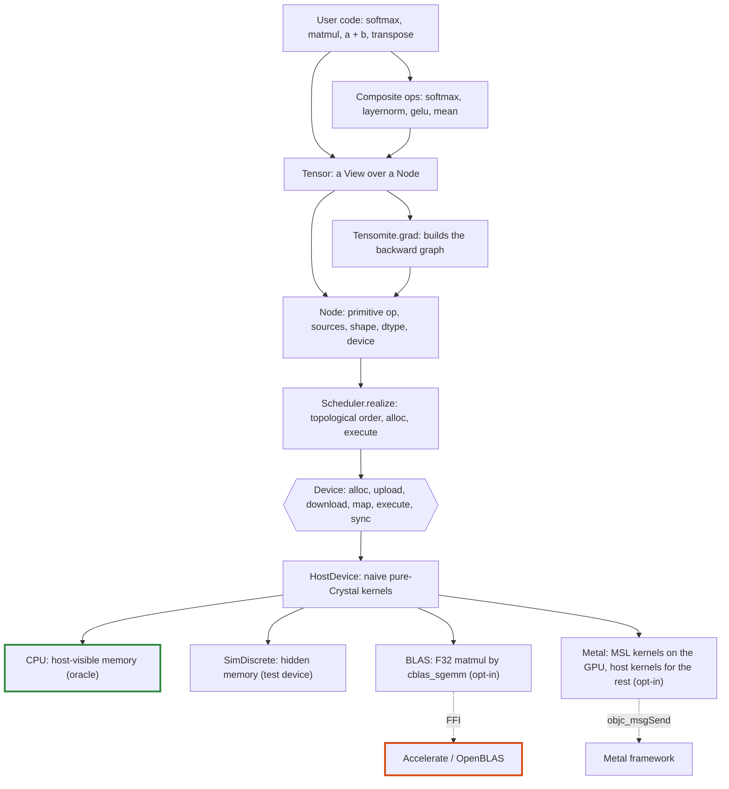

## Core types

Type            |File                      |Role                                                                                                                     
----------------|--------------------------|-------------------------------------------------------------------------------------------------------------------------
`DType`         |`dtype.cr`                |Runtime element type: `F32`, `I32`. `DType.of(Float32)` maps a Crystal type to it; `bytes_for(count)` gives storage size.
`View`          |`view.cr`                 |Shape, strides and offset, counted in elements. Pure metadata.                                                           
`Buffer`        |`device.cr`               |An opaque allocation owned by one device, which it names.                                                                
`Device`        |`device.cr`               |Where buffers live and kernels run.                                                                                      
`Op`            |`node.cr`                 |The primitive operations devices implement.                                                                              
`Node`          |`node.cr`                 |A graph vertex producing one contiguous array.                                                                           
`Tensor`        |`tensor.cr`, `tensor/*.cr`|The user-facing value: a `View` over a `Node`. Its ops are grouped by kind in `tensor/`.                                 
`Scheduler`     |`scheduler.cr`            |Turns unrealised nodes into kernel runs.                                                                                 
`Tensomite.grad`|`autograd.cr`             |Builds the backward graph of a loss: lazy gradients for a list of params.                                                
`Optimizer`     |`optim.cr`                |`SGD` and `AdamW`: new params from params and gradients.                                                                 
`Kernel`        |`kernel.cr`, `kernels.cr` |A fused elementwise kernel made by the `Tensomite.kernel` macro, with its gradient kernels.                              
`BufferPool`    |`buffer_pool.cr`          |Freed device memory kept for reuse, by exact size.                                                                       
`HostDevice`    |`devices/host.cr`         |Abstract device whose kernels run on the host CPU; holds `HostBuffer`s.                                                  
`CPU`           |`devices/cpu.cr`          |The reference device: host kernels on host-visible memory.                                                               
`SimDiscrete`   |`devices/sim_discrete.cr` |A test device: host kernels on memory the host cannot map.                                                               
`BLAS`          |`blas.cr`                 |Opt-in: host kernels with `F32` matmul by the platform BLAS.                                                             
`Metal`         |`metal.cr`, `metal/`      |Opt-in, Apple Silicon: MSL kernels on the GPU over shared memory, host kernels for unported ops.                         
`MappedFile`    |`mapped_file.cr`          |A read-only memory mapping of a file, unmapped when collected.                                                           
`SafeTensors`   |`safetensors.cr`          |Reads tensors from a safetensors file, zero-copy on host devices.                                                        
`BPE`           |`bpe.cr`                  |GPT-2's byte-level byte-pair-encoding tokeniser.                                                                         
`Sampler`       |`sampler.cr`              |Picks the next token: greedy, or seeded temperature and top-k sampling.                                                  
`GPT2`          |`models/gpt2.cr`          |The GPT-2 decoder with a KV cache.                                                                                       

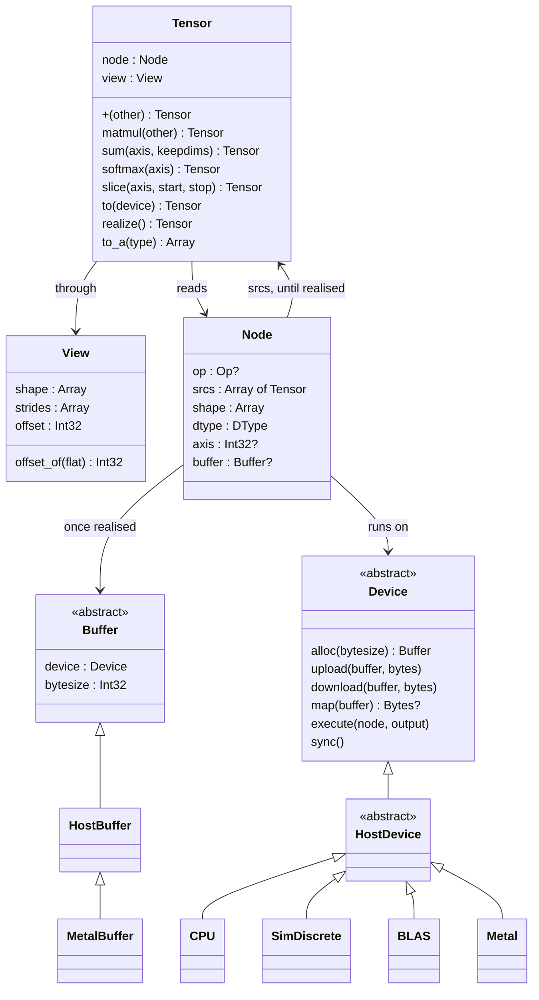

### Tensor and Node

A `Tensor` is a small struct holding a `Node` and a `View`. The node is where the data comes from. The view says how to read it.

- **Views share nodes.** `transpose`, `permute`, `expand`, `slice` and contiguous `reshape` return a new `Tensor` over the *same* node with a different view. They never copy, and they work on unrealised nodes too.
- **A node always produces a contiguous, row-major array** of its `shape`. All of the non-trivial layout lives in the views that read it.
- **A leaf node** (from `Tensor.from`, `Tensor.scalar` or `Tensor.causal_mask`) has no op and is created realised.
- **Any other node** holds its op and source tensors until it is realised. After that it holds only its buffer, and its sources are dropped so the graph behind it can be collected.

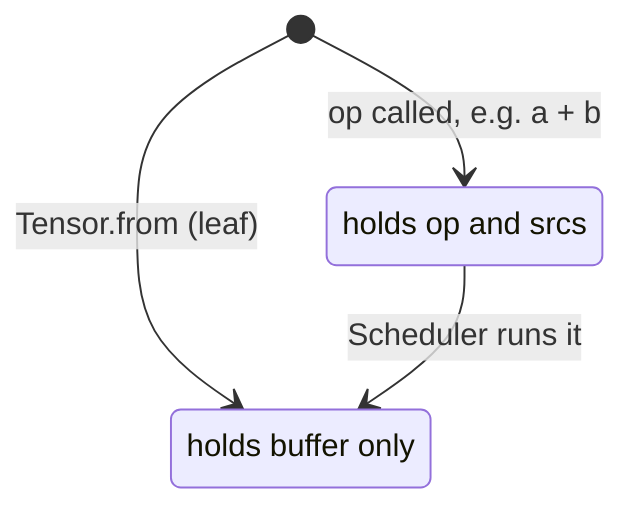

For example, here is the graph for `(a.transpose + c).sum`, before it is realised:

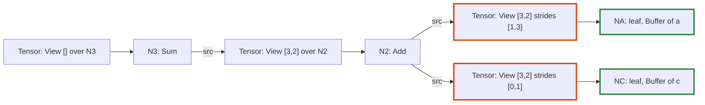

The orange tensors are views (a transpose and a broadcast) that copy nothing. The green nodes hold buffers.

### Views and broadcasting

A `View` maps a logical index onto a position in storage: `offset + Σ index[i] × strides[i]`.

Operation          |Effect on the view (from shape `[2, 3]`, strides `[3, 1]`)
-------------------|----------------------------------------------------------
`transpose`        |shape `[3, 2]`, strides `[1, 3]`                          
`expand([4, 2, 3])`|shape `[4, 2, 3]`, strides `[0, 3, 1]`                    
`slice(1, 1, 3)`   |shape `[2, 2]`, strides `[3, 1]`, offset `1`              
`reshape([3, 2])`  |shape `[3, 2]`, strides `[2, 1]` (contiguous views only)  

A stride of 0 re-reads the same element along that dimension. This is how broadcasting works without copying. A slice moves the offset to its first element and shortens one dimension.

For example, here is how two views over the storage `[1, 2, 3, 4, 5, 6]` locate one element each:

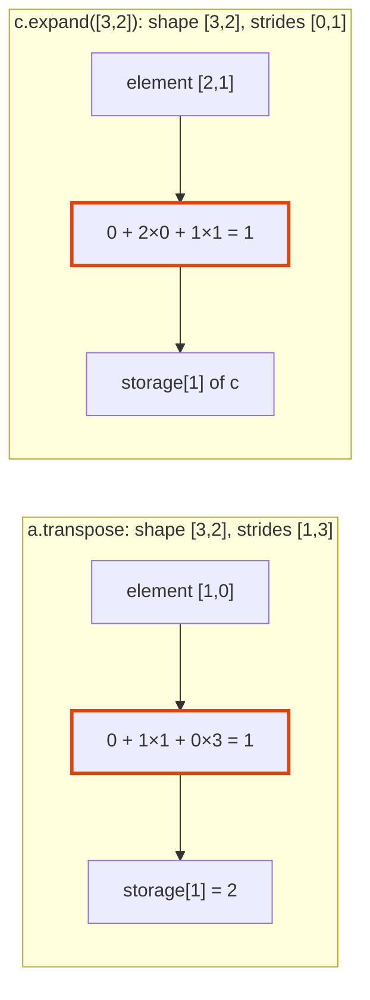

Binary ops broadcast eagerly. `a + b` computes the common shape with NumPy rules, then expands both operands to that shape before building the node. **Kernels therefore only ever see sources whose shape equals the output shape**, with arbitrary strides. Every device inherits that simplification. `matmul` does the same for its leading batch dimensions.

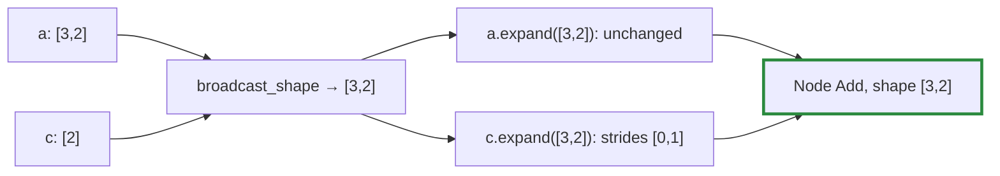

`reshape` of a non-contiguous view inserts a `Copy` node first, then reshapes the contiguous result.

## Ops

### Primitive and composite ops

Devices implement only the primitive ops in `Op`. Everything else is a composite: a `Tensor` method that builds a small graph of primitives. A new device therefore needs kernels for the primitives and nothing more.

Kind      |Primitive ops (`Op`)                  |`Tensor` API                                                          
----------|--------------------------------------|----------------------------------------------------------------------
Binary    |`Add`, `Sub`, `Mul`, `Div`, `Maximum` |`+`, `-`, `*`, `/`, `maximum`, with tensors or scalars                
Unary     |`Exp`, `Log`, `Tanh`, `Sqrt`          |`exp`, `log`, `tanh`, `sqrt`, unary `-`                               
Reduction |`Sum`, `Max`                          |`sum`, `max`, with optional `axis` and `keepdims`                     
Structural|`Copy`, `Cat`, `Gather`, `MatMul`     |`contiguous`, `Tensor.cat`, `gather`, `matmul`                        
Adjoint   |`GreaterEqual`, `Unview`, `ScatterAdd`|`greater_equal`; the other two only through `Tensomite.grad`          
Fused     |`Kernel`                              |any `Tensomite.kernel`, such as `gelu`                                
Composite |none: built from the rows above       |`mean`, `softmax`, `log_softmax`, `cross_entropy`, `layernorm`, `gelu`

- **Scalars** become rank-0 leaf tensors of the operand's dtype (`Tensor.scalar`), which then broadcast like any other tensor. So `x * 0.5` is `Mul` of `x` and a broadcast scalar.
- **Float-only ops** (`/`, `exp`, `log`, `tanh`, `sqrt`, `mean` and the composites) raise `DTypeError` on `I32` when called.
- **One dtype per op.** Every source of an op must share one dtype (`check_compatible`), and `gather` ids are the only exception (`I32`). Decision N in `PLAN.md` relaxes this per op for quantised weights in M9.
- **Byte sizes** always come from `DType#bytes_for(count)`, never from a size per element, so block formats with many elements per block fit without changes.
- **`keepdims`** reshapes the reduced result to keep the axis with size 1. The reduction's output is contiguous, so this is a view, not a copy.

For example, `softmax(axis)` expands into five primitive nodes:

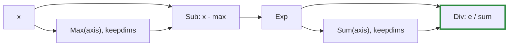

Subtracting the row's maximum keeps `exp` from overflowing without changing the result. `layernorm` and `gelu` expand the same way. Until kernel macros arrive in M7, each primitive node is a separate kernel run.

### The causal mask

`Tensor.causal_mask(rows, cols)` is a leaf built on the host: an `F32` tensor of 0 where a query row may attend to a key column, and -∞ where the column lies in its future. Adding it to attention scores before `softmax` turns masked scores into zero weight.

`cols` may exceed `rows` when a KV cache holds earlier positions. The last row then sees every column, and row `i` sees columns up to `i + cols - rows`:

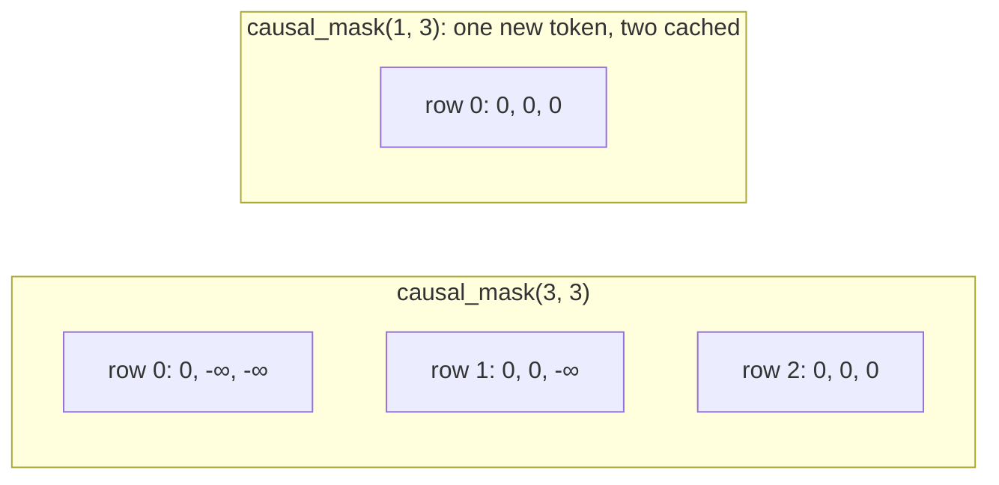

## Devices

### The device interface

The device interface always speaks in transfers, so that discrete-memory devices fit it unchanged:

- **`alloc(bytesize)`:** returns a new buffer that names this device.
- **`upload(buffer, bytes)` / `download(buffer, bytes)`:** copy between the host and the device.
- **`map(buffer)`:** returns host-visible `Bytes`, or `nil` when the memory isn't host-visible. Readers try `map` first and fall back to `download`.
- **`execute(node, output)`:** computes a node into a freshly allocated contiguous buffer, reading its sources' buffers through their views.
- **`sync`:** waits for submitted work to finish.
- **`shape_invariant?`:** reports whether results can depend on the shape of the computation around them, such as batch size (level 2 of Decision K). Features that need level 2 check it (Decision L).

A buffer belongs to exactly one device and records which. A device rejects any buffer it does not own with `DeviceError`.

### Host devices: CPU, SimDiscrete and BLAS

`HostDevice` holds the pure-Crystal kernels. Its subclasses differ in whether the host may see their memory, and in whether any kernel is replaced:

Device       |`map`             |`shape_invariant?`|Purpose                                                      
-------------|------------------|------------------|-------------------------------------------------------------
`CPU`        |returns the buffer|true              |The oracle every other device is tested against              
`SimDiscrete`|always `nil`      |true              |Behaves like a discrete GPU; counts `uploads` and `downloads`
`BLAS`       |returns the buffer|false             |Replaces `F32` `MatMul` with `cblas_sgemm`                   

Every op spec runs on all three. Code that reads a buffer directly instead of going through `map` or `download` passes on `CPU` and fails on `SimDiscrete`, long before a real discrete GPU is involved.

### The BLAS device

`BLAS` is the first device to cross into native code. It is opt-in: `require "tensomite/blas"` links Accelerate on macOS or OpenBLAS elsewhere, so the core shard stays pure Crystal.

It overrides `execute` for one case only, an `F32` `MatMul`, and inherits every other kernel from `HostDevice`, including `I32` matmul. Each batch matrix becomes one `cblas_sgemm` call. BLAS describes a matrix by a pointer, a transpose flag and a leading dimension (the distance between rows), so each operand's view is mapped onto those where possible and copied only where not:

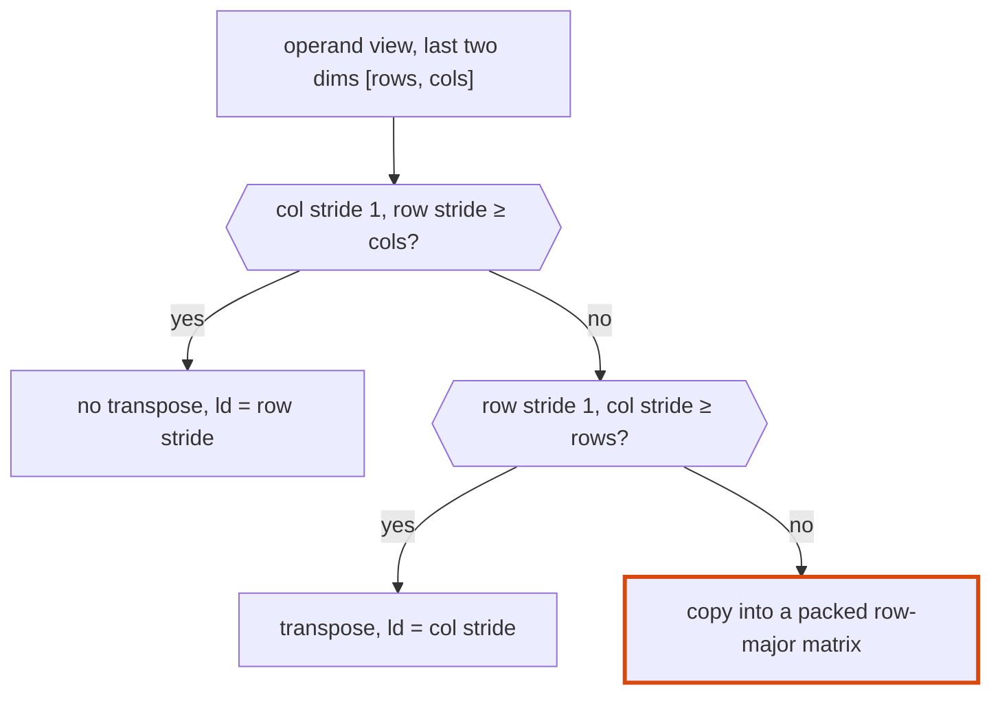

So contiguous, transposed and column-sliced operands pass to BLAS without copying. A broadcast batch dimension (stride 0) is handled by the per-batch pointer. Only a broadcast inside the matrix, such as a row repeated with stride 0, is copied.

Vendor BLAS libraries choose their blocking and threading by shape, so `BLAS` reports `shape_invariant?` false (Decision L). Results repeat exactly from run to run for the same shapes.

### The Metal device

`Metal` is opt-in (`require "tensomite/metal"`) and Apple Silicon only. It is a `HostDevice` too, which is the key to porting one op at a time.

- **Buffers are shared.** Each `MetalBuffer` is an `MTLBuffer` in shared storage, and also a `HostBuffer` over the same bytes. The CPU and GPU address the same memory, so `map` returns it and transfers are plain copies.
- **Ported ops run on the GPU; the rest run on the host, on the same memory.** `execute` looks for an MSL kernel for the node. If there is one, it encodes a dispatch. If not, it waits for the GPU and runs the inherited host kernel. Porting an op therefore changes where it runs, never whether it runs, and every op works from the first PR.
- **Dispatches are batched.** Kernels are encoded into one open command buffer, which is committed and waited for only when the host next needs memory: a host kernel, `map`, `upload`, `download` or `sync`. The encoder dispatches serially, so each kernel sees its predecessors' results.
- **Kernels are MSL source**, in `metal/kernels.metal`, embedded at compile time and compiled by the driver when the device is created, with fast math off. Each thread computes one output element and reads its sources through their views, with the same arithmetic as `View#offset_of`, so any view the host accepts works on the GPU (up to 8 dimensions).

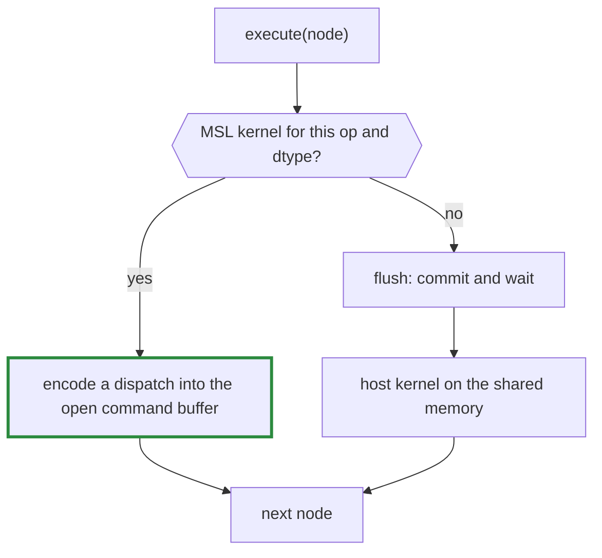

**Determinism.** Addition, subtraction, multiplication and comparisons are correctly rounded IEEE operations, so they give the same bits on the GPU as on the CPU, and `spec/gpu_spec.cr` checks them for equality. Division and the transcendental functions use the GPU maths library and are compared within 1e-6 (level 3 of Decision K). `MatMul` splits its sums across threads and is compared within 1e-5 (Decision S, below). Every kernel computes each element on its own, so the device is shape-invariant.

**Calling Objective-C from Crystal.** Metal has no C API, so `metal/objc.cr` sends messages through `objc_msgSend`. That function must be called with the exact C signature of the method it reaches, and Crystal does not allow one C symbol to be declared with several signatures. So `ObjC.send(ReturnType, receiver, "selector:", args...)` casts its address to a `Proc` typed by its arguments, one type per call site. `NSUInteger` is `UInt64`, `BOOL` is passed as `UInt32`, and `MTLSize`, a 24-byte struct, is passed as a pointer, as arm64 passes structs over 16 bytes. Objects the runtime autoreleases are created inside `ObjC.autoreleasepool`, and those kept beyond it are retained.

**Kernels that add.** Each of these kernels combines in a fixed order. `ScatterAdd` and `Unview` add in the host's order and are bit-identical to it; `Sum` and `Max` work in chunks (below):

Op          |Threads                                                                                  |Each thread                                                                                      
------------|-----------------------------------------------------------------------------------------|-------------------------------------------------------------------------------------------------
`Sum`, `Max`|one threadgroup per output, a thread per chunk of 64 (one thread for a run of 64 or less)|folds whole chunks in index order; the first thread folds the chunk results in chunk order       
`ScatterAdd`|one per column                                                                           |zeroes its column, then adds the source rows into the rows their ids select, in order            
`Unview`    |one per output position                                                                  |inverts the view to find which logical elements read the position, and adds them in logical order

`Unview` inverts a view by decomposing `position - offset` over the dimensions with a nonzero stride, largest first. The dimensions with stride 0 are the ones that repeat a position: their indices are walked in row-major order, which is logical order. The decomposition is unique when each stride exceeds the furthest the smaller ones can reach together. Every view tensomite builds satisfies that, and a view that did not would run on the host.

**Reductions in chunks (Decision X).** One thread per output made a long reduction slow: each of a GPT-2 layer norm's means was a single thread adding 768 numbers one after another, 126 µs each and 57% of a decoded token's GPU time. Each output now has a threadgroup, with each thread folding chunks of 64 at fixed offsets. As with split-K, chunk boundaries never depend on the run's length or on the number of threads, so a row padded with zeros (or, for `Max`, with -∞), as a masked attention row is, keeps its bits, and prefill still equals decode. `Max` is exact in any order and still matches the host bit for bit. `Sum` of more than one chunk adds in a different order from the host's and is compared within 1e-5. A run of one chunk or less keeps one thread per output, which is the host's arithmetic exactly.

**Errors.** A GPU kernel cannot raise. `Gather` and `ScatterAdd` report an id out of range through a small shared error buffer, and `flush` raises the host's `ExecutionError` when it finds a report. The error therefore surfaces when the command buffer completes, at `realize`, as it does on the host. One difference remains: the nodes encoded before the error are marked realised, with undefined contents for the failing one.

**`MatMul`** has three modes (`Metal#matmul_mode`), because a matrix-vector product (`m` = 1), which is what decoding mostly does, has too few outputs to fill the GPU with one thread each:

Mode             |Threads per output                    |How partial sums combine                     |Bits                                                           
-----------------|--------------------------------------|---------------------------------------------|---------------------------------------------------------------
`Serial`         |one, adding over all of `k` in order  |none                                         |identical to the host                                          
`Split` (default)|8, each summing chunks of 64 along `k`|one thread adds the chunks in chunk order    |repeat every run; independent of `m` and of zero-padding of `k`
`Atomic`         |8, as `Split`                         |atomic adds, in whatever order threads finish|may change from run to run; for measurement only               

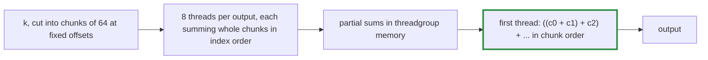

- **Why chunks, not slices.** Cutting `k` into 8 equal slices would move the boundaries whenever `k` changes. In attention, `scores · v` sums over the sequence: in prefill, a position's row has zeros for the masked positions after it, and in decode the same position's row simply stops there. Chunks at fixed offsets give both rows the same chunks, plus chunks of exact zeros in prefill, and `x + 0 = x`. So prefill and decode stay bit-identical (`spec/gpt2_spec.cr`, and the padding spec in `spec/metal_spec.cr`).
- **Coalesced reads.** A threadgroup owns 32 adjacent output columns of one row, so the 32 threads working on the same chunk read 32 adjacent columns of the weights at a time.
- **Decision S.** Splitting changes the order of additions, so `Split` no longer matches the host bit for bit: `spec/gpu_spec.cr` compares matmuls within 1e-5. Levels 1 and 2 of Decision K still hold, which is what caching and reproducibility need.
- **No fused multiply-add.** Each product and running sum are separate statements, so the compiler cannot fuse them into one rounding. That is what keeps `Serial` identical to the host.

**Profiling.** Setting `Metal#profile` to a `Metal::Profile` collects where time goes: seconds spent encoding dispatches, allocating and waiting for the GPU, the number of dispatches and command buffers, and the wall time of each op that ran on the host. With `per_kernel: true`, every op is committed alone and its GPU time recorded under its op's name, which slows the run but shows the GPU's own cost per op. `bench/profile_gpt2.cr` prints both for a decoded GPT-2 token.

The atomic kernel needs `atomic_float`, from Metal 3. Without it the device still works, and only `Atomic` raises.

Every op now has an `F32` Metal kernel. `I32` ops, views of more than 8 dimensions and overlapping views run on the host.

### Moving data between devices

An op whose operands are on different devices raises `DeviceError`. Data moves only through an explicit `Tensor#to(device)`, which realises the source, copies it through host memory and returns a realised leaf on the target:

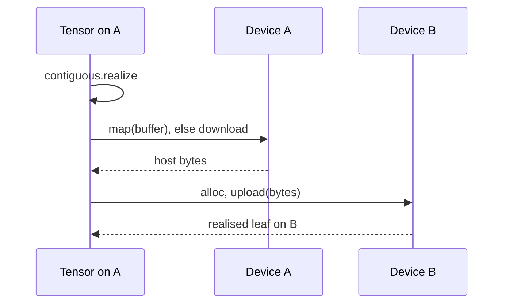

`to` is eager, unlike other ops, because a transfer between devices is a synchronisation point anyway.

### Host kernels

The host kernels are deliberately naive, and they run in a fixed order. That gives level 1 determinism from Decision K: the same inputs give the same bits on every run. Their order of arithmetic also never depends on shape, which is the basis for level 2 later.

- **Kernel structure.** `execute` dispatches on `DType` to a generic method, `execute(Float32, …)` or `execute(Int32, …)`, which dispatches on `Op`. A buffer's bytes are read as `Slice(T)`. Results are converted with `T.new(...)`, so every branch compiles for every dtype; float-only ops never reach an integer kernel because they are rejected when called.
- **Indexing in runs.** Kernels walk logical indices in order, in runs that each view can step through with a fixed stride. When every view involved is dense or constant, the run is the whole tensor. Otherwise it is the last dimension. `View#offset_of` finds each run's start, once per run rather than once per element. The order of arithmetic is the same as indexing every element, so the results are bit-identical, and strided reads are three to five times faster.
- **Reductions.** The reduced axis is permuted to the end of the source view, so each output element reads one run of consecutive logical indices. `Sum` folds the run from zero, and `Max` from its first element. A reduction over all elements is the same loop with a single output.

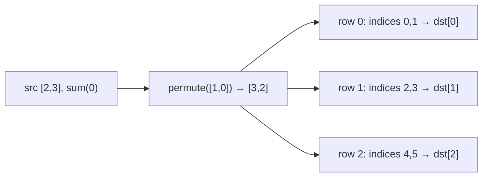

- **`Cat`** writes each source through a *slice view of the output*, so the same indexing code that reads views also writes them.
- **`Unview`** zero-fills its output, then adds each source element at the position its view reads, in index order. **`ScatterAdd`** does the same for whole rows. Both add in a fixed order, so gradients are deterministic too.
- **`Gather`** copies row `ids[i]` of a 2-D table into output row `i`. An id outside the table raises `ExecutionError`.
- **`MatMul`** computes each output as a dot product over `k`, added in index order. Its sources arrive already expanded to the common batch shape. It is the one kernel that does not call `offset_of` per element: it finds where each batch matrix starts, then walks rows, columns and `k` with the sources' strides directly. The order of additions is unchanged, so the result is bit-identical to indexing each element (`spec/host_kernels_spec.cr`), and about 10 times faster.

## Realisation

`Scheduler.realize(node)`:

1. **Order.** A depth-first walk, with an explicit stack so that deep training graphs cannot exhaust the call stack, lists the unrealised nodes reachable from the root, in topological order. A node shared by several consumers is listed, and computed, once.
2. **Run.** For each node: allocate an output buffer on its device, `execute`, then mark the node realised, which drops its sources.
3. **Wait.** Call `sync` on the root's device.

`Tensor#to_a(T)` realises the tensor, then reads the buffer (through `map` or `download`) in the view's logical order.

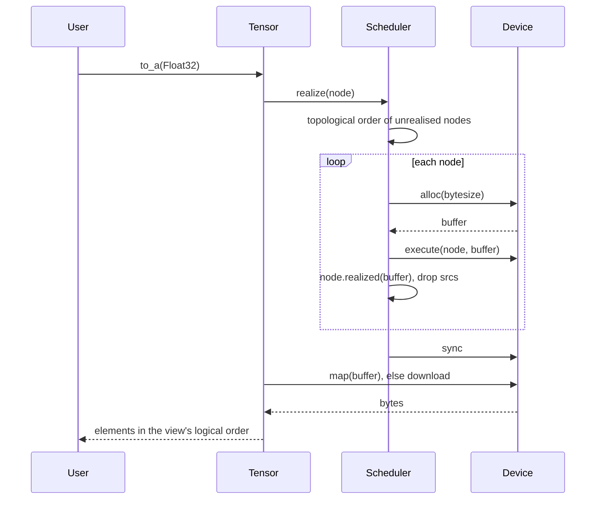

If a kernel raises, the nodes before it stay realised and the failing node stays unrealised.

### Buffer pool

A graph built anew every step, as in training or decoding, would allocate a fresh buffer for every node, every time. Instead, each host device and `Metal` keeps a `BufferPool` of freed memory, keyed by exact size (Decision U):

1. **Giving back.** When the collector finalizes a buffer, its finalizer hands the memory to the device's pool. A buffer is collected only once nothing can reach it, so reuse is always safe. Memory from a file mapping is never pooled.
2. **Taking.** `alloc` takes memory of the exact size from the pool when there is some, and allocates otherwise. A pooled buffer's old contents remain, which is why `Device#alloc` promises nothing about contents and every kernel writes all of its output.
3. **Re-entrancy.** A finalizer can run in the middle of any allocation, including one made by the pool itself. While the pool is changing it declines memory, and the memory is freed instead.
4. **On Metal**, a buffer given back while GPU work is pending waits in a retired list until that work completes, because the GPU may still be reading it. The pool holds the `MTLBuffer`s themselves.
5. **A limit** (1 GiB by default) bounds what a pool holds.

Reuse lags by one collection: memory comes back only when the collector runs. A training loop that collects once per step (`examples/shakespeare.cr`) gets most of its buffers back before the next step; on the Linux container, that took a step from 744 to 470 ms, with identical losses.

**Batched commits on Metal.** The device commits its command buffer every `commit_every` dispatches (64), without waiting, and starts a new one. The GPU therefore starts work while the host is still building and encoding the rest. A queue runs its command buffers in order, with Metal tracking each buffer's readers and writers across them, so results are unchanged.

## Kernel macros

`Tensomite.kernel(name) { |x, …| expression }` fuses an elementwise expression into one primitive, `Op::Kernel`: one pass over memory on host devices and one dispatch on Metal, instead of a node per operation (Decision J). `Tensor#gelu` is the first: eight primitives become one kernel.

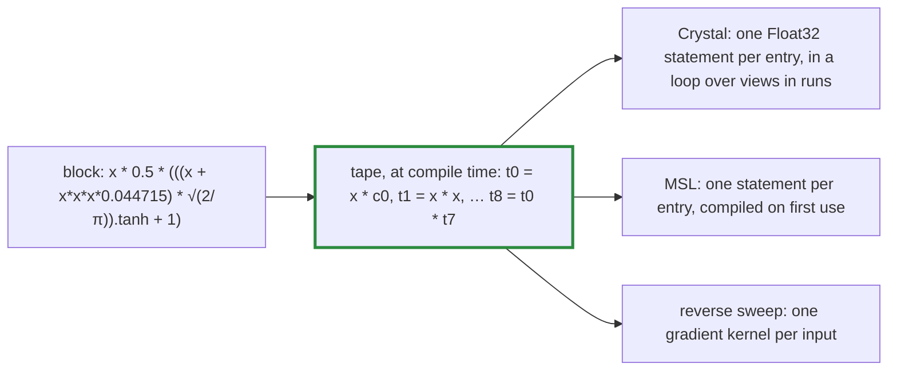

1. **The tape.** The macro walks the block's syntax tree in post order, with an explicit stack, because the macro language has no recursion that returns values. Each operation becomes one tape entry with its own temporary, in Crystal's own order of evaluation, so `x * x * x` is `(x · x) · x`, as the composite computes it.
2. **Constants.** A subexpression without inputs, such as `Math.sqrt(2 / Math::PI)`, is computed once in `Float64` and converted to `Float32`, which is exactly how `Tensor.scalar` converts a number operand.
3. **The host loop** computes each entry in `Float32`, and Crystal never fuses a multiply and an add. So a kernel gives **the same bits as the composite it replaces**, and the composite is its oracle (`spec/kernel_spec.cr`). `tanh`, `exp`, `log` and `sqrt` call the same `Math` functions as the host kernels.
4. **MSL** puts one statement per entry, so the Metal compiler cannot fuse operations either; only the maths library's functions differ from the CPU's. `Metal` compiles a kernel's source, after `metal/prelude.metal`, the first time the kernel runs, and caches the pipeline.
5. **Gradients.** A reverse sweep over the tape applies each operation's chain rule: the output's gradient spreads to its operands, and contributions to one value are added in the order the sweep meets them. Each input gets its own gradient kernel, whose inputs are the output's gradient followed by the kernel's inputs. Autograd's rule for `Op::Kernel` applies them, so a kernel needs no hand-written backward. Gradient kernels have no gradients of their own.

The expression language is deliberately small: `+`, `-` (binary and unary), `*`, `/`, number literals, constant paths such as `Math::PI`, and `tanh`, `exp`, `log` and `sqrt`. Anything else fails at compile time with the offending expression. Inputs broadcast like a binary op's, and must be `F32` on one device.

## Autograd

`Tensomite.grad(loss, params)` returns the gradient of a one-element `loss` with respect to each param, as lazy tensors. It is a graph transform: it reads the unrealised graph behind `loss` and builds a second graph of ordinary primitive ops beside it. Nothing runs until a gradient is realised, and devices need no autograd code at all.

1. **Order.** List the nodes behind `loss` in topological order, stopping at leaves.
2. **Mark.** Keep only the nodes that lead to a param. Inputs, masks and targets get no gradient.
3. **Seed.** The loss node's gradient is a tensor of ones.
4. **Walk back.** In reverse order, each node's accumulated gradient, in the node's shape, goes through its op's chain rule to give one gradient per marked source. Each is added to its source's node.
5. **Read out.** Each param's gradient is its node's gradient, read through the param's view.

For example, `loss = (w * x).sum` builds two nodes forwards and two backwards:

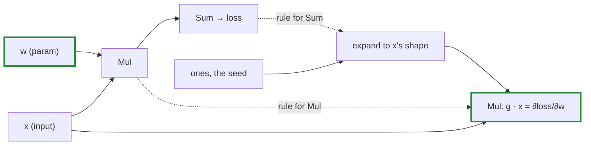

The backward graph reuses `x`, a forward node, so realising a gradient realises whatever forward work it needs. Realising `loss` and the gradients in either order shares that work.

### Chain rules

Each rule turns `g`, the gradient of the op's output, into a gradient for each source in the source's view shape. `out` is the op's own output, reused where it is cheaper than recomputing.

Op            |Gradient for each source                                                      
--------------|------------------------------------------------------------------------------
`Add`, `Sub`  |`g`, and `g` or `-g`                                                          
`Mul`         |`g·b`, `g·a`                                                                  
`Div`         |`g / b`, `-g·out / b`                                                         
`Maximum`     |`g·m` and `g·(1 - m)`, where `m = a.greater_equal(b)`; ties go to `a`         
`Exp`         |`g·out`                                                                       
`Log`         |`g / a`                                                                       
`Tanh`        |`g·(1 - out²)`                                                                
`Sqrt`        |`g / (2·out)`                                                                 
`Sum`         |`g` reshaped to keep the reduced axis, then expanded back                     
`Max`         |`g` expanded, times `m / m.sum`, where `m` marks the maxima; ties share evenly
`Copy`        |`g`                                                                           
`Cat`         |one slice of `g` per source                                                   
`Gather`      |`ScatterAdd` of `g`'s rows into the table's rows; ids get none                
`MatMul`      |`g·bᵀ`, `aᵀ·g`                                                                
`ScatterAdd`  |`g` gathered by the ids                                                       
`Unview`      |`g` read through the inverted view                                            
`GreaterEqual`|none: it is a step function                                                   

### Views and broadcasting, backwards

Sources are views, so a source's gradient arrives in the view's shape and has to land on the node behind it. Broadcasting needs no rule of its own: an `expand` is a view with stride 0, and its adjoint sums.

- **A view covering its whole node in row-major order** (the common case) only needs a reshape.
- **Any other view** (a transpose, slice, expand or permute) becomes an `Unview` node holding the view. Each output position is the sum of the gradient elements that the view reads from it. So a bias of shape `[C]`, expanded to `[N, C]`, gets the column sums; a slice gets zeros outside its range.

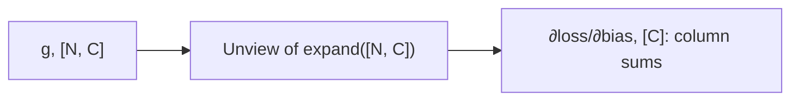

A tensor used twice gets two contributions, added together in the walk's fixed order.

### Realised nodes and constants

A realised node has dropped its sources (see "Tensor and Node"), so there is nothing behind it to differentiate. Rather than silently treating it as a constant, and returning zeros for every param behind it, `grad` raises `Error`. A value that is meant to be constant, such as a precomputed table, is made a leaf with `Tensor#detach`, which realises the tensor and wraps its buffer in a new leaf node.

### Optimizers

Tensors are immutable, so an optimizer does not update params in place. `Optimizer#step(params, grads)` returns new params, realised and detached, and the training loop passes them to the next forward pass. State such as momentum is kept by position in the params array, and detached each step, so no step's graph outlives it.

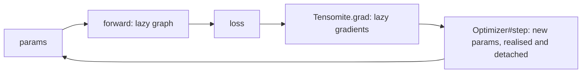

- **`SGD`**: `p - lr·v`, where `v` is `g` or, with momentum, `momentum·v + g`.
- **`AdamW`**: Adam with decoupled weight decay and bias correction. `lr` can be changed between steps for a schedule. Params that should not decay, such as norms and biases, are given to a second `AdamW` with `weight_decay: 0`.

### Cross-entropy

`logits.cross_entropy(targets)` is the mean of `-log_softmax(logits)[row, target]` over rows. `log_softmax` is `x - max - log(Σ exp(x - max))`, which never takes the log of an underflowed probability. The entries are picked by `gather` from the log-probabilities flattened to a `[rows × classes, 1]` table, with indices `row × classes + target` computed on the host. So the targets are realised when the op is built, and the gradient arrives through the `Gather` rule.

## Error timing

The plan accepts that errors in a lazy graph may surface far from their cause. To keep that rare, every check that can be made when an op is called is made then:

Error           |Raised when                                                                                                 
----------------|------------------------------------------------------------------------------------------------------------
`ShapeError`    |Building the op: broadcast mismatch, bad axis, slice or permutation, wrong element count, empty max         
`DTypeError`    |Building the op: mixed dtypes, a float-only op on `I32`, non-`I32` gather ids; or `to_a` with the wrong type
`DeviceError`   |Building the op with tensors on different devices, or a device given another device's buffer                
`ExecutionError`|`realize`: a kernel met invalid data, such as a gather id out of range                                      

Only `ExecutionError` depends on the data rather than the shapes, so it is the only one raised at `realize`.

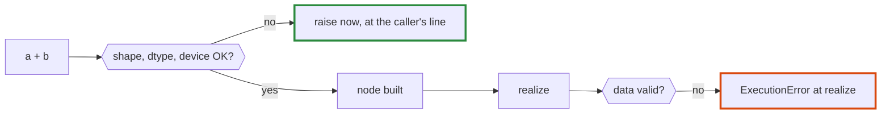

## Models and data

### Loading weights

`SafeTensors.open(path)` maps the whole file once with `MappedFile` and parses only the JSON header. Each tensor is then a realised leaf over its own byte range:

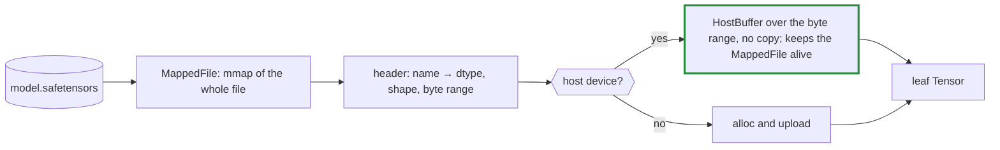

- **Nothing is read until used.** The operating system pages weights in as kernels touch them.
- **Unaligned tensors are copied.** A tensor is read in place only when its data starts on a 4-byte boundary. Older safetensors writers do not pad the header: in GPT-2 small's published file the data section starts at byte 14,291, so every tensor is 3 bytes off and is copied into a new, aligned buffer at load. Reading `Float32`s from unaligned addresses happens to work on x86 and ARM64, but LLVM treats it as undefined behaviour, and GPU uploads need alignment anyway.
- **The mapping lives as long as any tensor over it,** because each `HostBuffer` holds its `MappedFile`.
- **Limits:** one tensor must fit in 2 GiB (an `Int32` `Slice`), but the file may be larger. Only `F32` and `I32` tensors load; other dtypes raise `DTypeError`.
- **Every header entry is checked** against the file: its byte range fits and holds exactly the bytes its shape needs.

### Tokeniser

`BPE` reproduces GPT-2's byte-level byte-pair encoding from a `vocab.json` and a `merges.txt`:

```mermaid
flowchart LR
    Text["text"] --> Words["split by GPT-2's pattern (Unicode-aware)"]
    Words --> Bytes["each word's UTF-8 bytes"]
    Bytes --> Chars["bytes mapped to printable characters"]
    Chars --> Merge["merge the lowest-ranked adjacent pair, repeatedly"]
    Merge --> Ids["vocabulary ids"]
```

- **Every byte maps to a printable character** (space becomes `Ġ`, newline `Ċ`), so any byte sequence round-trips, including emoji and broken UTF-8.
- **The pattern is compiled with `Regex::Options::UCP`,** so `\s` matches Unicode whitespace, such as a no-break space, as in the reference implementations.
- **Decoding** maps characters back to bytes and replaces invalid UTF-8 with U+FFFD, as the reference does.
- **Words are cached** after their first encoding.

### GPT-2

`GPT2.load(path, heads, device)` reads every size except the number of heads from the weight shapes. `forward(ids, cache)` runs new positions after those in the cache and returns their logits:

```mermaid
flowchart TD
    Ids["ids"] --> Embed["token embedding + position embedding"]
    Embed --> Block["block × layers"]
    subgraph Block["each block"]
        LN1["layernorm"] --> Attn["causal self-attention over cache + new keys"]
        Attn --> Add1["+ residual"]
        Add1 --> LN2["layernorm"]
        LN2 --> MLP["matmul, GELU, matmul"]
        MLP --> Add2["+ residual"]
    end
    Block --> LNF["final layernorm"]
    LNF --> Logits["matmul with the token embedding (tied) → logits"]
```

- **The KV cache** holds each layer's keys and values as `[heads, positions, head width]`. New positions are appended with `Tensor.cat`, which copies the cache. That costs O(n²) over a whole generation, which is fine at GPT-2's 1,024 positions.
- **The causal mask** is `Tensor.causal_mask(new, past + new)`, so the same code serves prefill (many new positions) and decode (one).
- **Weights stay in GPT-2's `[in, out]` layout,** so each linear layer is a plain `x.matmul(w) + b`. The output layer reuses the token embedding through a transposed view, with no copy.
- **`generate(prompt, count, sampler)`** prefills the prompt, then decodes one token at a time, yielding each.

### Sampling

`Sampler.greedy` picks the highest logit, the first on ties. Otherwise logits are divided by the temperature, cut to the `top_k` highest when it is positive, and drawn from their softmax with a seeded `Random::PCG32`, so a seed repeats a run.

### Verified against the reference

Model         |Tokeniser corpus|Max logit difference from PyTorch|Greedy tokens|Prefill against decode       
--------------|----------------|---------------------------------|-------------|-----------------------------
Tiny reference|identical ids   |4.6e-6 (`CPU`), 3.9e-6 (`BLAS`)  |20 identical |bit-identical on host devices
GPT-2 small   |identical ids   |3.7e-4 (`CPU`)                   |64 identical |bit-identical on `CPU`       

GPT-2 small's larger difference reflects its size: 12 layers of 768-wide dot products added in a different order from PyTorch's.

### Determinism in practice

On host devices, a position's logits are bit-identical whether it is computed in a prefill or one token at a time (`spec/gpt2_spec.cr`). That is level 2 of Decision K. It holds because every host kernel's order of arithmetic depends only on the index, and masked positions contribute exact zeros to sums.

On `BLAS`, the same comparison on the tiny reference model differs in the low bits of 77% of logits (at most 1.4e-6). That is why `BLAS` reports `shape_invariant?` false.

## Performance baselines

Measured with `bench/matmul.cr` and `bench/gpt2.cr`, built with `--release`. Medians of several runs.

**Matmul, naive oracle against BLAS, square `F32` matrices** (the oracle as of M3, before its strided matmul):

Size|Linux container, 4 cores, OpenBLAS: oracle / BLAS ms|MacBook Pro, M5 Pro, Accelerate: oracle / BLAS ms|M5 Pro GFLOP/s
----|----------------------------------------------------|-------------------------------------------------|--------------
64  |8.03 / 0.015                                        |2.59 / 0.004                                     |141           
128 |40.87 / 0.042                                       |20.92 / 0.007                                    |606           
256 |349.72 / 0.123                                      |169.20 / 0.043                                   |774           
512 |3,276.51 / 1.176                                    |1,301.29 / 0.260                                 |1,031         

The M5 Pro's BLAS throughput is higher than its NEON units alone can deliver. Accelerate is most likely using the CPU's matrix extension.

**GPT-2 small, Linux container** (shapes of GPT-2 small, 64-token prompt, 32 decoded tokens):

Device|M4 prefill tokens/s|M4 decode tokens/s|M5 prefill tokens/s|M5 decode tokens/s|M5 ms per decoded token
------|-------------------|------------------|-------------------|------------------|-----------------------
`CPU` |2.1                |1.64              |2.7                |2.17              |462                    
`BLAS`|57.9               |10.25             |258.3              |29.59             |34                     

M5's gain comes from walking views in runs (see "Host kernels"), which made `Cat`, the KV cache's copy, several times cheaper. As of M4, before that change, a decoded token's 93 ms on `BLAS` went as follows:

Kernel                      |ms per token|Share
----------------------------|------------|-----
`Cat` (growing the KV cache)|44.9        |48%  
`MatMul` (`cblas_sgemm`)    |30.1        |32%  
All other host kernels      |15.6        |17%  
Outside kernels             |2.7         |3%   

- **The KV cache cost the most:** every token copies the whole cache. It still does, but in runs; a preallocated cache written in place would remove the copy altogether.
- **The matmuls are limited by memory bandwidth:** each decoded token streams all ~500 MB of weights once, and 30 ms is about 17 GB/s.

**Metal on the MacBook Pro, M5 Pro** (M6: every op on the GPU; `MatMul` in each of its modes):

Device                |GPT-2 prefill tokens/s|GPT-2 decode tokens/s|ms per decoded token
----------------------|----------------------|---------------------|--------------------
`CPU`                 |8.6                   |7.63                 |131                 
`BLAS`                |905.5                 |152.01               |7                   
`Metal`, serial matmul|635.3                 |34.22                |29                  
`Metal`, split matmul |1,148.7               |63.57                |16                  
`Metal`, atomic matmul|1,267.5               |63.52                |16                  

Size|`BLAS` ms|`BLAS` GFLOP/s|`Metal` ms (split)|`Metal` GFLOP/s
----|---------|--------------|------------------|---------------
64  |0.003    |151.6         |0.255             |2.1            
128 |0.005    |786.3         |0.293             |14.3           
256 |0.027    |1,240.8       |0.966             |34.7           
512 |0.205    |1,308.1       |2.716             |98.8           

- **Splitting `k` nearly doubled decode** (34 to 64 tokens/s) and lifted prefill past `BLAS` (1,149 against 906 tokens/s).
- **Determinism costs nothing in decode and about 9% in prefill.** The atomic split decodes at the same speed and prefills at 1,268 tokens/s. Waiting for the 8 partial sums and adding them in order is cheap beside streaming the weights.
**Matrix-vector products by mode** (`bench/matvec.cr`, M5 Pro; 20 products per realise, ms per 20):

Shape (GPT-2 small)         |Serial|Split |Atomic|Atomic saving
----------------------------|------|------|------|-------------
attention q·k·v, 768 → 2,304|3.293 |0.895 |0.859 |4%           
attention out, 768 → 768    |2.070 |0.564 |0.570 |-1%          
MLP up, 768 → 3,072         |3.231 |0.923 |0.914 |1%           
MLP down, 3,072 → 768       |11.713|1.839 |1.795 |2%           
logits, 768 → 50,257        |13.986|11.804|11.768|0%           
prefill MLP up, 64 rows     |11.851|12.574|11.537|8%           

- **The logits product runs at memory bandwidth.** Its 154 MB of weights, too large for any cache, stream in 0.59 ms, about 260 GB/s.
- **A token's matmuls take about 3 ms of its 16.** Each layer's four products take about 211 µs, so 2.5 ms for 12 layers, plus 0.6 ms for the logits. The smaller weights may stay in the GPU's cache across the 20 products, so those figures flatter decode a little.
- **With 64 rows, splitting costs 6%** over serial: the GPU is already full, and the split's barriers are pure cost. One kernel for every number of rows is what keeps prefill equal to decode.
- **Decode is still behind `BLAS`** (16 ms against 7 ms per token). The matmuls take about 3 ms of it (above), so about 13 ms goes elsewhere. Each primitive op is its own dispatch, hundreds per token, and the reductions inside `layernorm` and `softmax` use one thread per output. That is M7's work: kernel macros fuse those chains (Decision O requires Metal to beat `BLAS` there).
- **Square matmuls barely change, at 99 GFLOP/s** against Accelerate's 1.3 TFLOP/s on the CPU's matrix units. They already had enough outputs to fill the GPU; they need tiling in threadgroup memory, which comes with M7's matmul epilogues.
- **About 0.3 ms per realise is fixed cost:** committing a command buffer and waiting for it. It dominates small matrices, and is paid once per decoded token.
- **With one thread per output (serial), decode left most of the GPU idle:** a 768-wide layer launched 768 threads, each looping over all of `k`.

**Where a decoded token's time goes on Metal** (`bench/profile_gpt2.cr`, M5 Pro, M7 part 1):

Part of the 15.65 ms wall time                                          |ms   |Share
------------------------------------------------------------------------|-----|-----
Waiting for the GPU                                                     |13.19|84%  
Everything else on the host (graph building, scheduling, reading logits)|1.19 |8%   
Allocating buffers                                                      |1.00 |6%   
Encoding 710 dispatches                                                 |0.26 |2%   

GPU time per op, each committed alone (13.75 ms in all):

Op        |Per token|GPU ms|Share
----------|---------|------|-----
`Sum`     |62       |7.81  |57%  
`MatMul`  |73       |3.81  |28%  
`Add`     |159      |0.49  |4%   
`Mul`     |134      |0.40  |3%   
`Max`     |12       |0.36  |3%   
`Div`     |87       |0.30  |2%   
all others|151      |0.57  |4%   

- **One thread per output is what makes `Sum` slow.** Fifty of the 62 sums are the means inside the 25 layer norms, each a single row of 768: one GPU thread adds 768 numbers in turn, waiting on memory for each, about 126 µs per sum. The other 12 are softmax denominators.
- **Dispatch overhead is not the problem.** Encoding 710 dispatches costs 0.26 ms, and a small elementwise op about 3 µs of GPU time.
- **Allocation costs 1 ms a token**, which the buffer pool (Decision U) targets.

**After parallel reductions** (M7 part 2, M5 Pro):

Measure                                                    |Part 1|Part 2
-----------------------------------------------------------|------|------
Metal decode, tokens/s (split)                             |63.6  |104.9 
Metal prefill, tokens/s (split)                            |1,149 |1,279 
Wall per decoded token, ms                                 |15.65 |10.14 
of which waiting for the GPU                               |13.19 |6.98  
of which on the host: allocating, encoding, everything else|2.45  |3.16  
GPU time in `Sum`, ms                                      |7.81  |1.03  
GPU time in `MatMul`, ms                                   |3.81  |4.04  
GPU time in elementwise ops and `Cat`, ms                  |1.76  |2.10  

- **Host work is now about a third of a decoded token's 10 ms.** The host builds the graph, allocates buffers and encodes every dispatch before the command buffer is committed, so the GPU waits for all of it. The buffer pool (part 3) removes most of the allocation. Committing in batches as encoding proceeds would let the GPU start before the host finishes.
- **Matmul is now the largest GPU cost, at 54%.** Elementwise ops, about 2 ms over 500 dispatches, are what fusion removes.
- **`BLAS` decodes at 6.6 ms per token.** Metal is at 9.5, so about 3 ms is left to find.

**After the buffer pool and batched commits** (M7 part 3, M5 Pro):

Measure                          |Part 2|Part 3
---------------------------------|------|------
Metal decode, tokens/s (split)   |104.9 |138.6 
`BLAS` decode, tokens/s, same run|151.7 |144.0 
Metal prefill, tokens/s (split)  |1,279 |1,521 
Wall per decoded token, ms       |10.14 |6.98  
of which waiting for the GPU     |6.98  |5.23  
allocating buffers               |1.29  |0.60  
everything else on the host      |1.53  |0.78  
Command buffers per token        |1     |12    
GPU time, each op alone, ms      |7.44  |6.78  

- **The host now overlaps the GPU.** The wall time (6.98 ms) is less than the GPU's own work timed op by op (6.78 ms) plus the host's (1.74 ms), because the GPU starts on each batch of 64 dispatches while the host encodes the next.
- **Metal decodes within 4% of `BLAS`** in the same run, and prefills 1.7 times as fast. `BLAS` itself varies by about 5% between runs (144 to 153 tokens/s), so the M7 exit compares the two within one run.
- **What is left is GPU work:** matmul 3.8 ms, and about 2 ms of small elementwise dispatches, which fusion removes.

**Training a character-level GPT on Tiny Shakespeare, Linux container.** The M5 exit is a validation loss below 1.8 within an hour here, and M7's is below 1.6 within an hour (Decision R). Runs use `examples/shakespeare.cr` on `BLAS`, with AdamW and a cosine schedule from 1e-3 to 1e-4:

Model                                   |Params|Tokens per step|ms per step|Steps|Wall time|Validation loss, nats/char        
----------------------------------------|------|---------------|-----------|-----|---------|----------------------------------
4 layers, 4 heads, width 128, context 64|0.8M  |1,024          |720        |3,000|36 min   |1.726 (1.80 at step 2,250, 27 min)

Where the time of a step went, measured over 10 steps of that model before two fixes:

Cost                                       |Before             |After                             
-------------------------------------------|-------------------|----------------------------------
Per-element `offset_of` in host kernels    |11 s of kernel time|3.9 s, after walking runs         
Allocation, with `GC_UNMAP_THRESHOLD` unset|3.6 s              |0.9 s, with `GC_UNMAP_THRESHOLD=0`
`MatMul` on `BLAS`                         |0.4 s              |0.4 s                             

- **Training is bound by elementwise passes, not by matmul.** The composites are built from primitives, so `gelu`, `softmax` and `layernorm`, forwards and backwards, touch tens of millions of elements per step. Each pass reads and writes fresh memory at about 2.4 ns per element, against 0.45 ns for the same loop over cached buffers. Fusion (M7) and buffer reuse (M7) attack exactly this, and parallel host kernels (Decision D) would divide it by the core count.
- **The 720 ms was measured without `GC_UNMAP_THRESHOLD=0`,** which brings it to about 500 ms. With the buffer pool and a collection per step (M7), a step takes about 470 ms with no flag.
- **Attention grows with the square of the context.** Doubling the context to 128, at the same width, more than doubles the step.

## Current limits

- **Element counts and offsets are `Int32`,** following Crystal's `Slice` indexing. That caps one buffer at about 2 GB.
- **Only `F32` and `I32`.** No type promotion: operands must have the same dtype.
- **BLAS covers `F32` matmul only.** See "Performance baselines" for how far the oracle is behind it.
- **Model weights load as `F32` only.** `F16` and quantised weights arrive with M9.
- **The KV cache grows by copying** (`Tensor.cat`), which is quadratic over a long generation and is half of decode time on `BLAS`.
- **One device per op.** Moving data needs an explicit `to`, which goes through host memory.
- **Only what is written as a kernel is fused.** `gelu` is one kernel; `softmax`, `layernorm` and the attention's scale and mask are still several primitives each, until the fused row ops (M7 part 5) and the models' move onto kernels (M7 part 6).
- **Each scalar operand is a new leaf,** uploaded to the device once per use.
- **Buffer reuse waits for the collector.** A freed buffer returns to its pool only when the collector finalizes it, so a loop that does not collect between steps reuses less (see "Buffer pool").
- **Gradients of gradients** are built by the same rules, but are not tested.
- **`grad` needs an unrealised graph.** Realise the loss after calling `grad`, or together with the gradients.
