# Tensomite: design

This document describes the design as it is built today, through milestone 11 (fast quantised CPU kernels); M8's run on a discrete GPU is still to do. `PLAN.md` holds where the design is going, and `DECISIONS.md` why it is as it is. `DEVELOPMENT.md` covers how to work on the code.

## Overview

Tensomite is a lazy tensor runtime. Operations on a `Tensor` build a graph, and nothing is computed until a result is needed. The scheduler then runs the graph on a `Device`, one kernel per node.

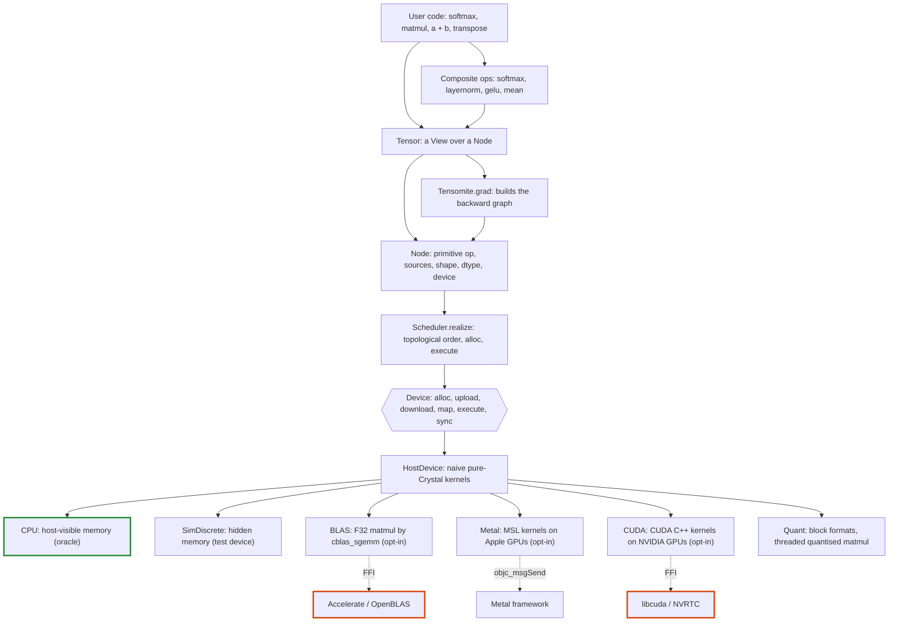

## Glossary

The kernels use a small vocabulary with exact meanings. Each term below is linked from its first use in this document.

Term           |Meaning                                                                                                                                                                          |Where it is used                                                  |Introduced by                                   
---------------|---------------------------------------------------------------------------------------------------------------------------------------------------------------------------------|------------------------------------------------------------------|------------------------------------------------
oracle         |the naive CPU kernel, or the composite op, that every faster kernel is compared with, bit for bit or within a stated tolerance                                                   |`CPU`, `Quant.matmul_reference`, the specs                        |the principles in `PLAN.md`; Decision M         
shape-invariant|giving bits that do not depend on the batch size, or on how a prompt is cut into chunks, so that a position's logits are the same in prefill and in decode                       |`Device#shape_invariant?`, the prefill-against-decode specs       |Decisions K (level 2) and L                     
run            |consecutive logical indices that a host kernel walks with one fixed stride through each view: the whole tensor when every view is dense or constant, otherwise the last dimension|host kernels (`View.run_length`, `View#run_stride`), `Tensor#to_a`|the host kernels' design ("Host kernels", below)
chunk          |a fixed-size piece of a sum at fixed offsets, 64 along a matmul's `k` and 16 in reductions, summed alone and then added to the total in chunk order                              |GPU matmuls, reductions and fused row ops                         |Decisions S and X                               
split-K        |a matmul whose chunks of `k` are summed by different threads and then combined in chunk order, so its bits depend only on `k`, not on the number of rows                         |`Split` in `Metal::MatMulMode` and `CUDA::MatMulMode`             |Decision S                                      
tile           |a block of outputs, or of `k`, staged in a threadgroup's (Metal) or block's (CUDA) shared memory, so that its threads reuse each value they load                                 |`Tiled` in both                                                   |Decision AD                                     
patch          |the outputs one thread computes within a tile, 4 × 4 by default, so that each value loaded serves several multiply-adds                                                          |the tiled matmul kernels                                          |Decision AD; [Q-X](faq/q-x-patch-per-thread.md) 
two-pass       |a product whose chunk sums are written to scratch memory by one kernel and folded, in chunk order, by a second                                                                   |`CUDA::MatMulMode::TwoPass`, Metal's `TiledTwoPass`               |Decisions AX and BJ                             
block          |32 consecutive quantised values of a row sharing one scale (`Q8_0`, `Q4_0`), or a scale and a minimum (`Q4_1`); not a CUDA thread block                                          |`DType`, `Quant`, `BlockMatMul`                                   |Decisions N and CL                              
lane           |one thread of a warp (CUDA) or SIMD group (Metal); in a quantised product each lane takes whole blocks, and the lanes' contributions are added in block order                    |`BlockMatMulMode::Lanes`                                          |Decision CO                                     
span           |the outputs that one CPU thread takes of a quantised product, up to 4 per thread and at least 64 KB of weights each, claimed in turn from a shared counter                       |`Quant.in_parallel`, `SpinPool`                                   |Decisions DD and DF                             

## Core types

Type            |File                      |Role                                                                                                                                                                                   
----------------|--------------------------|---------------------------------------------------------------------------------------------------------------------------------------------------------------------------------------
`DType`         |`dtype.cr`                |Runtime element type: `F32`, `I32`, and the [block](#glossary) formats `Q8_0`, `Q4_0` and `Q4_1`. `DType.of(Float32)` maps a Crystal type to it; `bytes_for(count)` gives storage size.
`View`          |`view.cr`                 |Shape, strides and offset, counted in elements. Pure metadata.                                                                                                                         
`Buffer`        |`device.cr`               |An opaque allocation owned by one device, which it names.                                                                                                                              
`Device`        |`device.cr`               |Where buffers live and kernels run.                                                                                                                                                    
`Op`            |`node.cr`                 |The primitive operations devices implement.                                                                                                                                            
`Node`          |`node.cr`                 |A graph vertex producing one contiguous array.                                                                                                                                         
`Tensor`        |`tensor.cr`, `tensor/*.cr`|The user-facing value: a `View` over a `Node`. Its ops are grouped by kind in `tensor/`.                                                                                               
`Scheduler`     |`scheduler.cr`            |Turns unrealised nodes into kernel runs.                                                                                                                                               
`Tensomite.grad`|`autograd.cr`             |Builds the backward graph of a loss: lazy gradients for a list of params.                                                                                                              
`Optimizer`     |`optim.cr`                |`SGD` and `AdamW`: new params from params and gradients.                                                                                                                               
`Kernel`        |`kernel.cr`, `kernels.cr` |A fused elementwise kernel made by the `Tensomite.kernel` macro, with its gradient kernels.                                                                                            
`BufferPool`    |`buffer_pool.cr`          |Freed device memory kept for reuse, by exact size.                                                                                                                                     
`RetiredList`   |`buffer_pool.cr`          |Buffers freed by finalizers, queued without allocating or locking until a pool takes them.                                                                                             
`HostDevice`    |`devices/host.cr`         |Abstract device whose kernels run on the host CPU; holds `HostBuffer`s.                                                                                                                
`CPU`           |`devices/cpu.cr`          |The reference device: host kernels on host-visible memory.                                                                                                                             
`SimDiscrete`   |`devices/sim_discrete.cr` |A test device: host kernels on memory the host cannot map.                                                                                                                             
`BLAS`          |`blas.cr`                 |Opt-in: host kernels with `F32` matmul by the platform BLAS.                                                                                                                           
`Metal`         |`metal.cr`, `metal/`      |Opt-in, Apple Silicon: MSL kernels on the GPU over shared memory, one for every op.                                                                                                    
`CUDA`          |`cuda.cr`, `cuda/`        |Opt-in (`-Dcuda`), NVIDIA: CUDA C++ kernels compiled by NVRTC, copies between host and device memory.                                                                                  
`Quant`         |`quant.cr`                |Quantises and dequantises ggml's block formats, and multiplies by them on the host, threaded, with the [oracle](#glossary)'s bits.                                                     
`MappedFile`    |`mapped_file.cr`          |A read-only memory mapping of a file, unmapped when collected.                                                                                                                         
`SafeTensors`   |`safetensors.cr`          |Reads tensors from a safetensors file, zero-copy on host devices.                                                                                                                      
`GGUF`          |`gguf.cr`                 |Reads tensors and metadata from a GGUF file, block formats included.                                                                                                                   
`F16`, `BF16`   |`f16.cr`, `bf16.cr`       |Half-precision values as `UInt16`-backed structs, widened to `F32` as weights load.                                                                                                    
`Module`        |`module.cr`, `modules.cr` |Models as classes of named `Parameter`s and child modules; `Linear`, `Embedding`, `LayerNorm` and others are built in.                                                                 
`Builder`       |`builder.cr`              |Builds built-in modules with shared settings, as the model DSL.                                                                                                                        
`Dropout`       |`dropout.cr`              |Seeded dropout masks for one forward pass, the same on every device.                                                                                                                   
`BPE`           |`bpe.cr`                  |GPT-2's byte-level byte-pair-encoding tokeniser.                                                                                                                                       
`Sampler`       |`sampler.cr`              |Picks the next token: greedy, or seeded temperature and top-k sampling.                                                                                                                
`GPT2`          |`models/gpt2.cr`          |The GPT-2 decoder with a KV cache.                                                                                                                                                     
`Llama`         |`models/llama.cr`         |Llama-family decoders (RoPE, RMSNorm, SwiGLU, grouped-query attention), from safetensors or GGUF.                                                                                      

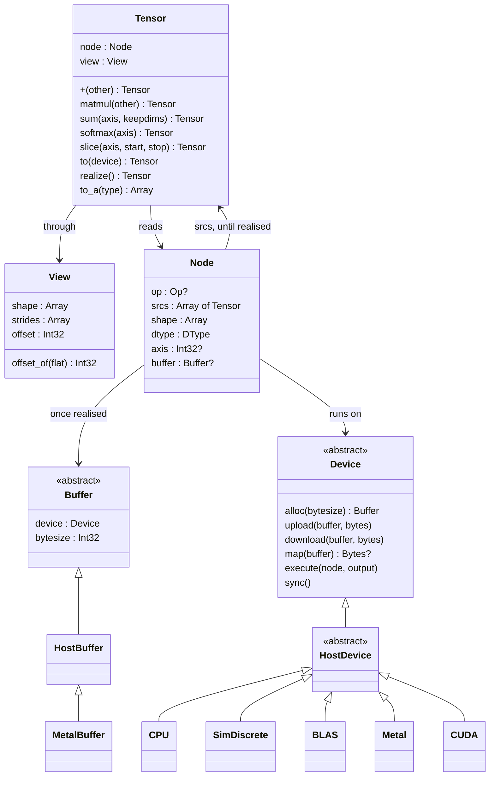

### Tensor and Node

A `Tensor` is a small struct holding a `Node` and a `View`. The node is where the data comes from. The view says how to read it.

- **Views share nodes.** `transpose`, `permute`, `expand`, `slice` and most `reshape`s return a new `Tensor` over the *same* node with a different view. They never copy, and they work on unrealised nodes too.
- **A node always produces a contiguous, row-major array** of its `shape`. All of the non-trivial layout lives in the views that read it.
- **A leaf node** (from `Tensor.from`, `Tensor.scalar` or `Tensor.causal_mask`) has no op and is created realised.
- **Any other node** holds its op and source tensors until it is realised. After that it holds only its buffer, and its sources are dropped so the graph behind it can be collected.

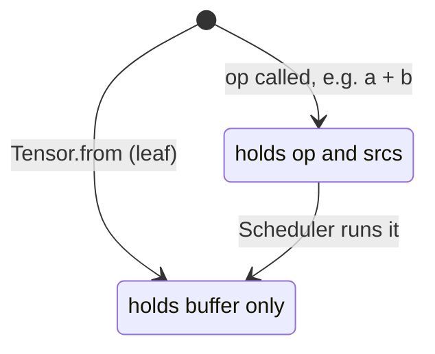

For example, here is the graph for `(a.transpose + c).sum`, before it is realised:

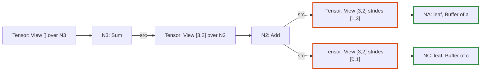

The orange tensors are views (a transpose and a broadcast) that copy nothing. The green nodes hold buffers.

### Views and broadcasting

A `View` maps a logical index onto a position in storage: `offset + Σ index[i] × strides[i]`.

Operation          |Effect on the view (from shape `[2, 3]`, strides `[3, 1]`)
-------------------|----------------------------------------------------------
`transpose`        |shape `[3, 2]`, strides `[1, 3]`                          
`expand([4, 2, 3])`|shape `[4, 2, 3]`, strides `[0, 3, 1]`                    
`slice(1, 1, 3)`   |shape `[2, 2]`, strides `[3, 1]`, offset `1`              
`reshape([3, 2])`  |shape `[3, 2]`, strides `[2, 1]`                          

A stride of 0 re-reads the same element along that dimension. This is how broadcasting works without copying. A slice moves the offset to its first element and shortens one dimension.

For example, here is how two views over the storage `[1, 2, 3, 4, 5, 6]` locate one element each:

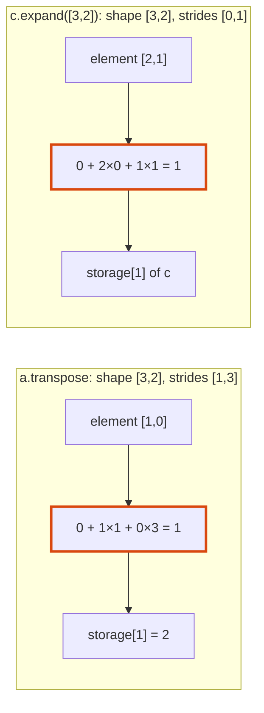

Binary ops broadcast eagerly. `a + b` computes the common shape with NumPy rules, then expands both operands to that shape before building the node. **Kernels therefore only ever see sources whose shape equals the output shape**, with arbitrary strides. Every device inherits that simplification. `matmul` does the same for its leading batch dimensions.

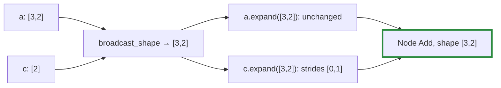

`reshape` is a view whenever strides can express it, as PyTorch's `view` is: it splits and merges dimensions, so each group of old dimensions that new ones merge must be laid out row-major, ignoring dimensions of size 1. Splitting a slice of rows works (`[2, 6]` sliced to `[2, 4]` reshapes to `[2, 2, 2]` with strides `[6, 2, 1]`); flattening a transpose does not, and then `reshape` inserts a `Copy` node first and reshapes the contiguous result. Attention's queries, keys and values are such slices of one projection, and its heads are rejoined by a permute and a reshape that is a view when there is one position. Before views covered them, these were 48 copies in a decoded GPT-2 token, and 36 in a prefill (Decision BF).

## Ops

### Primitive and composite ops

Devices implement only the primitive ops in `Op`. Everything else is a composite: a `Tensor` method that builds a small graph of primitives. A new device therefore needs kernels for the primitives and nothing more.

Kind      |Primitive ops (`Op`)                  |`Tensor` API                                                          
----------|--------------------------------------|----------------------------------------------------------------------
Binary    |`Add`, `Sub`, `Mul`, `Div`, `Maximum` |`+`, `-`, `*`, `/`, `maximum`, with tensors or scalars                
Unary     |`Exp`, `Log`, `Tanh`, `Sqrt`          |`exp`, `log`, `tanh`, `sqrt`, unary `-`                               
Reduction |`Sum`, `Max`                          |`sum`, `max`, with optional `axis` and `keepdims`                     
Structural|`Copy`, `Cat`, `Gather`, `MatMul`     |`contiguous`, `Tensor.cat`, `gather`, `matmul` (with an optional bias)
Adjoint   |`GreaterEqual`, `Unview`, `ScatterAdd`|`greater_equal`; the other two only through `Tensomite.grad`          
Fused     |`Kernel`                              |any `Tensomite.kernel`, such as `gelu`                                
Row       |`Softmax`, `LogSoftmax`, `LayerNorm`  |`softmax`, `log_softmax` and `layernorm` along the last axis          
Composite |none: built from the rows above       |`mean`, `softmax`, `log_softmax`, `cross_entropy`, `layernorm`, `gelu`

- **Scalars** become rank-0 leaf tensors of the operand's dtype (`Tensor.scalar`), which then broadcast like any other tensor. So `x * 0.5` is `Mul` of `x` and a broadcast scalar.
- **Float-only ops** (`/`, `exp`, `log`, `tanh`, `sqrt`, `mean` and the composites) raise `DTypeError` on `I32` when called.
- **One dtype per op.** Every source of an op must share one dtype (`check_compatible`), and `gather` ids are the only exception (`I32`). Decision N in `DECISIONS.md` relaxes this per op for quantised weights in M9.
- **Byte sizes** always come from `DType#bytes_for(count)`, never from a size per element, so block formats with many elements per block fit without changes.
- **`keepdims`** reshapes the reduced result to keep the axis with size 1. The reduction's output is contiguous, so this is a view, not a copy.

For example, `softmax(axis)` expands into five primitive nodes:

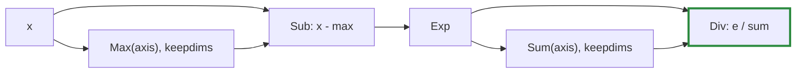

Subtracting the row's maximum keeps `exp` from overflowing without changing the result. `layernorm` and `gelu` expand the same way. Until kernel macros arrive in M7, each primitive node is a separate kernel run.

### The causal mask

`Tensor.causal_mask(rows, cols)` is a leaf built on the host: an `F32` tensor of 0 where a query row may attend to a key column, and -∞ where the column lies in its future. Adding it to attention scores before `softmax` turns masked scores into zero weight.

`cols` may exceed `rows` when a KV cache holds earlier positions. The last row then sees every column, and row `i` sees columns up to `i + cols - rows`:

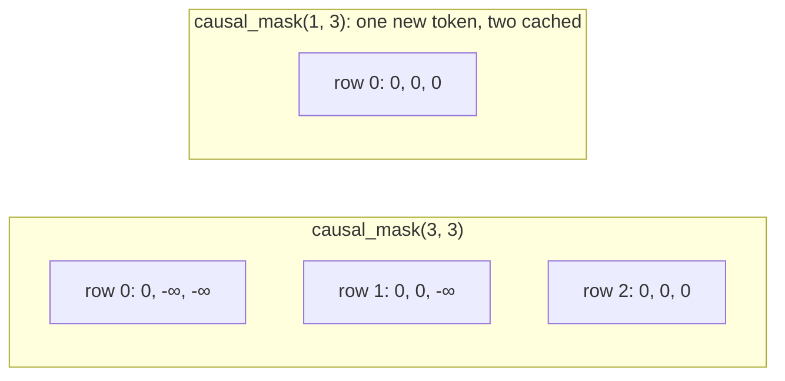

## Devices

### The device interface

The device interface always speaks in transfers, so that discrete-memory devices fit it unchanged:

- **`alloc(bytesize)`:** returns a new buffer that names this device.
- **`upload(buffer, bytes)` / `download(buffer, bytes)`:** copy between the host and the device.
- **`map(buffer)`:** returns host-visible `Bytes`, or `nil` when the memory isn't host-visible. Readers try `map` first and fall back to `download`.
- **`execute(node, output)`:** computes a node into a freshly allocated contiguous buffer, reading its sources' buffers through their views.
- **`sync`:** waits for submitted work to finish.
- **`shape_invariant?`:** reports whether results can depend on the shape of the computation around them, such as batch size (level 2 of Decision K). Features that need level 2 check it (Decision L).

A buffer belongs to exactly one device and records which. A device rejects any buffer it does not own with `DeviceError`.

### Host devices: CPU, SimDiscrete and BLAS

`HostDevice` holds the pure-Crystal kernels. Its subclasses differ in whether the host may see their memory, and in whether any kernel is replaced:

Device       |`map`             |`shape_invariant?`|Purpose                                                      
-------------|------------------|------------------|-------------------------------------------------------------
`CPU`        |returns the buffer|true              |The oracle every other device is tested against              
`SimDiscrete`|always `nil`      |true              |Behaves like a discrete GPU; counts `uploads` and `downloads`
`BLAS`       |returns the buffer|false             |Replaces `F32` `MatMul` with `cblas_sgemm`                   

Every op spec runs on all three. Code that reads a buffer directly instead of going through `map` or `download` passes on `CPU` and fails on `SimDiscrete`, long before a real discrete GPU is involved.

### The BLAS device

`BLAS` is the first device to cross into native code. It is opt-in: `require "tensomite/blas"` links Accelerate on macOS or OpenBLAS elsewhere, so the core shard stays pure Crystal.

It overrides `execute` for one case only, an `F32` `MatMul`, and inherits every other kernel from `HostDevice`, including `I32` matmul. Each batch matrix becomes one `cblas_sgemm` call. BLAS describes a matrix by a pointer, a transpose flag and a leading dimension (the distance between rows), so each operand's view is mapped onto those where possible and copied only where not:

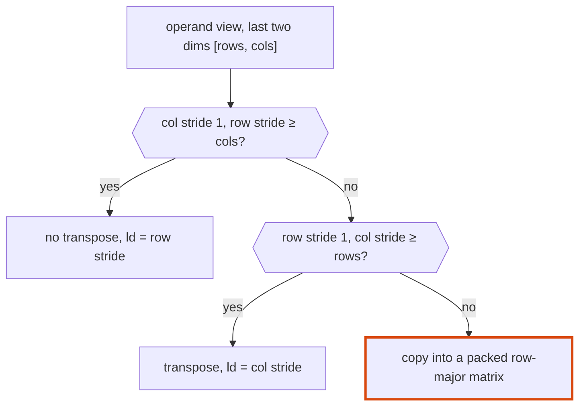

So contiguous, transposed and column-sliced operands pass to BLAS without copying. A broadcast batch dimension (stride 0) is handled by the per-batch pointer. Only a broadcast inside the matrix, such as a row repeated with stride 0, is copied.

Vendor BLAS libraries choose their blocking and threading by shape, so `BLAS` reports `shape_invariant?` false (Decision L). Results repeat exactly from run to run for the same shapes.

### The Metal device

`Metal` is opt-in (`require "tensomite/metal"`) and Apple Silicon only. It is a `HostDevice` too, which is the key to porting one op at a time.

- **Buffers are shared.** Each `MetalBuffer` is an `MTLBuffer` in shared storage, and also a `HostBuffer` over the same bytes. The CPU and GPU address the same memory, so `map` returns it and transfers are plain copies.
- **Ported ops run on the GPU; the rest run on the host, on the same memory.** `execute` looks for an MSL kernel for the node. If there is one, it encodes a dispatch. If not, it waits for the GPU and runs the inherited host kernel. Porting an op therefore changes where it runs, never whether it runs, and every op works from the first PR.
- **Dispatches are batched.** Kernels are encoded into one open command buffer, which is committed and waited for only when the host next needs memory: a host kernel, `map`, `upload`, `download` or `sync`. The encoder dispatches serially, so each kernel sees its predecessors' results.
- **Kernels are MSL source**, in `metal/kernels.metal`, embedded at compile time and compiled by the driver when the device is created, with fast math off. Each thread computes one output element and reads its sources through their views, with the same arithmetic as `View#offset_of`, so any view the host accepts works on the GPU (up to 8 dimensions).

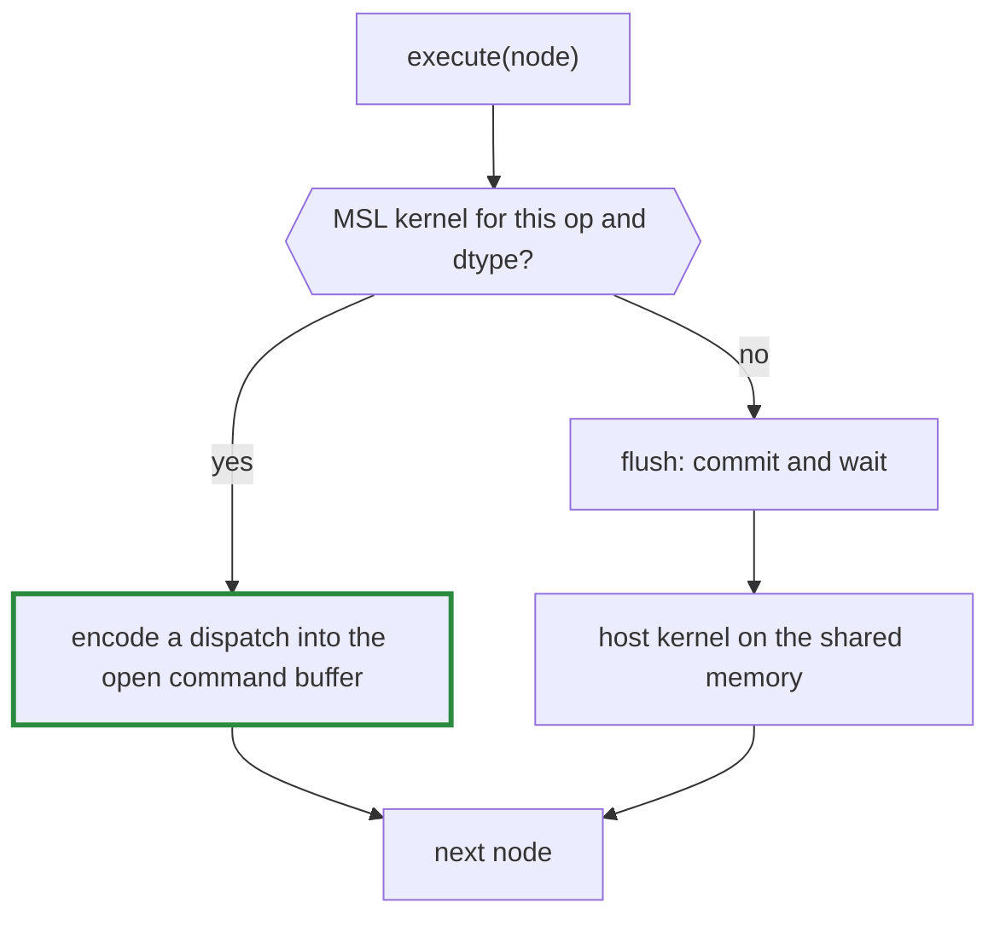

**Determinism.** Addition, subtraction, multiplication and comparisons are correctly rounded IEEE operations, so they give the same bits on the GPU as on the CPU, and `spec/gpu_spec.cr` checks them for equality. Division and the transcendental functions use the GPU maths library and are compared within 1e-6 (level 3 of Decision K). `MatMul` splits its sums across threads and is compared within 1e-5 (Decision S, below). Every kernel computes each element on its own, so the device is [shape-invariant](#glossary).

**Calling Objective-C from Crystal.** Metal has no C API, so `metal/objc.cr` sends messages through `objc_msgSend`. That function must be called with the exact C signature of the method it reaches, and Crystal does not allow one C symbol to be declared with several signatures. So `ObjC.send(ReturnType, receiver, "selector:", args...)` casts its address to a `Proc` typed by its arguments, one type per call site. `NSUInteger` is `UInt64`, `BOOL` is passed as `UInt32`, and `MTLSize`, a 24-byte struct, is passed as a pointer, as arm64 passes structs over 16 bytes. Objects the runtime autoreleases are created inside `ObjC.autoreleasepool`, and those kept beyond it are retained.

**Kernels that add.** Each of these kernels combines in a fixed order. `ScatterAdd` and `Unview` add in the host's order and are bit-identical to it; `Sum` and `Max` work in [chunks](#glossary) (below):

Op          |Threads                                                                                  |Each thread                                                                                                                                         
------------|-----------------------------------------------------------------------------------------|----------------------------------------------------------------------------------------------------------------------------------------------------
`Sum`, `Max`|one threadgroup per output, a thread per chunk of 16 (one thread for a run of 16 or less)|folds whole chunks in index order; the first thread folds the chunk results in chunk order                                                          
`ScatterAdd`|one per column, or into one column one per id, after one per element to zero the output  |adds the source rows into the rows their ids select, in order; into one column, the thread of each id's first occurrence adds all of its occurrences
`Unview`    |one per output position                                                                  |inverts the view to find which logical elements read the position, and adds them in logical order                                                   

`Unview` inverts a view by decomposing `position - offset` over the dimensions with a nonzero stride, largest first. The dimensions with stride 0 are the ones that repeat a position: their indices are walked in row-major order, which is logical order. The decomposition is unique when each stride exceeds the furthest the smaller ones can reach together. Every view tensomite builds satisfies that, and a view that did not would run on the host.

**Reductions in chunks (Decision X).** One thread per output made a long reduction slow: each of a GPT-2 layer norm's means was a single thread adding 768 numbers one after another, 126 µs each and 57% of a decoded token's GPU time. Each output now has a threadgroup, with each thread folding chunks of 16 at fixed offsets. As with [split-K](#glossary), chunk boundaries never depend on the run's length or on the number of threads, so a row padded with zeros (or, for `Max`, with -∞), as a masked attention row is, keeps its bits, and prefill still equals decode. `Max` is exact in any order and still matches the host bit for bit. `Sum` of more than one chunk adds in a different order from the host's and is compared within 1e-5. A run of one chunk or less (16 elements) keeps one thread per output, which is the host's arithmetic exactly. Within a run along the last axis, threads step by the view's stride rather than calling `offset_of` for every element.

**Errors.** A GPU kernel cannot raise. `Gather` and `ScatterAdd` report an id out of range through a small shared error buffer, and `flush` raises the host's `ExecutionError` when it finds a report. The error therefore surfaces when the command buffer completes, at `realize`, as it does on the host. One difference remains: the nodes encoded before the error are marked realised, with undefined contents for the failing one.

**`MatMul`** has five modes (`Metal#matmul_mode`). A matrix-vector product (`m` = 1), which is what decoding mostly does, has too few outputs to fill the GPU with one thread each; a prefill has enough outputs that reading the operands, not adding them, is the cost:

Mode            |Work per thread                                                                                        |How partial sums combine                     |Bits                                                           
----------------|-------------------------------------------------------------------------------------------------------|---------------------------------------------|---------------------------------------------------------------
`Serial`        |one output, adding over all of `k` in order                                                            |none                                         |identical to the host                                          
`Split`         |whole chunks of 64 along `k` for one output, 8 threads per output                                      |one thread adds the chunks in chunk order    |repeat every run; independent of `m` and of zero-padding of `k`
`Atomic`        |as `Split`                                                                                             |atomic adds, in whatever order threads finish|may change from run to run; for measurement only               
`Tiled`         |a 4×4 [patch](#glossary) of outputs, reading operands from [tiles](#glossary) shared by its threadgroup|each output adds its chunks in chunk order   |identical to `Split`                                           
`Auto` (default)|`Tiled` for 16 rows or more, `Split` below                                                             |as the mode chosen                           |identical to `Split`                                           

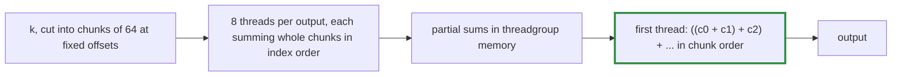

- **Why chunks, not slices.** Cutting `k` into 8 equal slices would move the boundaries whenever `k` changes. In attention, `scores · v` sums over the sequence: in prefill, a position's row has zeros for the masked positions after it, and in decode the same position's row simply stops there. Chunks at fixed offsets give both rows the same chunks, plus chunks of exact zeros in prefill, and `x + 0 = x`. So prefill and decode stay bit-identical (`spec/gpt2_spec.cr`, and the padding spec in `spec/metal_spec.cr`).
- **Coalesced reads.** A threadgroup owns 32 adjacent output columns of one row, so the 32 threads working on the same chunk read 32 adjacent columns of the weights at a time.
- **Decision S.** Splitting changes the order of additions, so `Split` no longer matches the host bit for bit: `spec/gpu_spec.cr` compares matmuls within 1e-5. Levels 1 and 2 of Decision K still hold, which is what caching and reproducibility need.
- **No fused multiply-add.** Each product and running sum are separate statements, so the compiler cannot fuse them into one rounding. That is what keeps `Serial` identical to the host.

**Tiled matmul (Decision AD).** In a prefill each weight is used by every token, yet `Split` reads it from memory once per output. The tiled kernel (`matmul_tiled` in `metal/kernels.metal`, an MSL template) gives each threadgroup a block of outputs (`Metal#matmul_tile`: 64×64 by default, or 32×32 and 32×64 for comparison) and each thread a 4×4 patch of it. For each tile of `k` the threadgroup copies a block of `a` and of `b` into threadgroup memory, every element once, along whichever index is contiguous in memory, so the head's transposed embedding loads as well as a plain weight; then every thread reads its operands from there. Each value fetched serves a whole row or column of the block, not one output. Larger patches, 8×4 and 8×8, were measured on a training step's products in Decision BR: 8×8 ran 2–3 times slower, I think from the registers its 128 accumulators need, and 8×4 was within noise of 4×4, so 4×4 stays.

Tiling changes where operands are read from, not the order they are added in. Each output still sums every chunk of 64 from zero in index order, then adds the chunk sums to its total in chunk order, and never reads past `k`; it even adds the exact zero split-K adds for chunks past `k` when their number is not a multiple of 8, which matters only for a total of `-0`. So `Tiled` gives `Split`'s bits, and `Auto` can choose between them by speed alone: prefill (tiled) and decode (split) stay bit-identical (`spec/metal_spec.cr`). What this rules out is Apple's 8×8 matrix instructions (`simdgroup_matrix`), whose internal order of addition is not specified.

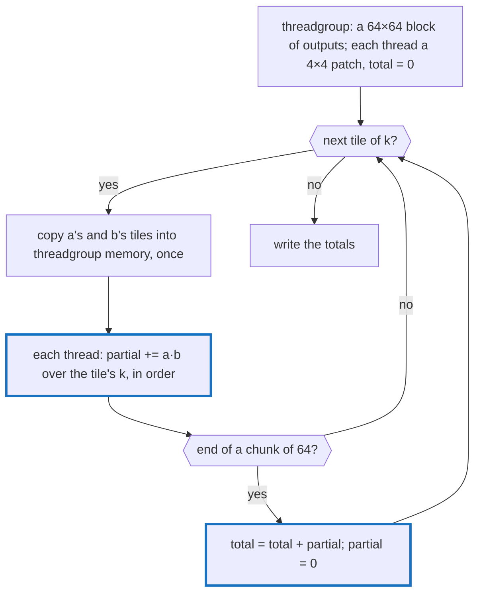

The kernel was checked before it first ran on a GPU by compiling the MSL source as C++ with each threadgroup's threads as OS threads and real barriers: every tile matched `Split` bit for bit on odd sizes, batched and transposed operands, while `Serial` differed whenever `k` > 64.

**Profiling.** Setting `Metal#profile` to a `Metal::Profile` collects where time goes: seconds spent encoding dispatches, allocating and waiting for the GPU, the number of dispatches and command buffers, the buffers allocated, those the pool could not serve and those released, and the wall time of each op that ran on the host. With `per_kernel: true`, every op is committed alone and its GPU time recorded under its op's name, which slows the run but shows the GPU's own cost per op; with `shapes: true` as well, under its shapes too, such as `MatMul [128,768]·[768,50257]`. `Metal::Profile.report` prints both, and `CUDA::Profile.report` the same tables for CUDA, through `ProfileReport`: the wall time by part, then GPU time by op and by op and shape, with each matmul's rate. `bench/profile_decode.cr` prints it for a decoded GPT-2 token, or with `--prefill N` for a prefill of N tokens, and `examples/shakespeare.cr --device metal --profile N` for N training steps (Decision BH).

The atomic kernel needs `atomic_float`, from Metal 3. Without it the device still works, and only `Atomic` raises.

Every op now has an `F32` Metal kernel. `I32` ops, views of more than 8 dimensions and overlapping views run on the host.

> [!NOTE]
> **Why this design?** Two matmul changes expected to help did not:
> - `Atomic`, which adds partial sums with atomics rather than in chunk order, saved at most 8% of a product in M6, so `Split`'s fixed order stays the default.
> - Larger [patches](#glossary) per thread: 8 × 8 ran 2–3 times slower on every product, I think because its accumulators cost the GPU its threads in flight, and 8 × 4 gained within the noise. `T64x64`'s 4 × 4 stays (Decision BR; [Q-AZ](faq/q-az-bigger-patches.md)).

### Moving data between devices

An op whose operands are on different devices raises `DeviceError`. Data moves only through an explicit `Tensor#to(device)`, which realises the source, copies it through host memory and returns a realised leaf on the target:

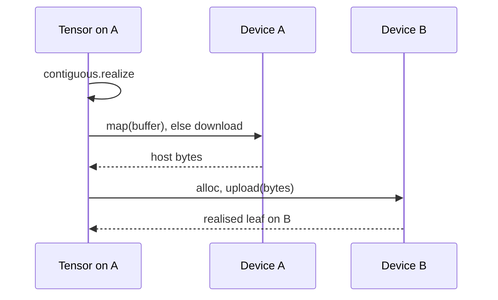

`to` is eager, unlike other ops, because a transfer between devices is a synchronisation point anyway.

### Host kernels

The host kernels are deliberately naive, and they run in a fixed order. That gives level 1 determinism from Decision K: the same inputs give the same bits on every run. Their order of arithmetic also never depends on shape, which is the basis for level 2 later.

- **Kernel structure.** `execute` dispatches on `DType` to a generic method, `execute(Float32, …)` or `execute(Int32, …)`, which dispatches on `Op`. A buffer's bytes are read as `Slice(T)`. Results are converted with `T.new(...)`, so every branch compiles for every dtype; float-only ops never reach an integer kernel because they are rejected when called.
- **Indexing in [runs](#glossary).** Kernels walk logical indices in order, in runs that each view can step through with a fixed stride. When every view involved is dense or constant, the run is the whole tensor. Otherwise it is the last dimension. `View#offset_of` finds each run's start, once per run rather than once per element. The order of arithmetic is the same as indexing every element, so the results are bit-identical, and strided reads are three to five times faster.
- **Pointers within a run.** A kernel checks a run's first and last positions against each buffer once, then reads and writes through pointers, with a separate loop for unit strides. Without a bounds check on every element LLVM vectorises those loops, which made elementwise ops three to four times faster (2.8 to 0.7 ns per element for `Mul` in training).
- **Transcendental functions** (`exp`, `log`, `tanh`) are tensomite's own, in `Tensomite::Maths` (Decision Y): range reduction and a short polynomial, written with selects rather than branches so the loops around them vectorise, each within 2 ulp of the correctly rounded result (`spec/maths_spec.cr`). Inputs whose results would be subnormal are never computed with, because arithmetic on subnormals is about 100 times slower on x86; that mattered for the `-inf` of the causal mask. `sqrt` stays `Math.sqrt`, which compiles to one instruction.
- **Reductions.** The reduced axis is permuted to the end of the source view, so each output element reads one run of consecutive logical indices. `Sum` folds the run from zero, and `Max` from its first element. A reduction over all elements is the same loop with a single output.

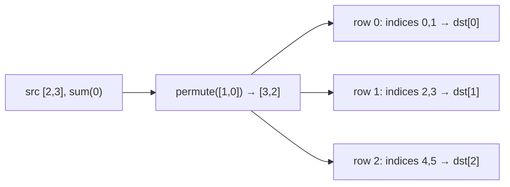

- **`Cat`** writes each source through a *slice view of the output*, so the same indexing code that reads views also writes them.
- **`Unview`** zero-fills its output, then adds each source element at the position its view reads, in index order. **`ScatterAdd`** does the same for whole rows. Both add in a fixed order, so gradients are deterministic too.
- **`Gather`** copies row `ids[i]` of a 2-D table into output row `i`. An id outside the table raises `ExecutionError`.
- **`MatMul`** computes each output as a dot product over `k`, added in index order. Its sources arrive already expanded to the common batch shape. It is the one kernel that does not call `offset_of` per element: it finds where each batch matrix starts, then walks rows, columns and `k` with the sources' strides directly. The order of additions is unchanged, so the result is bit-identical to indexing each element (`spec/host_kernels_spec.cr`), and about 10 times faster.

### Quantised products

`BlockMatMul` is `x · wᵀ` for a weight in a [block](#glossary) format (`Tensor#linear`). Every device computes it as ggml's reference code does, and the host's `Quant.matmul_reference` is the [oracle](#glossary):

1. Each row of `x` is quantised to `Q8_0` a block at a time (`Q8_1`, which also keeps `d · Σq`, for `Q4_1` weights).
2. Each output is a sum over blocks, in block order: the block's integer dot product, then its two scales and, for `Q4_1`, the minimum.

The integer part can be added in any order without changing a bit; the sum over blocks cannot ([Q-CE](faq/q-ce-integers-in-any-order.md)), so every kernel keeps the block order.

- **On the host,** `Quant.matmul` gives the oracle's bits faster. Dense activations are read in place and quantised through pointers. Each block's dot product is taken on signed bytes, its nibbles unpacked less 8, which LLVM turns into `sdot` under `+dotprod` or `--mcpu=native`. Two weight rows share each pass over the activations, and `F16` scales come from `HALVES`, a table of every half's value.
- **Threads.** `Quant.in_parallel` cuts a product's outputs into [spans](#glossary), up to 4 a thread and at least 64 KB of weights each, so faster cores take more of them. A `SpinPool` of `TENSOMITE_THREADS − 1` workers, each in its own isolated execution context, spins on one atomic word holding the product's generation and its next span; the calling thread works too. A span is claimed by compare-and-set, so a claim for a finished product fails. An idle worker naps, each nap twice the last, up to 10 ms.
- **On GPUs,** a pass quantises the activations, then the product runs one thread per output, or, for fewer than 65,536 outputs, 32 [lanes](#glossary) per output, each taking whole blocks (`BlockMatMulMode`). CUDA multiplies four byte pairs an instruction with `__dp4a`, one output a warp; Metal reads a byte at a time. `Unordered` adds in a tree, for measurement only.

> [!NOTE]
> **Why this design?** Each of these was expected to help and did not:
> - A parked pool (`Fiber::ExecutionContext::Parallel`): no gain on the M5 Pro and a loss on the GB10, since a product's spans take 50–200 µs and parked threads woke after the first had done them all. More spinning threads than cores was worse still, so the workers are one fewer than the threads (Decision DD).
> - Widening `F16` scales in registers, exactly, by a multiply by 2¹¹²: about 1 ns more a scale than the table, one scale every 32 weights, 3–5 ms a token on SmolLM2-1.7B ([Q-CI](faq/q-ci-tables-against-arithmetic.md)). `llvm.convert.from.fp16` would give one `fcvt`, but some LLVMs Crystal links do not accept it (Decision DF).
> - `--mattr=+dotprod` alone, while the nibbles were unsigned: LLVM had no instruction for unsigned by signed bytes short of `usdot`, so nothing changed (Decisions DE and DF).
> - Quantising the activations inside each product's kernel, to save a dispatch: every threadgroup quantised the whole row again, and the products took twice as long (Decision DB).
> - On Metal, `__dp4a` emulated with shifts, exact float sums, 32 outputs a group, and padding against bank conflicts: each slower than the byte-at-a-time kernel. On CUDA, grouping 2, 4 or 8 outputs was no faster than one (Decisions CW and CX).
> - 32 lanes per block, adding their products across the warp: exact, but five shuffles a lane per block halved decode on the GB10 (Decision CO).

### CUDA

`src/tensomite/cuda.cr` reaches NVIDIA GPUs through CUDA's driver API (Decisions AS to AV). M8's first part is the layer under the device to come:

- **Linked, opt-in.** `-Dcuda` links `libcuda` and `libnvrtc` (Decision AV); without the flag, requiring the file is a compile error. The bindings name the exported symbols, so `cuMemAlloc_v2` rather than the header's `cuMemAlloc`.
- **Compiled by NVRTC on first use** (Decision AU), from CUDA C++ to PTX, with `--fmad=false`, so a multiply and an add round separately, as on the host and as MSL does with fast math off. PTX targets the newest architecture NVRTC supports at or below the GPU's (`CUDA.target_arch`); the driver compiles it to the GPU's machine code when the module loads.
- **A primary context per GPU** (`CUDA::Context`): device memory, synchronous copies, loaded modules and launches. A context is current per OS thread, and Crystal moves a fiber between threads (in 1.22, after a file write), so each call makes the context current when the calling thread differs from the last one's; the host stub keeps a current context per thread, so the specs catch a call that skips it. Launch arguments are passed as pointers to their values, as `cuLaunchKernel` expects.
- **Explicit transfers, even on shared memory.** The DGX Spark's GPU shares memory with its CPU, but tensomite allocates device memory and copies to and from it as on a discrete card, so one code path serves both (Decision AS).
- **The `CUDA` device** is a `HostDevice` whose buffers live in device memory, so every op without a CUDA kernel runs the host kernel and gives the host's bits. A `CUDABuffer` keeps a host copy, made when a host kernel first reads it and valid until the device memory is written again:

  ```mermaid
  flowchart LR
      U["upload"] --> D["device memory current<br/>host copy stale"]
      D -->|"a host kernel reads it"| B["download once:<br/>both current"]
      B -->|"another reader"| B
      B -->|"upload, or a CUDA kernel writes it"| D
      H["a host kernel writes it"] -->|"upload the result"| B
  ```

  So a graph of host ops downloads each source once, not once per reader, and uploads each output once. Device memory comes from a pool, as on Metal. A buffer's finalizer hands its memory to a retired list, which the device moves into the pool at its next allocation or sync. If the list is busy, the finalizer frees the memory at once instead, making the context current on its thread first, so it never waits.
- **Kernels** (`cuda/kernels.cu`) are ports of the Metal ones: elementwise arithmetic and comparisons, `exp`, `log`, `tanh`, `sqrt`, copies and `Cat`, `Sum` and `Max` in chunks of 16 at fixed offsets, `Gather`, `ScatterAdd` and `Unview`. Views reach them as a struct of 19 integers, passed by value. They are compiled once, on the first op, for the GPU's architecture, and queued in order on the default stream; a plain copy to or from the host waits for the kernels before it, so no explicit stream is needed yet. `Gather` and `ScatterAdd` report an id out of range in a small error buffer, which `sync` reads and clears, raising `ExecutionError`. - **Matmul, row ops and macro kernels** are ports too. `MatMul` has Metal's modes (`CUDA::MatMulMode`): serial, with the host's bits; split, in chunks of `k` at fixed offsets; and tiled, in the three tile sizes of `CUDA::MatMulTile`, with split's bits, so `Auto` picks tiled at 16 rows or more and split below, and a tiled prefill gives a split decode's bits. Softmax, log-softmax and layernorm fold rows in chunks as the reductions do, so a row padded with `-inf` keeps its bits. `Kernel#cuda` emits a macro kernel as CUDA C++, one statement per operation, as `#msl` emits MSL; each is compiled on its first launch and kept. With these, GPT-2's forward pass runs no host ops on CUDA.
- **Testing without a GPU.** `scripts/cuda_stub/libcuda.c` stands in for the driver: one "GPU" whose memory is host memory. It cannot run PTX, but with `TENSOMITE_CUDA_KERNELS` it loads `prelude.cu`, `kernels.cu` and every macro kernel's CUDA C++ (written out by `scripts/cuda_stub/macro_kernels.cr`), compiled as host C++ behind `emulate.h`. That header defines CUDA's built-ins and runs a block's threads in a loop, or, for a kernel with shared memory, as one OS thread per GPU thread, all meeting at a barrier inside the kernel and between blocks. NVRTC, from PyPI, still compiles the real source. So CI compiles every kernel, runs each on the host, and compares it with the CPU in `gpu_spec`, as `scripts/emulate_metal` does for MSL. What it cannot catch is a difference in CUDA's own semantics, such as its maths library; the GB10 runs the same specs on the real GPU.

> [!NOTE]
> **Why this design?** Two decode changes expected to help did not:
> - Narrower split blocks, 16 or 8 columns, to give few-row products more blocks: they read weights at 71–202 GB/s against 160–209 for 32 columns, since a warp of 32 columns reads 128 adjacent bytes at a step (Decision BE).
> - A first fused bias, read through a general view with integer divisions per output, cut prefill on the GB10 by a third; the bias is now a contiguous `[N]` read as `bias[col]` (Decision BF).

## Realisation

`Scheduler.realize(node)`:

1. **Order.** A depth-first walk, with an explicit stack so that deep training graphs cannot exhaust the call stack, lists the unrealised nodes reachable from the root, in topological order. A node shared by several consumers is listed, and computed, once.
2. **Run.** For each node: allocate an output buffer on its device, `execute`, then mark the node realised, which drops its sources.
3. **Wait.** Call `sync` on the root's device.

`Tensor#to_a(T)` realises the tensor, then reads the buffer (through `map` or `download`) in the view's logical order.

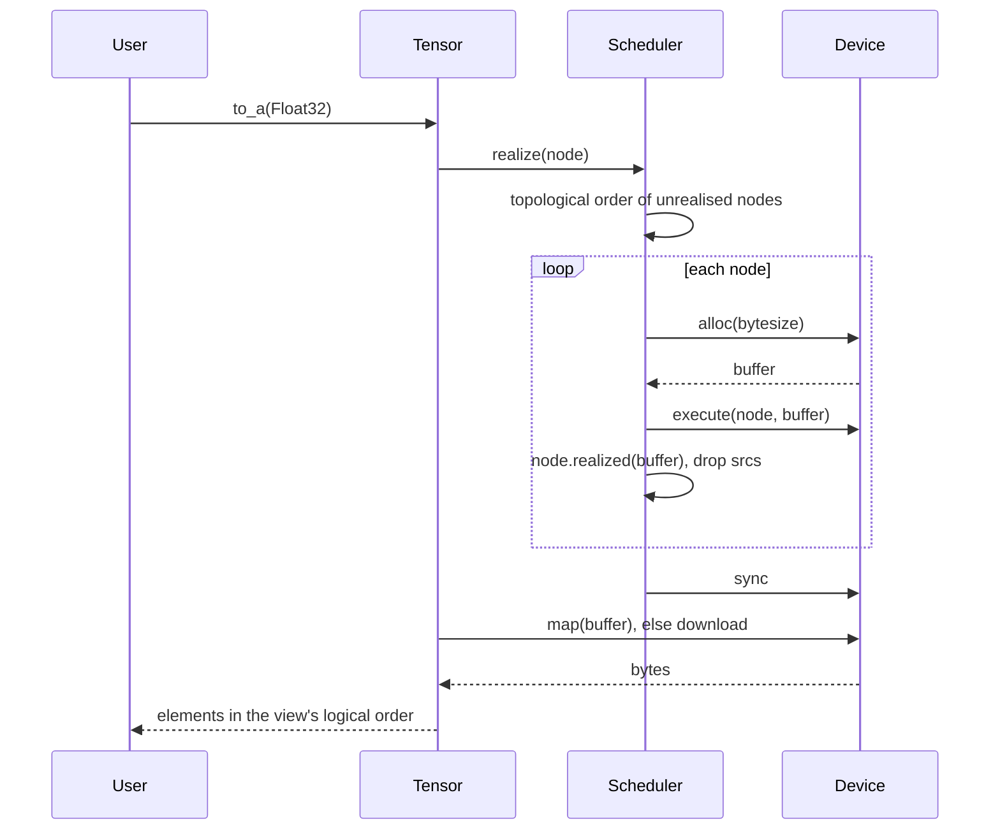

If a kernel raises, the nodes before it stay realised and the failing node stays unrealised.

### Buffer pool

A graph built anew every step, as in training or decoding, would allocate a fresh buffer for every node, every time. Instead, each host device and `Metal` keeps a `BufferPool` of freed memory, keyed by exact size (Decision U):

1. **Giving back.** When the collector finalizes a buffer, its finalizer hands the memory to the device's pool. A buffer is collected only once nothing can reach it, so reuse is always safe. Memory from a file mapping is never pooled.
2. **Taking.** `alloc` takes memory of the exact size from the pool when there is some, and allocates otherwise. A pooled buffer's old contents remain, which is why `Device#alloc` promises nothing about contents and every kernel writes all of its output.
3. **Threads and re-entrancy.** A finalizer can run in the middle of any allocation, including one made by the pool itself, and on any thread: in Crystal 1.22 the execution-context monitor thread runs them too, while the main thread is computing. So the pool is guarded by an atomic try-lock and never waits. While one caller holds it, `take` misses, and the caller allocates, and `give` declines, and the memory is freed. Before this lock, a race between the two threads corrupted the free lists, about once in 30 runs of `gpt2_spec`, and once in a 5,000-step training run.
4. **On Metal and CUDA**, finalizers only queue a buffer in a `RetiredList`. The device's own thread drains it into the pool at the next allocation or sync, or on Metal when no GPU work is pending, because the GPU may still be reading a buffer. A finalizer can run inside another finalizer's allocation on the same thread, so the list never allocates: it fills one of two fixed arrays, of 16,384 entries, and draining swaps them. When the list is busy or full, the finalizer frees the memory at once instead: Metal releases the `MTLBuffer`, which is safe because command buffers retain what they use, and CUDA frees it with `cuMemFree`, which waits for the GPU. The pool holds the `MTLBuffer`s and device pointers themselves.

   Until Decision BG, the retired list was a growable array, replaced by an empty one at each drain. Appending to it allocated, the allocation ran the other waiting finalizers inside the first, and each of those found the list held and freed its memory. On CUDA almost every buffer was freed rather than pooled: in a training step on the stub, 416 of 429 allocations missed the pool, and on the GB10 allocating took 17 of the step's 109 ms.
5. **A limit** bounds what a pool holds: 1 GiB on host devices, and on CUDA and Metal a quarter of the GPU's memory (on Metal, its recommended working set), if that is more. A training step frees more than 1 GiB on GPT-2 small, so a 1 GiB pool sends most of it back to the driver and the next step allocates it again: With a 1 GiB limit, Metal missed its pool 673 times a step on GPT-2 small, about 22 ms of allocating on the M5 Pro; CUDA, with a quarter of the GB10's memory, missed none. With a quarter of its working set, Metal misses none either: 0 of 1,066 allocations, 0.2 ms.

Reuse lags by one collection: memory comes back only when the collector runs. A training loop that collects once per step (`examples/shakespeare.cr`) gets most of its buffers back before the next step; on the Linux container, that took a step from 744 to 470 ms, with identical losses.

**Releasing within a realize (Decision CD).** The collector cannot see device memory, and it is conservative: a stale pointer to any collection that holds a step's nodes, such as the scheduler's list or autograd's table of gradients, keeps every buffer of the step. On GPT-2 large that is about 60 GB, and the GB10 killed runs that held two steps at once. So `Tensor.realize(tensors, release: true)`, which `Optimizer#step(loss)` uses, does not leave intermediates to the collector:

1. Before running, it counts how many nodes of the realize read each node.
2. After each node runs, it counts down its sources, and releases each with no readers left: `Buffer#release` gives the memory back now, and finalizers skip a released buffer.
3. Roots keep their buffers, as do `Write` nodes and the buffers they write into. A released node raises `Error` when read or computed, rather than reading memory reused since.

Memory released mid-step goes back through the same path as a finalizer's, so later nodes of the step can reuse it: the forward pass's activations are reused as the backward pass finishes with them. That is safe because each device runs work in the order it is submitted, one CUDA stream and one Metal queue, so a buffer still being read by a queued kernel is only overwritten by work queued after it. A second stream would break this. Metal moves retired buffers into its pool only when the GPU is idle, so there the release happens within the step but reuse waits for its end. Measured on BLAS, three training steps of GPT-2 small at batch 2 × 128: the peak fell from 5.5 to 3.2 GB, and memory held after a step from 4.2 to 2.3 GB. On the GB10, GPT-2 large at batch 4 × 512 takes 2,395 ms a step, from 2,624, with the same losses to the last digit printed.

**Batched commits on Metal.** The device commits its command buffer every `commit_every` dispatches (64), without waiting, and starts a new one. The GPU therefore starts work while the host is still building and encoding the rest. A queue runs its command buffers in order, with Metal tracking each buffer's readers and writers across them, so results are unchanged.

## Kernel macros

`Tensomite.kernel(name) { |x, …| expression }` fuses an elementwise expression into one primitive, `Op::Kernel`: one pass over memory on host devices and one dispatch on Metal, instead of a node per operation (Decision J). `Tensor#gelu` is the first: eight primitives become one kernel.

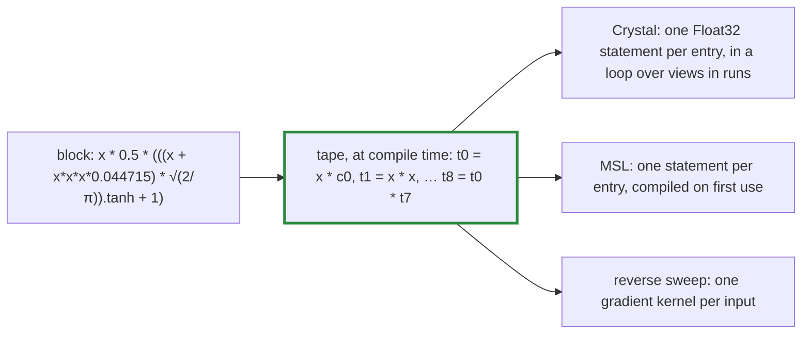

1. **The tape.** The macro walks the block's syntax tree in post order, with an explicit stack, because the macro language has no recursion that returns values. Each operation becomes one tape entry with its own temporary, in Crystal's own order of evaluation, so `x * x * x` is `(x · x) · x`, as the composite computes it.
2. **Constants.** A subexpression without inputs, such as `Math.sqrt(2 / Math::PI)`, is computed once in `Float64` and converted to `Float32`, which is exactly how `Tensor.scalar` converts a number operand.
3. **The host loop** computes each entry in `Float32`, and Crystal never fuses a multiply and an add. So a kernel gives **the same bits as the composite it replaces**, and the composite is its oracle (`spec/kernel_spec.cr`). `tanh`, `exp` and `log` call the same `Tensomite::Maths` functions as the host kernels, and `sqrt` the same `Math.sqrt`.
4. **MSL** puts one statement per entry, so the Metal compiler cannot fuse operations either; only the maths library's functions differ from the CPU's. `Metal` compiles a kernel's source, after `metal/prelude.metal`, the first time the kernel runs, and caches the pipeline.
5. **Gradients.** A reverse sweep over the tape applies each operation's chain rule: the output's gradient spreads to its operands, and contributions to one value are added in the order the sweep meets them. Each input gets its own gradient kernel, whose inputs are the output's gradient followed by the kernel's inputs. Autograd's rule for `Op::Kernel` applies them, so a kernel needs no hand-written backward. Gradient kernels have no gradients of their own.

The expression language is deliberately small: `+`, `-` (binary and unary), `*`, `/`, number literals, constant paths such as `Math::PI`, and `tanh`, `exp`, `log` and `sqrt`. Anything else fails at compile time with the offending expression. Inputs broadcast like a binary op's, and must be `F32` on one device.

## Fused row ops

`softmax`, `log_softmax` and `layernorm` along the last axis are one primitive each (Decision T), in place of five to eight. Along another axis, or with weights of another shape, they fall back to their composites.

- **On host devices,** each row is one loop that does the composite's operations in the composite's order, so a fused op gives the composite's bits. The composites in `spec/row_ops_spec.cr` are the oracles.
- **On Metal,** each row gets a threadgroup that makes three passes over it: reduce, write, normalise. The reductions are the chunked ones of "Reductions in chunks", so a softmax row padded with -∞, as a masked attention row is, keeps its bits, and prefill still equals decode. In the last pass, each thread rewrites only the elements it wrote itself.
- **Attention's scale and mask (Decision BO).** `softmax(scale: s, mask: m)` is the softmax of `x · s + m`, with `m` broadcast to `x`'s shape. Along the last axis it is one `Softmax` node with the mask as a second source and the scale on the node; each kernel computes `x · s`, then `+ m`, as separate statements, as it reads each element, so the bits are those of a `Mul`, an `Add` and a `Softmax`. Attention's scores no longer make two extra passes over a `[batch, heads, length, positions]` tensor. With `SoftmaxGrad`, measured on the larger model: a step takes 19.6 ms on the M5 Pro, from 20.5, and 13.6 on the GB10, from 14.3. The GB10's `Softmax` is unchanged at 0.65 ms, as reading the mask costs it little more traffic; the M5 Pro's grows from 0.43 to 0.59. Not from `offset_of`, as first guessed: it runs once per row. Each element's `x · scale + mask` is computed in both of the kernel's passes, loading `x` and the mask each time, and Metal waits for each load in turn (see Q-AS). Storing the values in the max pass and reading them back in the exponential pass was tried (Decision BQ): 0.54 ms on the M5 Pro, but 0.94 on the GB10, from 0.65, which is bound by memory and paid for the extra write and read of 6.3 MB per layer. So both kernels still compute the values twice. `SoftmaxGrad` takes 0.25 and 0.36 ms for the four layers, against about 1.2 for the five ops it replaced.
- **Backward rules** are checked by finite differences. Softmax's is one fused op, `SoftmaxGrad`, from the output's gradient `g` and the softmax's output `y`: it adds `g · y` along each row in the order a `Sum` adds them (sequentially on host devices, in chunks of 16 on the GPUs), then writes `y · (g - Σ)`, times the scale, so its bits are those of the five primitives it replaces. The mask's gradient is the same without the scale. Log-softmax's is `LogSoftmaxGrad`, the same pattern: it adds `g` along each row in `Sum`'s order, then writes `g - exp(y) · Σ`, with each device's own `exp`, in place of four ops that each passed over cross-entropy's `[rows, vocabulary]` logits. On the M5 Pro, for GPT-2 small at batch 8 × 256, it takes 5.8 ms where the four took 12.3, and a step 738 ms rather than 745. Layer norm's input gradient is another, `LayerNormGrad` (Decision BP): each row recomputes the mean and the deviation as the composite does, with its sums in `Sum`'s order, then `ĝ = g · weight`, the means of `ĝ` and `ĝ · x̂`, and the gradient, in about one launch for the sixteen primitives it replaces; with `x` as its only source, the same op writes `x̂`, which the weight's gradient multiplies by `g`. `LogSoftmax`'s is built from primitives:

  Op         |Gradient of the input
  -----------|-----------------------------------------------------------------------
  `Softmax`  |`y · (g - Σ g·y) · s`, per row, fused
  `LogSoftmax`|`g - exp(y) · Σ g`, per row, fused
  `LayerNorm`|`(ĝ - mean(ĝ) - x̂ · mean(ĝ · x̂)) / σ`, with `ĝ = g · weight` and `x̂ = (x - mean) / σ`, fused

  The weight's gradient is `g · x̂` and the bias's is `g`, in the expanded shape, so that accumulating them sums over the rows.

> [!NOTE]
> **Why this design?** Two fusions saved less than expected at first:
> - The first fused row ops removed half of a decoded token's dispatches but little GPU time: a layer norm of 768 ran on 12 threads, each reading [chunks](#glossary) of 64 through `offset_of`. More threads, with chunks of 16 and stride indexing, did what fusing had promised (M7 part 5 in `PLAN.md`).
> - The first fused attention kernel found every key and value with `offset_of`'s divisions and left each output column's sum to one thread: 1.73 ms a token on the GB10 and 1.33 on the M5 Pro, against 0.73 and 0.92 for the three ops it replaced. Stepping by stride and sharing each column's sum gave 0.42 and 0.70 (Decision CZ).

## Dropout

`Tensor#dropout(rate, seed:)` zeroes a share *rate* of a tensor's elements and divides the rest by `1 - rate`, one primitive, `Op::Dropout` (Decision BY). Its mask comes from no random numbers at all: element *i* is kept when a hash of `(seed, i)`, two rounds of `lowbias32` in wrapping 32-bit integer arithmetic, is at least `rate · 2³²`. Integer arithmetic is exact on every device, so the CPU, Metal and CUDA make the same mask from the same seed, with nothing generated on the host or uploaded, and `gpu_spec` checks it bit for bit. The gradient is the same op, mask and scale on `g`. `Tensomite::Dropout` gives each use within a forward pass a seed of its own, mixed from one seed and a count of uses, so a forward pass that applies it in the same order makes the same masks. GPT-2 applies it where Hugging Face's does: after the embeddings, to each block's attention weights, and after each attention and MLP; only when given one, so inference never drops anything. `apps/finetune` seeds each step's from the run's seed and the step, so resumed runs keep their bits.

## Autograd

`Tensomite.grad(loss, params)` returns the gradient of a one-element `loss` with respect to each param, as lazy tensors. It is a graph transform: it reads the unrealised graph behind `loss` and builds a second graph of ordinary primitive ops beside it. Nothing runs until a gradient is realised, and devices need no autograd code at all.

1. **Order.** List the nodes behind `loss` in topological order, stopping at leaves.
2. **Mark.** Keep only the nodes that lead to a param. Inputs, masks and targets get no gradient.
3. **Seed.** The loss node's gradient is a tensor of ones.
4. **Walk back.** In reverse order, each node's accumulated gradient, in the node's shape, goes through its op's chain rule to give one gradient per marked source. Each is added to its source's node.
5. **Read out.** Each param's gradient is its node's gradient, read through the param's view.

For example, `loss = (w * x).sum` builds two nodes forwards and two backwards:

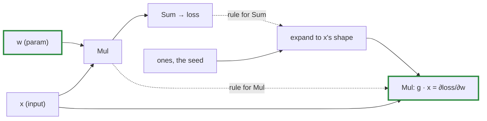

The backward graph reuses `x`, a forward node, so realising a gradient realises whatever forward work it needs. Realising `loss` and the gradients in either order shares that work.

### Chain rules

Each rule turns `g`, the gradient of the op's output, into a gradient for each source in the source's view shape. `out` is the op's own output, reused where it is cheaper than recomputing.

Op            |Gradient for each source                                                      
--------------|------------------------------------------------------------------------------
`Add`, `Sub`  |`g`, and `g` or `-g`                                                          
`Mul`         |`g·b`, `g·a`                                                                  
`Div`         |`g / b`, `-g·out / b`                                                         
`Maximum`     |`g·m` and `g·(1 - m)`, where `m = a.greater_equal(b)`; ties go to `a`         
`Exp`         |`g·out`                                                                       
`Log`         |`g / a`                                                                       
`Tanh`        |`g·(1 - out²)`                                                                
`Sqrt`        |`g / (2·out)`                                                                 
`Sum`         |`g` reshaped to keep the reduced axis, then expanded back                     
`Max`         |`g` expanded, times `m / m.sum`, where `m` marks the maxima; ties share evenly
`Copy`        |`g`                                                                           
`Cat`         |one slice of `g` per source                                                   
`Gather`      |`ScatterAdd` of `g`'s rows into the table's rows; ids get none                
`MatMul`      |`g·bᵀ`, `aᵀ·g`                                                                
`ScatterAdd`  |`g` gathered by the ids                                                       
`Unview`      |`g` read through the inverted view                                            
`GreaterEqual`|none: it is a step function                                                   

### Views and broadcasting, backwards

Sources are views, so a source's gradient arrives in the view's shape and has to land on the node behind it. Broadcasting needs no rule of its own: an `expand` is a view with stride 0, and its adjoint sums.

- **A view covering its whole node in row-major order** (the common case) only needs a reshape.
- **Any other view** (a transpose, slice, expand or permute) becomes an `Unview` node holding the view. Each output position is the sum of the gradient elements that the view reads from it. So a bias of shape `[C]`, expanded to `[N, C]`, gets the column sums; a slice gets zeros outside its range.

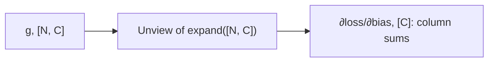

A tensor used twice gets two contributions, added together in the walk's fixed order.

### Realised nodes and constants

A realised node has dropped its sources (see "Tensor and Node"), so there is nothing behind it to differentiate. Rather than silently treating it as a constant, and returning zeros for every param behind it, `grad` raises `Error`. A value that is meant to be constant, such as a precomputed table, is made a leaf with `Tensor#detach`, which realises the tensor and wraps its buffer in a new leaf node.

### Optimizers

Tensors are immutable, so an optimizer does not update params in place. `Optimizer#step(params, grads)` returns new params, realised and detached, and the training loop passes them to the next forward pass. State such as momentum is kept by position in the params array, and detached each step, so no step's graph outlives it.

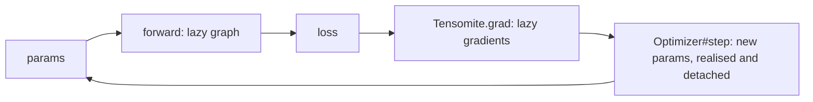

- **`SGD`**: `p - lr·v`, where `v` is `g` or, with momentum, `momentum·v + g`.
- **`AdamW`**: Adam with decoupled weight decay and bias correction. `lr` can be changed between steps for a schedule. Given tensors, every param decays, so params that should not, such as norms and biases, go to a second `AdamW` with `weight_decay: 0`; given `Parameter`s, each one's `decay?` flag decides.
- **Over parameters.** Created with a model's `Parameter`s (see "Modules"), an optimizer's `step(loss)` does the whole loop in the diagram's order: lazy gradients, then reading the loss, then the update, stored back into each parameter's slot. It is the same arithmetic as `step(params, grads)`, to the bit (`spec/module_spec.cr`).
- **One wait per step.** Both forms build every update, and the state carried to the next step (through `Optimizer#keep`), lazily, then realise them together with `Tensor.realize`, and `step(loss)` the loss with them. Realising waits for the device, so detaching each tensor as it was made waited for the GPU three times per AdamW parameter, about a hundred times a step for the larger Shakespeare model (Metal committed 114 command buffers a step), each a pause in which the GPU had nothing to do. The arithmetic and its order are unchanged, so the bits are too.

### Cross-entropy

`logits.cross_entropy(targets)` is the mean of `-log_softmax(logits)[row, target]` over rows. `log_softmax` is `x - max - log(Σ exp(x - max))`, which never takes the log of an underflowed probability. The entries are picked by `gather` from the log-probabilities flattened to a `[rows × classes, 1]` table, with indices `row × classes + target` computed on the host. So the targets are realised when the op is built, and the gradient arrives through the `Gather` rule.

## Modules

`Tensomite::Module` (`src/tensomite/module.cr`) is how models are written: a class whose instance variables hold its parts and whose `forward` combines them (Decisions AH to AM). The built-in parts are in `src/tensomite/modules.cr`.

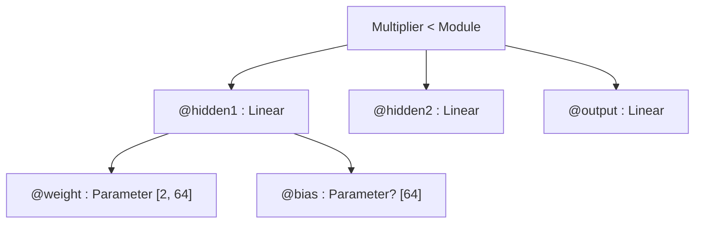

- **One op writes in place (Decision BB).** `Tensor#write(value, axis, start)` makes a `Write` node whose buffer is its target's: the scheduler hands the node the target's buffer instead of allocating one, and the device copies *value* into the region, leaving the rest. It breaks immutability on purpose, for caches that grow without copying, under two rules. The target must cover its whole buffer, so that the region is simple to describe. Anything read from the target before the write must already be realised, because the scheduler orders a write after its sources but not after other readers of the same buffer. The KV cache meets the second rule because each forward pass is realised before the next writes, and it only ever reads positions written earlier, which no later write touches. A write has no gradient.
- **Parameters are slots (Decision AI).** A `Parameter` holds a tensor, a name and a weight-decay flag. Tensors stay immutable; an optimizer replaces the tensor in each slot. Setting a value names the tensor after the parameter, so diagrams show `hidden1.weight`.
- **Parts are found at compile time (Decision AJ).** `Module#each_child` is a macro loop over the subclass's instance variables, as `JSON::Serializable` loops over fields. Variables typed `Parameter`, `Module`, `Array` of either, or nilable versions, are parts, named after the variable, with `.i` for array members. Crystal lists declared variables (`@blocks : Array(Block)`) before inferred ones, which fixes the order of `params`; arrays need such a declaration, because Crystal cannot infer a type from `Array.new(n) { ... }`.
- **Names and tied weights.** `named_params` walks the tree depth first and names each parameter by its path. A parameter reached twice, as tied embeddings are, is listed once, under its first path.
- **`call` and scopes.** `call(*args, **options)` names each child module's scope after its variable, without an array index, so the members of an array share a name and fold in diagrams. Then it runs `forward` inside the module's own scope; the root module has none. `Sequential` names its steps' scopes by kind instead (`linear`, `gelu`).
- **`Layer`** is a `Module` whose `forward` takes one tensor and returns one, which is what `Sequential` holds. A method called on a value of the base type is compiled for every subclass, so `Sequential` cannot hold any `Module`: a transformer block's `forward(x, mask)` would fail to compile there.
- **Initialisation (Decision AK).** Modules draw from `rng:`, by default `Tensomite.rng`, seeded with 0, so a program builds the same model every run. `Linear` draws uniformly from ±1/√inputs, PyTorch's default, and `Embedding` from a normal distribution with standard deviation 0.02, GPT-2's. Normal values use the Box–Muller transform exactly as `examples/shakespeare.cr` does, so that model can move onto modules with the same weights.
- **Bit-identical to hand-written models.** The tutorial's model, rewritten on modules, gives the same loss bits for all 2,000 steps, and the same answers, as the tensor version; so does the Shakespeare model, for every training and validation loss checked, in two shapes. Moving both onto a `Builder` changed no bits either; `spec/builder_spec.cr` keeps a plain-module copy of each to check it. The operations and the draws from the generator are the same, in the same order. The Shakespeare model keeps its position table as a bare `Parameter`, sliced as before: an `Embedding` over position ids would compute the same values, but its gradient goes through `ScatterAdd` rather than `Unview`, which adds in a different order.
- **Builders (Decision AN).** A `Builder` (`src/tensomite/builder.cr`) holds a generator, a device, a bias flag and an initialiser, and makes built-in modules with them, so a model states them once. It is plain Crystal; Crystal's type inference shapes it:
  - an instance variable assigned inside a block in `initialize` becomes nilable, so a builder cannot wrap the constructor in a block, and is passed in as an argument instead;
  - Crystal works out an instance variable's type from a method call only when the receiver is a typed argument, and the constructor's other arguments are typed: `@ln = build.layernorm(width)` needs `build : Builder` and `width : Int32` in the signature;
  - it does so for class methods called with a block, but not for instance methods, which is why `Sequential.build(build) do ... end` is a class method;
  - `with ... yield` stops working when the block parameter has a type (`& : -> _`), so `Sequential.build` leaves it untyped.
- **A declarative macro was tried and set aside (Decision AN).** A `parts(width : Int32) do ln1 = layernorm(width); ... end` macro wrote the constructor, getters and a method per part, so `forward` read `attention(ln1(x), mask)` rather than `@attention.call(@ln1.call(x), mask)`. It built both models with the same bits, but ameba reports every part line as a useless assignment, the block could hold nothing but parts, and mistakes appeared as macro-expansion errors. A second look is a follow-up (Decision AR), and needs a syntax that ameba accepts without suppressions.
- **`CausalSelfAttention`** is GPT-2's attention as a module, over rows of `[batch × length, width]`, the sequence length taken from the mask. It keeps the rows flat rather than `[batch, length, width]`, because a batched matmul is a different shape to BLAS, which chooses its blocking by shape. Given a `CausalSelfAttention::Cache`, it appends its keys and values, `[batch, heads, positions, head width]`, and attends over all of them.
- **GPT-2 on modules (Decisions AO to AQ).** `GPT2` is a `Module` whose variables have Hugging Face's names (`wte`, `wpe`, `h`, `ln_1`, `attn`, `c_attn`, `c_proj`, `mlp`, `c_fc`, `ln_f`), as nanoGPT's do, so the weights file loads by name with `load(prefix:, ignore:)`; `ignore` skips each block's stored causal mask, `attn.bias`, which PyTorch saves because it is a registered buffer. The model is built with `Init.placeholder`, a one-element zero expanded to the parameter's shape, so building it before loading allocates only the biases and norms. Its logits are bit-identical to the hand-written model's on CPU and BLAS, prefilling 64 tokens and decoding 8 (`bench/gpt2_digest.cr`): the attention's batch axis of 1 changes no bits. The KV cache is one `CausalSelfAttention::Cache` per block, passed through `call` as an argument.
- **Scope names are set when parameters are listed,** as well as by `call`, because a model's own entry point, such as `GPT2#graph`, may run `forward` without `call`.

## Graph diagrams

`Tensor#to_mermaid` draws the graph behind a tensor as a Mermaid flowchart, so it can be read rather than walked through `node.srcs` by hand.

- **Every op** (`to_mermaid`, the default): a box per node with its op, name and shape, and an edge per source. Views are not nodes, so a source read through one labels its edge with the kind of view (`reshape`, `slice`, `expand` or `permute`) and the shape it reads. Leaves have a green border and the root a red one. A graph larger than `max_nodes` (200) keeps the nodes nearest the root and puts the rest behind one box, since Mermaid refuses graphs of more than about 500 edges.
- **A summary** (`to_mermaid(depth: n, params: model.params)`): nodes grouped by scope, cut to `n` levels, one box per group with its op count and parameter count.

**Scopes** name the parts of a model. `Tensomite.scope("block") { ... }` opens a scope, nested in the current one, and every node built inside records it, in one reference per node. The chain rules of `grad` build their nodes in the scope of the node they differentiate, so a block's gradients belong to the block. Leaves get names with `Tensor#named`; GPT-2 names its weights as the weights file does.

A summary folds repetition: sibling scopes of one name whose graphs match (the same ops, shapes and parameter sizes, in order) become one box marked `×k`, with counts per instance, and edges from one instance into the next are drawn dashed as `next`. Scopes above the last level become subgraphs, and the nodes a scope holds directly, outside its children, are its "own ops", such as a block's residual adds. The Shakespeare model's loss at depth 2, from `examples/shakespeare.cr --layers 4 --heads 6 --width 192 --context 128 --diagram 2`. The model is built from modules (see "Modules"), so its boxes are named after them:

```mermaid
flowchart TB
    b1["ids · leaf [16,128] I32"]
    b5["causal mask · leaf [128,128]"]
    b12["leaf [2048] I32"]
    subgraph sub1 ["embedding"]
        b2["own ops<br/>1 op · 24.6k params"]
        b0["tokens<br/>1 op · 12.5k params"]
    end
    subgraph sub2 ["blocks ×4"]
        b6["own ops<br/>2 ops each"]
        b3["ln1<br/>1 op · 384 params each"]
        b4["attention<br/>11 ops · 147k params each"]
        b7["ln2<br/>1 op · 384 params each"]
        b8["mlp<br/>3 ops · 295k params each"]
    end
    subgraph sub3 ["head"]
        b10["own ops<br/>1 op"]
        b9["ln<br/>1 op · 384 params"]
    end
    b11["loss<br/>5 ops"]
    b1 -- "[16,128]" --> b0
    b0 -- "[16,128,192]" --> b2
    b2 -- "[2048,192]" --> b3
    b3 -- "[2048,192]" --> b4
    b5 -- "[16,6,128,128]" --> b4
    b2 -- "[2048,192]" --> b6
    b4 -- "[2048,192]" --> b6
    b6 -- "[2048,192]" --> b7
    b7 -- "[2048,192]" --> b8
    b8 -- "[2048,192]" --> b6
    b6 -. "next" .-> b3
    b6 -. "next" .-> b6
    b6 -- "[2048,192]" --> b9
    b9 -- "[2048,192]" --> b10
    b10 -- "[2048,65]" --> b11
    b12 -- "[2048]" --> b11
    classDef leaf stroke:#2b8a3e,stroke-width:2px
    class b1,b5,b12 leaf
    classDef root stroke:#c92a2a,stroke-width:2px
    class b11 root
```

GPT-2 small at the same depth (`examples/gpt2_diagram.cr`) has the same shape, with Hugging Face's names: an embedding of 39.4M params, `h ×12` of 7.09M each, whose `attn` has 13 ops to the Shakespeare model's 11 because its projections have biases.

Box ids follow the graph's order, so the same graph always gives the same text, and diagrams can be compared as text.

**Towards inspection.** Diagrams are the first step towards looking inside a running model: its activations, attention patterns and gradients. Scopes are the addresses that will need. Each call to `scope` makes a new instance, so "the third block" stays addressable even where a summary folds four into one, and a lazy graph can keep any intermediate it computes, so a probe needs no change to the model's code.

## Error timing

The plan accepts that errors in a lazy graph may surface far from their cause. To keep that rare, every check that can be made when an op is called is made then:

Error           |Raised when                                                                                                 
----------------|------------------------------------------------------------------------------------------------------------
`ShapeError`    |Building the op: broadcast mismatch, bad axis, slice or permutation, wrong element count, empty max         
`DTypeError`    |Building the op: mixed dtypes, a float-only op on `I32`, non-`I32` gather ids; or `to_a` with the wrong type
`DeviceError`   |Building the op with tensors on different devices, or a device given another device's buffer                
`ExecutionError`|`realize`: a kernel met invalid data, such as a gather id out of range                                      

Only `ExecutionError` depends on the data rather than the shapes, so it is the only one raised at `realize`.

```mermaid
flowchart LR
    Call["a + b"] --> Check{{"shape, dtype, device OK?"}}
    Check -- no --> Err["raise now, at the caller's line"]
    Check -- yes --> Node["node built"]
    Node --> Real["realize"]
    Real --> Exec{{"data valid?"}}
    Exec -- no --> Late["ExecutionError at realize"]
    style Err stroke:#2b8a3e,stroke-width:3px
    style Late stroke:#d9480f,stroke-width:3px
```

## Models and data

### Loading weights

`SafeTensors.open(path)` maps the whole file once with `MappedFile` and parses only the JSON header. Each tensor is then a realised leaf over its own byte range:

```mermaid
flowchart LR
    File[("model.safetensors")] --> Map["MappedFile: mmap of the whole file"]
    Map --> Header["header: name → dtype, shape, byte range"]
    Header --> Dev{{"host device?"}}
    Dev -- yes --> Adopt["HostBuffer over the byte range, no copy; keeps the MappedFile alive"]
    Dev -- no --> Upload["alloc and upload"]
    Adopt --> Leaf["leaf Tensor"]
    Upload --> Leaf
    style Adopt stroke:#2b8a3e,stroke-width:3px
```

- **Nothing is read until used.** The operating system pages weights in as kernels touch them.
- **Unaligned tensors are copied.** A tensor is read in place only when its data starts on a 4-byte boundary. Older safetensors writers do not pad the header: in GPT-2 small's published file the data section starts at byte 14,291, so every tensor is 3 bytes off and is copied into a new, aligned buffer at load. Reading `Float32`s from unaligned addresses happens to work on x86 and ARM64, but LLVM treats it as undefined behaviour, and GPU uploads need alignment anyway.
- **The mapping lives as long as any tensor over it,** because each `HostBuffer` holds its `MappedFile`.
- **Limits:** one tensor must fit in 2 GiB (an `Int32` `Slice`), but the file may be larger. Only `F32` and `I32` tensors load; other dtypes raise `DTypeError`.
- **Every header entry is checked** against the file: its byte range fits and holds exactly the bytes its shape needs.

**Writing.** `SafeTensors.write(path, tensors, metadata)` writes each tensor's values in row-major order, so a view is saved as the tensor it shows, and pads the header with spaces to a multiple of 8 bytes, as Hugging Face's writer does, so every `F32` and `I32` tensor is aligned and maps without a copy when read back. It writes a temporary file beside *path* and renames it over *path*. Writing in place would be a hazard: tensors loaded from a file are mapped from it, so a model that saves over the file it loaded would see its own weights change under it, or crash if the file shrank. A rename leaves the old file's data in place for as long as it is mapped (`spec/safetensors_spec.cr` checks both). Files written this way are read by Hugging Face's `safetensors` package, and files it writes are read here.

`Module#save` and `Module#load` (see "Modules") use these by parameter name: `load` puts each tensor on the device its parameter is on, and by default refuses a file with missing, extra or misshapen tensors.

### Tokeniser

`BPE` reproduces GPT-2's byte-level byte-pair encoding from a `vocab.json` and a `merges.txt`:

```mermaid
flowchart LR
    Text["text"] --> Words["split by GPT-2's pattern (Unicode-aware)"]
    Words --> Bytes["each word's UTF-8 bytes"]
    Bytes --> Chars["bytes mapped to printable characters"]
    Chars --> Merge["merge the lowest-ranked adjacent pair, repeatedly"]
    Merge --> Ids["vocabulary ids"]
```

- **Every byte maps to a printable character** (space becomes `Ġ`, newline `Ċ`), so any byte sequence round-trips, including emoji and broken UTF-8.
- **The pattern is compiled with `Regex::Options::UCP`,** so `\s` matches Unicode whitespace, such as a no-break space, as in the reference implementations.
- **Decoding** maps characters back to bytes and replaces invalid UTF-8 with U+FFFD, as the reference does.
- **Words are cached** after their first encoding.

### GPT-2

`GPT2.load(path, heads, device)` reads every size except the number of heads from the weight shapes. `forward(ids, cache)`, which `GPT2` and `Llama` share through `Generative` with the cache and `generate`, runs new positions after those in the cache and returns their logits:

```mermaid
flowchart TD
    Ids["ids"] --> Embed["token embedding + position embedding"]
    Embed --> Block["block × layers"]
    subgraph Block["each block"]
        LN1["layernorm"] --> Attn["causal self-attention over cache + new keys"]
        Attn --> Add1["+ residual"]
        Add1 --> LN2["layernorm"]
        LN2 --> MLP["matmul, GELU, matmul"]
        MLP --> Add2["+ residual"]
    end
    Block --> LNF["final layernorm"]
    LNF --> Logits["matmul with the token embedding (tied) → logits"]
```

- **The KV cache** holds each layer's keys and values in buffers of `[batch, heads, context, head width]`, made on the first token. Each token writes its keys and values into them in place (`Tensor#write`), and attention reads a slice of the positions filled so far. Decision BB; before it, each token joined its positions to a copy of the cache with `Tensor.cat`.
- **The causal mask** is `Tensor.causal_mask(new, past + new)`, so the same code serves prefill (many new positions) and decode (one).
- **Weights stay in GPT-2's `[in, out]` layout,** so each linear layer is a plain `x.matmul(w) + b`. The output layer reuses the token embedding through a transposed view, with no copy.
- **`generate(prompt, count, sampler)`** prefills the prompt, then decodes one token at a time, yielding each.

### Sampling

`Sampler.greedy` picks the highest logit, the first on ties. Otherwise logits are divided by the temperature, cut to the `top_k` highest when it is positive, and drawn from their softmax with a seeded `Random::PCG32`, so a seed repeats a run.

### Verified against the reference

Model         |Tokeniser corpus|Max logit difference from PyTorch|Greedy tokens|Prefill against decode       
--------------|----------------|---------------------------------|-------------|-----------------------------
Tiny reference|identical ids   |4.6e-6 (`CPU`), 3.9e-6 (`BLAS`)  |20 identical |bit-identical on host devices
GPT-2 small   |identical ids   |3.7e-4 (`CPU`)                   |64 identical |bit-identical on `CPU`       

GPT-2 small's larger difference reflects its size: 12 layers of 768-wide dot products added in a different order from PyTorch's.

### Determinism in practice

On host devices, a position's logits are bit-identical whether it is computed in a prefill or one token at a time (`spec/gpt2_spec.cr`). That is level 2 of Decision K. It holds because every host kernel's order of arithmetic depends only on the index, and masked positions contribute exact zeros to sums.

On `BLAS`, the same comparison on the tiny reference model differs in the low bits of 77% of logits (at most 1.4e-6). That is why `BLAS` reports `shape_invariant?` false.

## Performance baselines

Current numbers, to measure a change against: a regression shows only against a number. How each was reached is in `DECISIONS.md`, under the decision named (Decision DI). Built with `--release`; on the GPUs, the default modes.

**Inference.**

Workload                                        |Machine        |Device |Result                                              |Command                       |Decision  
------------------------------------------------|---------------|-------|----------------------------------------------------|------------------------------|----------
GPT-2 small: decode; prefill of 64 tokens       |M5 Pro         |`Metal`|186 tokens/s; 3,684 tokens/s                        |`bench/gpt2.cr`               |M7's exit 
GPT-2 small, as above                           |M5 Pro         |`BLAS` |166 tokens/s; 2,419 tokens/s                        |`bench/gpt2.cr`               |M7's exit 
GPT-2 small, as above                           |GB10           |`CUDA` |268 tokens/s; 5,050 tokens/s                        |`bench/gpt2.cr` with `-Dcuda` |BF        
GPT-2 small, decode                             |GB10           |`BLAS` |95 tokens/s                                         |`bench/gpt2.cr`               |BB        
SmolLM2-1.7B at Q4_0, decode                    |GB10           |`CUDA` |5.71 ms a token (llama.cpp: 4.85)                   |`bench/profile_decode_cuda.cr`|CZ        
SmolLM2-1.7B at Q4_0, decode                    |M5 Pro         |`Metal`|6.60 ms a token (llama.cpp: 4.73)                   |`bench/profile_decode.cr`     |CZ        
SmolLM2-1.7B at Q4_0, decode, all threads       |M5 Pro         |`BLAS` |7.17 ms a token; 6.36 native (llama.cpp's CPU: 6.7) |`bench/profile_decode_cpu.cr` |DF        
SmolLM2-1.7B at Q4_0, decode, all threads       |GB10           |`BLAS` |12.8 ms a token; 11.2 native (llama.cpp's CPU: 11.4)|`bench/profile_decode_cpu.cr` |DF        
SmolLM2-135M-Instruct at Q4_0, decode, 4 threads|Linux container|`BLAS` |8.2–8.3 ms a token, against 27–31 in `F32`          |`bench/profile_decode_cpu.cr` |M11's exit

`bench/profile_decode_cpu.cr` takes the model directory and `--quantize Q4_0`; the GPU profilers take the same, or a GGUF file. llama.cpp's figures are `llama-bench`'s on the same machines, with its own Q4_0 file, so they compare near enough rather than exactly.

**Training.**

Workload                                                                         |Machine        |Device |Result                   |Command                                 |Decision 
---------------------------------------------------------------------------------|---------------|-------|-------------------------|----------------------------------------|---------
Shakespeare, Decision R's larger model (4 layers, width 192, 16 × 128 characters)|M5 Pro         |`Metal`|18.7 ms a step           |`examples/shakespeare.cr --device metal`|BP       
the same                                                                         |GB10           |`CUDA` |12.9 ms a step           |`examples/shakespeare.cr --device cuda` |BP       
the same, to 1.494 nats/char in 5,000 steps                                      |Linux container|`BLAS` |431 ms a step, 36 minutes|`examples/shakespeare.cr`               |M7's exit
GPT-2 small, a training step                                                     |GB10           |`CUDA` |388 ms a step            |`bench/train_gpt2.cr` with `-Dcuda`     |CI       

Each training run gives the same losses from run to run on the same device.

## Current limits

- **Metal matmuls with few output blocks are slower than Accelerate.** A prefill's products with 768 output columns run at about 950 GFLOP/s against Accelerate's 1.5–1.8 TFLOP/s, though prefill as a whole is faster on Metal: 3,684 tokens/s against 2,419 (see "Performance baselines").
- **Element counts and offsets are `Int32`,** following Crystal's `Slice` indexing. That caps one buffer at about 2 GB.
- **Computation is in `F32` and `I32`.** No type promotion: operands must have the same dtype. The block formats are storage for weights (below).
- **BLAS covers `F32` matmul only.** The oracle's own matmul is far behind it: about 1,300 ms against 0.26 for a 512 × 512 product on the M5 Pro, as of M3.
- **Model weights compute in `F32` only.** `BF16` and `F16` weights are widened to `F32` as they load, which doubles their memory. Quantised weights load in their block formats (`Q8_0`, `Q4_0`, `Q4_1`), and only `BlockMatMul` (`Tensor#linear`) and `Gather` read them. Metal and CUDA have their own kernels for both: a pass that quantises each block of activations, then one thread per output or, for products of fewer than 65,536 outputs, 32 [lanes](#glossary) per output (a warp on CUDA, a SIMD group on Metal) that each take whole blocks; either way the blocks' contributions are added in the host's order (`BlockMatMulMode`). CUDA's give the host's bits; Metal's division may differ from the host's in the last bit, so its results may differ by a step of a block's scale. On host devices, `Quant.matmul` shares each product's outputs among `TENSOMITE_THREADS` threads (all cores by default), with the bits of `Quant.matmul_reference`, the oracle.
- **One device per op.** Moving data needs an explicit `to`, which goes through host memory.
- **Only what is written as a kernel, a fused row op or a fused composite is fused.** `gelu`, `softmax` (with its scale and mask), `log_softmax`, `layernorm`, `rmsnorm`, RoPE, attention on GPUs for decoding's few rows, and bias adds into `MatMul` are one op each; residual adds are still separate primitives.
- **Inference releases buffers only through the collector.** A training step gives each intermediate buffer back as soon as its last reader has run (Decision CD); a forward pass outside training returns its buffers to the pool when the collector finalizes them.
- **Gradients of gradients** are built by the same rules, but are not tested.
- **`grad` needs an unrealised graph.** Realise the loss after calling `grad`, or together with the gradients.
