# Tensomite: design

This document describes the design as it is built today, currently through milestone 5, with milestone 6 (Metal) under way. `PLAN.md` holds where the design is going and why. `DEVELOPMENT.md` covers how to work on the code.

## Overview

Tensomite is a lazy tensor runtime. Operations on a `Tensor` build a graph, and nothing is computed until a result is needed. The scheduler then runs the graph on a `Device`, one kernel per node.

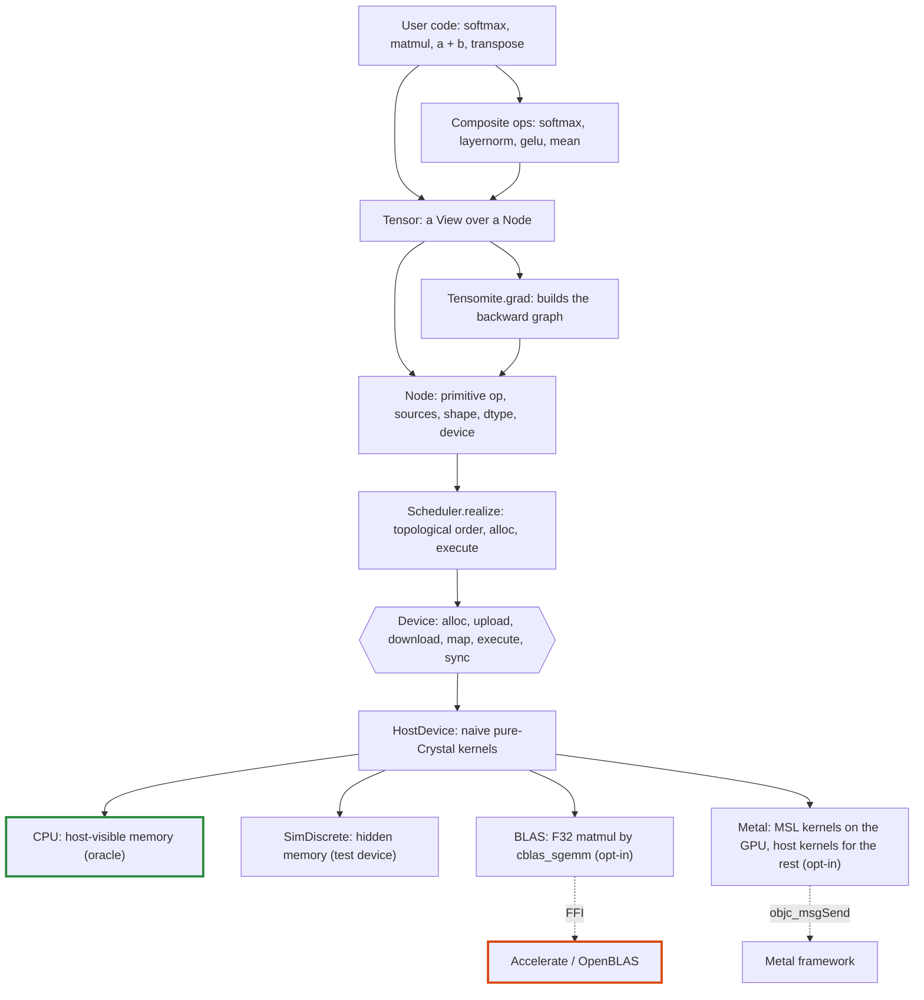

## Core types

Type            |File                      |Role                                                                                                                     
----------------|--------------------------|-------------------------------------------------------------------------------------------------------------------------
`DType`         |`dtype.cr`                |Runtime element type: `F32`, `I32`. `DType.of(Float32)` maps a Crystal type to it; `bytes_for(count)` gives storage size.
`View`          |`view.cr`                 |Shape, strides and offset, counted in elements. Pure metadata.                                                           
`Buffer`        |`device.cr`               |An opaque allocation owned by one device, which it names.                                                                
`Device`        |`device.cr`               |Where buffers live and kernels run.                                                                                      
`Op`            |`node.cr`                 |The primitive operations devices implement.                                                                              
`Node`          |`node.cr`                 |A graph vertex producing one contiguous array.                                                                           
`Tensor`        |`tensor.cr`, `tensor/*.cr`|The user-facing value: a `View` over a `Node`. Its ops are grouped by kind in `tensor/`.                                 
`Scheduler`     |`scheduler.cr`            |Turns unrealised nodes into kernel runs.                                                                                 
`Tensomite.grad`|`autograd.cr`             |Builds the backward graph of a loss: lazy gradients for a list of params.                                                
`Optimizer`     |`optim.cr`                |`SGD` and `AdamW`: new params from params and gradients.                                                                 
`Kernel`        |`kernel.cr`, `kernels.cr` |A fused elementwise kernel made by the `Tensomite.kernel` macro, with its gradient kernels.                              
`BufferPool`    |`buffer_pool.cr`          |Freed device memory kept for reuse, by exact size.                                                                       
`HostDevice`    |`devices/host.cr`         |Abstract device whose kernels run on the host CPU; holds `HostBuffer`s.                                                  
`CPU`           |`devices/cpu.cr`          |The reference device: host kernels on host-visible memory.                                                               
`SimDiscrete`   |`devices/sim_discrete.cr` |A test device: host kernels on memory the host cannot map.                                                               
`BLAS`          |`blas.cr`                 |Opt-in: host kernels with `F32` matmul by the platform BLAS.                                                             
`Metal`         |`metal.cr`, `metal/`      |Opt-in, Apple Silicon: MSL kernels on the GPU over shared memory, host kernels for unported ops.                         
`MappedFile`    |`mapped_file.cr`          |A read-only memory mapping of a file, unmapped when collected.                                                           
`SafeTensors`   |`safetensors.cr`          |Reads tensors from a safetensors file, zero-copy on host devices.                                                        
`BPE`           |`bpe.cr`                  |GPT-2's byte-level byte-pair-encoding tokeniser.                                                                         
`Sampler`       |`sampler.cr`              |Picks the next token: greedy, or seeded temperature and top-k sampling.                                                  
`GPT2`          |`models/gpt2.cr`          |The GPT-2 decoder with a KV cache.                                                                                       

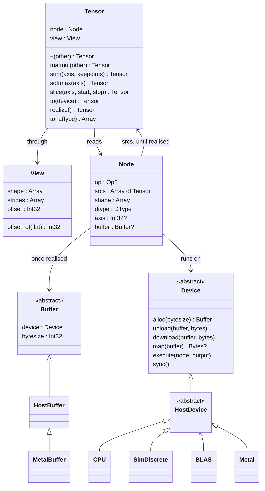

### Tensor and Node

A `Tensor` is a small struct holding a `Node` and a `View`. The node is where the data comes from. The view says how to read it.

- **Views share nodes.** `transpose`, `permute`, `expand`, `slice` and most `reshape`s return a new `Tensor` over the *same* node with a different view. They never copy, and they work on unrealised nodes too.
- **A node always produces a contiguous, row-major array** of its `shape`. All of the non-trivial layout lives in the views that read it.
- **A leaf node** (from `Tensor.from`, `Tensor.scalar` or `Tensor.causal_mask`) has no op and is created realised.
- **Any other node** holds its op and source tensors until it is realised. After that it holds only its buffer, and its sources are dropped so the graph behind it can be collected.

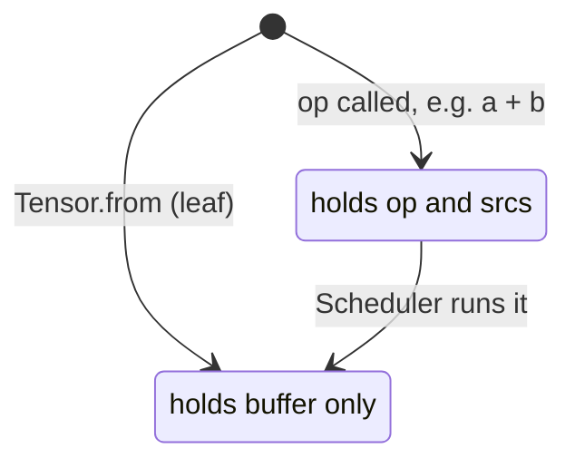

For example, here is the graph for `(a.transpose + c).sum`, before it is realised:

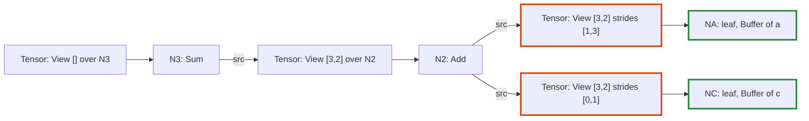

The orange tensors are views (a transpose and a broadcast) that copy nothing. The green nodes hold buffers.

### Views and broadcasting

A `View` maps a logical index onto a position in storage: `offset + Σ index[i] × strides[i]`.

Operation          |Effect on the view (from shape `[2, 3]`, strides `[3, 1]`)
-------------------|----------------------------------------------------------
`transpose`        |shape `[3, 2]`, strides `[1, 3]`                          
`expand([4, 2, 3])`|shape `[4, 2, 3]`, strides `[0, 3, 1]`                    
`slice(1, 1, 3)`   |shape `[2, 2]`, strides `[3, 1]`, offset `1`              
`reshape([3, 2])`  |shape `[3, 2]`, strides `[2, 1]`                          

A stride of 0 re-reads the same element along that dimension. This is how broadcasting works without copying. A slice moves the offset to its first element and shortens one dimension.

For example, here is how two views over the storage `[1, 2, 3, 4, 5, 6]` locate one element each:

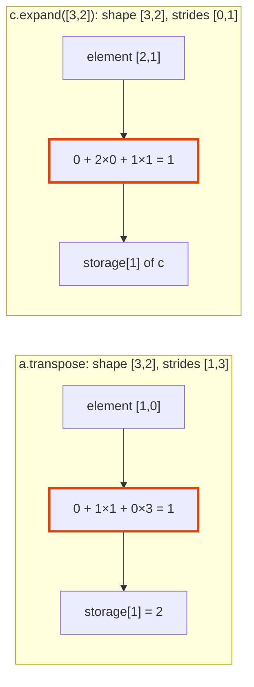

Binary ops broadcast eagerly. `a + b` computes the common shape with NumPy rules, then expands both operands to that shape before building the node. **Kernels therefore only ever see sources whose shape equals the output shape**, with arbitrary strides. Every device inherits that simplification. `matmul` does the same for its leading batch dimensions.

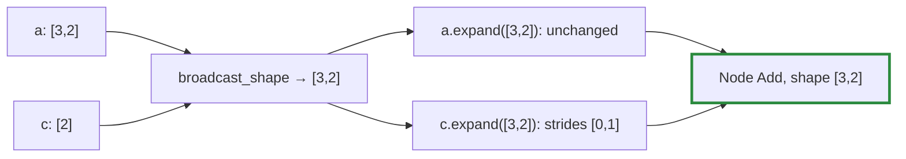

`reshape` is a view whenever strides can express it, as PyTorch's `view` is: it splits and merges dimensions, so each group of old dimensions that new ones merge must be laid out row-major, ignoring dimensions of size 1. Splitting a slice of rows works (`[2, 6]` sliced to `[2, 4]` reshapes to `[2, 2, 2]` with strides `[6, 2, 1]`); flattening a transpose does not, and then `reshape` inserts a `Copy` node first and reshapes the contiguous result. Attention's queries, keys and values are such slices of one projection, and its heads are rejoined by a permute and a reshape that is a view when there is one position. Before views covered them, these were 48 copies in a decoded GPT-2 token, and 36 in a prefill (Decision BF).

## Ops

### Primitive and composite ops

Devices implement only the primitive ops in `Op`. Everything else is a composite: a `Tensor` method that builds a small graph of primitives. A new device therefore needs kernels for the primitives and nothing more.

Kind      |Primitive ops (`Op`)                  |`Tensor` API                                                          
----------|--------------------------------------|----------------------------------------------------------------------
Binary    |`Add`, `Sub`, `Mul`, `Div`, `Maximum` |`+`, `-`, `*`, `/`, `maximum`, with tensors or scalars                
Unary     |`Exp`, `Log`, `Tanh`, `Sqrt`          |`exp`, `log`, `tanh`, `sqrt`, unary `-`                               
Reduction |`Sum`, `Max`                          |`sum`, `max`, with optional `axis` and `keepdims`                     
Structural|`Copy`, `Cat`, `Gather`, `MatMul`     |`contiguous`, `Tensor.cat`, `gather`, `matmul` (with an optional bias)
Adjoint   |`GreaterEqual`, `Unview`, `ScatterAdd`|`greater_equal`; the other two only through `Tensomite.grad`          
Fused     |`Kernel`                              |any `Tensomite.kernel`, such as `gelu`                                
Row       |`Softmax`, `LogSoftmax`, `LayerNorm`  |`softmax`, `log_softmax` and `layernorm` along the last axis          
Composite |none: built from the rows above       |`mean`, `softmax`, `log_softmax`, `cross_entropy`, `layernorm`, `gelu`

- **Scalars** become rank-0 leaf tensors of the operand's dtype (`Tensor.scalar`), which then broadcast like any other tensor. So `x * 0.5` is `Mul` of `x` and a broadcast scalar.
- **Float-only ops** (`/`, `exp`, `log`, `tanh`, `sqrt`, `mean` and the composites) raise `DTypeError` on `I32` when called.
- **One dtype per op.** Every source of an op must share one dtype (`check_compatible`), and `gather` ids are the only exception (`I32`). Decision N in `PLAN.md` relaxes this per op for quantised weights in M9.
- **Byte sizes** always come from `DType#bytes_for(count)`, never from a size per element, so block formats with many elements per block fit without changes.
- **`keepdims`** reshapes the reduced result to keep the axis with size 1. The reduction's output is contiguous, so this is a view, not a copy.

For example, `softmax(axis)` expands into five primitive nodes:

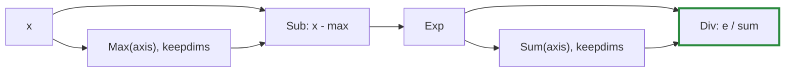

Subtracting the row's maximum keeps `exp` from overflowing without changing the result. `layernorm` and `gelu` expand the same way. Until kernel macros arrive in M7, each primitive node is a separate kernel run.

### The causal mask

`Tensor.causal_mask(rows, cols)` is a leaf built on the host: an `F32` tensor of 0 where a query row may attend to a key column, and -∞ where the column lies in its future. Adding it to attention scores before `softmax` turns masked scores into zero weight.

`cols` may exceed `rows` when a KV cache holds earlier positions. The last row then sees every column, and row `i` sees columns up to `i + cols - rows`:

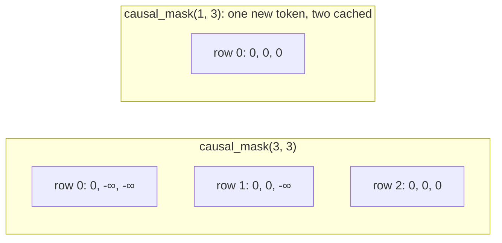

## Devices

### The device interface

The device interface always speaks in transfers, so that discrete-memory devices fit it unchanged:

- **`alloc(bytesize)`:** returns a new buffer that names this device.
- **`upload(buffer, bytes)` / `download(buffer, bytes)`:** copy between the host and the device.
- **`map(buffer)`:** returns host-visible `Bytes`, or `nil` when the memory isn't host-visible. Readers try `map` first and fall back to `download`.
- **`execute(node, output)`:** computes a node into a freshly allocated contiguous buffer, reading its sources' buffers through their views.
- **`sync`:** waits for submitted work to finish.
- **`shape_invariant?`:** reports whether results can depend on the shape of the computation around them, such as batch size (level 2 of Decision K). Features that need level 2 check it (Decision L).

A buffer belongs to exactly one device and records which. A device rejects any buffer it does not own with `DeviceError`.

### Host devices: CPU, SimDiscrete and BLAS

`HostDevice` holds the pure-Crystal kernels. Its subclasses differ in whether the host may see their memory, and in whether any kernel is replaced:

Device       |`map`             |`shape_invariant?`|Purpose                                                      
-------------|------------------|------------------|-------------------------------------------------------------
`CPU`        |returns the buffer|true              |The oracle every other device is tested against              
`SimDiscrete`|always `nil`      |true              |Behaves like a discrete GPU; counts `uploads` and `downloads`
`BLAS`       |returns the buffer|false             |Replaces `F32` `MatMul` with `cblas_sgemm`                   

Every op spec runs on all three. Code that reads a buffer directly instead of going through `map` or `download` passes on `CPU` and fails on `SimDiscrete`, long before a real discrete GPU is involved.

### The BLAS device

`BLAS` is the first device to cross into native code. It is opt-in: `require "tensomite/blas"` links Accelerate on macOS or OpenBLAS elsewhere, so the core shard stays pure Crystal.

It overrides `execute` for one case only, an `F32` `MatMul`, and inherits every other kernel from `HostDevice`, including `I32` matmul. Each batch matrix becomes one `cblas_sgemm` call. BLAS describes a matrix by a pointer, a transpose flag and a leading dimension (the distance between rows), so each operand's view is mapped onto those where possible and copied only where not:

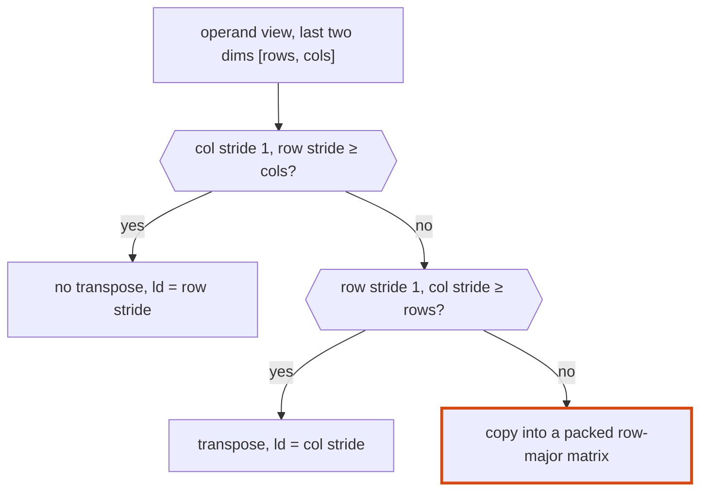

So contiguous, transposed and column-sliced operands pass to BLAS without copying. A broadcast batch dimension (stride 0) is handled by the per-batch pointer. Only a broadcast inside the matrix, such as a row repeated with stride 0, is copied.

Vendor BLAS libraries choose their blocking and threading by shape, so `BLAS` reports `shape_invariant?` false (Decision L). Results repeat exactly from run to run for the same shapes.

### The Metal device

`Metal` is opt-in (`require "tensomite/metal"`) and Apple Silicon only. It is a `HostDevice` too, which is the key to porting one op at a time.

- **Buffers are shared.** Each `MetalBuffer` is an `MTLBuffer` in shared storage, and also a `HostBuffer` over the same bytes. The CPU and GPU address the same memory, so `map` returns it and transfers are plain copies.
- **Ported ops run on the GPU; the rest run on the host, on the same memory.** `execute` looks for an MSL kernel for the node. If there is one, it encodes a dispatch. If not, it waits for the GPU and runs the inherited host kernel. Porting an op therefore changes where it runs, never whether it runs, and every op works from the first PR.
- **Dispatches are batched.** Kernels are encoded into one open command buffer, which is committed and waited for only when the host next needs memory: a host kernel, `map`, `upload`, `download` or `sync`. The encoder dispatches serially, so each kernel sees its predecessors' results.
- **Kernels are MSL source**, in `metal/kernels.metal`, embedded at compile time and compiled by the driver when the device is created, with fast math off. Each thread computes one output element and reads its sources through their views, with the same arithmetic as `View#offset_of`, so any view the host accepts works on the GPU (up to 8 dimensions).

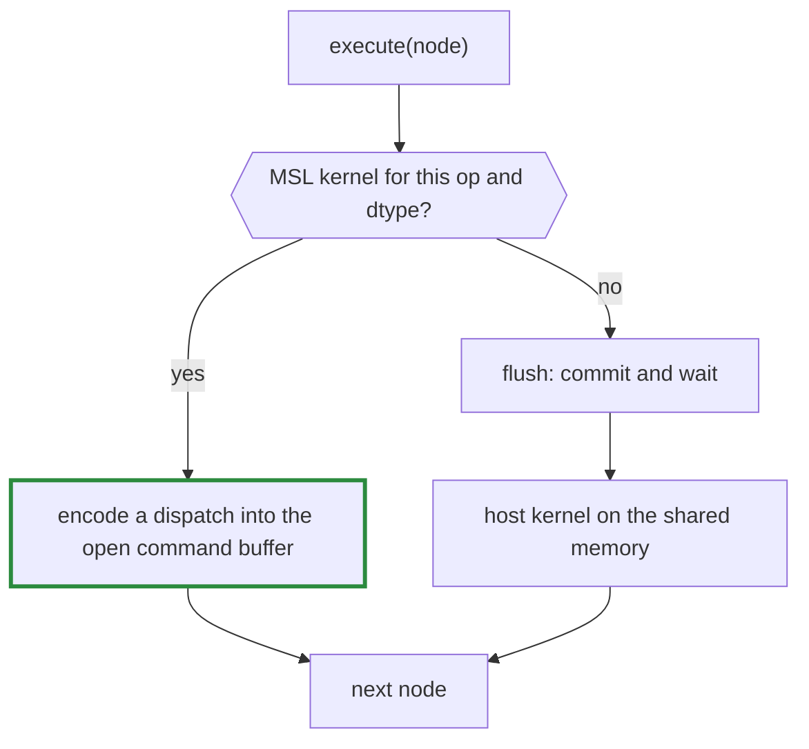

**Determinism.** Addition, subtraction, multiplication and comparisons are correctly rounded IEEE operations, so they give the same bits on the GPU as on the CPU, and `spec/gpu_spec.cr` checks them for equality. Division and the transcendental functions use the GPU maths library and are compared within 1e-6 (level 3 of Decision K). `MatMul` splits its sums across threads and is compared within 1e-5 (Decision S, below). Every kernel computes each element on its own, so the device is shape-invariant.

**Calling Objective-C from Crystal.** Metal has no C API, so `metal/objc.cr` sends messages through `objc_msgSend`. That function must be called with the exact C signature of the method it reaches, and Crystal does not allow one C symbol to be declared with several signatures. So `ObjC.send(ReturnType, receiver, "selector:", args...)` casts its address to a `Proc` typed by its arguments, one type per call site. `NSUInteger` is `UInt64`, `BOOL` is passed as `UInt32`, and `MTLSize`, a 24-byte struct, is passed as a pointer, as arm64 passes structs over 16 bytes. Objects the runtime autoreleases are created inside `ObjC.autoreleasepool`, and those kept beyond it are retained.

**Kernels that add.** Each of these kernels combines in a fixed order. `ScatterAdd` and `Unview` add in the host's order and are bit-identical to it; `Sum` and `Max` work in chunks (below):

Op          |Threads                                                                                  |Each thread                                                                                      
------------|-----------------------------------------------------------------------------------------|-------------------------------------------------------------------------------------------------
`Sum`, `Max`|one threadgroup per output, a thread per chunk of 16 (one thread for a run of 16 or less)|folds whole chunks in index order; the first thread folds the chunk results in chunk order       
`ScatterAdd`|one per column                                                                           |zeroes its column, then adds the source rows into the rows their ids select, in order            
`Unview`    |one per output position                                                                  |inverts the view to find which logical elements read the position, and adds them in logical order

`Unview` inverts a view by decomposing `position - offset` over the dimensions with a nonzero stride, largest first. The dimensions with stride 0 are the ones that repeat a position: their indices are walked in row-major order, which is logical order. The decomposition is unique when each stride exceeds the furthest the smaller ones can reach together. Every view tensomite builds satisfies that, and a view that did not would run on the host.

**Reductions in chunks (Decision X).** One thread per output made a long reduction slow: each of a GPT-2 layer norm's means was a single thread adding 768 numbers one after another, 126 µs each and 57% of a decoded token's GPU time. Each output now has a threadgroup, with each thread folding chunks of 16 at fixed offsets. As with split-K, chunk boundaries never depend on the run's length or on the number of threads, so a row padded with zeros (or, for `Max`, with -∞), as a masked attention row is, keeps its bits, and prefill still equals decode. `Max` is exact in any order and still matches the host bit for bit. `Sum` of more than one chunk adds in a different order from the host's and is compared within 1e-5. A run of one chunk or less (16 elements) keeps one thread per output, which is the host's arithmetic exactly. Within a run along the last axis, threads step by the view's stride rather than calling `offset_of` for every element.

**Errors.** A GPU kernel cannot raise. `Gather` and `ScatterAdd` report an id out of range through a small shared error buffer, and `flush` raises the host's `ExecutionError` when it finds a report. The error therefore surfaces when the command buffer completes, at `realize`, as it does on the host. One difference remains: the nodes encoded before the error are marked realised, with undefined contents for the failing one.

**`MatMul`** has five modes (`Metal#matmul_mode`). A matrix-vector product (`m` = 1), which is what decoding mostly does, has too few outputs to fill the GPU with one thread each; a prefill has enough outputs that reading the operands, not adding them, is the cost:

Mode            |Work per thread                                                              |How partial sums combine                     |Bits                                                           
----------------|-----------------------------------------------------------------------------|---------------------------------------------|---------------------------------------------------------------
`Serial`        |one output, adding over all of `k` in order                                  |none                                         |identical to the host                                          
`Split`         |whole chunks of 64 along `k` for one output, 8 threads per output            |one thread adds the chunks in chunk order    |repeat every run; independent of `m` and of zero-padding of `k`
`Atomic`        |as `Split`                                                                   |atomic adds, in whatever order threads finish|may change from run to run; for measurement only               
`Tiled`         |a 4×4 patch of outputs, reading operands from tiles shared by its threadgroup|each output adds its chunks in chunk order   |identical to `Split`                                           
`Auto` (default)|`Tiled` for 16 rows or more, `Split` below                                   |as the mode chosen                           |identical to `Split`                                           

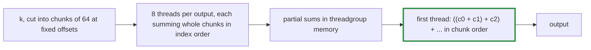

- **Why chunks, not slices.** Cutting `k` into 8 equal slices would move the boundaries whenever `k` changes. In attention, `scores · v` sums over the sequence: in prefill, a position's row has zeros for the masked positions after it, and in decode the same position's row simply stops there. Chunks at fixed offsets give both rows the same chunks, plus chunks of exact zeros in prefill, and `x + 0 = x`. So prefill and decode stay bit-identical (`spec/gpt2_spec.cr`, and the padding spec in `spec/metal_spec.cr`).
- **Coalesced reads.** A threadgroup owns 32 adjacent output columns of one row, so the 32 threads working on the same chunk read 32 adjacent columns of the weights at a time.
- **Decision S.** Splitting changes the order of additions, so `Split` no longer matches the host bit for bit: `spec/gpu_spec.cr` compares matmuls within 1e-5. Levels 1 and 2 of Decision K still hold, which is what caching and reproducibility need.
- **No fused multiply-add.** Each product and running sum are separate statements, so the compiler cannot fuse them into one rounding. That is what keeps `Serial` identical to the host.

**Tiled matmul (Decision AD).** In a prefill each weight is used by every token, yet `Split` reads it from memory once per output. The tiled kernel (`matmul_tiled` in `metal/kernels.metal`, an MSL template) gives each threadgroup a block of outputs (`Metal#matmul_tile`: 64×64 by default, or 32×32 and 32×64 for comparison) and each thread a 4×4 patch of it. For each tile of `k` the threadgroup copies a block of `a` and of `b` into threadgroup memory, every element once, along whichever index is contiguous in memory, so the head's transposed embedding loads as well as a plain weight; then every thread reads its operands from there. Each value fetched serves a whole row or column of the block, not one output.

Tiling changes where operands are read from, not the order they are added in. Each output still sums every chunk of 64 from zero in index order, then adds the chunk sums to its total in chunk order, and never reads past `k`; it even adds the exact zero split-K adds for chunks past `k` when their number is not a multiple of 8, which matters only for a total of `-0`. So `Tiled` gives `Split`'s bits, and `Auto` can choose between them by speed alone: prefill (tiled) and decode (split) stay bit-identical (`spec/metal_spec.cr`). What this rules out is Apple's 8×8 matrix instructions (`simdgroup_matrix`), whose internal order of addition is not specified.

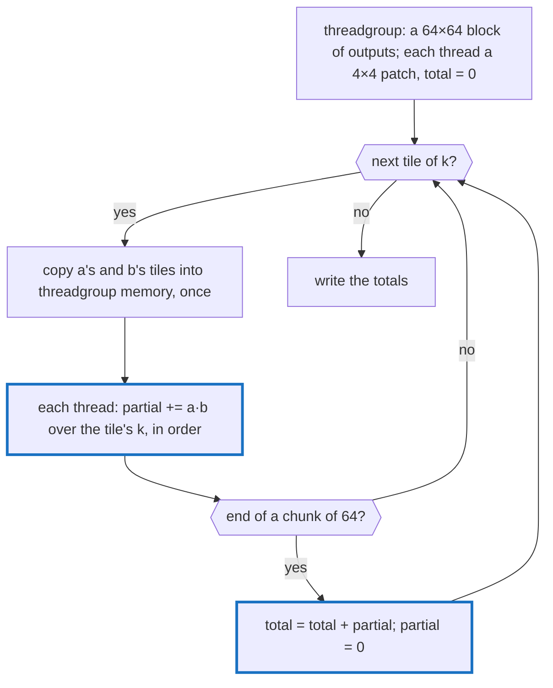

The kernel was checked before it first ran on a GPU by compiling the MSL source as C++ with each threadgroup's threads as OS threads and real barriers: every tile matched `Split` bit for bit on odd sizes, batched and transposed operands, while `Serial` differed whenever `k` > 64.

**Profiling.** Setting `Metal#profile` to a `Metal::Profile` collects where time goes: seconds spent encoding dispatches, allocating and waiting for the GPU, the number of dispatches and command buffers, and the wall time of each op that ran on the host. With `per_kernel: true`, every op is committed alone and its GPU time recorded under its op's name, which slows the run but shows the GPU's own cost per op; with `shapes: true` as well, under its shapes too, such as `MatMul [128,768]·[768,50257]`. `bench/profile_gpt2.cr` prints both for a decoded GPT-2 token, or with `--prefill N` for a prefill of N tokens, by shape and with each matmul's GFLOP/s.

The atomic kernel needs `atomic_float`, from Metal 3. Without it the device still works, and only `Atomic` raises.

Every op now has an `F32` Metal kernel. `I32` ops, views of more than 8 dimensions and overlapping views run on the host.

### Moving data between devices

An op whose operands are on different devices raises `DeviceError`. Data moves only through an explicit `Tensor#to(device)`, which realises the source, copies it through host memory and returns a realised leaf on the target:

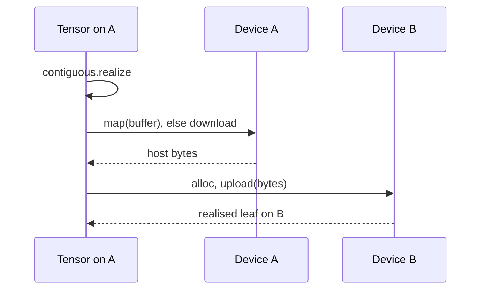

`to` is eager, unlike other ops, because a transfer between devices is a synchronisation point anyway.

### Host kernels

The host kernels are deliberately naive, and they run in a fixed order. That gives level 1 determinism from Decision K: the same inputs give the same bits on every run. Their order of arithmetic also never depends on shape, which is the basis for level 2 later.

- **Kernel structure.** `execute` dispatches on `DType` to a generic method, `execute(Float32, …)` or `execute(Int32, …)`, which dispatches on `Op`. A buffer's bytes are read as `Slice(T)`. Results are converted with `T.new(...)`, so every branch compiles for every dtype; float-only ops never reach an integer kernel because they are rejected when called.
- **Indexing in runs.** Kernels walk logical indices in order, in runs that each view can step through with a fixed stride. When every view involved is dense or constant, the run is the whole tensor. Otherwise it is the last dimension. `View#offset_of` finds each run's start, once per run rather than once per element. The order of arithmetic is the same as indexing every element, so the results are bit-identical, and strided reads are three to five times faster.
- **Pointers within a run.** A kernel checks a run's first and last positions against each buffer once, then reads and writes through pointers, with a separate loop for unit strides. Without a bounds check on every element LLVM vectorises those loops, which made elementwise ops three to four times faster (2.8 to 0.7 ns per element for `Mul` in training).
- **Transcendental functions** (`exp`, `log`, `tanh`) are tensomite's own, in `Tensomite::Maths` (Decision Y): range reduction and a short polynomial, written with selects rather than branches so the loops around them vectorise, each within 2 ulp of the correctly rounded result (`spec/maths_spec.cr`). Inputs whose results would be subnormal are never computed with, because arithmetic on subnormals is about 100 times slower on x86; that mattered for the `-inf` of the causal mask. `sqrt` stays `Math.sqrt`, which compiles to one instruction.
- **Reductions.** The reduced axis is permuted to the end of the source view, so each output element reads one run of consecutive logical indices. `Sum` folds the run from zero, and `Max` from its first element. A reduction over all elements is the same loop with a single output.

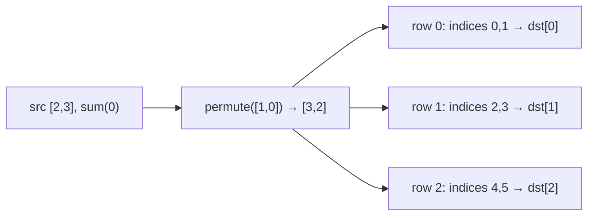

- **`Cat`** writes each source through a *slice view of the output*, so the same indexing code that reads views also writes them.
- **`Unview`** zero-fills its output, then adds each source element at the position its view reads, in index order. **`ScatterAdd`** does the same for whole rows. Both add in a fixed order, so gradients are deterministic too.
- **`Gather`** copies row `ids[i]` of a 2-D table into output row `i`. An id outside the table raises `ExecutionError`.
- **`MatMul`** computes each output as a dot product over `k`, added in index order. Its sources arrive already expanded to the common batch shape. It is the one kernel that does not call `offset_of` per element: it finds where each batch matrix starts, then walks rows, columns and `k` with the sources' strides directly. The order of additions is unchanged, so the result is bit-identical to indexing each element (`spec/host_kernels_spec.cr`), and about 10 times faster.

### CUDA

`src/tensomite/cuda.cr` reaches NVIDIA GPUs through CUDA's driver API (Decisions AS to AV). M8's first part is the layer under the device to come:

- **Linked, opt-in.** `-Dcuda` links `libcuda` and `libnvrtc` (Decision AV); without the flag, requiring the file is a compile error. The bindings name the exported symbols, so `cuMemAlloc_v2` rather than the header's `cuMemAlloc`.
- **Compiled by NVRTC on first use** (Decision AU), from CUDA C++ to PTX, with `--fmad=false`, so a multiply and an add round separately, as on the host and as MSL does with fast math off. PTX targets the newest architecture NVRTC supports at or below the GPU's (`CUDA.target_arch`); the driver compiles it to the GPU's machine code when the module loads.
- **A primary context per GPU** (`CUDA::Context`), current on the thread that made it: device memory, synchronous copies, loaded modules and launches. Launch arguments are passed as pointers to their values, as `cuLaunchKernel` expects.
- **Explicit transfers, even on shared memory.** The DGX Spark's GPU shares memory with its CPU, but tensomite allocates device memory and copies to and from it as on a discrete card, so one code path serves both (Decision AS).
- **The `CUDA` device** is a `HostDevice` whose buffers live in device memory, so every op without a CUDA kernel runs the host kernel and gives the host's bits. A `CUDABuffer` keeps a host copy, made when a host kernel first reads it and valid until the device memory is written again:

  ```mermaid
  flowchart LR
      U["upload"] --> D["device memory current<br/>host copy stale"]
      D -->|"a host kernel reads it"| B["download once:<br/>both current"]
      B -->|"another reader"| B
      B -->|"upload, or a CUDA kernel writes it"| D
      H["a host kernel writes it"] -->|"upload the result"| B
  ```

  So a graph of host ops downloads each source once, not once per reader, and uploads each output once. Device memory comes from a pool, as on Metal. A buffer's finalizer hands its memory to a retired list, which the device moves into the pool at its next allocation or sync, on its own thread. If the list is busy, the finalizer frees the memory at once instead, making the context current on its thread first, so it never waits.
- **Kernels** (`cuda/kernels.cu`) are ports of the Metal ones: elementwise arithmetic and comparisons, `exp`, `log`, `tanh`, `sqrt`, copies and `Cat`, `Sum` and `Max` in chunks of 16 at fixed offsets, `Gather`, `ScatterAdd` and `Unview`. Views reach them as a struct of 19 integers, passed by value. They are compiled once, on the first op, for the GPU's architecture, and queued in order on the default stream; a plain copy to or from the host waits for the kernels before it, so no explicit stream is needed yet. `Gather` and `ScatterAdd` report an id out of range in a small error buffer, which `sync` reads and clears, raising `ExecutionError`. - **Matmul, row ops and macro kernels** are ports too. `MatMul` has Metal's modes (`CUDA::MatMulMode`): serial, with the host's bits; split, in chunks of `k` at fixed offsets; and tiled, in the three tile sizes of `CUDA::MatMulTile`, with split's bits, so `Auto` picks tiled at 16 rows or more and split below, and a tiled prefill gives a split decode's bits. Softmax, log-softmax and layernorm fold rows in chunks as the reductions do, so a row padded with `-inf` keeps its bits. `Kernel#cuda` emits a macro kernel as CUDA C++, one statement per operation, as `#msl` emits MSL; each is compiled on its first launch and kept. With these, GPT-2's forward pass runs no host ops on CUDA.
- **Testing without a GPU.** `scripts/cuda_stub/libcuda.c` stands in for the driver: one "GPU" whose memory is host memory. It cannot run PTX, but with `TENSOMITE_CUDA_KERNELS` it loads `prelude.cu`, `kernels.cu` and every macro kernel's CUDA C++ (written out by `scripts/cuda_stub/macro_kernels.cr`), compiled as host C++ behind `emulate.h`. That header defines CUDA's built-ins and runs a block's threads in a loop, or, for a kernel with shared memory, as one OS thread per GPU thread, all meeting at a barrier inside the kernel and between blocks. NVRTC, from PyPI, still compiles the real source. So CI compiles every kernel, runs each on the host, and compares it with the CPU in `gpu_spec`, as `scripts/emulate_metal` does for MSL. What it cannot catch is a difference in CUDA's own semantics, such as its maths library; the GB10 runs the same specs on the real GPU.

## Realisation

`Scheduler.realize(node)`:

1. **Order.** A depth-first walk, with an explicit stack so that deep training graphs cannot exhaust the call stack, lists the unrealised nodes reachable from the root, in topological order. A node shared by several consumers is listed, and computed, once.
2. **Run.** For each node: allocate an output buffer on its device, `execute`, then mark the node realised, which drops its sources.
3. **Wait.** Call `sync` on the root's device.

`Tensor#to_a(T)` realises the tensor, then reads the buffer (through `map` or `download`) in the view's logical order.

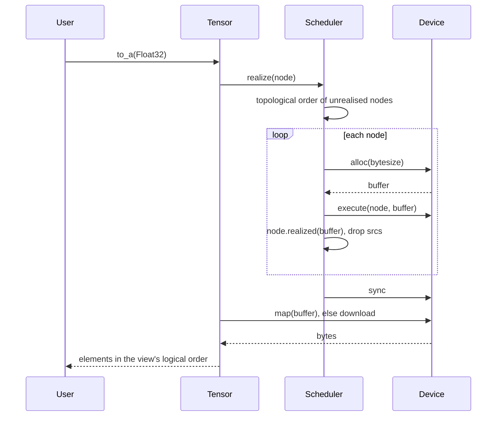

If a kernel raises, the nodes before it stay realised and the failing node stays unrealised.

### Buffer pool

A graph built anew every step, as in training or decoding, would allocate a fresh buffer for every node, every time. Instead, each host device and `Metal` keeps a `BufferPool` of freed memory, keyed by exact size (Decision U):

1. **Giving back.** When the collector finalizes a buffer, its finalizer hands the memory to the device's pool. A buffer is collected only once nothing can reach it, so reuse is always safe. Memory from a file mapping is never pooled.
2. **Taking.** `alloc` takes memory of the exact size from the pool when there is some, and allocates otherwise. A pooled buffer's old contents remain, which is why `Device#alloc` promises nothing about contents and every kernel writes all of its output.
3. **Threads and re-entrancy.** A finalizer can run in the middle of any allocation, including one made by the pool itself, and on any thread: in Crystal 1.22 the execution-context monitor thread runs them too, while the main thread is computing. So the pool is guarded by an atomic try-lock and never waits. While one caller holds it, `take` misses, and the caller allocates, and `give` declines, and the memory is freed. Before this lock, a race between the two threads corrupted the free lists, about once in 30 runs of `gpt2_spec`, and once in a 5,000-step training run.
4. **On Metal**, finalizers only queue a buffer in a retired list, under the same kind of try-lock. The device's own thread moves the list into the pool when no GPU work is pending, at the next allocation or flush, because the GPU may still be reading a buffer. When the list is held, the finalizer releases the `MTLBuffer` instead, which is safe because command buffers retain what they use. The pool holds the `MTLBuffer`s themselves.
5. **A limit** (1 GiB by default) bounds what a pool holds.

Reuse lags by one collection: memory comes back only when the collector runs. A training loop that collects once per step (`examples/shakespeare.cr`) gets most of its buffers back before the next step; on the Linux container, that took a step from 744 to 470 ms, with identical losses.

**Batched commits on Metal.** The device commits its command buffer every `commit_every` dispatches (64), without waiting, and starts a new one. The GPU therefore starts work while the host is still building and encoding the rest. A queue runs its command buffers in order, with Metal tracking each buffer's readers and writers across them, so results are unchanged.

## Kernel macros

`Tensomite.kernel(name) { |x, …| expression }` fuses an elementwise expression into one primitive, `Op::Kernel`: one pass over memory on host devices and one dispatch on Metal, instead of a node per operation (Decision J). `Tensor#gelu` is the first: eight primitives become one kernel.

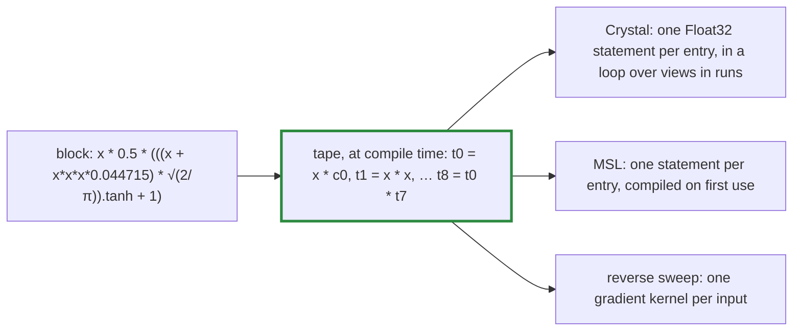

1. **The tape.** The macro walks the block's syntax tree in post order, with an explicit stack, because the macro language has no recursion that returns values. Each operation becomes one tape entry with its own temporary, in Crystal's own order of evaluation, so `x * x * x` is `(x · x) · x`, as the composite computes it.
2. **Constants.** A subexpression without inputs, such as `Math.sqrt(2 / Math::PI)`, is computed once in `Float64` and converted to `Float32`, which is exactly how `Tensor.scalar` converts a number operand.
3. **The host loop** computes each entry in `Float32`, and Crystal never fuses a multiply and an add. So a kernel gives **the same bits as the composite it replaces**, and the composite is its oracle (`spec/kernel_spec.cr`). `tanh`, `exp` and `log` call the same `Tensomite::Maths` functions as the host kernels, and `sqrt` the same `Math.sqrt`.
4. **MSL** puts one statement per entry, so the Metal compiler cannot fuse operations either; only the maths library's functions differ from the CPU's. `Metal` compiles a kernel's source, after `metal/prelude.metal`, the first time the kernel runs, and caches the pipeline.
5. **Gradients.** A reverse sweep over the tape applies each operation's chain rule: the output's gradient spreads to its operands, and contributions to one value are added in the order the sweep meets them. Each input gets its own gradient kernel, whose inputs are the output's gradient followed by the kernel's inputs. Autograd's rule for `Op::Kernel` applies them, so a kernel needs no hand-written backward. Gradient kernels have no gradients of their own.

The expression language is deliberately small: `+`, `-` (binary and unary), `*`, `/`, number literals, constant paths such as `Math::PI`, and `tanh`, `exp`, `log` and `sqrt`. Anything else fails at compile time with the offending expression. Inputs broadcast like a binary op's, and must be `F32` on one device.

## Fused row ops

`softmax`, `log_softmax` and `layernorm` along the last axis are one primitive each (Decision T), in place of five to eight. Along another axis, or with weights of another shape, they fall back to their composites.

- **On host devices,** each row is one loop that does the composite's operations in the composite's order, so a fused op gives the composite's bits. The composites in `spec/row_ops_spec.cr` are the oracles.
- **On Metal,** each row gets a threadgroup that makes three passes over it: reduce, write, normalise. The reductions are the chunked ones of "Reductions in chunks", so a softmax row padded with -∞, as a masked attention row is, keeps its bits, and prefill still equals decode. In the last pass, each thread rewrites only the elements it wrote itself.
- **Backward rules** are built from primitives and checked by finite differences:

  Op         |Gradient of the input
  -----------|-----------------------------------------------------------------------
  `Softmax`  |`y · (g - Σ g·y)`, per row
  `LogSoftmax`|`g - exp(y) · Σ g`, per row
  `LayerNorm`|`(ĝ - mean(ĝ) - x̂ · mean(ĝ · x̂)) / σ`, with `ĝ = g · weight` and `x̂ = (x - mean) / σ`

  The weight's gradient is `g · x̂` and the bias's is `g`, in the expanded shape, so that accumulating them sums over the rows.

## Autograd

`Tensomite.grad(loss, params)` returns the gradient of a one-element `loss` with respect to each param, as lazy tensors. It is a graph transform: it reads the unrealised graph behind `loss` and builds a second graph of ordinary primitive ops beside it. Nothing runs until a gradient is realised, and devices need no autograd code at all.

1. **Order.** List the nodes behind `loss` in topological order, stopping at leaves.
2. **Mark.** Keep only the nodes that lead to a param. Inputs, masks and targets get no gradient.
3. **Seed.** The loss node's gradient is a tensor of ones.
4. **Walk back.** In reverse order, each node's accumulated gradient, in the node's shape, goes through its op's chain rule to give one gradient per marked source. Each is added to its source's node.
5. **Read out.** Each param's gradient is its node's gradient, read through the param's view.

For example, `loss = (w * x).sum` builds two nodes forwards and two backwards:

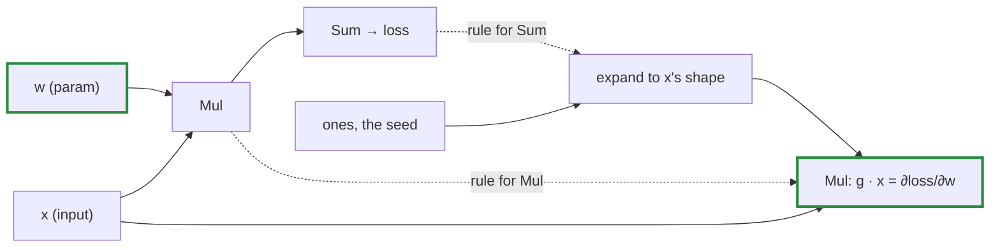

The backward graph reuses `x`, a forward node, so realising a gradient realises whatever forward work it needs. Realising `loss` and the gradients in either order shares that work.

### Chain rules

Each rule turns `g`, the gradient of the op's output, into a gradient for each source in the source's view shape. `out` is the op's own output, reused where it is cheaper than recomputing.

Op            |Gradient for each source                                                      
--------------|------------------------------------------------------------------------------
`Add`, `Sub`  |`g`, and `g` or `-g`                                                          
`Mul`         |`g·b`, `g·a`                                                                  
`Div`         |`g / b`, `-g·out / b`                                                         
`Maximum`     |`g·m` and `g·(1 - m)`, where `m = a.greater_equal(b)`; ties go to `a`         
`Exp`         |`g·out`                                                                       
`Log`         |`g / a`                                                                       
`Tanh`        |`g·(1 - out²)`                                                                
`Sqrt`        |`g / (2·out)`                                                                 
`Sum`         |`g` reshaped to keep the reduced axis, then expanded back                     
`Max`         |`g` expanded, times `m / m.sum`, where `m` marks the maxima; ties share evenly
`Copy`        |`g`                                                                           
`Cat`         |one slice of `g` per source                                                   
`Gather`      |`ScatterAdd` of `g`'s rows into the table's rows; ids get none                
`MatMul`      |`g·bᵀ`, `aᵀ·g`                                                                
`ScatterAdd`  |`g` gathered by the ids                                                       
`Unview`      |`g` read through the inverted view                                            
`GreaterEqual`|none: it is a step function                                                   

### Views and broadcasting, backwards

Sources are views, so a source's gradient arrives in the view's shape and has to land on the node behind it. Broadcasting needs no rule of its own: an `expand` is a view with stride 0, and its adjoint sums.

- **A view covering its whole node in row-major order** (the common case) only needs a reshape.
- **Any other view** (a transpose, slice, expand or permute) becomes an `Unview` node holding the view. Each output position is the sum of the gradient elements that the view reads from it. So a bias of shape `[C]`, expanded to `[N, C]`, gets the column sums; a slice gets zeros outside its range.

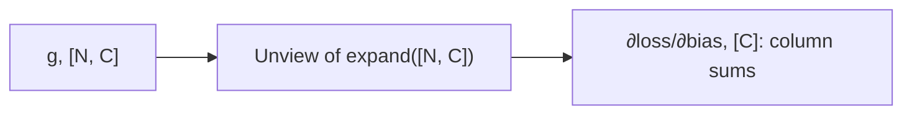

A tensor used twice gets two contributions, added together in the walk's fixed order.

### Realised nodes and constants

A realised node has dropped its sources (see "Tensor and Node"), so there is nothing behind it to differentiate. Rather than silently treating it as a constant, and returning zeros for every param behind it, `grad` raises `Error`. A value that is meant to be constant, such as a precomputed table, is made a leaf with `Tensor#detach`, which realises the tensor and wraps its buffer in a new leaf node.

### Optimizers

Tensors are immutable, so an optimizer does not update params in place. `Optimizer#step(params, grads)` returns new params, realised and detached, and the training loop passes them to the next forward pass. State such as momentum is kept by position in the params array, and detached each step, so no step's graph outlives it.

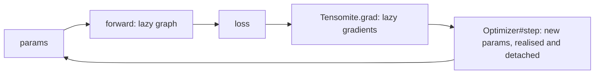

- **`SGD`**: `p - lr·v`, where `v` is `g` or, with momentum, `momentum·v + g`.
- **`AdamW`**: Adam with decoupled weight decay and bias correction. `lr` can be changed between steps for a schedule. Given tensors, every param decays, so params that should not, such as norms and biases, go to a second `AdamW` with `weight_decay: 0`; given `Parameter`s, each one's `decay?` flag decides.
- **Over parameters.** Created with a model's `Parameter`s (see "Modules"), an optimizer's `step(loss)` does the whole loop in the diagram's order: lazy gradients, then reading the loss, then the update, stored back into each parameter's slot. It is the same arithmetic as `step(params, grads)`, to the bit (`spec/module_spec.cr`).

### Cross-entropy

`logits.cross_entropy(targets)` is the mean of `-log_softmax(logits)[row, target]` over rows. `log_softmax` is `x - max - log(Σ exp(x - max))`, which never takes the log of an underflowed probability. The entries are picked by `gather` from the log-probabilities flattened to a `[rows × classes, 1]` table, with indices `row × classes + target` computed on the host. So the targets are realised when the op is built, and the gradient arrives through the `Gather` rule.

## Modules

`Tensomite::Module` (`src/tensomite/module.cr`) is how models are written: a class whose instance variables hold its parts and whose `forward` combines them (Decisions AH to AM). The built-in parts are in `src/tensomite/modules.cr`.

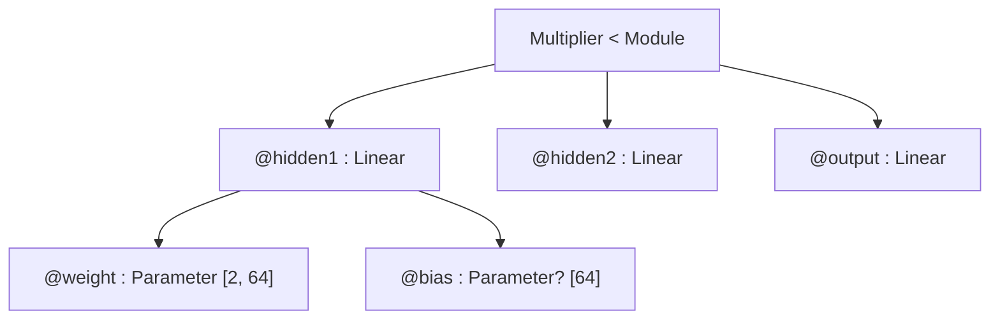

- **One op writes in place (Decision BB).** `Tensor#write(value, axis, start)` makes a `Write` node whose buffer is its target's: the scheduler hands the node the target's buffer instead of allocating one, and the device copies *value* into the region, leaving the rest. It breaks immutability on purpose, for caches that grow without copying, under two rules. The target must cover its whole buffer, so that the region is simple to describe. Anything read from the target before the write must already be realised, because the scheduler orders a write after its sources but not after other readers of the same buffer. The KV cache meets the second rule because each forward pass is realised before the next writes, and it only ever reads positions written earlier, which no later write touches. A write has no gradient.
- **Parameters are slots (Decision AI).** A `Parameter` holds a tensor, a name and a weight-decay flag. Tensors stay immutable; an optimizer replaces the tensor in each slot. Setting a value names the tensor after the parameter, so diagrams show `hidden1.weight`.
- **Parts are found at compile time (Decision AJ).** `Module#each_child` is a macro loop over the subclass's instance variables, as `JSON::Serializable` loops over fields. Variables typed `Parameter`, `Module`, `Array` of either, or nilable versions, are parts, named after the variable, with `.i` for array members. Crystal lists declared variables (`@blocks : Array(Block)`) before inferred ones, which fixes the order of `params`; arrays need such a declaration, because Crystal cannot infer a type from `Array.new(n) { ... }`.
- **Names and tied weights.** `named_params` walks the tree depth first and names each parameter by its path. A parameter reached twice, as tied embeddings are, is listed once, under its first path.
- **`call` and scopes.** `call(*args, **options)` names each child module's scope after its variable, without an array index, so the members of an array share a name and fold in diagrams. Then it runs `forward` inside the module's own scope; the root module has none. `Sequential` names its steps' scopes by kind instead (`linear`, `gelu`).
- **`Layer`** is a `Module` whose `forward` takes one tensor and returns one, which is what `Sequential` holds. A method called on a value of the base type is compiled for every subclass, so `Sequential` cannot hold any `Module`: a transformer block's `forward(x, mask)` would fail to compile there.
- **Initialisation (Decision AK).** Modules draw from `rng:`, by default `Tensomite.rng`, seeded with 0, so a program builds the same model every run. `Linear` draws uniformly from ±1/√inputs, PyTorch's default, and `Embedding` from a normal distribution with standard deviation 0.02, GPT-2's. Normal values use the Box–Muller transform exactly as `examples/shakespeare.cr` does, so that model can move onto modules with the same weights.
- **Bit-identical to hand-written models.** The tutorial's model, rewritten on modules, gives the same loss bits for all 2,000 steps, and the same answers, as the tensor version; so does the Shakespeare model, for every training and validation loss checked, in two shapes. Moving both onto a `Builder` changed no bits either; `spec/builder_spec.cr` keeps a plain-module copy of each to check it. The operations and the draws from the generator are the same, in the same order. The Shakespeare model keeps its position table as a bare `Parameter`, sliced as before: an `Embedding` over position ids would compute the same values, but its gradient goes through `ScatterAdd` rather than `Unview`, which adds in a different order.
- **Builders (Decision AN).** A `Builder` (`src/tensomite/builder.cr`) holds a generator, a device, a bias flag and an initialiser, and makes built-in modules with them, so a model states them once. It is plain Crystal; Crystal's type inference shapes it:
  - an instance variable assigned inside a block in `initialize` becomes nilable, so a builder cannot wrap the constructor in a block, and is passed in as an argument instead;
  - Crystal works out an instance variable's type from a method call only when the receiver is a typed argument, and the constructor's other arguments are typed: `@ln = build.layernorm(width)` needs `build : Builder` and `width : Int32` in the signature;
  - it does so for class methods called with a block, but not for instance methods, which is why `Sequential.build(build) do ... end` is a class method;
  - `with ... yield` stops working when the block parameter has a type (`& : -> _`), so `Sequential.build` leaves it untyped.
- **A declarative macro was tried and set aside (Decision AN).** A `parts(width : Int32) do ln1 = layernorm(width); ... end` macro wrote the constructor, getters and a method per part, so `forward` read `attention(ln1(x), mask)` rather than `@attention.call(@ln1.call(x), mask)`. It built both models with the same bits, but ameba reports every part line as a useless assignment, the block could hold nothing but parts, and mistakes appeared as macro-expansion errors. A second look is a follow-up (Decision AR), and needs a syntax that ameba accepts without suppressions.
- **`CausalSelfAttention`** is GPT-2's attention as a module, over rows of `[batch × length, width]`, the sequence length taken from the mask. It keeps the rows flat rather than `[batch, length, width]`, because a batched matmul is a different shape to BLAS, which chooses its blocking by shape. Given a `CausalSelfAttention::Cache`, it appends its keys and values, `[batch, heads, positions, head width]`, and attends over all of them.
- **GPT-2 on modules (Decisions AO to AQ).** `GPT2` is a `Module` whose variables have Hugging Face's names (`wte`, `wpe`, `h`, `ln_1`, `attn`, `c_attn`, `c_proj`, `mlp`, `c_fc`, `ln_f`), as nanoGPT's do, so the weights file loads by name with `load(prefix:, ignore:)`; `ignore` skips each block's stored causal mask, `attn.bias`, which PyTorch saves because it is a registered buffer. The model is built with `Init.placeholder`, a one-element zero expanded to the parameter's shape, so building it before loading allocates only the biases and norms. Its logits are bit-identical to the hand-written model's on CPU and BLAS, prefilling 64 tokens and decoding 8 (`bench/gpt2_digest.cr`): the attention's batch axis of 1 changes no bits. The KV cache is one `CausalSelfAttention::Cache` per block, passed through `call` as an argument.
- **Scope names are set when parameters are listed,** as well as by `call`, because a model's own entry point, such as `GPT2#graph`, may run `forward` without `call`.

## Graph diagrams

`Tensor#to_mermaid` draws the graph behind a tensor as a Mermaid flowchart, so it can be read rather than walked through `node.srcs` by hand.

- **Every op** (`to_mermaid`, the default): a box per node with its op, name and shape, and an edge per source. Views are not nodes, so a source read through one labels its edge with the kind of view (`reshape`, `slice`, `expand` or `permute`) and the shape it reads. Leaves have a green border and the root a red one. A graph larger than `max_nodes` (200) keeps the nodes nearest the root and puts the rest behind one box, since Mermaid refuses graphs of more than about 500 edges.
- **A summary** (`to_mermaid(depth: n, params: model.params)`): nodes grouped by scope, cut to `n` levels, one box per group with its op count and parameter count.

**Scopes** name the parts of a model. `Tensomite.scope("block") { ... }` opens a scope, nested in the current one, and every node built inside records it, in one reference per node. The chain rules of `grad` build their nodes in the scope of the node they differentiate, so a block's gradients belong to the block. Leaves get names with `Tensor#named`; GPT-2 names its weights as the weights file does.

A summary folds repetition: sibling scopes of one name whose graphs match (the same ops, shapes and parameter sizes, in order) become one box marked `×k`, with counts per instance, and edges from one instance into the next are drawn dashed as `next`. Scopes above the last level become subgraphs, and the nodes a scope holds directly, outside its children, are its "own ops", such as a block's residual adds. The Shakespeare model's loss at depth 2, from `examples/shakespeare.cr --layers 4 --heads 6 --width 192 --context 128 --diagram 2`. The model is built from modules (see "Modules"), so its boxes are named after them:

```mermaid
flowchart TB
    b1["ids · leaf [16,128] I32"]
    b5["causal mask · leaf [128,128]"]
    b12["leaf [2048] I32"]
    subgraph sub1 ["embedding"]
        b2["own ops<br/>1 op · 24.6k params"]
        b0["tokens<br/>1 op · 12.5k params"]
    end
    subgraph sub2 ["blocks ×4"]
        b6["own ops<br/>2 ops each"]
        b3["ln1<br/>1 op · 384 params each"]
        b4["attention<br/>11 ops · 147k params each"]
        b7["ln2<br/>1 op · 384 params each"]
        b8["mlp<br/>3 ops · 295k params each"]
    end
    subgraph sub3 ["head"]
        b10["own ops<br/>1 op"]
        b9["ln<br/>1 op · 384 params"]
    end
    b11["loss<br/>5 ops"]
    b1 -- "[16,128]" --> b0
    b0 -- "[16,128,192]" --> b2
    b2 -- "[2048,192]" --> b3
    b3 -- "[2048,192]" --> b4
    b5 -- "[16,6,128,128]" --> b4
    b2 -- "[2048,192]" --> b6
    b4 -- "[2048,192]" --> b6
    b6 -- "[2048,192]" --> b7
    b7 -- "[2048,192]" --> b8
    b8 -- "[2048,192]" --> b6
    b6 -. "next" .-> b3
    b6 -. "next" .-> b6
    b6 -- "[2048,192]" --> b9
    b9 -- "[2048,192]" --> b10
    b10 -- "[2048,65]" --> b11
    b12 -- "[2048]" --> b11
    classDef leaf stroke:#2b8a3e,stroke-width:2px
    class b1,b5,b12 leaf
    classDef root stroke:#c92a2a,stroke-width:2px
    class b11 root
```

GPT-2 small at the same depth (`examples/gpt2_diagram.cr`) has the same shape, with Hugging Face's names: an embedding of 39.4M params, `h ×12` of 7.09M each, whose `attn` has 13 ops to the Shakespeare model's 11 because its projections have biases.

Box ids follow the graph's order, so the same graph always gives the same text, and diagrams can be compared as text.

**Towards inspection.** Diagrams are the first step towards looking inside a running model: its activations, attention patterns and gradients. Scopes are the addresses that will need. Each call to `scope` makes a new instance, so "the third block" stays addressable even where a summary folds four into one, and a lazy graph can keep any intermediate it computes, so a probe needs no change to the model's code.

## Error timing

The plan accepts that errors in a lazy graph may surface far from their cause. To keep that rare, every check that can be made when an op is called is made then:

Error           |Raised when                                                                                                 
----------------|------------------------------------------------------------------------------------------------------------
`ShapeError`    |Building the op: broadcast mismatch, bad axis, slice or permutation, wrong element count, empty max         
`DTypeError`    |Building the op: mixed dtypes, a float-only op on `I32`, non-`I32` gather ids; or `to_a` with the wrong type
`DeviceError`   |Building the op with tensors on different devices, or a device given another device's buffer                
`ExecutionError`|`realize`: a kernel met invalid data, such as a gather id out of range                                      

Only `ExecutionError` depends on the data rather than the shapes, so it is the only one raised at `realize`.

```mermaid
flowchart LR
    Call["a + b"] --> Check{{"shape, dtype, device OK?"}}
    Check -- no --> Err["raise now, at the caller's line"]
    Check -- yes --> Node["node built"]
    Node --> Real["realize"]
    Real --> Exec{{"data valid?"}}
    Exec -- no --> Late["ExecutionError at realize"]
    style Err stroke:#2b8a3e,stroke-width:3px
    style Late stroke:#d9480f,stroke-width:3px
```

## Models and data

### Loading weights

`SafeTensors.open(path)` maps the whole file once with `MappedFile` and parses only the JSON header. Each tensor is then a realised leaf over its own byte range:

```mermaid
flowchart LR
    File[("model.safetensors")] --> Map["MappedFile: mmap of the whole file"]
    Map --> Header["header: name → dtype, shape, byte range"]
    Header --> Dev{{"host device?"}}
    Dev -- yes --> Adopt["HostBuffer over the byte range, no copy; keeps the MappedFile alive"]
    Dev -- no --> Upload["alloc and upload"]
    Adopt --> Leaf["leaf Tensor"]
    Upload --> Leaf
    style Adopt stroke:#2b8a3e,stroke-width:3px
```

- **Nothing is read until used.** The operating system pages weights in as kernels touch them.
- **Unaligned tensors are copied.** A tensor is read in place only when its data starts on a 4-byte boundary. Older safetensors writers do not pad the header: in GPT-2 small's published file the data section starts at byte 14,291, so every tensor is 3 bytes off and is copied into a new, aligned buffer at load. Reading `Float32`s from unaligned addresses happens to work on x86 and ARM64, but LLVM treats it as undefined behaviour, and GPU uploads need alignment anyway.
- **The mapping lives as long as any tensor over it,** because each `HostBuffer` holds its `MappedFile`.
- **Limits:** one tensor must fit in 2 GiB (an `Int32` `Slice`), but the file may be larger. Only `F32` and `I32` tensors load; other dtypes raise `DTypeError`.
- **Every header entry is checked** against the file: its byte range fits and holds exactly the bytes its shape needs.

**Writing.** `SafeTensors.write(path, tensors, metadata)` writes each tensor's values in row-major order, so a view is saved as the tensor it shows, and pads the header with spaces to a multiple of 8 bytes, as Hugging Face's writer does, so every `F32` and `I32` tensor is aligned and maps without a copy when read back. It writes a temporary file beside *path* and renames it over *path*. Writing in place would be a hazard: tensors loaded from a file are mapped from it, so a model that saves over the file it loaded would see its own weights change under it, or crash if the file shrank. A rename leaves the old file's data in place for as long as it is mapped (`spec/safetensors_spec.cr` checks both). Files written this way are read by Hugging Face's `safetensors` package, and files it writes are read here.

`Module#save` and `Module#load` (see "Modules") use these by parameter name: `load` puts each tensor on the device its parameter is on, and by default refuses a file with missing, extra or misshapen tensors.

### Tokeniser

`BPE` reproduces GPT-2's byte-level byte-pair encoding from a `vocab.json` and a `merges.txt`:

```mermaid
flowchart LR
    Text["text"] --> Words["split by GPT-2's pattern (Unicode-aware)"]
    Words --> Bytes["each word's UTF-8 bytes"]
    Bytes --> Chars["bytes mapped to printable characters"]
    Chars --> Merge["merge the lowest-ranked adjacent pair, repeatedly"]
    Merge --> Ids["vocabulary ids"]
```

- **Every byte maps to a printable character** (space becomes `Ġ`, newline `Ċ`), so any byte sequence round-trips, including emoji and broken UTF-8.
- **The pattern is compiled with `Regex::Options::UCP`,** so `\s` matches Unicode whitespace, such as a no-break space, as in the reference implementations.
- **Decoding** maps characters back to bytes and replaces invalid UTF-8 with U+FFFD, as the reference does.
- **Words are cached** after their first encoding.

### GPT-2

`GPT2.load(path, heads, device)` reads every size except the number of heads from the weight shapes. `forward(ids, cache)` runs new positions after those in the cache and returns their logits:

```mermaid
flowchart TD
    Ids["ids"] --> Embed["token embedding + position embedding"]
    Embed --> Block["block × layers"]
    subgraph Block["each block"]
        LN1["layernorm"] --> Attn["causal self-attention over cache + new keys"]
        Attn --> Add1["+ residual"]
        Add1 --> LN2["layernorm"]
        LN2 --> MLP["matmul, GELU, matmul"]
        MLP --> Add2["+ residual"]
    end
    Block --> LNF["final layernorm"]
    LNF --> Logits["matmul with the token embedding (tied) → logits"]
```

- **The KV cache** holds each layer's keys and values in buffers of `[batch, heads, context, head width]`, made on the first token. Each token writes its keys and values into them in place (`Tensor#write`), and attention reads a slice of the positions filled so far. Decision BB; before it, each token joined its positions to a copy of the cache with `Tensor.cat`.
- **The causal mask** is `Tensor.causal_mask(new, past + new)`, so the same code serves prefill (many new positions) and decode (one).
- **Weights stay in GPT-2's `[in, out]` layout,** so each linear layer is a plain `x.matmul(w) + b`. The output layer reuses the token embedding through a transposed view, with no copy.
- **`generate(prompt, count, sampler)`** prefills the prompt, then decodes one token at a time, yielding each.

### Sampling

`Sampler.greedy` picks the highest logit, the first on ties. Otherwise logits are divided by the temperature, cut to the `top_k` highest when it is positive, and drawn from their softmax with a seeded `Random::PCG32`, so a seed repeats a run.

### Verified against the reference

Model         |Tokeniser corpus|Max logit difference from PyTorch|Greedy tokens|Prefill against decode       
--------------|----------------|---------------------------------|-------------|-----------------------------
Tiny reference|identical ids   |4.6e-6 (`CPU`), 3.9e-6 (`BLAS`)  |20 identical |bit-identical on host devices
GPT-2 small   |identical ids   |3.7e-4 (`CPU`)                   |64 identical |bit-identical on `CPU`       

GPT-2 small's larger difference reflects its size: 12 layers of 768-wide dot products added in a different order from PyTorch's.

### Determinism in practice

On host devices, a position's logits are bit-identical whether it is computed in a prefill or one token at a time (`spec/gpt2_spec.cr`). That is level 2 of Decision K. It holds because every host kernel's order of arithmetic depends only on the index, and masked positions contribute exact zeros to sums.

On `BLAS`, the same comparison on the tiny reference model differs in the low bits of 77% of logits (at most 1.4e-6). That is why `BLAS` reports `shape_invariant?` false.

## Performance baselines

Measured with `bench/matmul.cr` and `bench/gpt2.cr`, built with `--release`. Medians of several runs.

**Matmul, naive oracle against BLAS, square `F32` matrices** (the oracle as of M3, before its strided matmul):

Size|Linux container, 4 cores, OpenBLAS: oracle / BLAS ms|MacBook Pro, M5 Pro, Accelerate: oracle / BLAS ms|M5 Pro GFLOP/s
----|----------------------------------------------------|-------------------------------------------------|--------------
64  |8.03 / 0.015                                        |2.59 / 0.004                                     |141           
128 |40.87 / 0.042                                       |20.92 / 0.007                                    |606           
256 |349.72 / 0.123                                      |169.20 / 0.043                                   |774           
512 |3,276.51 / 1.176                                    |1,301.29 / 0.260                                 |1,031         

The M5 Pro's BLAS throughput is higher than its NEON units alone can deliver. Accelerate is most likely using the CPU's matrix extension.

**GPT-2 small, Linux container** (shapes of GPT-2 small, 64-token prompt, 32 decoded tokens):

Device|M4 prefill tokens/s|M4 decode tokens/s|M5 prefill tokens/s|M5 decode tokens/s|M5 ms per decoded token
------|-------------------|------------------|-------------------|------------------|-----------------------
`CPU` |2.1                |1.64              |2.7                |2.17              |462                    
`BLAS`|57.9               |10.25             |258.3              |29.59             |34                     

M5's gain comes from walking views in runs (see "Host kernels"), which made `Cat`, the KV cache's copy, several times cheaper. As of M4, before that change, a decoded token's 93 ms on `BLAS` went as follows:

Kernel                      |ms per token|Share
----------------------------|------------|-----
`Cat` (growing the KV cache)|44.9        |48%  
`MatMul` (`cblas_sgemm`)    |30.1        |32%  
All other host kernels      |15.6        |17%  
Outside kernels             |2.7         |3%   

- **The KV cache cost the most:** every token copies the whole cache. It still does, but in runs; a preallocated cache written in place would remove the copy altogether.
- **The matmuls are limited by memory bandwidth:** each decoded token streams all ~500 MB of weights once, and 30 ms is about 17 GB/s.

**Metal on the MacBook Pro, M5 Pro** (M6: every op on the GPU; `MatMul` in each of its modes):

Device                |GPT-2 prefill tokens/s|GPT-2 decode tokens/s|ms per decoded token
----------------------|----------------------|---------------------|--------------------
`CPU`                 |8.6                   |7.63                 |131                 
`BLAS`                |905.5                 |152.01               |7                   
`Metal`, serial matmul|635.3                 |34.22                |29                  
`Metal`, split matmul |1,148.7               |63.57                |16                  
`Metal`, atomic matmul|1,267.5               |63.52                |16                  

Size|`BLAS` ms|`BLAS` GFLOP/s|`Metal` ms (split)|`Metal` GFLOP/s
----|---------|--------------|------------------|---------------
64  |0.003    |151.6         |0.255             |2.1            
128 |0.005    |786.3         |0.293             |14.3           
256 |0.027    |1,240.8       |0.966             |34.7           
512 |0.205    |1,308.1       |2.716             |98.8           

- **Splitting `k` nearly doubled decode** (34 to 64 tokens/s) and lifted prefill past `BLAS` (1,149 against 906 tokens/s).
- **Determinism costs nothing in decode and about 9% in prefill.** The atomic split decodes at the same speed and prefills at 1,268 tokens/s. Waiting for the 8 partial sums and adding them in order is cheap beside streaming the weights.
**Matrix-vector products by mode** (`bench/matvec.cr`, M5 Pro; 20 products per realise, ms per 20):

Shape (GPT-2 small)         |Serial|Split |Atomic|Atomic saving
----------------------------|------|------|------|-------------
attention q·k·v, 768 → 2,304|3.293 |0.895 |0.859 |4%           
attention out, 768 → 768    |2.070 |0.564 |0.570 |-1%          
MLP up, 768 → 3,072         |3.231 |0.923 |0.914 |1%           
MLP down, 3,072 → 768       |11.713|1.839 |1.795 |2%           
logits, 768 → 50,257        |13.986|11.804|11.768|0%           
prefill MLP up, 64 rows     |11.851|12.574|11.537|8%           

- **The logits product runs at memory bandwidth.** Its 154 MB of weights, too large for any cache, stream in 0.59 ms, about 260 GB/s.
- **A token's matmuls take about 3 ms of its 16.** Each layer's four products take about 211 µs, so 2.5 ms for 12 layers, plus 0.6 ms for the logits. The smaller weights may stay in the GPU's cache across the 20 products, so those figures flatter decode a little.
- **With 64 rows, splitting costs 6%** over serial: the GPU is already full, and the split's barriers are pure cost. One kernel for every number of rows is what keeps prefill equal to decode.
- **Decode is still behind `BLAS`** (16 ms against 7 ms per token). The matmuls take about 3 ms of it (above), so about 13 ms goes elsewhere. Each primitive op is its own dispatch, hundreds per token, and the reductions inside `layernorm` and `softmax` use one thread per output. That is M7's work: kernel macros fuse those chains (Decision O requires Metal to beat `BLAS` there).
- **Square matmuls barely change, at 99 GFLOP/s** against Accelerate's 1.3 TFLOP/s on the CPU's matrix units. They already had enough outputs to fill the GPU; they needed tiling in threadgroup memory, which came in M7 part 8.
- **About 0.3 ms per realise is fixed cost:** committing a command buffer and waiting for it. It dominates small matrices, and is paid once per decoded token.
- **With one thread per output (serial), decode left most of the GPU idle:** a 768-wide layer launched 768 threads, each looping over all of `k`.

**Where a decoded token's time goes on Metal** (`bench/profile_gpt2.cr`, M5 Pro, M7 part 1):

Part of the 15.65 ms wall time                                          |ms   |Share
------------------------------------------------------------------------|-----|-----
Waiting for the GPU                                                     |13.19|84%  
Everything else on the host (graph building, scheduling, reading logits)|1.19 |8%   
Allocating buffers                                                      |1.00 |6%   
Encoding 710 dispatches                                                 |0.26 |2%   

GPU time per op, each committed alone (13.75 ms in all):

Op        |Per token|GPU ms|Share
----------|---------|------|-----
`Sum`     |62       |7.81  |57%  
`MatMul`  |73       |3.81  |28%  
`Add`     |159      |0.49  |4%   
`Mul`     |134      |0.40  |3%   
`Max`     |12       |0.36  |3%   
`Div`     |87       |0.30  |2%   
all others|151      |0.57  |4%   

- **One thread per output is what makes `Sum` slow.** Fifty of the 62 sums are the means inside the 25 layer norms, each a single row of 768: one GPU thread adds 768 numbers in turn, waiting on memory for each, about 126 µs per sum. The other 12 are softmax denominators.
- **Dispatch overhead is not the problem.** Encoding 710 dispatches costs 0.26 ms, and a small elementwise op about 3 µs of GPU time.
- **Allocation costs 1 ms a token**, which the buffer pool (Decision U) targets.

**After parallel reductions** (M7 part 2, M5 Pro):

Measure                                                    |Part 1|Part 2
-----------------------------------------------------------|------|------
Metal decode, tokens/s (split)                             |63.6  |104.9 
Metal prefill, tokens/s (split)                            |1,149 |1,279 
Wall per decoded token, ms                                 |15.65 |10.14 
of which waiting for the GPU                               |13.19 |6.98  
of which on the host: allocating, encoding, everything else|2.45  |3.16  
GPU time in `Sum`, ms                                      |7.81  |1.03  
GPU time in `MatMul`, ms                                   |3.81  |4.04  
GPU time in elementwise ops and `Cat`, ms                  |1.76  |2.10  

- **Host work is now about a third of a decoded token's 10 ms.** The host builds the graph, allocates buffers and encodes every dispatch before the command buffer is committed, so the GPU waits for all of it. The buffer pool (part 3) removes most of the allocation. Committing in batches as encoding proceeds would let the GPU start before the host finishes.
- **Matmul is now the largest GPU cost, at 54%.** Elementwise ops, about 2 ms over 500 dispatches, are what fusion removes.
- **`BLAS` decodes at 6.6 ms per token.** Metal is at 9.5, so about 3 ms is left to find.

**After the buffer pool and batched commits** (M7 part 3, M5 Pro):

Measure                          |Part 2|Part 3
---------------------------------|------|------
Metal decode, tokens/s (split)   |104.9 |138.6 
`BLAS` decode, tokens/s, same run|151.7 |144.0 
Metal prefill, tokens/s (split)  |1,279 |1,521 
Wall per decoded token, ms       |10.14 |6.98  
of which waiting for the GPU     |6.98  |5.23  
allocating buffers               |1.29  |0.60  
everything else on the host      |1.53  |0.78  
Command buffers per token        |1     |12    
GPU time, each op alone, ms      |7.44  |6.78  

- **The host now overlaps the GPU.** The wall time (6.98 ms) is less than the GPU's own work timed op by op (6.78 ms) plus the host's (1.74 ms), because the GPU starts on each batch of 64 dispatches while the host encodes the next.
- **Metal decodes within 4% of `BLAS`** in the same run, and prefills 1.7 times as fast. `BLAS` itself varies by about 5% between runs (144 to 153 tokens/s), so the M7 exit compares the two within one run.
- **What is left is GPU work:** matmul 3.8 ms, and about 2 ms of small elementwise dispatches, which fusion removes.

**After kernel macros** (M7 part 4, M5 Pro, `gelu` as one kernel):

Measure                    |Part 3|Part 4
---------------------------|------|------
Dispatches per token       |710   |614   
Wall per decoded token, ms |6.98  |6.72  
GPU time, each op alone, ms|6.78  |6.48  
of which `MatMul`          |3.82  |3.80  
of which `Sum` and `Max`   |1.21  |1.21  
of which the 12 `gelu`s    |≈0.30 |0.04  

- **`gelu` went from nine dispatches per layer to one,** and from about 25 µs of GPU time per layer to about 3.
- **The rest of the non-matmul time is mostly inside `layernorm` and `softmax`:** their sums and maxima, and the `Sub`, `Div`, `Sqrt`, `Exp` and `Mul` around them. The fused row ops (part 5) replace each of them with one kernel.

**After fused row ops** (M7 part 5, M5 Pro, first version):

Measure                          |Part 4|Part 5
---------------------------------|------|------
Dispatches per token             |614   |316   
Metal decode, tokens/s           |—     |150.95
`BLAS` decode, tokens/s, same run|—     |167.82
Wall per decoded token, ms       |6.72  |6.54  
GPU time, each op alone, ms      |6.48  |6.33  
of which `MatMul`                |3.80  |3.74  
of which `LayerNorm` (25)        |—     |1.42  
of which `Softmax` (12)          |—     |0.51  

Fusing saved dispatches but little GPU time: a layer norm of one row of 768 took 57 µs. With chunks of 64 it had only 12 threads, each reading 64 elements in turn through `offset_of`, whose integer division and remainder per dimension are slow on a GPU. So reductions and row ops now use chunks of 16, giving a row of 768 48 threads, and step through a run by its stride; `offset_of` returns `offset + i` at once for a dense view, which every kernel benefits from.

**After more threads per row and stride indexing** (M7 part 5, M5 Pro):

Measure                          |Part 5, first|Part 5    
---------------------------------|-------------|----------
Metal decode, tokens/s (split)   |150.95       |**187.63**
`BLAS` decode, tokens/s, same run|167.82       |160.26    
Metal prefill, tokens/s (split)  |1,552        |1,642     
`BLAS` prefill, tokens/s         |1,285        |1,240     
Wall per decoded token, ms       |6.54         |4.95      
GPU time, each op alone, ms      |6.33         |4.74      
of which `MatMul`                |3.74         |3.73      
of which `LayerNorm` (25)        |1.42         |0.28      
of which `Softmax` (12)          |0.51         |0.08      

- **Metal decodes 17% faster than `BLAS`** in the same run, and prefills a third faster: what Decision O requires of M7.
- **A layer norm of one row now takes 11 µs, not 57.** Four times the threads, and no integer division per element.
- **Matmul is 79% of the GPU's time.** The rest is the residual and bias adds, the KV cache's `Cat` and `Copy`, and the fused ops.
- **Atomic matmul is now slower than the deterministic split in decode** (182.9 against 187.6 tokens/s), so determinism costs nothing there.

**After vectorised host loops and own maths** (M7 part 6, M5 Pro): Metal's kernels are unchanged, but `BLAS` runs every op except matmul on host kernels, which now vectorise.

Measure                          |Part 5|Part 6    
---------------------------------|------|----------
Metal decode, tokens/s (split)   |187.63|**183.80**
`BLAS` decode, tokens/s, same run|160.26|171.56    
Metal prefill, tokens/s (split)  |1,642 |1,590     
`BLAS` prefill, tokens/s         |1,240 |**2,349** 
Wall per decoded token, ms       |4.95  |4.98      

- **Metal still decodes faster, by 7% rather than 17%.** Decision O's requirement holds, with less room.
- **`BLAS` now prefills half as fast again as Metal.** Prefill is a few large matmuls, where Accelerate is strong and Metal's matmul, untiled until M7 part 8, was not.

**After the tiled matmul** (M7 part 8, M5 Pro, GPU time per product of a 128-token GPT-2 prefill from `bench/profile_gpt2.cr --prefill 128`):

Products                        |Before, ms|After, ms|GFLOP/s after|`BLAS` GFLOP/s
--------------------------------|----------|---------|-------------|--------------
head, `[128,768]·[768,50257]`   |24.9      |4.0      |2,481        |1,010         
mlp in, ×12                     |13.3      |3.4      |2,106        |1,139         
attention in, ×12               |10.0      |3.0      |1,826        |1,450         
mlp out, ×12                    |12.3      |7.5      |967          |1,756         
attention out, ×12              |3.5       |1.9      |941          |1,498         
attention scores and values, ×24|3.4       |0.6      |840–1,240    |730–970       
all GPU work                    |69.0      |22.1     |             |              

- **A 128-token prefill runs at 5,539 tokens/s,** against 2,010 for `BLAS` in `bench/gpt2.cr`: Decision AF's target, with room. Decode is unchanged (183 against `Split`'s 187 tokens/s, within run-to-run noise), because it still uses `Split`.
- **64×64 blocks win everywhere it matters.** In `bench/matmul.cr`, 32×32 and 32×64 blocks were slower on every large product, including the narrow ones.
- **Products with 768 output columns are the gap left** (Decision AG). A 128 × 768 output is 24 blocks of 64×64, too few to occupy the GPU, and each walks all of `k` alone; mlp out and attention out are 43% of the prefill now. Splitting `k` across threadgroups would fill the GPU, but split-K's left fold, `((c0 + c1) + c2) + …`, means each chunk's sum would have to be stored and folded by a second kernel, about 19 MB of scratch for mlp out, for an estimated 3 of 22 ms.

**M7's exit runs** (M5 Pro, `main` after part 8; `bench/gpt2.cr` times prefill warm, as the median of five):

Device                 |Prefill of 64 tokens, tokens/s|Decode, tokens/s
-----------------------|------------------------------|----------------
`BLAS`                 |2,419                         |166.4           
Metal, `Split`         |1,732                         |198.5           
Metal, `Atomic`        |1,988                         |186.6           
Metal, `Tiled`         |3,681                         |65.9            
Metal, `Auto` (default)|**3,684**                     |**186.1**       

- **Metal now leads on both counts:** 1.12 times `BLAS` at decode and 1.52 times at a 64-token prefill. At 128 tokens, where the tiled matmul has more rows to share, `bench/profile_gpt2.cr --prefill 128` gives 5,296 tokens/s.
- **A decoded token takes 5.07 ms** of wall time, 4.77 ms of it GPU work, in 316 dispatches and 5 command buffers.
- **`Tiled` alone decodes slowly** (66 tokens/s), because one row fills a sixty-fourth of a block; `Auto` sends such products to `Split`. The spread between `Split`, `Atomic` and `Auto` at decode, 186 to 199 tokens/s, is mostly run-to-run noise: they run the same kernels there.

**CUDA on the DGX Spark** (GB10, M8 part 4; `bench/gpt2.cr` with `-Dcuda`, prefill timed warm as the median of five):

Device                |Prefill of 64 tokens, tokens/s|Decode, tokens/s|ms per decoded token
----------------------|------------------------------|----------------|--------------------
CPU oracle            |8.2                           |7.21            |139                 
`BLAS` (OpenBLAS)     |836                           |67.2            |15                  
CUDA, `Serial`        |600                           |108.8           |9                   
CUDA, `Split`         |447                           |154.3           |6                   
CUDA, `Tiled`         |4,616                         |95.9            |10                  
CUDA, `Auto` (default)|**4,587**                     |**170.7**       |**6**               

- **CUDA leads on both counts:** 5.5 times `BLAS` at a 64-token prefill and 2.5 times at decode, with every op of the forward pass on the GPU.
- **`Auto` takes the best of both,** as on Metal: tiled products prefill nearly ten times faster than split ones, and split products decode 1.6 times faster than tiled ones.
- **Decode has room to grow.** A decoded token takes 5.9 ms; `bench/profile_gpt2_cuda.cr` shows where it goes. Reading GPT-2 small's 0.5 GB of `F32` weights once at the GB10's memory bandwidth would take about 2 ms, I think, so most of the time is elsewhere: about 316 launches a token, the logits copied back to the host, and a KV cache that `Cat` copies whole every token.

**Where a decoded token goes on the GB10** (Decision AW; `bench/profile_gpt2_cuda.cr`, part 4's kernels):

Cost                      |ms per token
--------------------------|------------
wall                      |6.38        
GPU time, every kernel    |5.63        
matmuls, 493 MB of weights|3.83        
the output head alone     |1.64        
launching (316 launches)  |0.94        
allocating                |1.04        
copying                   |0.03        

- **Decode is GPU-bound, and the matmuls are most of it.** They read weights at about 129 GB/s; the output head, `[1,768]·[768,50257]`, at 94.
- **`Split` has too few blocks for one row.** It launches one per 32 output columns, so the 768-column products get 24 blocks, and every block walks all of `k`.
- **The head reads across its weights.** Its `b` is the token embedding transposed, so `k` is contiguous in memory and neighbouring columns are 768 floats apart. `Split`'s neighbouring threads read neighbouring columns, so no two reads share a transaction.

**Two passes for few rows (Decision AX).** `TwoPass` cuts each product into blocks of 128 columns by one chunk of 64 along `k` (and 16 rows). Each block copies its chunk of `b` into shared memory along whichever axis is contiguous, then each thread sums its column's chunk in index order, as `Split` does, and stores the sum in scratch memory. A second kernel adds each output's chunk sums in chunk order from zero. The sums and their order are `Split`'s, so the bits are too. The head becomes 393 × 12 blocks instead of 1,571 blocks each walking 768. The scratch is one buffer kept by the device, grown as needed (2.4 MB for the head): kernels run one after another, so each launch may reuse it. `spec/cuda_spec.cr` checks `TwoPass` against `Split` bit for bit, and a change to the order of the second pass fails it.

Measured on the GB10 (`bench/gpt2.cr`, then `bench/profile_gpt2_cuda.cr`):

Product, decoding one token       |`Split`, GB/s|`TwoPass`, GB/s|`TwoPass`, ms
----------------------------------|-------------|---------------|-------------
head, `[1,768]·[768,50257]`       |94           |203            |0.761        
mlp out, `[1,3072]·[3072,768]`    |137          |140            |0.806        
mlp in, `[1,768]·[768,3072]`      |175          |172            |0.658        
qkv, `[1,768]·[768,2304]`         |171          |151            |0.562        
attention out, `[1,768]·[768,768]`|126          |99             |0.286        

- **Decode rose from 170.7 to 198.1 tokens/s,** 5.0 ms a token from 6.4, below the 210 estimated. `TwoPass` alone decodes at 181 and `Split` alone at 159.
- **The head gained, the rest did not.** Two passes more than doubled the head's bandwidth, because its reads now coalesce. The products whose weights are contiguous along `n` already coalesced under `Split`, so they gained nothing from coalescing. qkv and attention out got slower: I think from the extra launch and the 32 KB of shared memory per block, which limits how many blocks share a multiprocessor (not yet measured).
- **Launches rose from 316 to 389,** one more per matmul.

**`Auto` chooses by layout (Decision AY).** Below 16 rows it now uses `TwoPass` only when `b`'s columns are not contiguous, as in the head and attention's `q·kᵀ`, and `Split` otherwise. On the GB10 the profile gives 4.71 ms a decoded token, about 212 tokens/s, in 329 launches; attention out is back at `Split`'s 126 GB/s. qkv stayed at 149 GB/s under `Split`, against 171 in part 4's profile, so some of the earlier gap between the two was run-to-run variation.

**Timing decode.** Until this change `bench/gpt2.cr` timed decode once, 32 tokens, straight after loading each device's model. One such run put `Auto` at 169 tokens/s and `TwoPass`, which `Auto` mostly matches, at 206, while the profile put `Auto` at 212. I think the collector, finalizing the models of earlier runs, landed inside that timing. Decode is now the median of five runs, after a `GC.collect`, as prefill already was. Rerun that way on the GB10:

Device                |Prefill of 64 tokens, tokens/s|Decode, tokens/s|ms per decoded token
----------------------|------------------------------|----------------|--------------------
`BLAS` (OpenBLAS)     |773                           |70.9            |14                  
CUDA, `Serial`        |617                           |123.3           |8                   
CUDA, `Split`         |445                           |178.5           |6                   
CUDA, `Tiled`         |4,834                         |94.8            |11                  
CUDA, `TwoPass`       |3,718                         |203.2           |5                   
CUDA, `Auto` (default)|**4,585**                     |**211.4**       |**5**               

- **`Auto` decodes at 211 tokens/s,** from part 4's 171, and agrees with the profile's 212. It beats `TwoPass` alone by keeping `Split` where `b`'s columns are contiguous.
- **What remains,** by op (Decision AZ; `bench/profile_gpt2_cuda.cr` now totals each op whatever its shape):

Op       |Per token|GPU ms|Share
---------|---------|------|-----
`MatMul` |73       |3.160 |67%  
`Cat`    |24       |0.520 |11%  
`Add`    |85       |0.405 |9%   
`Copy`   |48       |0.246 |5%   
LayerNorm|25       |0.224 |5%   
`Softmax`|12       |0.086 |2%   
others   |25       |0.108 |2%   

- **The matmuls are still two thirds.** The five weight products take 2.96 ms for 493 MB, about 167 GB/s; mlp out (136 GB/s) and attention out (126) are the slowest, with 24 blocks each under `Split`.
- **`Cat` is the largest of the rest:** 24 a token, each copying a layer's whole key or value cache, about 22 µs apiece. The profile's by-shape table had hidden it, since its shape grows every token.
- **The small kernels cost about 4.7 µs each** whatever they do: 49 `Add [1,768]` take 0.229 ms.

**The KV cache written in place (Decision BB),** on the GB10, `bench/gpt2.cr` on `main` and then on the change, one after the other:

Device                |Decode before, tokens/s|Decode after, tokens/s
----------------------|-----------------------|----------------------
`BLAS`                |71.2                   |94.6                  
CUDA, `Split`         |176.1                  |197.6                 
CUDA, `TwoPass`       |203.1                  |229.4                 
CUDA, `Auto` (default)|203.6                  |**246.0**             

- **`Auto` decodes 21% faster,** 4.04 ms a token in the profile from 4.83, in 305 launches from 329: a `Write` is one launch where a `Cat` of two sources was two.
- **The saving is twice what `Cat` cost.** The 24 writes take 0.118 ms where the copies took 0.520, which accounts for 0.4 ms. The matmuls account for most of the rest, 2.89 ms from 3.16: mlp out reads at 182 GB/s from 136, mlp in at 200 from 174. I think the copies, about 13 MB of traffic a token, were evicting the weights' neighbours from the GPU's cache and churning the buffer pool (allocating fell from 0.41 to 0.32 ms), but this is not measured.
- **`BLAS` decodes 33% faster,** since on the host the copy was a larger share of a token.
- **Narrower split blocks did not help (Decisions BD, BE).** With the cache in place, the four decode products whose weights are contiguous read at 136–200 GB/s in the model, and `Split` gives a 768-column product only 24 blocks, about one for every two of the GB10's multiprocessors. Blocks of 16 and 8 columns, with 16 and 32 threads per column, made two and four times as many, with the same bits, and were slower on every product (`bench/matmul_cuda.cr`, GB/s of weights read on the GPU alone):

Product                           |32 columns|16 columns|8 columns|Two passes
----------------------------------|----------|----------|---------|----------
qkv, `[1,768]·[768,2304]`         |196       |168       |71       |150       
attention out, `[1,768]·[768,768]`|160       |161       |136      |141       
mlp in, `[1,768]·[768,3072]`      |209       |165       |79       |191       
mlp out, `[1,3072]·[3072,768]`    |202       |202       |151      |165       

  Block count was not the limit: mlp out reads at 202 GB/s with 24 blocks. I think the width of each read is: a warp of 32 columns reads 128 adjacent bytes of a row of weights at each step, while one of 8 columns reads four 32-byte pieces of rows far apart. The narrower kernels were removed, and `bench/matmul_cuda.cr` stays to compare split with two passes. In the model the same products read 10–15% slower than alone, worth about 0.15 ms a token.
- **Bias adds inside the matmul (Decision BF).** `matmul(b, bias)` with a contiguous `[N]` bias, as a `Linear` layer has, gives `MatMul` a third source, and every matmul kernel adds `bias[col]` to each output after the output's sum is complete: `with_bias(total, ...)` on CUDA and Metal, a pass over each row of the output on the host and after `cblas_sgemm`. Any other bias is added by a separate `Add`. A first version took any bias that broadcasts, read through a general view; finding each output's bias then cost integer divisions, and on the GB10 a 64-token prefill fell from 4,134 to 2,935 tokens/s and `BLAS`'s from 826 to 608. The sum is the same and the addition is the same single rounding, so the bits are those of a separate `Add`; specs compare the two on every device and in every matmul mode. Metal's `Atomic` mode starts its atomic adds from the bias instead of from zero, which, like the rest of that mode, is not bit-exact. `Linear` uses it, so GPT-2 loses 48 `Add`s a token, four per block. The gradient of the bias is the output's gradient summed over the rows, by the `Unview` of the bias expanded to the output, as a separate `Add` gives.

**After views and fused bias adds (Decision BF),** on the GB10 (`bench/gpt2.cr`, then `bench/profile_gpt2_cuda.cr`):

Change                 |`Auto` prefill, tokens/s|`Auto` decode, tokens/s|Launches a token
-----------------------|------------------------|-----------------------|----------------
the KV cache in place  |4,134                   |246.0                  |305             
`reshape` as a view    |4,250                   |254.8                  |257             
bias adds in the matmul|**5,050**               |**267.9**              |**209**         

- **A decoded token takes 3.67 ms,** 80% of its GPU time in matmuls, which read the weights at 182–222 GB/s except attention out (133).
- **Prefill gains most from the fused adds,** 19%: a 64-row product's bias add was a pass over 64 × 3,072 outputs, now done as each output is stored.
- **Prefill pays for the cache once (Decision BC).** A new cache allocates its whole capacity, 75 MB for GPT-2 small, and the prompt's keys and values are copied into it: about 1.3 ms and 0.4 ms on the GB10, a cost before the first token rather than per token. `bench/gpt2.cr` makes a new cache for every prefill it times, so its prefill rate fell 10%, to 4,134 tokens/s.

**Training on CUDA.** `examples/shakespeare.cr --device cuda` trains with every op on the GPU: on the stub, three steps of a small model run no host ops in 885 launches, and eleven steps give the same losses as the CPU and `BLAS` to four decimals. `spec/gpu_spec.cr` trains a small attention model for five AdamW steps on every GPU and compares the losses with the CPU's within 1e-5; Metal runs it on the macOS runner.

Metal keeps `Split` at decode: its decode was not profiled for this, and the fix there would be the same.

**Training step in the Linux container through M7** (the 0.8M-param model, 30 steps, identical losses):

Build                             |ms per step
----------------------------------|-----------
M6                                |744        
buffer pool, a collection per step|470        
`gelu` as one kernel              |387        
fused row ops                     |293        
pointer loops and own maths       |133        

The larger model Decision R's 1.6 target needs (4 layers, 6 heads, width 192, context 128, batch 16) went from 1.6 s to 0.54 s a step: about 45 minutes for 5,000 steps, inside the hour. The last row's two changes, measured in one session on that model:

Build                       |ms per step
----------------------------|-----------
`main` after fused row ops  |1,130      
pointer loops, libm         |808        
pointer loops, `Maths` (own)|542        

- **Own maths only pays in loops that vectorise.** With the old bounds-checked loops it made the step slower (1,065 to 1,282 ms): scalar code with both of `tanh`'s branches computed loses to libm's, and `softmax`'s masked `-inf` entries produced subnormals.
- **Kernel time per step fell from 1.0 to 0.4 s.** `gelu` went from 26 to 4.5 ns per element, its gradient from 28 to 6, and `softmax` from 9 to 4.2.

**Training a character-level GPT on Tiny Shakespeare, Linux container.** The M5 exit is a validation loss below 1.8 within an hour here, and M7's is below 1.6 within an hour (Decision R). Runs use `examples/shakespeare.cr` on `BLAS`, with AdamW and a cosine schedule from 1e-3 to 1e-4:

Model                                    |Params|Tokens per step|ms per step|Steps|Wall time|Validation loss, nats/char         
-----------------------------------------|------|---------------|-----------|-----|---------|-----------------------------------
4 layers, 4 heads, width 128, context 64 |0.8M  |1,024          |720        |3,000|36 min   |1.726 (1.80 at step 2,250, 27 min) 
4 layers, 6 heads, width 192, context 128|1.8M  |2,048          |431        |5,000|36 min   |1.494 (1.573 at step 2,749, 20 min)

- **The second row is M7's exit** (Decision R), run with M7 part 6 and the pool's thread fix. Its validation loss passes 1.6 at step 2,749.
- **On the M5 Pro,** the same run (Accelerate, before the thread fix) takes 90 ms a step, 7.5 minutes in all, and ends at 1.4936 against Linux's 1.4939. Host maths is identical on both, but the two BLAS libraries add matmul terms in different orders, and the last-bit differences compound over 5,000 steps.

Where the time of a step went, measured over 10 steps of the first model before two fixes:

Cost                                       |Before             |After                             
-------------------------------------------|-------------------|----------------------------------
Per-element `offset_of` in host kernels    |11 s of kernel time|3.9 s, after walking runs         
Allocation, with `GC_UNMAP_THRESHOLD` unset|3.6 s              |0.9 s, with `GC_UNMAP_THRESHOLD=0`
`MatMul` on `BLAS`                         |0.4 s              |0.4 s                             

- **Training is bound by elementwise passes, not by matmul.** The composites are built from primitives, so `gelu`, `softmax` and `layernorm`, forwards and backwards, touch tens of millions of elements per step. Each pass reads and writes fresh memory at about 2.4 ns per element, against 0.45 ns for the same loop over cached buffers. Fusion (M7) and buffer reuse (M7) attack exactly this, and parallel host kernels (Decision D) would divide it by the core count.
- **The 720 ms was measured without `GC_UNMAP_THRESHOLD=0`,** which brings it to about 500 ms. With the buffer pool and a collection per step (M7), a step takes about 470 ms with no flag.
- **Attention grows with the square of the context.** Doubling the context to 128, at the same width, more than doubles the step.

## Current limits

- **Metal matmuls with few output blocks are slower than Accelerate.** A prefill's products with 768 output columns run at about 950 GFLOP/s against Accelerate's 1.5–1.8 TFLOP/s, though prefill as a whole is 2.7 times as fast (see "Performance baselines").
- **Element counts and offsets are `Int32`,** following Crystal's `Slice` indexing. That caps one buffer at about 2 GB.
- **Only `F32` and `I32`.** No type promotion: operands must have the same dtype.
- **BLAS covers `F32` matmul only.** See "Performance baselines" for how far the oracle is behind it.
- **Model weights load as `F32` only.** `F16` and quantised weights arrive with M9.
- **One device per op.** Moving data needs an explicit `to`, which goes through host memory.
- **Only what is written as a kernel or a fused row op is fused.** `gelu`, `softmax`, `log_softmax` and `layernorm` are one op each; the attention's scale and mask, residual adds and biases are still separate primitives, until the models move onto kernels (M7 part 6).
- **Each scalar operand is a new leaf,** uploaded to the device once per use.
- **Buffer reuse waits for the collector.** A freed buffer returns to its pool only when the collector finalizes it, so a loop that does not collect between steps reuses less (see "Buffer pool").
- **Gradients of gradients** are built by the same rules, but are not tested.
- **`grad` needs an unrealised graph.** Realise the loss after calling `grad`, or together with the gradients.
