# Tensomite: design

This document describes the design as it is built today, currently through milestone 2. `PLAN.md` holds where the design is going and why. `DEVELOPMENT.md` covers how to work on the code.

## Overview

Tensomite is a lazy tensor runtime. Operations on a `Tensor` build a graph, and nothing is computed until a result is needed. The scheduler then runs the graph on a `Device`, one kernel per node.

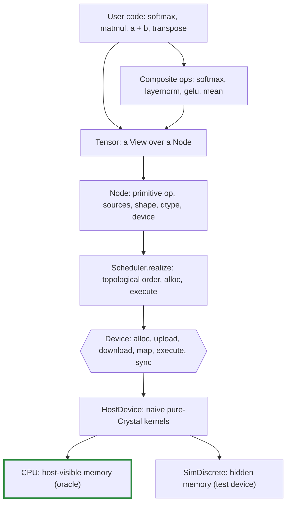

## Core types

Type         |File                      |Role                                                                                                                     
-------------|--------------------------|-------------------------------------------------------------------------------------------------------------------------
`DType`      |`dtype.cr`                |Runtime element type: `F32`, `I32`. `DType.of(Float32)` maps a Crystal type to it; `bytes_for(count)` gives storage size.
`View`       |`view.cr`                 |Shape, strides and offset, counted in elements. Pure metadata.                                                           
`Buffer`     |`device.cr`               |An opaque allocation owned by one device, which it names.                                                                
`Device`     |`device.cr`               |Where buffers live and kernels run.                                                                                      
`Op`         |`node.cr`                 |The primitive operations devices implement.                                                                              
`Node`       |`node.cr`                 |A graph vertex producing one contiguous array.                                                                           
`Tensor`     |`tensor.cr`, `tensor/*.cr`|The user-facing value: a `View` over a `Node`. Its ops are grouped by kind in `tensor/`.                                 
`Scheduler`  |`scheduler.cr`            |Turns unrealised nodes into kernel runs.                                                                                 
`HostDevice` |`devices/host.cr`         |Abstract device whose kernels run on the host CPU; holds `HostBuffer`s.                                                  
`CPU`        |`devices/cpu.cr`          |The reference device: host kernels on host-visible memory.                                                               
`SimDiscrete`|`devices/sim_discrete.cr` |A test device: host kernels on memory the host cannot map.                                                               

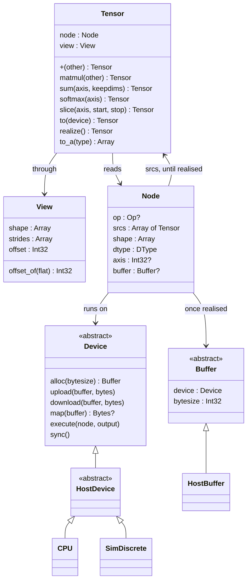

### Tensor and Node

A `Tensor` is a small struct holding a `Node` and a `View`. The node is where the data comes from. The view says how to read it.

- **Views share nodes.** `transpose`, `permute`, `expand`, `slice` and contiguous `reshape` return a new `Tensor` over the *same* node with a different view. They never copy, and they work on unrealised nodes too.
- **A node always produces a contiguous, row-major array** of its `shape`. All of the non-trivial layout lives in the views that read it.
- **A leaf node** (from `Tensor.from`, `Tensor.scalar` or `Tensor.causal_mask`) has no op and is created realised.
- **Any other node** holds its op and source tensors until it is realised. After that it holds only its buffer, and its sources are dropped so the graph behind it can be collected.

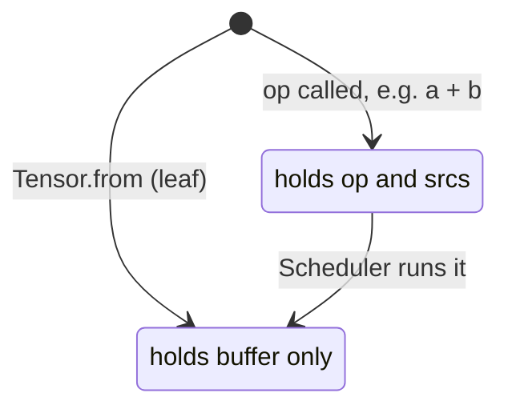

For example, here is the graph for `(a.transpose + c).sum`, before it is realised:

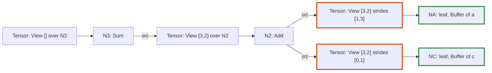

The orange tensors are views (a transpose and a broadcast) that copy nothing. The green nodes hold buffers.

### Views and broadcasting

A `View` maps a logical index onto a position in storage: `offset + Σ index[i] × strides[i]`.

Operation          |Effect on the view (from shape `[2, 3]`, strides `[3, 1]`)
-------------------|----------------------------------------------------------
`transpose`        |shape `[3, 2]`, strides `[1, 3]`                          
`expand([4, 2, 3])`|shape `[4, 2, 3]`, strides `[0, 3, 1]`                    
`slice(1, 1, 3)`   |shape `[2, 2]`, strides `[3, 1]`, offset `1`              
`reshape([3, 2])`  |shape `[3, 2]`, strides `[2, 1]` (contiguous views only)  

A stride of 0 re-reads the same element along that dimension. This is how broadcasting works without copying. A slice moves the offset to its first element and shortens one dimension.

For example, here is how two views over the storage `[1, 2, 3, 4, 5, 6]` locate one element each:

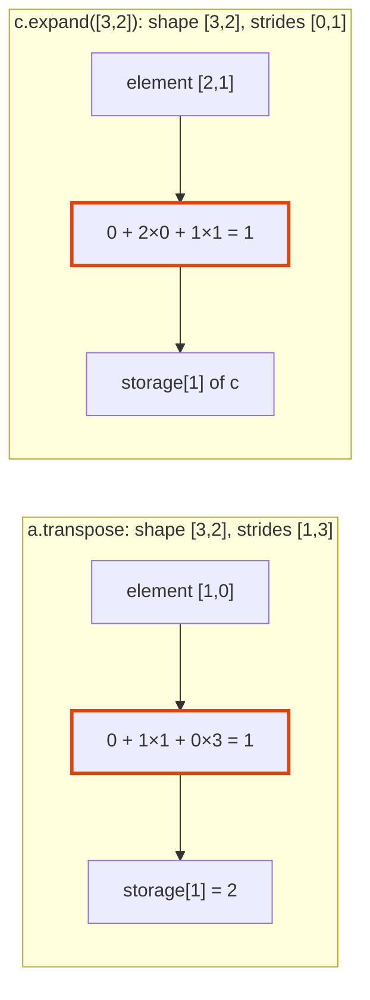

Binary ops broadcast eagerly. `a + b` computes the common shape with NumPy rules, then expands both operands to that shape before building the node. **Kernels therefore only ever see sources whose shape equals the output shape**, with arbitrary strides. Every device inherits that simplification. `matmul` does the same for its leading batch dimensions.

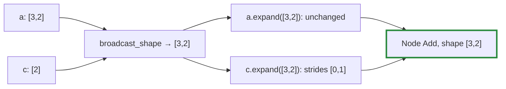

`reshape` of a non-contiguous view inserts a `Copy` node first, then reshapes the contiguous result.

## Ops

### Primitive and composite ops

Devices implement only the primitive ops in `Op`. Everything else is a composite: a `Tensor` method that builds a small graph of primitives. A new device therefore needs kernels for the primitives and nothing more.

Kind      |Primitive ops (`Op`)                 |`Tensor` API                                          
----------|-------------------------------------|------------------------------------------------------
Binary    |`Add`, `Sub`, `Mul`, `Div`, `Maximum`|`+`, `-`, `*`, `/`, `maximum`, with tensors or scalars
Unary     |`Exp`, `Log`, `Tanh`, `Sqrt`         |`exp`, `log`, `tanh`, `sqrt`, unary `-`               
Reduction |`Sum`, `Max`                         |`sum`, `max`, with optional `axis` and `keepdims`     
Structural|`Copy`, `Cat`, `Gather`, `MatMul`    |`contiguous`, `Tensor.cat`, `gather`, `matmul`        
Composite |none: built from the rows above      |`mean`, `softmax`, `layernorm`, `gelu`                

- **Scalars** become rank-0 leaf tensors of the operand's dtype (`Tensor.scalar`), which then broadcast like any other tensor. So `x * 0.5` is `Mul` of `x` and a broadcast scalar.
- **Float-only ops** (`/`, `exp`, `log`, `tanh`, `sqrt`, `mean` and the composites) raise `DTypeError` on `I32` when called.
- **One dtype per op.** Every source of an op must share one dtype (`check_compatible`), and `gather` ids are the only exception (`I32`). Decision N in `PLAN.md` relaxes this per op for quantised weights in M9.
- **Byte sizes** always come from `DType#bytes_for(count)`, never from a size per element, so block formats with many elements per block fit without changes.
- **`keepdims`** reshapes the reduced result to keep the axis with size 1. The reduction's output is contiguous, so this is a view, not a copy.

For example, `softmax(axis)` expands into five primitive nodes:

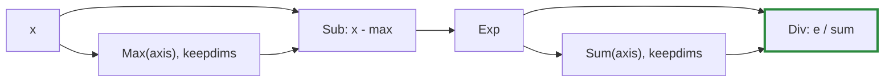

Subtracting the row's maximum keeps `exp` from overflowing without changing the result. `layernorm` and `gelu` expand the same way. Until kernel macros arrive in M7, each primitive node is a separate kernel run.

### The causal mask

`Tensor.causal_mask(rows, cols)` is a leaf built on the host: an `F32` tensor of 0 where a query row may attend to a key column, and -∞ where the column lies in its future. Adding it to attention scores before `softmax` turns masked scores into zero weight.

`cols` may exceed `rows` when a KV cache holds earlier positions. The last row then sees every column, and row `i` sees columns up to `i + cols - rows`:

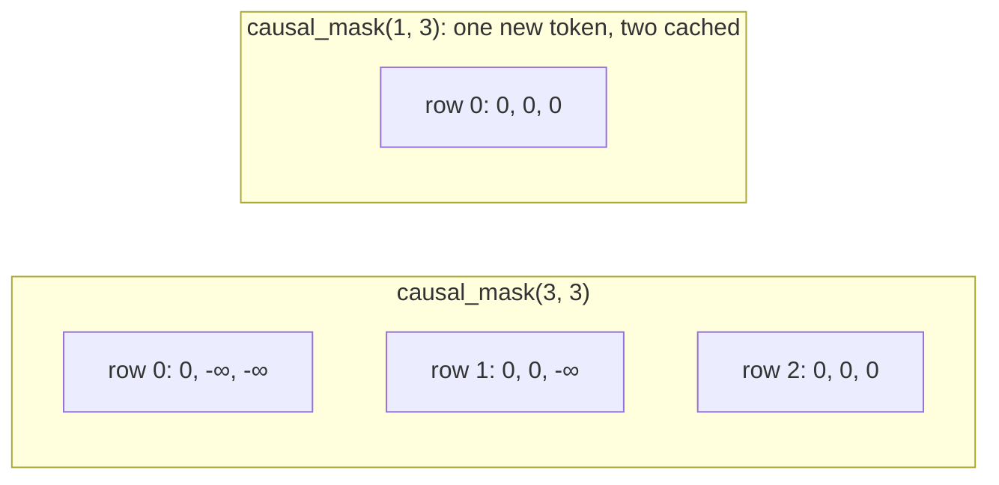

## Devices

### The device interface

The device interface always speaks in transfers, so that discrete-memory devices fit it unchanged:

- **`alloc(bytesize)`:** returns a new buffer that names this device.
- **`upload(buffer, bytes)` / `download(buffer, bytes)`:** copy between the host and the device.
- **`map(buffer)`:** returns host-visible `Bytes`, or `nil` when the memory isn't host-visible. Readers try `map` first and fall back to `download`.
- **`execute(node, output)`:** computes a node into a freshly allocated contiguous buffer, reading its sources' buffers through their views.
- **`sync`:** waits for submitted work to finish.

A buffer belongs to exactly one device and records which. A device rejects any buffer it does not own with `DeviceError`.

### Host devices: CPU and SimDiscrete

`HostDevice` holds the pure-Crystal kernels. Its two subclasses differ only in whether the host may see their memory:

Device       |`map`             |Purpose                                                      
-------------|------------------|-------------------------------------------------------------
`CPU`        |returns the buffer|The oracle every other device is tested against              
`SimDiscrete`|always `nil`      |Behaves like a discrete GPU; counts `uploads` and `downloads`

Every op spec runs on both. Code that reads a buffer directly instead of going through `map` or `download` passes on `CPU` and fails on `SimDiscrete`, long before a real discrete GPU is involved.

### Moving data between devices

An op whose operands are on different devices raises `DeviceError`. Data moves only through an explicit `Tensor#to(device)`, which realises the source, copies it through host memory and returns a realised leaf on the target:

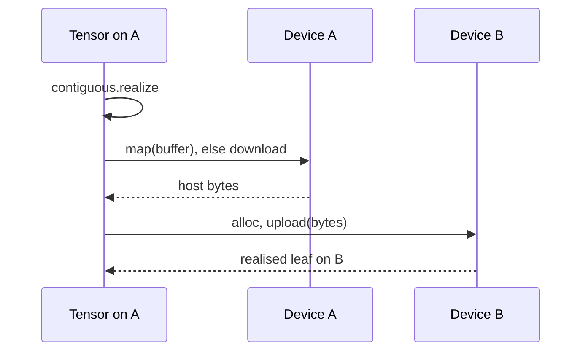

`to` is eager, unlike other ops, because a transfer between devices is a synchronisation point anyway.

### Host kernels

The host kernels are deliberately naive, and they run in a fixed order. That gives level 1 determinism from Decision K: the same inputs give the same bits on every run. Their order of arithmetic also never depends on shape, which is the basis for level 2 later.

- **Kernel structure.** `execute` dispatches on `DType` to a generic method, `execute(Float32, …)` or `execute(Int32, …)`, which dispatches on `Op`. A buffer's bytes are read as `Slice(T)`. Results are converted with `T.new(...)`, so every branch compiles for every dtype; float-only ops never reach an integer kernel because they are rejected when called.
- **Indexing.** Each element is located with `View#offset_of(flat_index)`. This favours clarity over speed.
- **Reductions.** The reduced axis is permuted to the end of the source view, so each output element reads one run of consecutive logical indices. `Sum` folds the run from zero, and `Max` from its first element. A reduction over all elements is the same loop with a single output.

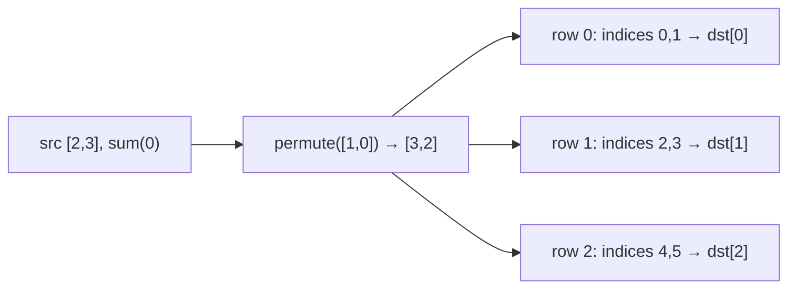

- **`Cat`** writes each source through a *slice view of the output*, so the same indexing code that reads views also writes them.
- **`Gather`** copies row `ids[i]` of a 2-D table into output row `i`. An id outside the table raises `ExecutionError`.
- **`MatMul`** computes each output as a dot product over `k`, added in index order. Its sources arrive already expanded to the common batch shape.

## Realisation

`Scheduler.realize(node)`:

1. **Order.** A depth-first walk lists the unrealised nodes reachable from the root, in topological order. A node shared by several consumers is listed, and computed, once.
2. **Run.** For each node: allocate an output buffer on its device, `execute`, then mark the node realised, which drops its sources.
3. **Wait.** Call `sync` on the root's device.

`Tensor#to_a(T)` realises the tensor, then reads the buffer (through `map` or `download`) in the view's logical order.

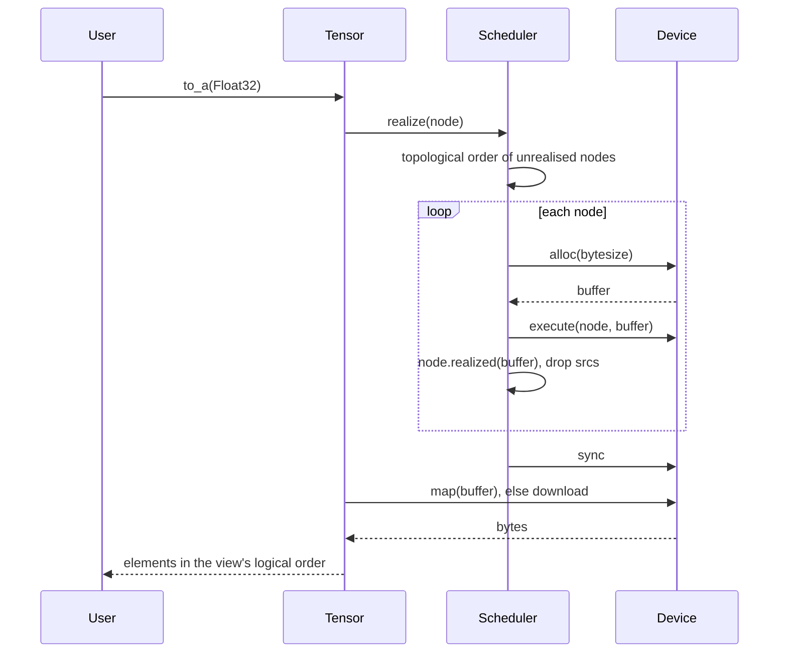

If a kernel raises, the nodes before it stay realised and the failing node stays unrealised.

## Error timing

The plan accepts that errors in a lazy graph may surface far from their cause. To keep that rare, every check that can be made when an op is called is made then:

Error           |Raised when                                                                                                 
----------------|------------------------------------------------------------------------------------------------------------
`ShapeError`    |Building the op: broadcast mismatch, bad axis, slice or permutation, wrong element count, empty max         
`DTypeError`    |Building the op: mixed dtypes, a float-only op on `I32`, non-`I32` gather ids; or `to_a` with the wrong type
`DeviceError`   |Building the op with tensors on different devices, or a device given another device's buffer                
`ExecutionError`|`realize`: a kernel met invalid data, such as a gather id out of range                                      

Only `ExecutionError` depends on the data rather than the shapes, so it is the only one raised at `realize`.

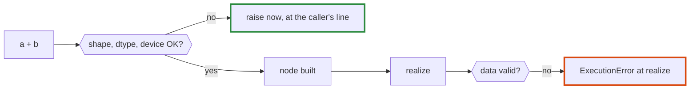

## Current limits

- **Element counts and offsets are `Int32`,** following Crystal's `Slice` indexing. That caps one buffer at about 2 GB.
- **Only `F32` and `I32`.** No type promotion: operands must have the same dtype.
- **One device per op.** Moving data needs an explicit `to`, which goes through host memory.
- **Every primitive is a separate kernel run.** `softmax` alone is five; fusion arrives in M7.
- **Each scalar operand is a new leaf,** uploaded to the device once per use.
- **No autograd.** Realised nodes drop their sources, which autograd (M5) will need to revisit.
- **Recursive graph walk.** Very deep graphs could exhaust the stack.
