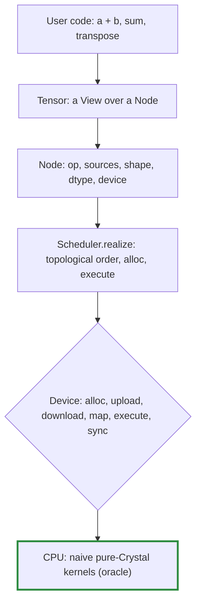
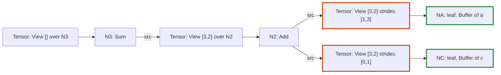

# Tensomite: design

This document describes the design as it is built today, currently through milestone 1. `PLAN.md` holds where the design is going and why. `DEVELOPMENT.md` covers how to work on the code.

## Overview

Tensomite is a lazy tensor runtime. Operations on a `Tensor` build a graph, and nothing is computed until a result is needed. The scheduler then runs the graph on a `Device`, one kernel per node.

## Core types

| Type | File | Role |
|---|---|---|
| `DType` | `dtype.cr` | Runtime element type: `F32`, `I32`. `DType.of(Float32)` maps a Crystal type to it. |
| `View` | `view.cr` | Shape, strides and offset, counted in elements. Pure metadata. |
| `Buffer` | `device.cr` | An opaque allocation owned by one device. |
| `Device` | `device.cr` | Where buffers live and kernels run. |
| `Op` | `node.cr` | What a node computes: `Add`, `Mul`, `Sum`, `Copy`. |
| `Node` | `node.cr` | A graph vertex producing one contiguous array. |
| `Tensor` | `tensor.cr` | The user-facing value: a `View` over a `Node`. |
| `Scheduler` | `scheduler.cr` | Turns unrealised nodes into kernel runs. |
| `CPU` | `devices/cpu.cr` | The reference device. |

### Tensor and Node

A `Tensor` is a small struct holding a `Node` and a `View`. The node is where the data comes from. The view says how to read it.

- **Views share nodes.** `transpose`, `permute`, `expand` and contiguous `reshape` return a new `Tensor` over the *same* node with a different view. They never copy, and they work on unrealised nodes too.
- **A node always produces a contiguous, row-major array** of its `shape`. All of the non-trivial layout lives in the views that read it.
- **A leaf node** (from `Tensor.from`) has no op and is created realised.
- **Any other node** holds its op and source tensors until it is realised. After that it holds only its buffer, and its sources are dropped so the graph behind it can be collected.

For example, here is the graph for `(a.transpose + c).sum`, before it is realised:

The orange tensors are views (a transpose and a broadcast) that copy nothing. The green nodes hold buffers.

### Views and broadcasting

A `View` maps a logical index onto a position in storage: `offset + Σ index[i] × strides[i]`.

| Operation | Effect on the view (from shape `[2, 3]`, strides `[3, 1]`) |
|---|---|
| `transpose` | shape `[3, 2]`, strides `[1, 3]` |
| `expand([4, 2, 3])` | shape `[4, 2, 3]`, strides `[0, 3, 1]` |
| `reshape([3, 2])` | shape `[3, 2]`, strides `[2, 1]` (contiguous views only) |

A stride of 0 re-reads the same element along that dimension. This is how broadcasting works without copying.

Binary ops broadcast eagerly. `a + b` computes the common shape with NumPy rules, then expands both operands to that shape before building the node. **Kernels therefore only ever see sources whose shape equals the output shape**, with arbitrary strides. Every device inherits that simplification.

`reshape` of a non-contiguous view inserts a `Copy` node first, then reshapes the contiguous result.

### Devices and buffers

The device interface always speaks in transfers, so that discrete-memory devices fit it unchanged:

- **`alloc(bytesize)`:** returns a new buffer.
- **`upload(buffer, bytes)` / `download(buffer, bytes)`:** copy between the host and the device.
- **`map(buffer)`:** returns host-visible `Bytes`, or `nil` when the memory isn't host-visible. Readers try `map` first and fall back to `download`.
- **`execute(node, output)`:** computes a node into a freshly allocated contiguous buffer, reading its sources' buffers through their views.
- **`sync`:** waits for submitted work to finish.

A buffer belongs to exactly one device. A device rejects buffers it does not own with `DeviceError`.

### The CPU device

The CPU device is the oracle that every future device is tested against. Its kernels are deliberately naive, and they run in a fixed order. That gives level 1 determinism from Decision K: the same inputs give the same bits on every run.

- **Kernel structure.** `execute` dispatches on `DType` to a generic method, `execute(Float32, …)` or `execute(Int32, …)`, which dispatches on `Op`. A buffer's bytes are read as `Slice(T)`.
- **Indexing.** Each element is located with `View#offset_of(flat_index)`. This favours clarity over speed.
- **Sum over an axis.** The summed axis is permuted to the end of the source view. Each output element then reads one run of consecutive logical indices, added left to right. A sum over all elements is the same loop with a single output.

### Realisation

`Scheduler.realize(node)`:

1. **Order.** A depth-first walk lists the unrealised nodes reachable from the root, in topological order. A node shared by several consumers is listed, and computed, once.
2. **Run.** For each node: allocate an output buffer on its device, `execute`, then mark the node realised, which drops its sources.
3. **Wait.** Call `sync` on the root's device.

`Tensor#to_a(T)` realises the tensor, then reads the buffer (through `map` or `download`) in the view's logical order.

## Error timing

The plan accepts that errors in a lazy graph may surface far from their cause. To keep that rare, every check that can be made when an op is called is made then:

| Error | Raised when |
|---|---|
| `ShapeError` | Building the op: broadcast mismatch, bad axis or permutation, wrong element count |
| `DTypeError` | Building the op (mixed dtypes), or `to_a` with the wrong Crystal type |
| `DeviceError` | Building the op with tensors on different devices |

Only failures during execution (none exist yet on the CPU) would surface at `realize`.

## Current limits

- **Element counts and offsets are `Int32`,** following Crystal's `Slice` indexing. That caps one buffer at about 2 GB.
- **Only `F32` and `I32`.** No type promotion: both operands must have the same dtype.
- **One device per graph.** Transfers between devices arrive with `SimDiscrete` in M2.
- **No autograd.** Realised nodes drop their sources, which autograd (M5) will need to revisit.
- **Recursive graph walk.** Very deep graphs could exhaust the stack.
