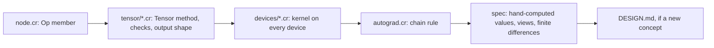
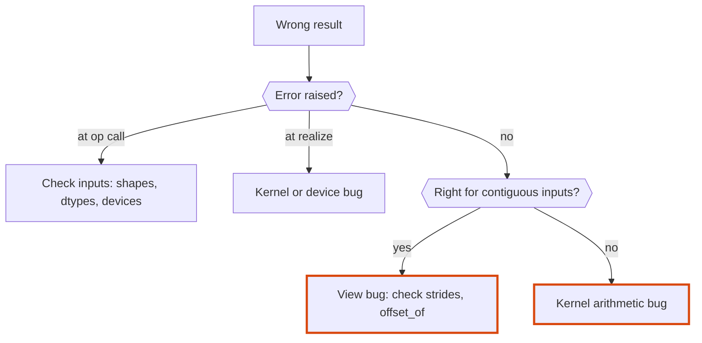
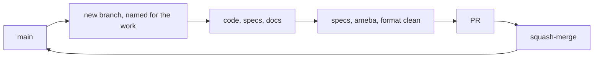

# Tensomite: development

A guide for maintaining tensomite, fixing bugs and adding features. `DESIGN.md` explains how the code works, `PLAN.md` explains where it's going, and `HANDOFF.md` says where things stand and how we work.

## Setup

1. **Install Crystal 1.22 or later**, which includes `shards`. On macOS, use `brew install crystal`.
2. **Install a BLAS library** for the `BLAS` device, which the specs use. macOS already has Accelerate. On Debian or Ubuntu, `sudo apt-get install libopenblas-dev`.
3. **Install development dependencies:** `shards install`.
4. **Build the linter:**

   ```sh
   mkdir -p bin && cp lib/ameba/bin/ameba.cr bin && crystal build -o bin/ameba bin/ameba.cr
   ```

   If you use [`ops`](https://github.com/nickthecook/ops), `ops up` does steps 3 and 4 from `ops.yml`.

## Everyday commands

Task                  |Command                                              |With `ops`                 
----------------------|-----------------------------------------------------|---------------------------
Run specs             |`crystal spec`                                       |`ops test_specs`           
Lint                  |`bin/ameba src/ spec/ bench/ examples/`              |`ops lint` (`src/` only)   
Check formatting      |`crystal tool format --check src spec bench examples`|                           
Fix formatting        |`crystal tool format src spec bench examples`        |                           
Everything before a PR|all three of the above                               |`ops test` (specs and lint)

All three must be clean before a PR.

Benchmarks live in `bench/` and examples in `examples/`. Both run in release mode, for example `crystal run --release bench/matmul.cr`. CI type-checks, formats and lints them with everything else, but does not run them.

**Training on Tiny Shakespeare** (the M5 exit):

```sh
scripts/fetch_shakespeare.sh
crystal build --release examples/shakespeare.cr -o shakespeare
./shakespeare --steps 2000
```

`--help` lists the model and training options. The trainer calls `GC.collect` after each step, so that the step's buffers return to the device's pool (see "Buffer pool" in `DESIGN.md`) before the next step allocates. `GC_UNMAP_THRESHOLD=0` still saves a few per cent on Linux, by keeping the collector from returning freed pages to the system.

**High system time is OpenBLAS, not the collector.** OpenBLAS's worker threads busy-wait between calls, so `time` reports several times the wall time in `user` and `sys`. `OPENBLAS_NUM_THREADS=1` removes it, at little cost to the wall time of these small models.

**Random order.** `ops test_specs` runs `crystal spec --order random`, which ends with `Randomized with seed: N`. To replay that order, as when a failure appears only sometimes, run `crystal spec --order N`.

## Continuous integration

`.github/workflows/ci.yml` runs on every push to `main` and on every pull request, whatever its base, so stacked PRs are checked too. It runs on Linux, with OpenBLAS installed, and on macOS, with Accelerate:

Step                                   |Linux|macOS
---------------------------------------|-----|-----
`crystal spec --release`               |yes  |yes  
Type-check `bench/`, `examples/`       |yes  |yes  
Cross-compile the Metal path           |yes  |     
CUDA specs on the host stub            |yes  |     
Formatting check                       |yes  |     
`bin/ameba src/ spec/ bench/ examples/`|yes  |     

- **Crystal is pinned** in the job matrix (currently 1.22.0). Bump it there, together with `crystal:` in `shard.yml` when the minimum changes.
- **The cache** holds `lib/`, `shard.lock` and `bin/ameba`. Its key combines the OS, the Crystal version and a hash of `shard.yml`. `shard.lock` is not committed (this is a library), so `shard.yml` stands in for it. The Crystal version is in the key because `bin/ameba` is compiled with it.

## Layout

```
src/tensomite.cr            requires everything, defines VERSION
src/tensomite/errors.cr     error classes
src/tensomite/dtype.cr      DType
src/tensomite/view.cr       View: shape, strides, offset
src/tensomite/device.cr     Buffer and Device interfaces
src/tensomite/node.cr       Op and Node
src/tensomite/tensor.cr     Tensor: construction, views, transfers, reading data
src/tensomite/tensor/       Tensor ops by kind: elementwise, reduce, structural, composite
src/tensomite/scheduler.cr  realisation
src/tensomite/autograd.cr   Tensomite.grad and the chain rule for every op
src/tensomite/scope.cr      Tensomite.scope and Scope
src/tensomite/diagram.cr    Tensor#to_mermaid: graphs and summaries as Mermaid
src/tensomite/module.cr     Parameter, Init, Module and Layer
src/tensomite/modules.cr    Linear, Embedding, LayerNorm, Activation, Sequential
src/tensomite/builder.cr    Builder and Sequential.build: built-in modules with shared settings
src/tensomite/kernel.cr     the Tensomite.kernel macro and the Kernel class
src/tensomite/kernels.cr    the kernels tensomite's own ops use, such as gelu
src/tensomite/buffer_pool.cr  BufferPool
src/tensomite/optim.cr      SGD and AdamW
src/tensomite/cuda.cr       opt-in CUDA (-Dcuda): versions, GPUs, NVRTC, contexts; cuda/lib.cr binds libcuda and libnvrtc
src/tensomite/devices/      host.cr (shared host kernels), then one file per pure-Crystal device
src/tensomite/blas.cr       opt-in BLAS binding and device; not required by src/tensomite.cr
src/tensomite/metal.cr      opt-in Metal device (Apple Silicon); not required by src/tensomite.cr
src/tensomite/metal/        objc.cr (Objective-C runtime calls), kernels.metal (MSL source)
src/tensomite/mapped_file.cr, safetensors.cr   weight loading
src/tensomite/bpe.cr, sampler.cr               tokeniser and sampling
src/tensomite/models/       one file per model architecture
spec/                       specs, one file per type or kind of op
spec/fixtures/              reference outputs and small reference files (see below)
scripts/                    fixture generation, model download, document checks, emulate_metal/ (Metal kernels on the CPU) and cuda_stub/ (CUDA builds without a driver)
bench/                      benchmarks, run with --release
examples/                   programs using the library, such as training on Shakespeare and TUTORIAL.md's multiply.cr
models/, data/              downloaded weights and datasets (git-ignored)
```

## Reference fixtures

Model specs compare tensomite against Hugging Face `transformers` and PyTorch on the same files. The fixtures are generated once by `scripts/make_fixtures.py` and committed, so specs and CI need no Python.

Fixture     |Contents                                                                                       |Needs                        
------------|-----------------------------------------------------------------------------------------------|-----------------------------
`tiny_gpt2/`|a small trained byte-level BPE vocabulary, a random 2-layer GPT-2 (160 KB), and `expected.json`|PyPI packages only           
`gpt2/`     |`expected.json` only; the weights are downloaded, not committed                                |GPT-2 small from Hugging Face

`expected.json` holds a Unicode tokeniser corpus and its ids, a prompt and its ids, reference logits, and the greedy continuation. The tiny tokeniser's ids are checked against both Hugging Face's Rust tokeniser and transformers' Python port of GPT-2's original one before they are written.

Running the specs needs no Python: the fixtures are committed, and only GPT-2 small's weights are downloaded (below). To regenerate the fixtures:

1. **Create a Python environment** with a Python that PyTorch publishes wheels for. 3.13 was used here; a newer release such as 3.15 can have none yet, and pip then reports "no matching distribution found for torch": `python3.13 -m venv .venv && .venv/bin/pip install torch transformers tokenizers safetensors`.
2. **Tiny fixtures:** `.venv/bin/python scripts/make_fixtures.py tiny`.
3. **GPT-2 small fixtures:** `scripts/fetch_gpt2.sh models/gpt2`, then `.venv/bin/python scripts/make_fixtures.py gpt2 models/gpt2`.

The GPT-2 small specs (the M4 exit) run only when `TENSOMITE_GPT2_DIR` names a directory holding the downloaded files and `spec/fixtures/gpt2/expected.json` exists; otherwise they are pending. CI downloads GPT-2 small, cached. Run them with `--release`: a debug build takes about 6 minutes, and a release build about 1 minute plus compilation.

```sh
scripts/fetch_gpt2.sh models/gpt2
TENSOMITE_GPT2_DIR=models/gpt2 crystal spec --release
```

Benchmarks of model speed depend only on shapes, so `bench/gpt2.cr` can run on any weights with GPT-2 small's shapes, such as a randomly initialised `GPT2LMHeadModel(GPT2Config())` saved with `save_pretrained`.

To check that a change leaves GPT-2's arithmetic alone, run `bench/gpt2_digest.cr` on the same weights before and after: it prints one SHA-256 digest of the logits per device, over a prefill and 8 decoded tokens, so equal digests mean equal bits.

## Conventions

### Code

- **Comments document the API and its outcomes:** what a type is, and what a method returns or does. Inside a function, a comment describes the steps of the algorithm, as a numbered list when there are several. Comments never record history or how the code came to be. That belongs in commit messages, and in `PLAN.md` when it affects future contributors.
- **Check eagerly.** Any shape, dtype or device check that can run when an op is built must run there, not in a kernel. See "Error timing" in `DESIGN.md`.
- **Raise tensomite errors** (`ShapeError`, `DTypeError`, `DeviceError`, `ExecutionError`, or `Error`) with a message naming the values involved, such as `"cannot expand [3] to [4]"`.
- **Prefer composites to new primitives.** If an op can be built from existing `Op`s at acceptable cost, write it as a `Tensor` method in `tensor/composite.cr`. Every primitive costs a kernel on every device.
- **Native code stays behind an opt-in `require`.** A file that binds a C library (`lib ... end` with `@[Link]`) is not required by `src/tensomite.cr`, so users who don't need it never link it. `tensomite/blas` is the first.
- **Avoid `not_nil!`** (ameba flags it). Use an accessor that raises a meaningful error instead, such as `Node#buffer!`.

### Crystal gotchas met so far

- **Finalizers can run on another thread,** concurrently with the main fiber: in Crystal 1.22 the execution-context monitor thread invokes them when it allocates. Anything a finalizer touches needs an atomic guard, and must never wait for it, because a finalizer can also interrupt the holder on its own thread (see `BufferPool`).
- **`out` is a reserved word** (used for C out-parameters). Don't use it as a variable name. Kernels use `dst`.
- **Array literals mixing types become unions.** `[1f32, 2, 3]` is `Array(Float32 | Int32)`, which `Tensor.from` rejects. In specs, use the `f32(1, 2, 3)` helper. Elsewhere, use `[1, 2, 3].map(&.to_f32)`.
- **`Bytes#unsafe_slice_of(T)`** reinterprets a buffer's bytes as `Slice(T)` without copying. It works for structs too: a packed block struct of 18 bytes reads straight out of a buffer.
- **Kernels loop over `Slice`, never `Array`.** LLVM vectorises loops over a `Slice` but not over an `Array`, whose size and pointer it must re-read after every store. Float sums don't vectorise either way, because that would reorder additions. See "No portable SIMD" in `PLAN.md`.
- **Crystal has no `Float16`.** Half-precision values need tensomite's own `UInt16`-backed type (Decision N).
- **Instance variables assigned inside a block are not seen as initialised.** `File.open(path) do |file| @size = … end` leaves `@size` nilable. Open the file without a block and close it explicitly, or assign outside the block.
- **`Reference` cannot be used in a union.** `@owner : Reference?` does not compile; name a concrete class, as `HostBuffer` does with `MappedFile?`.
- **Unicode-aware regexes need `Regex::Options::UCP`.** Without it `\s`, `\w` and `\d` match ASCII only, while `\p{L}` and `\p{N}` work either way.
- **Crystal cannot `require` an absolute path.** Scripts outside the repo cannot load it by path. Put a temporary script inside the repo, relative to `src/`, and delete it afterwards.
- **Class variables are shared with subclasses.** A `class_getter default : CPU` on `CPU` stops a subclass from declaring its own `default` of another type. That is why `CPU` and `SimDiscrete` are siblings under `HostDevice` rather than parent and child.
- **Indexing a `Slice` in a loop stops it vectorising,** because each access carries a bounds check that can raise. In hot loops, check the first and last positions once, then index `slice.to_unsafe + offset` (see `HostDevice#binary`). Measure the loop afterwards: a call LLVM cannot inline, such as one into libm, also stops vectorisation, which is why host kernels use `Tensomite::Maths`.
- **Generic kernels compile every branch for every dtype.** `Math.exp(x)` on an `Int32` returns `Float64`, which does not fit a `Slice(Int32)`. Wrap results in `T.new(...)` so the code compiles, and reject float-only ops when they are called, so integer kernels never run them.
- **`Void*` is a type, not an expression.** Pass `Pointer(Void)` where a type is an argument, as in `ObjC.send(Pointer(Void), …)`.
- **The macro language is small.** `ArrayLiteral` has no `pop`, `reverse` or `index`: use `last` with a slice (`a[0...-1]`), a loop over indices, or a `HashLiteral`. An empty array literal passed to another macro needs a type (`[] of String`). There is no recursion that returns a value and no `while`, so tree walks use an explicit stack in a bounded `for` loop, as `Tensomite.kernel` does.
- **One C symbol, one signature.** A `lib` cannot declare `objc_msgSend` twice with different arguments, even under different Crystal names. Cast the function's address to a typed `Proc` instead, as `ObjC.send` does. A proc literal needs parentheses before `.pointer`: `(->LibObjC.objc_msgSend).pointer`.
- **Methods are type-checked only when called.** A new `Tensor` method with a type error compiles silently until a spec calls it, so every new method needs a spec.

### Specs

- **Expected values are worked out by hand,** never produced by tensomite itself. Write the intermediate result in a comment above the assertion, for example `# a.T + b = [[11, 24], [32, 45], [53, 66]]`, so a reviewer can check the arithmetic.
- **Transcendental values come from an independent reference,** Python's `math` module, in float64, and are compared with `expect_close` (tolerance 1e-6 by default). Say so in a comment at the top of the spec file.
- **Op specs run on every device.** Wrap them in `DEVICES.each do |device| … end` and build inputs with `tensor(device, shape, data)`. `DEVICES` holds `CPU`, `SimDiscrete` and `BLAS`. Results must be identical on all of them for the small integer inputs these specs use, so the same expectations apply. Comparisons on random data, where `BLAS` legitimately differs in the last bits, go in the device's own spec with a tolerance, as in `blas_spec.cr`. Device-specific behaviour, such as transfer counts, goes in `device_spec.cr`.
- **GPU devices are compared with the CPU, not hand-computed values.** `GPUS` in `spec_helper.cr` lists the GPUs present (`Metal` on an Apple Silicon Mac with a GPU, otherwise none), and `gpu_spec.cr` runs every op on each of them. Exact ops (IEEE arithmetic, comparisons, data movement) must match bit for bit; division and transcendental functions within 1e-6. Without a GPU those specs are pending.
- **Each milestone's exit criterion has its own `describe "Mn exit: …"` block.**
- **Include non-contiguous inputs** (transposed and broadcast views) for any new op. Most indexing bugs hide there.
- **Test the timing of errors,** as well as the fact that they are raised, when an op adds new checks.
- **Gradients are checked against central finite differences** with `check_gradients` in `autograd_spec.cr`. The loss weights each output element by a different random number, so a rule that mixes up elements cannot pass by symmetry. In `F32`, a step of 1e-2 balances truncation error against rounding error, and the tolerance is relative, 2e-3. Random inputs keep `max` and `maximum` away from ties, where the derivative is undefined. A spec that breaks a rule on purpose should fail; two deliberate mistakes were caught when the specs were written.
- **Exact comparison** (`should eq`) is right for the CPU device on small integers. Use tolerances only where the order of arithmetic legitimately differs, such as between devices.

## Recipes

### Adding an op



1. **Add a member to `Op`** in `node.cr`, with a one-line comment stating what it computes.
2. **Add the `Tensor` method** in the matching `tensor/*.cr` file. It validates the shapes and dtypes (`check_compatible`, `check_float`), computes the output shape, and builds the node with `Tensor.lazy(Node.new(...))`. Broadcast or permute the sources there, so the kernel stays simple.
3. **Implement the kernel on every device.** For host devices, add a branch to `HostDevice#execute(T, node, dst)`. The `case` is exhaustive, so a missing branch is a compile error.
4. **Add its chain rule** to `Tensor.backward` in `autograd.cr`: one gradient per source, in the source's shape, or `nil` for a source without one. That `case` is exhaustive too.
5. **Write specs** with hand-computed values over contiguous, transposed and broadcast inputs, and a finite-difference check of the gradient in `autograd_spec.cr`.
6. **Update `DESIGN.md`** if the op adds a concept, such as a new node field or a new kind of view.

### Adding a fused kernel

1. **Define it** with `Tensomite.kernel(:name) { |x, y| ... }` in `kernels.cr`, using only the operations listed under "Kernel macros" in `DESIGN.md`. This defines `Tensomite::Kernels::NAME`.
2. **Write the expression in the same order as the composite it replaces,** operation for operation, so the two give the same bits on the CPU.
3. **Spec it** in `kernel_spec.cr`: bit-for-bit against the composite on every device, a finite-difference check of its gradients, and a case in `gpu_spec.cr`.

### Adding a dtype

1. **Add the member to `DType`** and its `bytes_for`. A block format returns the bytes for whole blocks.
2. **Add a `DType.of` overload** for the Crystal type.
3. **Add a dispatch branch** to each device's `execute(node, output)`.
4. **Add specs** that run existing ops in the new dtype.

### Adding a device

1. **Subclass `Device` and `Buffer`** under `src/tensomite/devices/`, and require the file from `src/tensomite.cr`. A device whose kernels run on the host subclasses `HostDevice` instead and gets every kernel for free.
2. **Implement every abstract method.** `map` returns `nil` if the device's memory isn't host-visible. Buffers record their device, and every method rejects a buffer from another device with `DeviceError`.
3. **Run the full op suite** on the new device. Host devices join the `DEVICES` list in `spec/spec_helper.cr`. Other devices compare against the CPU, with tolerances where their order of arithmetic differs.

## Working on the Metal device

Metal code compiles only for macOS on Apple Silicon. On any other machine:

```sh
crystal build --cross-compile --target aarch64-apple-darwin spec/gpu_spec.cr spec/metal_spec.cr spec/gpt2_spec.cr -o /tmp/specs_darwin
```

type-checks and generates code for the Metal path without linking it, so mistakes in Crystal surface before a Mac is involved. The MSL in `metal/kernels.metal` is compiled by the driver only when a `Metal` device is created, so it is checked only on a Mac: `crystal spec spec/metal_spec.cr spec/gpu_spec.cr`. A compile error is raised as `DeviceError`, with the compiler's message.

**Kernels on Linux.** MSL is close enough to C++ that a kernel can be run on the CPU before it reaches a GPU: compile its source with `g++ -std=c++20` behind a few defines (`kernel`, `device` and `constant` empty, `threadgroup` as `static`), run each threadgroup's threads as `std::thread`s, and make `threadgroup_barrier` a `std::barrier`. That checks indexing and order of arithmetic, though not MSL's own rules, such as matching widths of position attributes. `scripts/emulate_metal/run.sh` does this for the matmul kernels, checking every tiled variant against split-K bit for bit; it is a reference, not part of CI, and the pattern carries over to other kernels.

CI runs the specs on macOS too. A hosted runner may have no usable GPU, in which case the Metal specs are pending rather than failing.

## Working on the CUDA device

CUDA is opt-in: `require "tensomite/cuda"` and build with `-Dcuda`, which links the NVIDIA driver's `libcuda` and NVRTC's `libnvrtc` (Decision AV). A build without the flag raises at compile time. NVRTC usually lives outside the linker's search path, so give its directory in `LIBRARY_PATH`; for running, it must be on the loader's path too, through `/etc/ld.so.conf.d` or `LD_LIBRARY_PATH`:

```sh
export LIBRARY_PATH=/usr/local/cuda-13.1/targets/sbsa-linux/lib   # x86-64: targets/x86_64-linux/lib
crystal run -Dcuda examples/cuda_info.cr
crystal spec -Dcuda spec/cuda_spec.cr
```

`examples/cuda_info.cr` prints the driver's and NVRTC's versions and every GPU, then squares a million floats on the first one, which checks compilation, loading, transfers and launches together.

**Without a GPU,** `scripts/cuda_stub/setup.sh DIR` prepares `DIR`:
- NVRTC from PyPI;
- a stand-in `libcuda` (`libcuda.c`): one "GPU", named `tensomite host stub`, whose memory is host memory;
- `libkernels.so`: `src/tensomite/cuda/prelude.cu`, `kernels.cu` and the CUDA C++ of every `Tensomite.kernel` (printed by `macro_kernels.cr`, which needs `crystal`), compiled as host C++ behind `emulate.h`, with a registry of the kernels that `register.py` writes.

```sh
dir=$(scripts/cuda_stub/setup.sh /tmp/tensomite-cuda | tail -1)
export LIBRARY_PATH=$dir LD_LIBRARY_PATH=$dir TENSOMITE_CUDA_KERNELS=$dir/libkernels.so
crystal spec -Dcuda
```

The `CUDA` device then compiles its kernels with NVRTC, as on a GPU, and the stub runs them on the host, so `gpu_spec` compares every kernel with the CPU. Without `TENSOMITE_CUDA_KERNELS`, the stub cannot load modules and the device runs every op on host kernels. Specs that load PTX of their own need a real GPU. CI runs `cuda_spec`, `gpu_spec`, `device_spec` and `gpt2_spec` this way on Linux. A new kernel needs nothing more: `register.py` finds it, and marks one with `__shared__` memory to run its threads as OS threads, since it may wait at `__syncthreads`.

`bench/gpt2.cr` and `bench/gpt2_digest.cr` add CUDA when built with `-Dcuda`: `crystal run --release -Dcuda bench/gpt2.cr -- models/gpt2/model.safetensors`. `bench/profile_gpt2_cuda.cr` breaks a decoded token or a prefill down into launching, allocating, copying, waiting and host ops, then times each op on the GPU alone with CUDA events (`CUDA::Profile`); on the stub its times are the emulator's, not a GPU's. `CUDA#matmul_mode` picks the matmul kernels (`Serial`, `Split`, `Tiled`, `TwoPass` or the default `Auto`); `bench/gpt2.cr` runs each, timing prefill and decode as medians of five. `bench/matmul_cuda.cr` times the products of a decoded token on the GPU alone, split and in two passes.

**Errors from kernels arrive late.** `cuLaunchKernel` only queues a kernel, so a fault inside it is reported by the next call that waits for the GPU, such as a download. To find which kernel failed, call `context.synchronize` after each launch.

**Kernels are compiled with `--fmad=false`** (Decision AU), so `a * b + c` is a multiply and an add, each rounded, as on the host. A spec checks the PTX for it.

## Debugging



- **Draw it.** `puts t.to_mermaid` shows every op behind `t`, and `t.to_mermaid(depth: 2, params: params)` a model's parts; paste either into any Mermaid viewer. `examples/shakespeare.cr --diagram 2` and `examples/gpt2_diagram.cr` print the two models'.
- **Inspect before realising.** An unrealised tensor's graph is all there: `t.node.op`, `t.node.srcs`, `t.node.shape`, and each source's `view`.
- **Check the view first** when a result is wrong for transposed or broadcast inputs but right for contiguous ones. `View#offset_of(i)` shows where element `i` is read from.
- **`node.realized?`** shows whether work has run. A realised node has no sources left to inspect, so inspect before realising.
- **Passes on `CPU`, fails on `SimDiscrete`?** Something read a buffer directly instead of through `map` or `download`, or mixed buffers between devices. `SimDiscrete#uploads` and `#downloads` show how much data moved.

## Documents

- **`GUIDE.md` and `TUTORIAL.md` explain plainly,** for people using the library: no analogies or figurative wording, only what the code does and why.
- **Tables** have no outer pipes, with columns padded to equal width:

  ```
  Type   |File      |Role
  -------|----------|----------------
  `View` |`view.cr` |Shape and strides
  ```

- **Diagrams** are Mermaid, embedded where they explain the design better than prose. Decision nodes use the hexagon `{{"question?"}}`, not the diamond. Emphasis uses a coloured border only (`stroke`), never a fill.
- **Check both before a PR** that touches documents:
  - `python3 scripts/format_tables.py DESIGN.md DEVELOPMENT.md PLAN.md HANDOFF.md` pads tables in place, and changes nothing when they are already right.
  - `scripts/check_diagrams.sh` renders every Mermaid block with mermaid-cli (through `npx`) and lists any that fail to parse.

## Workflow



- **One branch per PR,** named for its purpose (for example `m2-cpu-ops-simdiscrete`, `docs-design-development`). Branches start from the latest `main`.
- **PRs are squash-merged.**
- **Keep the documents current in the same PR as the code:**
  - `DESIGN.md` whenever the design as built changes.
  - `DEVELOPMENT.md` whenever a convention, command or gotcha is learned.
  - `PLAN.md` when a decision or milestone changes.
  - `GUIDE.md` whenever the public API changes, with every example run and its output shown; `TUTORIAL.md` and `examples/multiply.cr` together.
  - `HANDOFF.md` at the end of each PR, rewritten rather than appended to: where things stand, working agreements, follow-ups, environment and concepts covered.
- **AI use** follows `DISCLOSURE.md`: generated code is reviewed until it is understood as if written by hand.
