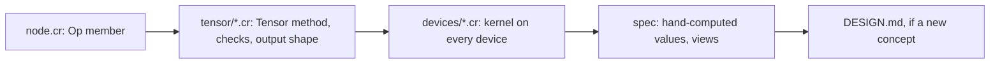
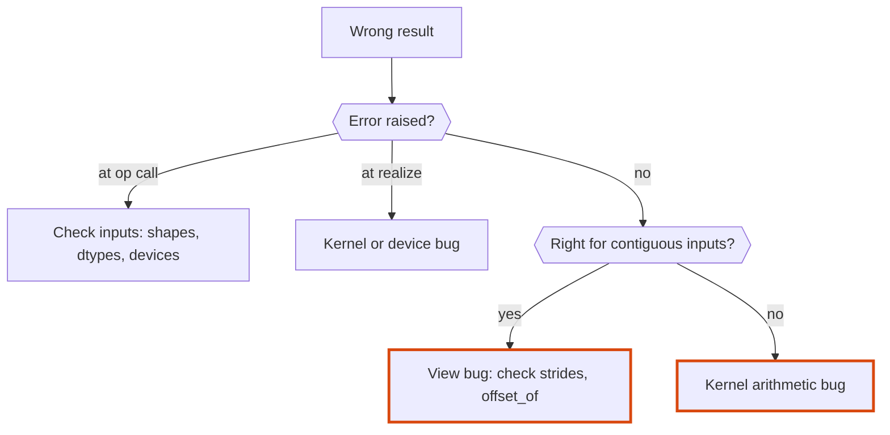
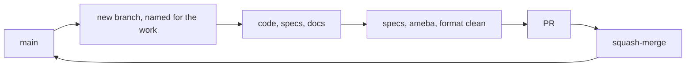

# Tensomite: development

A guide for maintaining tensomite, fixing bugs and adding features. `DESIGN.md` explains how the code works, and `PLAN.md` explains where it's going.

## Setup

1. **Install Crystal 1.22 or later**, which includes `shards`. On macOS, use `brew install crystal`.
2. **Install a BLAS library** for the `BLAS` device, which the specs use. macOS already has Accelerate. On Debian or Ubuntu, `sudo apt-get install libopenblas-dev`.
3. **Install development dependencies:** `shards install`.
4. **Build the linter:**

   ```sh
   mkdir -p bin && cp lib/ameba/bin/ameba.cr bin && crystal build -o bin/ameba bin/ameba.cr
   ```

   If you use [`ops`](https://github.com/nickthecook/ops), `ops up` does steps 3 and 4 from `ops.yml`.

## Everyday commands

Task                  |Command                                     |With `ops`                 
----------------------|--------------------------------------------|---------------------------
Run specs             |`crystal spec`                              |`ops test_specs`           
Lint                  |`bin/ameba src/ spec/ bench/`               |`ops lint` (`src/` only)   
Check formatting      |`crystal tool format --check src spec bench`|                           
Fix formatting        |`crystal tool format src spec bench`        |                           
Everything before a PR|all three of the above                      |`ops test` (specs and lint)

All three must be clean before a PR.

Benchmarks live in `bench/` and run in release mode, for example `crystal run --release bench/matmul.cr`. CI type-checks, formats and lints them with everything else, but does not run them.

## Continuous integration

`.github/workflows/ci.yml` runs on every push to `main` and on every pull request, whatever its base, so stacked PRs are checked too. It runs on Linux, with OpenBLAS installed, and on macOS, with Accelerate:

Step                         |Linux|macOS
-----------------------------|-----|-----
`crystal spec --release`     |yes  |yes  
Type-check `bench/`          |yes  |yes  
Formatting check             |yes  |     
`bin/ameba src/ spec/ bench/`|yes  |     

- **Crystal is pinned** in the job matrix (currently 1.22.0). Bump it there, together with `crystal:` in `shard.yml` when the minimum changes.
- **The cache** holds `lib/`, `shard.lock` and `bin/ameba`. Its key combines the OS, the Crystal version and a hash of `shard.yml`. `shard.lock` is not committed (this is a library), so `shard.yml` stands in for it. The Crystal version is in the key because `bin/ameba` is compiled with it.

## Layout

```
src/tensomite.cr            requires everything, defines VERSION
src/tensomite/errors.cr     error classes
src/tensomite/dtype.cr      DType
src/tensomite/view.cr       View: shape, strides, offset
src/tensomite/device.cr     Buffer and Device interfaces
src/tensomite/node.cr       Op and Node
src/tensomite/tensor.cr     Tensor: construction, views, transfers, reading data
src/tensomite/tensor/       Tensor ops by kind: elementwise, reduce, structural, composite
src/tensomite/scheduler.cr  realisation
src/tensomite/devices/      host.cr (shared host kernels), then one file per pure-Crystal device
src/tensomite/blas.cr       opt-in BLAS binding and device; not required by src/tensomite.cr
src/tensomite/mapped_file.cr, safetensors.cr   weight loading
src/tensomite/bpe.cr, sampler.cr               tokeniser and sampling
src/tensomite/models/       one file per model architecture
spec/                       specs, one file per type or kind of op
spec/fixtures/              reference outputs and small reference files (see below)
scripts/                    fixture generation and model download
bench/                      benchmarks, run with --release
models/                     downloaded weights (git-ignored)
```

## Reference fixtures

Model specs compare tensomite against Hugging Face `transformers` and PyTorch on the same files. The fixtures are generated once by `scripts/make_fixtures.py` and committed, so specs and CI need no Python.

Fixture     |Contents                                                                                       |Needs                        
------------|-----------------------------------------------------------------------------------------------|-----------------------------
`tiny_gpt2/`|a small trained byte-level BPE vocabulary, a random 2-layer GPT-2 (160 KB), and `expected.json`|PyPI packages only           
`gpt2/`     |`expected.json` only; the weights are downloaded, not committed                                |GPT-2 small from Hugging Face

`expected.json` holds a Unicode tokeniser corpus and its ids, a prompt and its ids, reference logits, and the greedy continuation. The tiny tokeniser's ids are checked against both Hugging Face's Rust tokeniser and transformers' Python port of GPT-2's original one before they are written.

To regenerate:

1. **Create a Python environment:** `python3 -m venv .venv && .venv/bin/pip install torch transformers tokenizers safetensors`.
2. **Tiny fixtures:** `.venv/bin/python scripts/make_fixtures.py tiny`.
3. **GPT-2 small fixtures:** `scripts/fetch_gpt2.sh models/gpt2`, then `.venv/bin/python scripts/make_fixtures.py gpt2 models/gpt2`.

The GPT-2 small specs (the M4 exit) run only when `TENSOMITE_GPT2_DIR` names a directory holding the downloaded files and `spec/fixtures/gpt2/expected.json` exists; otherwise they are pending. CI downloads GPT-2 small, cached. Run them with `--release`: a debug build takes about 6 minutes, and a release build about 1 minute plus compilation.

```sh
scripts/fetch_gpt2.sh models/gpt2
TENSOMITE_GPT2_DIR=models/gpt2 crystal spec --release
```

Benchmarks of model speed depend only on shapes, so `bench/gpt2.cr` can run on any weights with GPT-2 small's shapes, such as a randomly initialised `GPT2LMHeadModel(GPT2Config())` saved with `save_pretrained`.

## Conventions

### Code

- **Comments document the API and its outcomes:** what a type is, and what a method returns or does. Inside a function, a comment describes the steps of the algorithm, as a numbered list when there are several. Comments never record history or how the code came to be. That belongs in commit messages, and in `PLAN.md` when it affects future contributors.
- **Check eagerly.** Any shape, dtype or device check that can run when an op is built must run there, not in a kernel. See "Error timing" in `DESIGN.md`.
- **Raise tensomite errors** (`ShapeError`, `DTypeError`, `DeviceError`, `ExecutionError`, or `Error`) with a message naming the values involved, such as `"cannot expand [3] to [4]"`.
- **Prefer composites to new primitives.** If an op can be built from existing `Op`s at acceptable cost, write it as a `Tensor` method in `tensor/composite.cr`. Every primitive costs a kernel on every device.
- **Native code stays behind an opt-in `require`.** A file that binds a C library (`lib ... end` with `@[Link]`) is not required by `src/tensomite.cr`, so users who don't need it never link it. `tensomite/blas` is the first.
- **Avoid `not_nil!`** (ameba flags it). Use an accessor that raises a meaningful error instead, such as `Node#buffer!`.

### Crystal gotchas met so far

- **`out` is a reserved word** (used for C out-parameters). Don't use it as a variable name. Kernels use `dst`.
- **Array literals mixing types become unions.** `[1f32, 2, 3]` is `Array(Float32 | Int32)`, which `Tensor.from` rejects. In specs, use the `f32(1, 2, 3)` helper. Elsewhere, use `[1, 2, 3].map(&.to_f32)`.
- **`Bytes#unsafe_slice_of(T)`** reinterprets a buffer's bytes as `Slice(T)` without copying. It works for structs too: a packed block struct of 18 bytes reads straight out of a buffer.
- **Kernels loop over `Slice`, never `Array`.** LLVM vectorises loops over a `Slice` but not over an `Array`, whose size and pointer it must re-read after every store. Float sums don't vectorise either way, because that would reorder additions. See "No portable SIMD" in `PLAN.md`.
- **Crystal has no `Float16`.** Half-precision values need tensomite's own `UInt16`-backed type (Decision N).
- **Instance variables assigned inside a block are not seen as initialised.** `File.open(path) do |file| @size = … end` leaves `@size` nilable. Open the file without a block and close it explicitly, or assign outside the block.
- **`Reference` cannot be used in a union.** `@owner : Reference?` does not compile; name a concrete class, as `HostBuffer` does with `MappedFile?`.
- **Unicode-aware regexes need `Regex::Options::UCP`.** Without it `\s`, `\w` and `\d` match ASCII only, while `\p{L}` and `\p{N}` work either way.
- **Crystal cannot `require` an absolute path.** Scripts outside the repo cannot load it by path. Put a temporary script inside the repo, relative to `src/`, and delete it afterwards.
- **Class variables are shared with subclasses.** A `class_getter default : CPU` on `CPU` stops a subclass from declaring its own `default` of another type. That is why `CPU` and `SimDiscrete` are siblings under `HostDevice` rather than parent and child.
- **Generic kernels compile every branch for every dtype.** `Math.exp(x)` on an `Int32` returns `Float64`, which does not fit a `Slice(Int32)`. Wrap results in `T.new(...)` so the code compiles, and reject float-only ops when they are called, so integer kernels never run them.
- **Methods are type-checked only when called.** A new `Tensor` method with a type error compiles silently until a spec calls it, so every new method needs a spec.

### Specs

- **Expected values are worked out by hand,** never produced by tensomite itself. Write the intermediate result in a comment above the assertion, for example `# a.T + b = [[11, 24], [32, 45], [53, 66]]`, so a reviewer can check the arithmetic.
- **Transcendental values come from an independent reference,** Python's `math` module, in float64, and are compared with `expect_close` (tolerance 1e-6 by default). Say so in a comment at the top of the spec file.
- **Op specs run on every device.** Wrap them in `DEVICES.each do |device| … end` and build inputs with `tensor(device, shape, data)`. `DEVICES` holds `CPU`, `SimDiscrete` and `BLAS`. Results must be identical on all of them for the small integer inputs these specs use, so the same expectations apply. Comparisons on random data, where `BLAS` legitimately differs in the last bits, go in the device's own spec with a tolerance, as in `blas_spec.cr`. Device-specific behaviour, such as transfer counts, goes in `device_spec.cr`.
- **Each milestone's exit criterion has its own `describe "Mn exit: …"` block.**
- **Include non-contiguous inputs** (transposed and broadcast views) for any new op. Most indexing bugs hide there.
- **Test the timing of errors,** as well as the fact that they are raised, when an op adds new checks.
- **Exact comparison** (`should eq`) is right for the CPU device on small integers. Use tolerances only where the order of arithmetic legitimately differs, such as between devices.

## Recipes

### Adding an op



1. **Add a member to `Op`** in `node.cr`, with a one-line comment stating what it computes.
2. **Add the `Tensor` method** in the matching `tensor/*.cr` file. It validates the shapes and dtypes (`check_compatible`, `check_float`), computes the output shape, and builds the node with `Tensor.lazy(Node.new(...))`. Broadcast or permute the sources there, so the kernel stays simple.
3. **Implement the kernel on every device.** For host devices, add a branch to `HostDevice#execute(T, node, dst)`. The `case` is exhaustive, so a missing branch is a compile error.
4. **Write specs** with hand-computed values over contiguous, transposed and broadcast inputs.
5. **Update `DESIGN.md`** if the op adds a concept, such as a new node field or a new kind of view.

### Adding a dtype

1. **Add the member to `DType`** and its `bytes_for`. A block format returns the bytes for whole blocks.
2. **Add a `DType.of` overload** for the Crystal type.
3. **Add a dispatch branch** to each device's `execute(node, output)`.
4. **Add specs** that run existing ops in the new dtype.

### Adding a device

1. **Subclass `Device` and `Buffer`** under `src/tensomite/devices/`, and require the file from `src/tensomite.cr`. A device whose kernels run on the host subclasses `HostDevice` instead and gets every kernel for free.
2. **Implement every abstract method.** `map` returns `nil` if the device's memory isn't host-visible. Buffers record their device, and every method rejects a buffer from another device with `DeviceError`.
3. **Run the full op suite** on the new device. Host devices join the `DEVICES` list in `spec/spec_helper.cr`. Other devices compare against the CPU, with tolerances where their order of arithmetic differs.

## Debugging



- **Inspect before realising.** An unrealised tensor's graph is all there: `t.node.op`, `t.node.srcs`, `t.node.shape`, and each source's `view`.
- **Check the view first** when a result is wrong for transposed or broadcast inputs but right for contiguous ones. `View#offset_of(i)` shows where element `i` is read from.
- **`node.realized?`** shows whether work has run. A realised node has no sources left to inspect, so inspect before realising.
- **Passes on `CPU`, fails on `SimDiscrete`?** Something read a buffer directly instead of through `map` or `download`, or mixed buffers between devices. `SimDiscrete#uploads` and `#downloads` show how much data moved.

## Documents

- **Tables** have no outer pipes, with columns padded to equal width:

  ```
  Type   |File      |Role
  -------|----------|----------------
  `View` |`view.cr` |Shape and strides
  ```

- **Diagrams** are Mermaid, embedded where they explain the design better than prose. Decision nodes use the hexagon `{{"question?"}}`, not the diamond. Emphasis uses a coloured border only (`stroke`), never a fill.

## Workflow



- **One branch per PR,** named for its purpose (for example `m2-cpu-ops-simdiscrete`, `docs-design-development`). Branches start from the latest `main`.
- **PRs are squash-merged.**
- **Keep the documents current in the same PR as the code:**
  - `DESIGN.md` whenever the design as built changes.
  - `DEVELOPMENT.md` whenever a convention, command or gotcha is learned.
  - `PLAN.md` when a decision or milestone changes.
- **AI use** follows `DISCLOSURE.md`: generated code is reviewed until it is understood as if written by hand.
