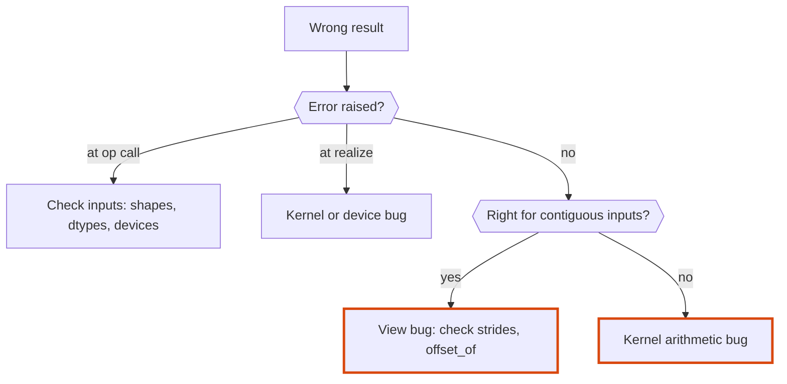
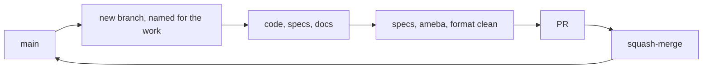

# Tensomite: development

A guide for maintaining tensomite, fixing bugs and adding features. `DESIGN.md` explains how the code works, and `PLAN.md` explains where it's going.

## Setup

1. **Install Crystal 1.22 or later**, which includes `shards`. On macOS, use `brew install crystal`.
2. **Install development dependencies:** `shards install`.
3. **Build the linter:**

   ```sh
   mkdir -p bin && cp lib/ameba/bin/ameba.cr bin && crystal build -o bin/ameba bin/ameba.cr
   ```

   If you use [`ops`](https://github.com/nickthecook/ops), `ops up` does steps 2 and 3 from `ops.yml`.

## Everyday commands

Task                  |Command                               |With `ops`                 
----------------------|--------------------------------------|---------------------------
Run specs             |`crystal spec`                        |`ops test_specs`           
Lint                  |`bin/ameba src/ spec/`                |`ops lint` (`src/` only)   
Check formatting      |`crystal tool format --check src spec`|                           
Fix formatting        |`crystal tool format src spec`        |                           
Everything before a PR|all three of the above                |`ops test` (specs and lint)

All three must be clean before a PR.

## Layout

```
src/tensomite.cr            requires everything, defines VERSION
src/tensomite/errors.cr     error classes
src/tensomite/dtype.cr      DType
src/tensomite/view.cr       View: shape, strides, offset
src/tensomite/device.cr     Buffer and Device interfaces
src/tensomite/node.cr       Op and Node
src/tensomite/tensor.cr     Tensor, the public API
src/tensomite/scheduler.cr  realisation
src/tensomite/devices/      one file per device
spec/                       specs, one file per type
```

## Conventions

### Code

- **Comments document the API and its outcomes:** what a type is, and what a method returns or does. Inside a function, a comment describes the steps of the algorithm, as a numbered list when there are several. Comments never record history or how the code came to be. That belongs in commit messages, and in `PLAN.md` when it affects future contributors.
- **Check eagerly.** Any shape, dtype or device check that can run when an op is built must run there, not in a kernel. See "Error timing" in `DESIGN.md`.
- **Raise tensomite errors** (`ShapeError`, `DTypeError`, `DeviceError`, or `Error`) with a message naming the values involved, such as `"cannot expand [3] to [4]"`.
- **Avoid `not_nil!`** (ameba flags it). Use an accessor that raises a meaningful error instead, such as `Node#buffer!`.

### Crystal gotchas met so far

- **`out` is a reserved word** (used for C out-parameters). Don't use it as a variable name. Kernels use `dst`.
- **Array literals mixing types become unions.** `[1f32, 2, 3]` is `Array(Float32 | Int32)`, which `Tensor.from` rejects. In specs, use the `f32(1, 2, 3)` helper. Elsewhere, use `[1, 2, 3].map(&.to_f32)`.
- **`Bytes#unsafe_slice_of(T)`** reinterprets a buffer's bytes as `Slice(T)` without copying.

### Specs

- **Expected values are worked out by hand,** never produced by tensomite itself. Write the intermediate result in a comment above the assertion, for example `# a.T + b = [[11, 24], [32, 45], [53, 66]]`, so a reviewer can check the arithmetic.
- **Each milestone's exit criterion has its own `describe "Mn exit: …"` block.**
- **Include non-contiguous inputs** (transposed and broadcast views) for any new op. Most indexing bugs hide there.
- **Test the timing of errors,** as well as the fact that they are raised, when an op adds new checks.
- **Exact comparison** (`should eq`) is right for the CPU device on small integers. Use tolerances only where the order of arithmetic legitimately differs, such as between devices.

## Recipes

### Adding an op


1. **Add a member to `Op`** in `node.cr`, with a one-line comment stating what it computes.
2. **Add the `Tensor` method** in `tensor.cr`. It validates the shapes and dtypes, computes the output shape, and builds the node with `Tensor.lazy(Node.new(...))`. Broadcast or permute the sources there, so the kernel stays simple.
3. **Implement the kernel on every device.** On the CPU, add a branch to `CPU#execute(T, node, dst)`. The `case` is exhaustive, so a missing branch is a compile error.
4. **Write specs** with hand-computed values over contiguous, transposed and broadcast inputs.
5. **Update `DESIGN.md`** if the op adds a concept, such as a new node field or a new kind of view.

### Adding a dtype

1. **Add the member to `DType`** and its `bytesize`.
2. **Add a `DType.of` overload** for the Crystal type.
3. **Add a dispatch branch** to each device's `execute(node, output)`.
4. **Add specs** that run existing ops in the new dtype.

### Adding a device

1. **Subclass `Device` and `Buffer`** under `src/tensomite/devices/`, and require the file from `src/tensomite.cr`.
2. **Implement every abstract method.** `map` returns `nil` if the device's memory isn't host-visible.
3. **Run the full op suite** on the new device, comparing results against the CPU device.

## Debugging



- **Inspect before realising.** An unrealised tensor's graph is all there: `t.node.op`, `t.node.srcs`, `t.node.shape`, and each source's `view`.
- **Check the view first** when a result is wrong for transposed or broadcast inputs but right for contiguous ones. `View#offset_of(i)` shows where element `i` is read from.
- **`node.realized?`** shows whether work has run. A realised node has no sources left to inspect, so inspect before realising.

## Workflow



- **One branch per PR,** named for its purpose (for example `m2-cpu-ops-simdiscrete`, `docs-design-development`). Branches start from the latest `main`.
- **PRs are squash-merged.**
- **Keep the documents current in the same PR as the code:**
  - `DESIGN.md` whenever the design as built changes.
  - `DEVELOPMENT.md` whenever a convention, command or gotcha is learned.
  - `PLAN.md` when a decision or milestone changes.
- **AI use** follows `DISCLOSURE.md`: generated code is reviewed until it is understood as if written by hand.
