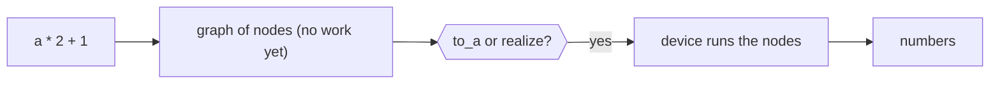
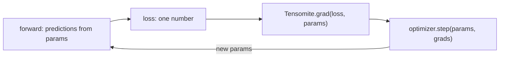
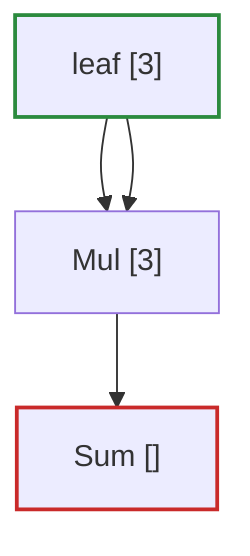

# Tensomite: user's guide

Tensomite is a tensor library for Crystal: arrays of numbers with the operations that machine learning needs, automatic gradients for training, and devices that run the work on the CPU, through BLAS, or on an Apple GPU. This guide explains the API with small examples. [The tutorial](TUTORIAL.md) then trains a tiny model from start to finish.

Every example here was run, and its output is shown in a `# =>` comment.

## Installing

Add tensomite to your project's `shard.yml`, then run `shards install`:

```yaml
dependencies:
  tensomite:
    github: nogginly/tensomite.cr
```

Tensomite needs Crystal 1.22 or later. In your code:

```crystal
require "tensomite"
include Tensomite
```

`include Tensomite` lets you write `Tensor` rather than `Tensomite::Tensor`. The faster devices are opt-in (see "Devices" below).

## The idea: describe now, compute later

A tensor in tensomite is **lazy**. Writing `a * 2 + 1` does no arithmetic. It records what you asked for, as a node in a graph. The work happens when you ask for the numbers, with `to_a` or `realize`.

Because the whole graph exists before anything runs, tensomite can work out gradients from it, combine operations into fewer passes over memory, and reuse memory between them.



```crystal
a = Tensor.from([1, 2, 3, 4, 5, 6].map(&.to_f32), [2, 3])
b = a * 2 + 1
b.node.realized?  # => false
b.to_a(Float32)   # => [3.0, 5.0, 7.0, 9.0, 11.0, 13.0]
```

Mistakes in shape or type are still reported at once, when you write the operation, not later when it runs (see "Errors").

## Creating tensors

A tensor has a **shape** (its size along each axis), a **dtype** (`F32` or `I32`) and a **device**. Data is given flat, in row-major order: the last axis varies fastest.

```crystal
a = Tensor.from([1, 2, 3, 4, 5, 6].map(&.to_f32), [2, 3])
a.shape   # => [2, 3]
a.dtype   # => Tensomite::DType::F32
a.size    # => 6
a.to_a(Float32)  # => [1.0, 2.0, 3.0, 4.0, 5.0, 6.0]

Tensor.full([2, 2], 7).to_a(Float32)    # => [7.0, 7.0, 7.0, 7.0]
Tensor.zeros([3]).to_a(Float32)         # => [0.0, 0.0, 0.0]
Tensor.from([1, 2, 3], [3]).dtype       # => Tensomite::DType::I32
```

The dtype comes from the array's element type: `Float32` gives `F32`, and `Int32` gives `I32`. `to_a` takes the type you expect back, and raises `DTypeError` if it is the wrong one. Shape `[]` is a scalar, a tensor of one element.

## Arithmetic and broadcasting

`+`, `-`, `*` and `/` work element by element, between two tensors or a tensor and a number (with the number on the right: `a * 2`, not `2 * a`). There is unary minus, `exp`, `log`, `tanh` and `sqrt`, and `maximum` and `greater_equal` between tensors.

When shapes differ, the smaller one is **broadcast**: repeated along the axes where it has size 1, or which it lacks, counting from the right.

```crystal
row = Tensor.from([10, 20, 30].map(&.to_f32), [3])
(a + row).to_a(Float32)   # => [11.0, 22.0, 33.0, 14.0, 25.0, 36.0]   (row added to each row)

col = Tensor.from([100, 200].map(&.to_f32), [2, 1])
(a + col).to_a(Float32)   # => [101.0, 102.0, 103.0, 204.0, 205.0, 206.0]   (one number per row)

(-a).to_a(Float32)                                           # => [-1.0, -2.0, ...]
a.maximum(Tensor.from([3, 3, 3].map(&.to_f32), [3])).to_a(Float32)  # => [3.0, 3.0, 3.0, 4.0, 5.0, 6.0]
Tensor.from([1, 4, 9].map(&.to_f32), [3]).sqrt.to_a(Float32)         # => [1.0, 2.0, 3.0]
```

Both operands must have the same dtype; there is no automatic conversion between `F32` and `I32`. `exp`, `log`, `tanh`, `sqrt` and `/` need `F32`.

## Reductions

`sum`, `max` and `mean` reduce over one axis, or over everything when no axis is given. Negative axes count from the end. `keepdims: true` keeps the reduced axis with size 1, which is handy for broadcasting the result back.

```crystal
a.sum.to_a(Float32)      # => [21.0]
a.sum(0).to_a(Float32)   # => [5.0, 7.0, 9.0]    (down the columns)
a.sum(1).to_a(Float32)   # => [6.0, 15.0]        (along the rows)
a.max(-1).to_a(Float32)  # => [3.0, 6.0]
a.mean(1, keepdims: true).shape  # => [2, 1]
```

## Reshaping and other views

These change how a tensor's data is read, without copying it:

Method                     |What it does                           |Example on `a` (`[2, 3]`)               
---------------------------|---------------------------------------|----------------------------------------
`reshape(shape)`           |same elements, new shape               |`a.reshape([3, 2])`                     
`transpose(i = -2, j = -1)`|swaps two axes                         |`a.transpose.shape # => [3, 2]`         
`permute(axes)`            |reorders all axes                      |`a.permute([1, 0])`                     
`slice(axis, start, stop)` |a range along one axis, `stop` excluded|`a.slice(1, 1, 3) # => [[2, 3], [5, 6]]`
`expand(shape)`            |repeats size-1 axes                    |`row.reshape([1, 3]).expand([2, 3])`    
`contiguous`               |copies into row-major order, if needed |`a.transpose.contiguous`                

And two that build new tensors:

```crystal
Tensor.cat([a, a], 0).shape   # => [4, 3]   (joined along axis 0)

table = Tensor.from([0, 1, 10, 11, 20, 21].map(&.to_f32), [3, 2])
table.gather(Tensor.from([2, 0], [2])).to_a(Float32)   # => [20.0, 21.0, 0.0, 1.0]   (rows 2 and 0)
```

`gather` picks rows of a 2-D table by `I32` indices. It is how embeddings work: a token's id selects its row.

## Matrix products

`matmul` multiplies `[..., m, k]` by `[..., k, n]`. Leading axes are batch axes, broadcast like elementwise operands.

```crystal
w = Tensor.from([1, 0, 0, 1, 1, 1].map(&.to_f32), [3, 2])
a.matmul(w).to_a(Float32)   # => [4.0, 5.0, 10.0, 11.0]

Tensor.zeros([4, 2, 3]).matmul(Tensor.zeros([3, 5])).shape   # => [4, 2, 5]
```

## Neural-network building blocks

Method                               |Use                                                                     
-------------------------------------|------------------------------------------------------------------------
`gelu`                               |the GELU activation (tanh approximation), as in GPT-2                   
`softmax(axis = -1)`                 |turns scores into probabilities that sum to 1                           
`log_softmax(axis = -1)`             |the log of `softmax`, computed stably                                   
`layernorm(weight, bias, eps = 1e-5)`|normalises each row to mean 0 and variance 1, then scales and shifts    
`cross_entropy(targets)`             |the mean loss of `[n, classes]` scores against `[n]` `I32` class indices
`Tensor.causal_mask(rows, cols)`     |0 where a position may look, -∞ where it may not, for attention         

```crystal
logits = Tensor.from([1, 2, 3].map(&.to_f32), [1, 3])
logits.softmax.to_a(Float32)                           # => [0.09003057, 0.24472848, 0.66524094]
logits.cross_entropy(Tensor.from([2], [1])).to_a(Float32)  # => [0.40760595]
Tensor.from([-1, 0, 1].map(&.to_f32), [3]).gelu.to_a(Float32)  # => [-0.158808, 0.0, 0.841192]
```

## Gradients

`Tensomite.grad(loss, params)` returns the gradient of a one-element `loss` with respect to each tensor in `params`: how much the loss changes as each element of each param changes.

```crystal
x = Tensor.from([1, 2, 3].map(&.to_f32), [3])
loss = (x * x).sum
Tensomite.grad(loss, [x]).first.to_a(Float32)   # => [2.0, 4.0, 6.0]   (the derivative of x², 2x)
```

Gradients are lazy tensors too, built from the loss's graph. Two rules follow:

1. **Call `grad` before reading the loss.** Once a tensor is realised, the graph that made it is gone, and `grad` raises `Error` if it meets a realised intermediate. Reading the loss *after* `grad`, or together with the gradients, is fine.
2. **Use `detach` for constants.** `t.detach` returns `t`'s value with no history, so no gradient flows through it.

## Training

An optimizer turns gradients into new parameters. Tensors never change in place, so `step` returns new tensors; keep them for the next step.

Optimizer|Constructor                                                                   
---------|------------------------------------------------------------------------------
`SGD`    |`SGD.new(lr: 0.01, momentum: 0.0)`                                            
`AdamW`  |`AdamW.new(lr: 1e-3, beta1: 0.9, beta2: 0.999, eps: 1e-8, weight_decay: 0.01)`

Here is a whole training loop, fitting `y = w · x` to points on `y = 3x`:

```crystal
w = Tensor.from([0f32], [1])
xs = Tensor.from([1, 2, 3, 4].map(&.to_f32), [4, 1])
ys = Tensor.from([3, 6, 9, 12].map(&.to_f32), [4, 1])
optimizer = SGD.new(lr: 0.02)

100.times do
  error = xs.matmul(w.reshape([1, 1])) - ys
  loss = (error * error).mean
  w = optimizer.step([w], Tensomite.grad(loss, [w])).first
end
w.to_a(Float32)   # => [2.9999998]
```

Every step has the same shape:



A long training run should call `GC.collect` once per step. Freed device memory goes back to a pool when the collector runs, so collecting once per step lets the next step reuse the last one's buffers.

## Devices

Each tensor lives on a device, given by the `device:` argument when it is created. All of an operation's operands must be on the same device; `t.to(device)` copies a tensor to another.

Device       |How to get it                                |Use                                                                                                 
-------------|---------------------------------------------|----------------------------------------------------------------------------------------------------
`CPU`        |built in; the default                        |correct and simple, the reference the others are tested against; slow for large matrices            
`BLAS`       |`require "tensomite/blas"`                   |the CPU with matrix products from Accelerate (macOS) or OpenBLAS (Linux): far faster for real models
`Metal`      |`require "tensomite/metal"`, on Apple Silicon|the GPU; `Metal.available?` says whether there is one                                               
`SimDiscrete`|built in                                     |behaves like a GPU with separate memory, for testing code that moves data between devices           

```crystal
sim = SimDiscrete.default
(Tensor.from([1f32, 2f32], [2], sim) * 3).to_a(Float32)   # => [3.0, 6.0]
Tensor.from([1f32], [1]).to(sim).device.class             # => Tensomite::SimDiscrete
```

Use each device's shared instance, such as `BLAS.default` or `Metal.default`, rather than creating new ones. Results repeat exactly from run to run on every device. Different devices may differ in the last bits of a result, because they add numbers in different orders.

## Fused kernels

Each operation is a separate pass over memory. `Tensomite.kernel` compiles a whole elementwise expression into one kernel, for the CPU and the GPU, with its gradients worked out at compile time:

```crystal
Tensomite.kernel(:axpb) { |x, a, b| x * a + b }

x = Tensor.from([1, 2, 3].map(&.to_f32), [3])
Tensomite::Kernels::AXPB.call(x, Tensor.from([2f32], [1]), Tensor.from([1f32], [1])).to_a(Float32)
# => [3.0, 5.0, 7.0]
```

The block may use `+`, `-`, `*`, `/`, number literals, constants such as `Math::PI`, and `tanh`, `exp`, `log` and `sqrt`. Its inputs must be `F32` tensors on one device, and are broadcast like operands. `gelu` is defined this way.

## Seeing the graph

`to_mermaid` draws the graph behind a tensor as a [Mermaid](https://mermaid.js.org) flowchart, which any Mermaid viewer renders:

```crystal
x = Tensor.from([1, 2, 3].map(&.to_f32), [3])
puts (x * x).sum.to_mermaid
```



For a model, name its parts with `Tensomite.scope("name") { ... }` and its weights with `tensor.named("name")`. Then `to_mermaid(depth: 1, params: model_params)` draws one box per part, with its operation and parameter counts, and folds repeated parts (such as a transformer's blocks) into one. [The tutorial](TUTORIAL.md) shows one.

## Pretrained models: GPT-2

Tensomite loads GPT-2 from Hugging Face's safetensors files. `scripts/fetch_gpt2.sh models/gpt2` downloads GPT-2 small (124M parameters) with its tokeniser files.

```crystal
model = GPT2.load("models/gpt2/model.safetensors")   # device: BLAS.default or Metal.default for speed
bpe = BPE.from_files("models/gpt2/vocab.json", "models/gpt2/merges.txt")

ids = model.generate(bpe.encode("The meaning of life is"), 12)
puts bpe.decode(ids)   # => " not the same as the meaning of death.\n\nThe"

sampler = Sampler.new(temperature: 0.8, top_k: 40, seed: 1)
puts bpe.decode(model.generate(bpe.encode("Once upon a time"), 10, sampler))
```

`generate` returns only the new tokens. Without a sampler it picks the likeliest token each time (greedy), so the output is always the same. With a `Sampler` it picks at random, in proportion to each token's probability, among the `top_k` likeliest tokens (all of them when `top_k` is 0, the default). A `temperature` above 1 makes unlikely tokens more likely to be picked, and below 1 less likely. The same seed gives the same text.

For other weights in safetensors files, `SafeTensors.open(path)` lists them (`names`) and loads each as a tensor (`file["name", device]`).

## Errors

Error           |When                        |For example                                                             
----------------|----------------------------|------------------------------------------------------------------------
`ShapeError`    |when you write the operation|`a + Tensor.zeros([4])`: "shapes [2, 3] and [4] cannot be broadcast"    
`DTypeError`    |when you write the operation|`a.to_a(Int32)` on an `F32` tensor: "cannot read F32 tensor as Int32"   
`ExecutionError`|when the graph runs         |a `gather` index past the table's end: "index 3 out of range for 1 rows"
`DeviceError`   |when a device is used       |`Metal.default` on a machine without a GPU                              

All of them are subclasses of `Tensomite::Error`.

## Current limits

- **Two dtypes:** `F32` and `I32`. Half precision and quantised weights are planned.
- **No saving yet.** Weights can be read from safetensors files but not written. To keep a trained model, write each parameter's `shape` and `to_a(Float32)` to a file and rebuild them with `Tensor.from`, as [the tutorial](TUTORIAL.md) does with JSON.
- **Numbers go on the right** of an operator: `x * 2` works, `2 * x` does not.
- **One device per operation.** Move tensors with `to` first.
- **A tensor holds at most about 2 GB,** because element counts are `Int32`.
