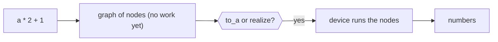
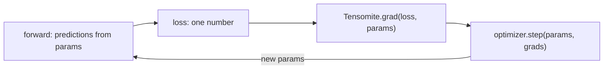
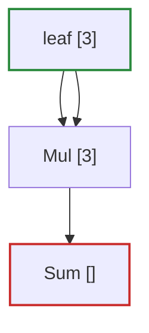

# Tensomite: user's guide

Tensomite is a tensor library for Crystal: arrays of numbers with the operations that machine learning needs, automatic gradients for training, and devices that run the work on the CPU, through BLAS, or on an Apple GPU. This guide explains the API with small examples. [The tutorial](TUTORIAL.md) then trains a tiny model from start to finish.

Every example here was run, and its output is shown in a `# =>` comment.

## Installing

Add tensomite to your project's `shard.yml`, then run `shards install`:

```yaml
dependencies:
  tensomite:
    github: nogginly/tensomite.cr
```

Tensomite needs Crystal 1.22 or later. In your code:

```crystal
require "tensomite"
include Tensomite
```

`include Tensomite` lets you write `Tensor` rather than `Tensomite::Tensor`. The faster devices are opt-in (see "Devices" below).

## The idea: describe now, compute later

A tensor in tensomite is **lazy**. Writing `a * 2 + 1` does no arithmetic. It records what you asked for, as a node in a graph. The work happens when you ask for the numbers, with `to_a` or `realize`.

Because the whole graph exists before anything runs, tensomite can work out gradients from it, combine operations into fewer passes over memory, and reuse memory between them.



```crystal
a = Tensor.from([1, 2, 3, 4, 5, 6].map(&.to_f32), [2, 3])
b = a * 2 + 1
b.node.realized?  # => false
b.to_a(Float32)   # => [3.0, 5.0, 7.0, 9.0, 11.0, 13.0]
```

Mistakes in shape or type are still reported at once, when you write the operation, not later when it runs (see "Errors").

## Creating tensors

A tensor has a **shape** (its size along each axis), a **dtype** (`F32` or `I32`) and a **device**. Data is given flat, in row-major order: the last axis varies fastest.

```crystal
a = Tensor.from([1, 2, 3, 4, 5, 6].map(&.to_f32), [2, 3])
a.shape   # => [2, 3]
a.dtype   # => Tensomite::DType::F32
a.size    # => 6
a.to_a(Float32)  # => [1.0, 2.0, 3.0, 4.0, 5.0, 6.0]

Tensor.full([2, 2], 7).to_a(Float32)    # => [7.0, 7.0, 7.0, 7.0]
Tensor.zeros([3]).to_a(Float32)         # => [0.0, 0.0, 0.0]
Tensor.from([1, 2, 3], [3]).dtype       # => Tensomite::DType::I32
```

The dtype comes from the array's element type: `Float32` gives `F32`, and `Int32` gives `I32`. `to_a` takes the type you expect back, and raises `DTypeError` if it is the wrong one. Shape `[]` is a scalar, a tensor of one element.

## Arithmetic and broadcasting

`+`, `-`, `*` and `/` work element by element, between two tensors or a tensor and a number (with the number on the right: `a * 2`, not `2 * a`). There is unary minus, `exp`, `log`, `tanh` and `sqrt`, and `maximum` and `greater_equal` between tensors.

When shapes differ, the smaller one is **broadcast**: repeated along the axes where it has size 1, or which it lacks, counting from the right.

```crystal
row = Tensor.from([10, 20, 30].map(&.to_f32), [3])
(a + row).to_a(Float32)   # => [11.0, 22.0, 33.0, 14.0, 25.0, 36.0]   (row added to each row)

col = Tensor.from([100, 200].map(&.to_f32), [2, 1])
(a + col).to_a(Float32)   # => [101.0, 102.0, 103.0, 204.0, 205.0, 206.0]   (one number per row)

(-a).to_a(Float32)                                           # => [-1.0, -2.0, ...]
a.maximum(Tensor.from([3, 3, 3].map(&.to_f32), [3])).to_a(Float32)  # => [3.0, 3.0, 3.0, 4.0, 5.0, 6.0]
Tensor.from([1, 4, 9].map(&.to_f32), [3]).sqrt.to_a(Float32)         # => [1.0, 2.0, 3.0]
```

Both operands must have the same dtype; there is no automatic conversion between `F32` and `I32`. `exp`, `log`, `tanh`, `sqrt` and `/` need `F32`.

## Reductions

`sum`, `max` and `mean` reduce over one axis, or over everything when no axis is given. Negative axes count from the end. `keepdims: true` keeps the reduced axis with size 1, which is handy for broadcasting the result back.

```crystal
a.sum.to_a(Float32)      # => [21.0]
a.sum(0).to_a(Float32)   # => [5.0, 7.0, 9.0]    (down the columns)
a.sum(1).to_a(Float32)   # => [6.0, 15.0]        (along the rows)
a.max(-1).to_a(Float32)  # => [3.0, 6.0]
a.mean(1, keepdims: true).shape  # => [2, 1]
```

## Reshaping and other views

These change how a tensor's data is read, without copying it:

Method                     |What it does                           |Example on `a` (`[2, 3]`)               
---------------------------|---------------------------------------|----------------------------------------
`reshape(shape)`           |same elements, new shape               |`a.reshape([3, 2])`                     
`transpose(i = -2, j = -1)`|swaps two axes                         |`a.transpose.shape # => [3, 2]`         
`permute(axes)`            |reorders all axes                      |`a.permute([1, 0])`                     
`slice(axis, start, stop)` |a range along one axis, `stop` excluded|`a.slice(1, 1, 3) # => [[2, 3], [5, 6]]`
`expand(shape)`            |repeats size-1 axes                    |`row.reshape([1, 3]).expand([2, 3])`    
`contiguous`               |copies into row-major order, if needed |`a.transpose.contiguous`                

And two that build new tensors:

```crystal
Tensor.cat([a, a], 0).shape   # => [4, 3]   (joined along axis 0)

table = Tensor.from([0, 1, 10, 11, 20, 21].map(&.to_f32), [3, 2])
table.gather(Tensor.from([2, 0], [2])).to_a(Float32)   # => [20.0, 21.0, 0.0, 1.0]   (rows 2 and 0)
```

`gather` picks rows of a 2-D table by `I32` indices. It is how embeddings work: a token's id selects its row.

One op changes a buffer instead of making a new one. `write(value, axis, start)` copies `value` into positions `start` onwards along `axis`, in place, and returns a tensor sharing the buffer:

```crystal
cache = Tensor.zeros([4, 2])
cache = cache.write(Tensor.from([1f32, 2f32], [1, 2]), 0, 1)   # row 1 is now [1, 2]
```

The target must cover its whole buffer, and anything read from it before the write must be realised first, or it may see the new values. It exists for caches that grow without copying; `CausalSelfAttention::Cache.new(capacity: n)` uses it.

## Matrix products

`matmul` multiplies `[..., m, k]` by `[..., k, n]`. Leading axes are batch axes, broadcast like elementwise operands.

```crystal
w = Tensor.from([1, 0, 0, 1, 1, 1].map(&.to_f32), [3, 2])
a.matmul(w).to_a(Float32)   # => [4.0, 5.0, 10.0, 11.0]

Tensor.zeros([4, 2, 3]).matmul(Tensor.zeros([3, 5])).shape   # => [4, 2, 5]
```

A second argument adds a bias, with the same bits as a separate `+`. A `[n]` vector, as `Linear` has, is added inside the product, saving an op; any other bias that broadcasts is added after it:

```crystal
a.matmul(w, Tensor.from([0.5f32, -1f32], [2])).to_a(Float32)   # => [4.5, 4.0, 10.5, 10.0]
```

## Neural-network building blocks

Method                                        |Use                                                                                                                                                
----------------------------------------------|---------------------------------------------------------------------------------------------------------------------------------------------------
`gelu`                                        |the GELU activation (tanh approximation), as in GPT-2                                                                                              
`softmax(axis = -1)`                          |turns scores into probabilities that sum to 1                                                                                                      
`softmax(scale: s, mask: m)`                  |the softmax of `x · s + m`, as attention takes it, in one fused op                                                                                 
`log_softmax(axis = -1)`                      |the log of `softmax`, computed stably                                                                                                              
`layernorm(weight, bias, eps = 1e-5)`         |normalises each row to mean 0 and variance 1, then scales and shifts                                                                               
`rmsnorm(weight, eps = 1e-5)`                 |divides each row by its root mean square, then scales, as in Llama, in one fused op                                                                
`silu`, `swiglu(up)`                          |SiLU, `x · sigmoid(x)`, and Llama's gate `silu(x) · up`, each one fused kernel                                                                     
`rotate_half`, `rope(cos, sin)`               |swaps the last axis's halves and negates the first, `[x₁, x₂] → [-x₂, x₁]`; and `x · cos + rotate_half(x) · sin`, rotary embeddings in one fused op
`cross_entropy(targets)`                      |the mean loss of `[n, classes]` scores against `[n]` `I32` class indices                                                                           
`Tensor.causal_mask(rows, cols)`              |0 where a position may look, -∞ where it may not, for attention                                                                                    
`Tensor.attention(q, k, v, scale: s, mask: m)`|`softmax(q · kᵀ · s + m) · v`; on a GPU, for decoding's few rows, one fused op whose scores stay on the GPU                                        

```crystal
logits = Tensor.from([1, 2, 3].map(&.to_f32), [1, 3])
logits.softmax.to_a(Float32)                           # => [0.09003057, 0.24472848, 0.66524094]
logits.cross_entropy(Tensor.from([2], [1])).to_a(Float32)  # => [0.40760595]
Tensor.from([-1, 0, 1].map(&.to_f32), [3]).gelu.to_a(Float32)  # => [-0.158808, 0.0, 0.841192]
```

## Gradients

`Tensomite.grad(loss, params)` returns the gradient of a one-element `loss` with respect to each tensor in `params`: how much the loss changes as each element of each param changes.

```crystal
x = Tensor.from([1, 2, 3].map(&.to_f32), [3])
loss = (x * x).sum
Tensomite.grad(loss, [x]).first.to_a(Float32)   # => [2.0, 4.0, 6.0]   (the derivative of x², 2x)
```

Gradients are lazy tensors too, built from the loss's graph. Two rules follow:

1. **Call `grad` before reading the loss.** Once a tensor is realised, the graph that made it is gone, and `grad` raises `Error` if it meets a realised intermediate. Reading the loss *after* `grad`, or together with the gradients, is fine.
2. **Use `detach` for constants.** `t.detach` returns `t`'s value with no history, so no gradient flows through it.

## Training

An optimizer turns gradients into new parameters. Tensors never change in place, so `step` returns new tensors; keep them for the next step.

Optimizer|Constructor                                                                   
---------|------------------------------------------------------------------------------
`SGD`    |`SGD.new(lr: 0.01, momentum: 0.0)`                                            
`AdamW`  |`AdamW.new(lr: 1e-3, beta1: 0.9, beta2: 0.999, eps: 1e-8, weight_decay: 0.01)`

An optimizer's state, such as AdamW's running averages `m` and `v`, lasts the whole run. To save a run and resume it, write `optimizer.state` with `SafeTensors.write` beside the model's weights, and keep `optimizer.steps`; later, `optimizer.restore(SafeTensors.open(path), steps: steps)` on an optimizer made with the same settings and parameters takes the step an uninterrupted run would have taken. `apps/finetune` does this in its checkpoints.

Here is a whole training loop, fitting `y = w · x` to points on `y = 3x`:

```crystal
w = Tensor.from([0f32], [1])
xs = Tensor.from([1, 2, 3, 4].map(&.to_f32), [4, 1])
ys = Tensor.from([3, 6, 9, 12].map(&.to_f32), [4, 1])
optimizer = SGD.new(lr: 0.02)

100.times do
  error = xs.matmul(w.reshape([1, 1])) - ys
  loss = (error * error).mean
  w = optimizer.step([w], Tensomite.grad(loss, [w])).first
end
w.to_a(Float32)   # => [2.9999998]
```

Every step has the same shape:



A long training run should call `GC.collect` once per step. Freed device memory goes back to a pool when the collector runs, so collecting once per step lets the next step reuse the last one's buffers.

## Models from modules

Writing a model as tensors means keeping a list of parameters and remembering their order. `Tensomite::Module` does that bookkeeping. A model is a class whose instance variables hold its parts, and whose `forward` combines them:

```crystal
class Multiplier < Tensomite::Module
  def initialize
    @hidden = Linear.new(2, 64)
    @output = Linear.new(64, 1)
  end

  def forward(x : Tensor) : Tensor
    @output.call(@hidden.call(x).gelu)
  end
end

model = Multiplier.new
model.call(Tensor.zeros([3, 2])).shape   # => [3, 1]
model.named_params.keys                  # => ["hidden.weight", "hidden.bias", "output.weight", "output.bias"]
```

- **Parts are found at compile time.** Any instance variable holding a `Parameter`, a `Module`, an `Array` of either, or a nilable one, is part of the model, named after the variable. Members of an array are named by position: `blocks.0.norm.weight`.
- **`forward` defines; `call` runs.** `call` runs `forward` with the same arguments, inside a scope named after the module's place in its parent, so diagrams show one box per part. `forward` can take any arguments.
- **A `Parameter` is a slot** holding a tensor (`param.value`), with a name and a flag for weight decay. Tensors never change; training replaces the tensor in each slot.
- **Weights are drawn from `Tensomite.rng`,** a generator seeded with 0, so the same program builds the same model on every run. Each built-in module also takes `rng:` and `device:` arguments, which a `Builder` (below) fills in.

Built-in module                                    |Parameters                                                       |`forward`                                                                                                                                                                                                                                                                                                   
---------------------------------------------------|-----------------------------------------------------------------|------------------------------------------------------------------------------------------------------------------------------------------------------------------------------------------------------------------------------------------------------------------------------------------------------------
`Linear.new(inputs, outputs, bias: true)`          |`weight [inputs, outputs]` (decayed), `bias [outputs]`           |`x.matmul(weight) + bias`                                                                                                                                                                                                                                                                                   
`Embedding.new(count, width)`                      |`weight [count, width]` (decayed)                                |rows of the weight selected by `I32` ids of any shape                                                                                                                                                                                                                                                       
`LayerNorm.new(width, eps: 1e-5)`                  |`weight`, `bias`                                                 |`x.layernorm(weight, bias, eps)`                                                                                                                                                                                                                                                                            
`Activation.gelu`, `Activation.tanh`               |none                                                             |the function                                                                                                                                                                                                                                                                                                
`Sequential.new(layer, layer, ...)`                |its steps'                                                       |each step in turn                                                                                                                                                                                                                                                                                           
`CausalSelfAttention.new(width, heads, bias: true)`|`c_attn`, `c_proj` (both `Linear`)                               |`call(x, mask)`: GPT-2's multi-head attention over `[batch × length, width]` rows, under a `Tensor.causal_mask(length, length)`; `call(x, mask, cache)` also attends to the positions in a `CausalSelfAttention::Cache`, which with a `capacity` writes new positions in place rather than copying the cache
`RMSNorm.new(width, eps: 1e-5)`                    |`weight`                                                         |`x.rmsnorm(weight, eps)`                                                                                                                                                                                                                                                                                    
`SwiGLU.new(width, hidden)`                        |`gate_proj`, `up_proj`, `down_proj` (`Linear`s without biases)   |Llama's MLP, `down_proj(gate_proj(x).swiglu(up_proj(x)))`                                                                                                                                                                                                                                                   
`GroupedQueryAttention.new(width, heads, kv_heads)`|`q_proj`, `k_proj`, `v_proj`, `o_proj` (`Linear`s without biases)|`call(x, mask, rope)`, or `call(x, mask, rope, cache)`: Llama's attention, in which each key and value head serves `heads / kv_heads` query heads, with queries and keys rotated by a `RotaryEmbedding`; its cache holds `kv_heads` heads                                                                   

A `RotaryEmbedding.new(head_width, context, theta)` has no parameters: it holds the cosines and sines of every position, and `rope.call(x, start)` rotates `[..., length, head_width]` rows as positions `start` onwards.

`Linear` draws its weight uniformly from ±1/√inputs, and `Embedding` from a normal distribution with standard deviation 0.02. Either takes `init:` to change that: `Init.uniform(bound)`, `Init.normal(std)` or `Init.constant(value)`.

```crystal
mlp = Sequential.new(Linear.new(2, 64), Activation.gelu, Linear.new(64, 1))
mlp.named_params.keys   # => ["steps.0.weight", "steps.0.bias", "steps.2.weight", "steps.2.bias"]
```

`Sequential` holds `Layer`s, modules whose `forward` takes one tensor and returns one. Every built-in module is a `Layer`. A model whose `forward` takes more, such as a transformer block that also takes a mask, inherits from `Module` instead.

**Builders.** A `Builder` holds the settings a model's parts share: the random generator, the device, whether `Linear`s have biases, and how weights are drawn. Its methods `linear`, `embedding`, `layernorm`, `attention` (a `CausalSelfAttention`), `rmsnorm`, `swiglu`, `grouped_attention` (a `GroupedQueryAttention`) and `parameter` take the same arguments as the modules, without those settings. `Sequential.build` makes a `Sequential` from a block in which `linear`, `layernorm`, `gelu` and `tanh` each add a step, and `add` adds any layer:

```crystal
class Block < Tensomite::Module
  def initialize(width : Int32, heads : Int32, build : Builder)
    @ln1 = build.layernorm(width)
    @attention = build.attention(width, heads)
    @ln2 = build.layernorm(width)
    @mlp = Sequential.build(build) do
      linear width, 4 * width
      gelu
      linear 4 * width, width
    end
  end

  def forward(x : Tensor, mask : Tensor) : Tensor
    x = x + @attention.call(@ln1.call(x), mask)
    x + @mlp.call(@ln2.call(x))
  end
end

build = Builder.new(rng: Random.new(1), device: BLAS.default, bias: false, init: Init.normal(0.02))
block = Block.new(128, 4, build)
```

- **Settings apply unless overridden.** With `bias: false` above, `build.linear(2, 3, bias: true)` still has a bias. `build.with(bias: true)` returns a builder with one setting changed.
- **`init: nil`,** the default, leaves each module's own: uniform ±1/√inputs for `Linear`, normal with standard deviation 0.02 for `Embedding`, `CausalSelfAttention` and `parameter`.
- **Pass the builder as a typed argument,** `build : Builder`, and give the constructor's other arguments types too. Crystal works out an instance variable's type from `build.linear(...)` only when it knows `build`'s type from the method's signature; a builder made in a local variable inside `initialize` does not work. For the same reason, `Sequential.build(build) do ... end` is a class method: Crystal does not work out a type from an instance method called with a block.

**Repeated parts** go in an array, which needs its type declared, because Crystal cannot infer it from `Array.new`:

```crystal
class Stack < Tensomite::Module
  @blocks : Array(Block)

  def initialize(layers : Int32, width : Int32)
    @embed = Embedding.new(100, width)
    @blocks = Array.new(layers) { Block.new(width) }
  end

  def forward(ids : Tensor) : Tensor
    @blocks.reduce(@embed.call(ids)) { |x, block| block.call(x) }
  end
end
```

Parameters are listed in the order the class declares its variables, so `@blocks`, declared above `initialize`, comes before `@embed`. Code that needs a particular parameter should look it up by name.

**Training a module.** Give the optimizer the model's parameters once; then `step(loss)` computes the gradients, reads the loss, replaces each parameter's value, and returns the loss's value:

```crystal
line = Linear.new(1, 1, bias: false, init: Init.constant(0))
optimizer = SGD.new(line.params, lr: 0.02)
100.times do
  error = line.call(xs) - ys
  optimizer.step((error * error).mean)
end
line.weight.value.to_a(Float32)   # => [2.9999998]
```

This is the same fit as in "Training", with the same result. `AdamW` applies weight decay only to parameters flagged for it: weight matrices and embeddings, not biases or normalisation parameters.

**Other things modules do:**

- `model.save(path)` writes every parameter to a safetensors file under its name, and `model.load(path)` replaces each parameter with the tensor of the same name. A missing or extra name raises `Error`, unless `strict: false`; a different shape raises `ShapeError`. The file can be read by other tools, such as Hugging Face's `safetensors` package.
- `load(path, prefix: "transformer.")` reads names with a prefix in front, and `load(path, ignore: /\.attn\.bias$/)` skips tensors in the file that are not parameters. A model built only to be loaded can use `Init.placeholder`, zeros that take no memory, so building it allocates almost nothing.
- `model.to(device)` moves every parameter to another device.
- `tensor.to_mermaid(model: model, depth: 1)` draws a summary of the model's parts, with their parameter counts. [The tutorial](TUTORIAL.md) shows one.

## Devices

Each tensor lives on a device, given by the `device:` argument when it is created. All of an operation's operands must be on the same device; `t.to(device)` copies a tensor to another.

Device       |How to get it                                  |Use                                                                                                                                                                  
-------------|-----------------------------------------------|---------------------------------------------------------------------------------------------------------------------------------------------------------------------
`CPU`        |built in; the default                          |correct and simple, the reference the others are tested against; slow for large `F32` matrices, fast for quantised ones (below)                                      
`BLAS`       |`require "tensomite/blas"`                     |the CPU with matrix products from Accelerate (macOS) or OpenBLAS (Linux): far faster for real models                                                                 
`Metal`      |`require "tensomite/metal"`, on Apple Silicon  |the GPU; `Metal.available?` says whether there is one                                                                                                                
`CUDA`       |`require "tensomite/cuda"`, built with `-Dcuda`|an NVIDIA GPU; `CUDA.available?` says whether there is one. Every `F32` op GPT-2 uses runs on the GPU; integer ops run on the CPU, with data kept in the GPU's memory
`SimDiscrete`|built in                                       |behaves like a GPU with separate memory, for testing code that moves data between devices                                                                            

```crystal
sim = SimDiscrete.default
(Tensor.from([1f32, 2f32], [2], sim) * 3).to_a(Float32)   # => [3.0, 6.0]
Tensor.from([1f32], [1]).to(sim).device.class             # => Tensomite::SimDiscrete
```

Use each device's shared instance, such as `BLAS.default`, `Metal.default` or `CUDA.default`, rather than creating new ones. `realize` waits for the device to finish, which on a GPU leaves it idle while the host prepares the next piece of work; `Tensor.realize([a, b, c])` computes several tensors and waits once, as an optimizer's `step` does for the loss, its state and every update. Building with CUDA needs the NVIDIA driver and NVRTC, NVIDIA's runtime compiler; see "Working on the CUDA device" in `DEVELOPMENT.md`. Results repeat exactly from run to run on every device. Different devices may differ in the last bits of a result, because they add numbers in different orders.

## Fused kernels

Each operation is a separate pass over memory. `Tensomite.kernel` compiles a whole elementwise expression into one kernel, for the CPU and the GPU, with its gradients worked out at compile time:

```crystal
Tensomite.kernel(:axpb) { |x, a, b| x * a + b }

x = Tensor.from([1, 2, 3].map(&.to_f32), [3])
Tensomite::Kernels::AXPB.call(x, Tensor.from([2f32], [1]), Tensor.from([1f32], [1])).to_a(Float32)
# => [3.0, 5.0, 7.0]
```

The block may use `+`, `-`, `*`, `/`, number literals, constants such as `Math::PI`, and `tanh`, `exp`, `log` and `sqrt`. Its inputs must be `F32` tensors on one device, and are broadcast like operands. `gelu` is defined this way.

## Seeing the graph

`to_mermaid` draws the graph behind a tensor as a [Mermaid](https://mermaid.js.org) flowchart, which any Mermaid viewer renders:

```crystal
x = Tensor.from([1, 2, 3].map(&.to_f32), [3])
puts (x * x).sum.to_mermaid
```



For a model, name its parts with `Tensomite.scope("name") { ... }` and its weights with `tensor.named("name")`. Then `to_mermaid(depth: 1, params: model_params)` draws one box per part, with its operation and parameter counts, and folds repeated parts (such as a transformer's blocks) into one. [The tutorial](TUTORIAL.md) shows one.

## Pretrained models: GPT-2

Tensomite loads GPT-2 from Hugging Face's safetensors files. `scripts/fetch_gpt2.sh` downloads GPT-2 small (124M parameters) with its tokeniser files into `models/gpt2`; `scripts/fetch_gpt2.sh medium` (or `large`, `xl`) downloads a larger one into `models/gpt2-medium`. Load those with their heads, `n_head` in their `config.json`: 16, 20 and 25.

```crystal
model = GPT2.load("models/gpt2/model.safetensors")   # device: BLAS.default or Metal.default for speed
bpe = BPE.from_files("models/gpt2/vocab.json", "models/gpt2/merges.txt")

ids = model.generate(bpe.encode("The meaning of life is"), 12)
puts bpe.decode(ids)   # => " not the same as the meaning of death.\n\nThe"

sampler = Sampler.new(temperature: 0.8, top_k: 40, seed: 1)
puts bpe.decode(model.generate(bpe.encode("Once upon a time"), 10, sampler))
```

To stream text a token at a time, decode each token's bytes with `bpe.decode_bytes(ids)`, which may end partway through a character, and print only whole characters; `bpe.id?("<|endoftext|>")` gives GPT-2's end-of-text token, 50256, after which the model has finished. `apps/server` does both, serving a model over HTTP.

**Tokenisers in one file.** Newer models publish their tokeniser as a single `tokenizer.json`, which `BPE.from_json` reads. It holds special tokens as well, such as ChatML's `<|im_start|>`, and `encode` gives each one its own id wherever it appears in the text. For text from users, call `encode(text, special: false)`, so that typing `<|im_end|>` cannot end a message early. It reads byte-level BPE tokenisers, GPT-2's kind, with or without SmolLM2's rule that every digit is a token of its own. Anything else, such as a SentencePiece tokeniser or a normaliser, raises rather than encoding wrongly.

```crystal
bpe = BPE.from_json("models/smollm2-135m-instruct/tokenizer.json")
bpe.encode("<|im_start|>user\nWhat is 12 + 345?")
# => [1, 4093, 198, 1780, 314, 216, 33, 34, 1232, 216, 35, 36, 37, 47]: 1 is <|im_start|>; 33 to 37 are the digits 1 to 5
```

`model.forward_last(ids, cache)` is `forward` for the last position alone, `[1, vocab]`: the final norm and the head, the largest product, run on one row, as `generate` and `apps/server` use it. `generate` returns only the new tokens, and with `stop:` it ends after any of the given tokens, such as `<|endoftext|>`, which it returns last. Without a sampler it picks the likeliest token each time (greedy), so the output is always the same. With a `Sampler` it picks at random, in proportion to each token's probability, among the `top_k` likeliest tokens (all of them when `top_k` is 0, the default). A `temperature` above 1 makes unlikely tokens more likely to be picked, and below 1 less likely. The same seed gives the same text.

`GPT2` is a `Module`, and its parts have the names used in Hugging Face's file: `wte` and `wpe` (the token and position embeddings), `h.0` to `h.11` (the blocks, each with `ln_1`, `attn`, `ln_2` and `mlp`), and `ln_f`. So `model.named_params["h.0.attn.c_attn.weight"]` is that weight, and diagrams of the model use the same names.

**Fine-tuning.** Called with a tensor of token ids `[batch, length]`, a GPT-2 runs each row as its own sequence from position 0, without a cache, and returns lazy logits `[batch * length, vocab]` to train with:

```crystal
optimizer = AdamW.new(model.params, lr: 1e-4, weight_decay: 0.01)
loss = optimizer.step(model.call(inputs).cross_entropy(targets))   # inputs [8, 256], targets [2048]
model.save("models/gpt2-tuned/model.safetensors")
```

Fine-tuning on a small text overfits quickly: the model starts to memorise the text, and its loss on text it has not seen rises. Dropout, which zeroes a random tenth of the activations at each step, keeps the model from relying on any one of them. Pass a `Dropout` to apply it, a new one each step with its own seed; without one, nothing is dropped, as in inference:

```crystal
loss = model.call(inputs, dropout: Dropout.new(0.1, seed: step.to_u64)).cross_entropy(targets)
```

`x.dropout(0.1, seed: 42_u64)` applies it to any `F32` tensor. The same seed gives the same mask on every device, and gradients flow through the same mask.

`bench/train_gpt2.cr` fine-tunes GPT-2 small on a text file for a few steps and reports the cost of a step; `apps/finetune` runs a whole fine-tune, with checkpoints, validation and early stopping, and exports a model `apps/server` serves. Fine-tuning keeps a gradient and AdamW's `m` and `v` beside every weight, so GPT-2 small needs about 2 GB for them in F32, before activations.

For other weights in safetensors files, `SafeTensors.open(path)` lists them (`names`) and loads each as a tensor (`file["name", device]`). `SafeTensors.write(path, {"name" => tensor, ...})` writes tensors to a new file.

## Pretrained models: Llama family

`Llama` loads Llama-family models, such as SmolLM2, from a Hugging Face model directory: its `config.json` gives the sizes and its `model.safetensors` the weights. `scripts/fetch_smollm2.sh` downloads SmolLM2-135M-Instruct into `models/smollm2-135m-instruct`. Its weights ship as `BF16` and are widened to `F32` as they load. Compared with GPT-2, the parts are different but play the same roles:

GPT-2                                |Llama                                    |What it changes                                                                         
-------------------------------------|-----------------------------------------|----------------------------------------------------------------------------------------
learned position embeddings          |rotary embeddings (`RotaryEmbedding`)    |positions rotate queries and keys, so attention depends on how far apart two tokens are 
`LayerNorm`                          |`RMSNorm`                                |no mean subtracted and no bias                                                          
GELU MLP                             |SwiGLU MLP (`SwiGLU`)                    |a gate, `silu(gate) · up`, chooses what passes                                          
one key and value head per query head|grouped queries (`GroupedQueryAttention`)|SmolLM2's 9 query heads share 3 key and value heads, so the cache is a third of the size

```crystal
model = Llama.load("models/smollm2-135m-instruct", BLAS.default)
bpe = BPE.from_json("models/smollm2-135m-instruct/tokenizer.json")
prompt = bpe.encode("<|im_start|>user\nWhat is the capital of France?<|im_end|>\n<|im_start|>assistant\n")
puts bpe.decode(model.generate(prompt, 64, stop: [bpe.specials["<|im_end|>"]]))
# => The capital of France is Paris. ... <|im_end|>
```

A loaded `Llama` joins the projections that read the same input, queries, keys and values, and the MLP's gate and up, into one product each (`Linear.merge`), which halves the dispatches of a decoded token's products without changing its logits.

An instruct model expects its chat template, ChatML for SmolLM2, as above, and `stop:` ends a turn at `<|im_end|>`. `GPT2` and `Llama` share their cache, `forward(ids, cache)` and `generate` (`Generative`). `Llama` is a `Module` named as Hugging Face's file is (`model.embed_tokens`, `model.layers.0.self_attn.q_proj`, `model.norm`, and `lm_head` when the head does not share the embeddings). PyTorch stores each `Linear`'s weight as `[outputs, inputs]`, so `Module#load(path, transposed: regex)` copies the matching weights into tensomite's `[inputs, outputs]` as they load.

**GGUF files.** llama.cpp's format holds a model's weights, configuration, tokeniser and chat template in one file. `Llama.load` reads one when the path ends in `.gguf`, and `BPE.from_gguf` reads its tokeniser. `scripts/fetch_smollm2_gguf.sh` downloads SmolLM2-135M-Instruct at F16, Q8_0 and Q4_0. F32, F16 and BF16 tensors load as `F32`, and quantised tensors in their block formats (below), which `Llama` runs as they are.

```crystal
file = GGUF.open("models/smollm2-135m-instruct-gguf/SmolLM2-135M-Instruct-f16.gguf")
model = Llama.load(file, BLAS.default)
bpe = BPE.from_gguf(file)
file.metadata["llama.attention.head_count_kv"].as_i   # => 3
```

**Quantised tensors.** `DType::Q8_0`, `Q4_0` and `Q4_1` are ggml's block formats. Each run of 32 values along a row is stored as small integers sharing one `F16` scale; `Q4_1` also has an `F16` minimum. That costs 8.5, 4.5 and 5 bits a value, against 32 for `F32`.

```crystal
w = Tensor.from(values, [576, 1536])   # rows of whole blocks of 32
q = w.quantize(DType::Q4_0)            # a new leaf, quantised as ggml's reference does
q.dequantize                           # F32 again, within half a step of each value
file["blk.0.attn_q.weight"].dtype      # => Q4_0, from a GGUF
```

Block tensors are leaves, and they cannot be read with `to_a`. Their only views are runs of whole rows, such as `q.slice(0, 2, 10)`. A transpose, a reshape, or a slice across a row would cut through blocks, so each raises `DTypeError`. Two ops read them:

- `x.linear(w)` is `x · wᵀ` for a weight stored `[outputs, inputs]`, as GGUF and PyTorch store it. With a quantised `w`, each row of `x` is first quantised to 8 bits a block, as ggml's CPU code does, so each output is a sum of integer dot products, one per block, times both scales. With an `F32` `w` it is `x.matmul(w.transpose)`.
- `table.gather(ids)` on a quantised table gives `F32` rows, each dequantised.

`model.quantize(DType::Q8_0)` quantises every `Linear` in a model. Add `embeddings: true` to quantise its `Embedding` tables too. A quantised `Linear` holds its weight `[outputs, inputs]`, so each output's inputs are whole blocks. Gradients do not pass through quantised weights: train at `F32`, then quantise.

```crystal
model = GPT2.load("models/gpt2/model.safetensors").quantize(DType::Q8_0)
model = Llama.load("models/smollm2-135m-instruct-gguf/SmolLM2-135M-Instruct-Q4_0.gguf")
```

`bench/perplexity.cr` measures what quantisation costs. With `--reference`, it also reports the KL divergence of the quantised model's predictions from the unquantised model's. That is the better measure: on a text a model is too sure of, noise that softens its predictions lowers perplexity. Quantised GPT-2 scores *better* than F32 on Shakespeare for that reason. Some results, from 16 windows of 128 tokens of Shakespeare:

Model                                      |Perplexity|KL from F32, nats/token
-------------------------------------------|----------|-----------------------
SmolLM2 at F32                             |60.7      |0                      
SmolLM2 at Q8_0                            |61.0      |0.005                  
SmolLM2 at Q4_0, llama.cpp's file          |68.0      |0.154                  
GPT-2 at F32                               |139.4     |0                      
GPT-2, matrices at Q4_0                    |126.6     |0.080                  
GPT-2, matrices at Q4_0, embeddings at Q8_0|124.3     |0.132                  

Embeddings are the most sensitive part. GPT-2's token table doubles as its output head: at Q8_0 it adds about 0.05 to the KL divergence, and at Q4_0 it sends perplexity into the thousands. So `quantize` leaves embeddings alone unless asked, as llama.cpp keeps them at 8 bits or more.

**Speed on the CPU.** On `CPU` and `BLAS`, a quantised product shares its outputs among all the machine's cores, with the same bits however many there are. `TENSOMITE_THREADS` sets the number of threads, and 1 runs on the calling thread alone. Building with `--mcpu=native` lets the compiler use the CPU's 8-bit dot-product instructions, for about 11–13% more on Apple Silicon and the GB10, but the program may then not run on an older CPU of the same architecture; `ops bn` and `ops run-native` build that way (see `DEVELOPMENT.md`). SmolLM2-1.7B at Q4_0 decodes in about 7 ms a token on an M5 Pro, portably, and 6.4 natively.

llama.cpp's converter reorders each head's query and key rows, so that its rotary embeddings rotate adjacent features, `(2i, 2i + 1)`. `Llama.load` reorders them back to Hugging Face's halves, `(i, i + width/2)`, so a GGUF at F32 gives exactly the logits of the safetensors model it came from.

## Errors

Error           |When                        |For example                                                             
----------------|----------------------------|------------------------------------------------------------------------
`ShapeError`    |when you write the operation|`a + Tensor.zeros([4])`: "shapes [2, 3] and [4] cannot be broadcast"    
`DTypeError`    |when you write the operation|`a.to_a(Int32)` on an `F32` tensor: "cannot read F32 tensor as Int32"   
`ExecutionError`|when the graph runs         |a `gather` index past the table's end: "index 3 out of range for 1 rows"
`DeviceError`   |when a device is used       |`Metal.default` on a machine without a GPU                              

All of them are subclasses of `Tensomite::Error`.

## Current limits

- **Two dtypes to compute in:** `F32` and `I32`. `F16` and `BF16` weights widen to `F32` as they load, which doubles their memory; quantised weights stay in their block formats, but only `linear` and `gather` read them, and gradients do not pass through them.
- **Numbers go on the right** of an operator: `x * 2` works, `2 * x` does not.
- **One device per operation.** Move tensors with `to` first.
- **A tensor holds at most about 2 GB,** because element counts are `Int32`.
