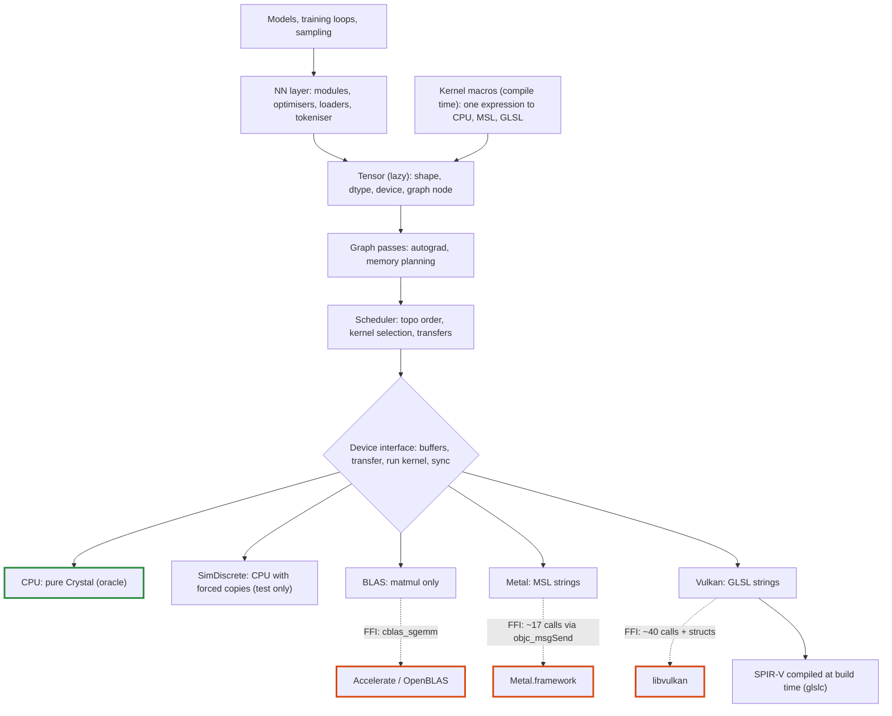
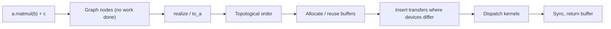

# Tensomite: plan

Oct 22, 2026

## Goal and principles

The aim is a minimal Crystal shard for tensor maths, inference and training on macOS and Linux, written almost entirely in Crystal. It must be fast by design, not fast later by rewrite. So the hard parts of a production runtime (lazy execution, device-owned memory, runtime dtypes) come first, in small steps.

- **Lazy by default.** Ops build a graph and `realize` executes it. This gives one place to schedule, plan memory and differentiate.
- **Memory belongs to devices.** A tensor never assumes it can read its own bytes. Unified memory (Apple Silicon) is an optimisation of the discrete case, not the default.
- **Narrow FFI waist.** Native calls go through two seams only: CPU BLAS and a GPU driver. Adding an op never adds an FFI binding.
- **Kernels live in Crystal.** GPU kernel source is written in Crystal, or generated from Crystal expressions by kernel macros at compile time. MSL is compiled by the Metal driver at runtime, and GLSL is compiled to SPIR-V at build time.
- **CPU backend is the oracle.** Every other backend is tested against the naive pure-Crystal implementation. Library ops keep a hand-written CPU version, so a mistake in a kernel macro's expression cannot pass its own parity test.
- **Always runnable.** Each milestone ends with something that runs end to end and has a measurable exit.
- **Inspectable.** A running model can be looked into: its graph drawn, and in time its activations, attention and gradients read, by the names of its parts (scopes), without changing its code.

## Architecture

### Core types

- **`DType`:** a runtime enum (`F32`, `F16`, `BF16`, `I32`, `U8`, then block formats `Q8_0`, `Q4_0`). Block formats have a block size and bytes per block rather than an element size, so every byte size comes from `DType#bytes_for(count)` (Decision N).
- **`Buffer`:** an opaque, device-owned allocation with a byte size. Only its device can read it. `Buffer#map` returns a host `Bytes` view when the device has unified memory, and `nil` otherwise.
- **`View`:** shape, strides and offset. It is pure metadata, so reshape, transpose, slice and broadcast never touch data.
- **`Node`:** a graph vertex producing one contiguous array, with a shape, `DType` and `Device`. It holds an op and its source tensors until realised, then only its `Buffer`.
- **`Tensor`:** non-generic. It is a `View` over a `Node`, so view operations share the node. Typed host access is explicit: `t.to_a(Float32)`.
- **Ownership:** a `Buffer` is released by its device, via a finaliser and an explicit `release`. Views keep their buffer alive. mmap'd files are a `Buffer` on the CPU device.

### Execution flow

Fusion happens before the graph exists. A kernel macro turns a whole expression into one node, and `realize` dispatches one kernel per node.

### Memory model

Discrete GPUs (CUDA, or Vulkan on a graphics card) have their own memory across a PCIe bus. Unified GPUs (Apple Silicon, integrated Intel/AMD) share RAM with the CPU. The device interface always speaks in transfers. A unified device implements a transfer as a no-op, or as a `map`.

The `SimDiscrete` device runs CPU kernels on private buffers and refuses host access except through explicit transfers. It finds residency bugs on any laptop, long before a Vulkan GPU is involved.

## Milestones

Each milestone is done when its exit criterion passes.

1. **Skeleton.** Build `DType`, `View`, `Buffer`, the device interface, the CPU device, lazy `Tensor`, and a `realize` that interprets the graph node by node. Implement elementwise add/mul and `sum`.
   - Exit: `(a + b).sum.to_a(Float32)` matches by hand, including over transposed and broadcast views.
2. **CPU op set and SimDiscrete.**
   - Elementwise and unary ops: exp, log, tanh, GELU (tanh approximation).
   - Reductions: sum, max, mean over an axis.
   - Composite ops: softmax, layernorm, embedding gather, causal mask, slice/concat, and naive matmul.
   - Exit: specs pass against hand-computed values, and the same suite passes unchanged on `SimDiscrete`.
3. **BLAS seam.** Bind `cblas_sgemm` for Accelerate and OpenBLAS, behind an opt-in `require "tensomite/blas"` so the core stays pure Crystal. Operands whose strides BLAS cannot describe are packed first. Devices gain `shape_invariant?` (Decision L).
   - Exit: results are within a relative error of 1e-5 of the naive matmul, and the speedup is benchmarked.
4. **GPT-2 inference.** Write a safetensors loader (mmap as a CPU `Buffer`), a byte-level BPE tokeniser, and the GPT-2 small forward pass with a KV cache and sampling.
   - Fixtures (logits and tokens) are generated once from a PyTorch reference and committed, so CI needs no Python. A tiny randomly initialised GPT-2 and a small trained BPE vocabulary, both built from PyPI packages alone, check the same code paths without GPT-2 small's files.
   - Exit: logits are within tolerance of the fixture, greedy decoding matches for 64 tokens, the tokeniser matches the reference on a Unicode corpus, logits for a position are bit-identical whether computed in prefill or in decode (CPU device), and baseline tokens/s is recorded.
5. **Autograd and training.** Implement reverse mode as a graph transform: `grad(loss, params)` returns new lazy tensors. Add SGD, AdamW and cross-entropy.
   - Exit: gradients pass finite-difference checks, and a char-level Shakespeare model reaches a validation loss below 1.8 nats/char within an hour of training in the 4-core Linux container (Decision R).
6. **Metal backend.** Bind the driver through `objc_msgSend` (one declaration per selector signature) with autorelease pools around dispatch. Add a pipeline cache, then hand-written MSL kernels, ported one op at a time.
   - Exit: every op matches the CPU oracle, GPT-2 tokens/s is recorded against BLAS (Decision O), prefill and decode logits are bit-identical on Metal, and the cost of the deterministic split-K matvec against an atomic version is measured.
7. **Kernel macros and memory planning.** `Tensomite.kernel` takes an elementwise expression block and generates, at compile time, a CPU loop and an MSL kernel, plus a backward kernel per input by symbolic differentiation. `softmax`, `log_softmax` and `layernorm` become fused row ops (Decision T). Matmul is tiled on Metal; bias and activation epilogues were measured and dropped (Decision AE). Buffers are reused through a pool (Decision U). GPT-2's and the trainer's elementwise chains (GELU, scale and mask, residual adds) move onto macros. In PRs:
   1. Profile Metal decode: GPU time per op, and the host's share of each token.
   2. Parallel reductions on Metal (Decision X): the profile put 57% of a decoded token's GPU time in one-thread-per-row sums.
   3. A buffer pool, on host devices and Metal, and batched commits on Metal so the GPU starts before the host has encoded the whole graph.
   4. Kernel macros for elementwise expressions. The spike settled it: pure macros suffice, flattening the block into a tape with an explicit stack and differentiating by a reverse sweep over it. No `{{ run(...) }}` helper is needed.
   5. Fused row ops.
   6. GPT-2 and the trainer on fused kernels, measured. Vectorised host loops and own maths (Decision Y) halved a training step, which met the training exit; the remaining fusions (attention's scale and mask, AdamW, bias adds) became optional.
   7. Graph diagrams (Decisions AB and AC): `Tensor#to_mermaid` renders the graph behind a tensor as a Mermaid flowchart, with ops as nodes, views as edge labels and a node limit for large graphs; with a depth, it summarises the graph by scope, folding repeated blocks.
   8. A tiled Metal matmul with split-K's bits (Decisions AD to AG): a 128-token prefill went from 69 to 22 ms of GPU time, 5,539 tokens/s against BLAS's 2,010, and decode is unchanged. Products with 768 output columns remain slower than Accelerate.
   9. The exit runs, recorded below and in "Performance baselines" in `DESIGN.md`.
   - Exit: dispatch count per GPT-2 token falls measurably, GPT-2 tokens/s on Metal beats BLAS (Decision O), macro kernels match their hand-written CPU oracles, macro gradients pass finite-difference checks, and the char-level Shakespeare model reaches a validation loss below 1.6 nats/char within an hour of training in the 4-core Linux container (Decision R).
   - Met (24 Oct 2026, M5 Pro and the Linux container):
     - dispatches per decoded GPT-2 token fell from 710 to 316;
     - Metal decodes at 186 tokens/s against BLAS's 166, and prefills 64 tokens at 3,684 tokens/s against 2,419, in the same run (`bench/gpt2.cr`);
     - `gelu`'s kernel gives its composite's bits on host devices, and kernel and fused-row-op gradients pass finite differences (`spec/kernel_spec.cr`, `spec/row_ops_spec.cr`);
     - the Shakespeare model reached 1.573 nats/char at step 2,749 (20 minutes) and 1.494 after 5,000 steps (36 minutes).
     - Memory is planned by a pool fed by the collector (Decision U); releasing buffers as soon as their last reader has run is Decision AA, after M7.

**7b. Modules and a model DSL (Decisions AH to AR).** Models are written as `Tensomite::Module`s: classes whose instance variables hold `Parameter`s and other modules, found and named at compile time, with a `forward` that combines them. Then a DSL over the modules, iterated with them. In PRs:

1. `Parameter`, `Module`, `Linear`, `Embedding`, `LayerNorm`, `Activation`, `Sequential`, and optimizers over parameters; the tutorial's model on modules.
2. A safetensors writer, and `save` and `load` by name (Decision AM). Files round-trip with Hugging Face's `safetensors` package, and saving over a file that a loaded model still maps leaves the model's weights unchanged.
3. The Shakespeare model on modules, with a `CausalSelfAttention`; its trainer simplified to one optimizer and one `step(loss)`. Training and validation losses are bit-identical to the hand-written model's, at the same speed.
4. DSL candidates, a builder in plain Crystal (`with ... yield`) and a declarative macro, written against the same models; then a choice, and changes to the modules that the DSL shows a need for. The builder was adopted, and the tutorial's and the Shakespeare models moved onto it with the same bits (Decision AN).
5. GPT-2 on modules, loading Hugging Face's weights by name, if step 3 shows that its KV cache fits. The cache fits as an argument to `CausalSelfAttention#call`, and the logits are bit-identical to the hand-written model's (Decisions AO to AQ). The second look at a declarative macro became a follow-up (Decision AR).

Exit of 7b: the tutorial, Shakespeare and GPT-2 models on modules, with training losses bit-identical to the hand-written versions; `GUIDE.md` and `TUTORIAL.md` updated; a DSL chosen and recorded.

Met (25 Oct 2026, the Linux container and the M5 Pro):
- the tutorial's model gives the same output, byte for byte, and the Shakespeare model the same training and validation losses, as hex, in two shapes, on modules and on the `Builder`; a 5,000-step run on the M5 Pro ended at 1.4936 nats/char, as the hand-written model's did;
- GPT-2's logits, over a 64-token prefill and 8 decoded tokens, have the same SHA-256 digest as the hand-written model's on CPU and BLAS in the container, and on CPU, Accelerate and Metal on the M5 Pro (`bench/gpt2_digest.cr`);
- `GUIDE.md` and `TUTORIAL.md` describe modules and the `Builder`;
- the `Builder` is the DSL (Decisions AN and AR).

8. **CUDA backend (Decisions AS to AV).** A `CUDA` device on NVIDIA GPUs, through the driver API, with kernels in CUDA C++ compiled by NVRTC when first used, with fused multiply-adds off. It is opt-in: `require "tensomite/cuda"` and build with `-Dcuda`. Developed on a DGX Spark (ARM64, memory shared with the CPU), and proven on a T4 (x86-64, a discrete card). The device always copies between host and device memory explicitly, so the Spark runs the discrete code path. In PRs:
   1. Bindings to `libcuda` and `libnvrtc`, a probe (`examples/cuda_info.cr`), and compiler specs that CI runs without a GPU.
   2. The `CUDA` device: buffers, transfers, a stream, and the device specs `SimDiscrete` and `Metal` pass, with ops not yet ported run on the host. Done without a stream, which arrives with the first kernels, since host ops are synchronous; CI runs the device on a stand-in driver in host memory.
   3. Elementwise and reduction kernels, ported from the MSL ones, matching the oracle. With them, the stub runs the kernels compiled as host C++, so CI compares each with the CPU.
   4. Matmul, split and tiled, in split-K's order, so prefill and decode stay bit-identical; fused row ops; kernel macros emitting CUDA C++. With them, GPT-2's forward pass runs no host ops on CUDA.
   - Profiling decode (Decision AW), then a two-pass matmul for decode (Decision AX).
   5. GPT-2 and the Shakespeare trainer on CUDA; the exit runs on the Spark and a T4.
   - Exit: the full op suite matches the oracle on a discrete GPU (a T4), GPT-2 runs there and on the Spark, and prefill equals decode bit for bit on both.
9. **Quantisation.** Add `F16`, block dtypes, a GGUF loader, and Q8_0/Q4_0 matmul kernels for CPU, Metal and CUDA.
   - `F16` and `BF16` are tensomite's own `UInt16`-backed structs with conversions to and from `Float32`, because Crystal has no half-precision float. GGUF block scales are `F16`, so M9 needs them at the latest.
   - Host kernels read blocks as `Slice` of a block struct (`BlockQ4_0` is 18 bytes: an `F16` scale and 16 bytes of packed weights).
   - Block tensors follow the rules of Decision N: leaves only, sliced by whole rows, and consumed only by `MatMul` (as the weight) and `Gather` (as the table).
   - The CPU kernel quantises activations to Q8 per block, takes the Q4 × Q8 dot product in integers, then applies both scales once per block. This is the oracle version, naive and exact within each block.
   - Exit: a quantised GPT-2 stays within a perplexity budget of f32.
10. **Llama-family model.** Add RoPE, RMSNorm, SwiGLU and grouped-query attention.
    - Exit: TinyLlama runs from GGUF on macOS and Linux, and matches reference fixtures.
11. **Fast quantised CPU kernels (Decision M).** Add a CPU device whose kernels are built for speed, tested against the oracle.
    - Contiguous fast paths loop directly over `Slice`s, so LLVM can vectorise them.
    - Float reductions use a fixed number of accumulators combined in a fixed order, so they vectorise and stay shape-invariant.
    - Quantised matmul uses the integer Q4 × Q8 block dot product.
    - Exit: a quantised small model runs on the CPU faster than with f32 weights, its results match the oracle within tolerance, and prefill and decode logits stay bit-identical.
12. **Vulkan backend.** Bind Vulkan compute, and port the hand-written kernels to GLSL compiled at build time. Kernel macros gain a GLSL backend beside Crystal, MSL and CUDA C++ (Decision V), so fused kernels come with it. It follows CUDA (Decision AT), for AMD and Intel GPUs.
    - Exit: the full op suite matches the oracle on a Linux discrete GPU, and GPT-2 runs there.

## Decisions

- **Decision A, own backends or bind ggml:** own backends (decided).
- **Decision B, Linux GPU:** Vulkan (decided), then superseded by Decision AT: CUDA first, Vulkan as M12. Vulkan still covers AMD, Intel and NVIDIA through one device.
- **Decision C, first model:** GPT-2 small, then TinyLlama (decided).
- **Decision D, CPU parallelism:** `-Dpreview_mt` or execution contexts. Defer until profiling shows the CPU path matters.
- **Decision E, execution model:** lazy graph with `realize` (decided).
- **Decision F, tensor typing:** non-generic `Tensor` with a runtime `DType` (decided).
- **Decision G, Metal plus Vulkan, or Vulkan everywhere via MoltenVK:** native Metal (decided). Revisit after M8, when keeping two codegen emitters has a known cost.
- **Decision H, Vulkan shader compilation:** compile at build time (decided). A Crystal macro runs `glslc` during `crystal build` and embeds the SPIR-V, so users need no compiler and there is no shaderc seam.
- **Decision I, fused kernels on Vulkan:** settled by Decision J. Macro kernels emit GLSL at compile time, from M8 (Decision V).
- **Decision J, how kernels are fused:** compile-time kernel macros (decided). Fusion is explicit: only what is written inside one macro is fused. Runtime auto-fusion over the graph is added only if measurements after M8 show a need for it. That would bring back the shader-compiler question for Vulkan (shaderc or a SPIR-V emitter in Crystal).
- **Decision K, determinism:** three levels (decided).
  1. Run to run: the same inputs, shapes and device give the same bits. Guaranteed everywhere, including parallel CPU code, which splits work independently of thread count.
  2. Shape invariance: a position's logits do not depend on batch size or prompt chunking. A goal for tensomite's own inference kernels, tested by exact comparison of prefill and decode. It makes prefix caching and chunked prefill reproducible: a cache hit gives the same bits as recomputing. The BLAS backend is exempt, because vendor libraries choose strategies by shape.
  3. Across devices: never promised. Comparisons use tolerances.
- **Decision L, level 2 on CPU:** devices report `shape_invariant?` (decided, lands in M3). BLAS reports false, and features that need level 2 fall back to tensomite's own matmul or warn. A cache-blocked CPU matmul in Crystal, shape-invariant by construction, is an optional later milestone if CPU inference matters.

- **Decision M, a fast CPU path:** own quantised CPU kernels after M9 (decided), as milestone 11. Quantised small models make the CPU worth running fast, and BLAS cannot help with them: `sgemm` takes `f32` only. The oracle stays naive.
- **Decision N, modelling dtypes for quantisation:** settled early so M9 adds code rather than refactoring it (decided).
  1. Byte sizes come only from `DType#bytes_for(count)`, never from a per-element size.
  2. Each op declares the dtype combinations it accepts. Today every op requires one dtype for all sources. From M9, `MatMul` accepts a block-format weight with `F32` activations and output, and `Gather` a block-format table. Host kernels then dispatch on the source dtypes as well as the output dtype.
  3. Block-format tensors are leaves loaded from files, stored row by row, sliced only by whole rows, and never produced by an op. `View` stays in logical elements.
  4. `F16` and `BF16` are tensomite's own types, stored as `UInt16` and computed in `Float32`.
- **Decision O, when Metal must beat BLAS:** measured in M6, required in M7 (decided). On Apple Silicon, Accelerate reaches about 1 TFLOP/s on a 512 matmul (M5 Pro), and GPT-2 decoding is a run of small matrix-vector products where a GPU's dispatch overhead and the shared memory bandwidth erode its advantage. Fewer dispatches per token, from kernel macros, are what is expected to give the GPU the lead.
- **Decision R, the M5 training exit:** below 1.8 nats/char within an hour in M5, and below 1.6 within an hour in M7 (decided). Training works: the 0.8M-param model reaches 1.80 by step 2,250 (27 minutes) and 1.726 after 3,000 steps (36 minutes) in the 4-core container. Reaching 1.6 needs a larger model and a longer context, about 1.6 s a step and two to three hours here, because training is bound by elementwise passes. Fusion and buffer reuse in M7 attack exactly that, so the 1.6 target becomes a measure of what they buy. The alternatives were a multi-hour run, which an idle cloud container does not survive, and bringing Decision D (CPU threads) forward into M5, which deserves its own design for deterministic work splitting.
- **Decision S, Metal matmul against the CPU's bits:** Metal's default matmul splits `k` across threads, so it may differ from the CPU in the last bits (decided). Level 3 of Decision K never promised otherwise. Levels 1 and 2 still hold: each output's sum is cut into chunks at fixed offsets and combined in chunk order, so the bits repeat from run to run and do not depend on the number of rows or on zero-padding of `k`. A serial mode, bit-identical to the CPU, remains for checking.
- **Decision T, how row ops are fused:** `softmax`, `log_softmax` and `layernorm` are hand-written fused ops, with the existing composites as their oracles and hand-derived backward rules checked by finite differences (decided). Kernel macros stay elementwise. Revisit after M8 if more row ops appear.
- **Decision U, how buffers are reused:** a pool fed by finalizers (decided). When the collector frees a buffer, its memory joins a free list by size, and allocation takes from that list first. On Metal, a buffer re-enters the pool only after the command buffer that last used it has completed. Freeing intermediates at their last use within a realisation would be tighter, but is unsafe while a user can hold a `Tensor` over any node.
- **Decision V, when kernel macros emit GLSL:** in M8, when a Vulkan device can run it (decided). Emitting code that nothing runs invites drift. The emitter is designed with GLSL as a third backend.
- **Decision W, if M7's training is still too slow:** decided after the fused models are measured in M7. The next lever would be Decision D, CPU threads, with work split independently of thread count.
- **Decision X, Metal reductions against the CPU's bits:** Metal's `Sum` of a long run folds it in chunks of 64 in parallel, so it may differ from the CPU in the last bits (decided). The rules of Decision S apply: chunks sit at fixed offsets and combine in chunk order, so bits repeat from run to run and do not change when a row is padded with zeros. `Max` is exact in any order, and runs of one chunk keep the host's arithmetic.
- **Decision Y, transcendental functions on host devices:** tensomite's own `Float32` `exp`, `log` and `tanh` (`Tensomite::Maths`), not the C library's (decided). A call into libm cannot be vectorised, and `tanhf` alone cost 12 ns per element, most of `gelu`'s time in training. Each function is range reduction and a polynomial written with selects, within 2 ulp of the correctly rounded result. They pay only in loops that vectorise, so host loops read unit-stride runs through pointers after checking each run's bounds once. Together they halve a training step. Host results no longer depend on the platform's maths library, so Linux and macOS give the same bits; they differ from libm's in the last bits, within the fixtures' tolerances.
- **Decision Z, after part 6's speed-up:** run the training exit at once, and treat the remaining fusions as optional (decided). It passed, so Decision W's CPU threads are not needed for M7.
- **Decision AA, planned release of intermediate buffers:** after M7 part 8 (decided). The scheduler would return a node's buffer to its pool once its last consumer has run, rather than when the collector finalizes it, which would lower a step's peak memory and make buffer lifetimes independent of the collector and its threads. Only nodes internal to the realised graph qualify, since a tensor the caller holds must stay valid. On Metal a buffer would be released when its consumer's command buffer completes, not when it is encoded, because the CPU may write a reused buffer before the GPU has read it.
- **Decision AB, a Mermaid view of the graph:** `Tensor#to_mermaid`, as its own PR between M7 parts 6 and 8 (decided). Node ids follow topological order, so the same graph gives the same text.
- **Decision AC, model summaries:** scopes (`Tensomite.scope`) and summaries by scope in the same PR as Decision AB (decided). Scopes are designed for inspection too: each call makes a new instance, so one of several repeated blocks stays addressable, and gradient nodes take the scope of the node they differentiate.
- **Decision AD, how Metal's matmul is tiled:** blocks of outputs per threadgroup, operands shared through threadgroup memory, adding in split-K's exact order (decided). Tiled and split products then have the same bits, so prefill and decode stay bit-identical (Decision K, level 2), and the choice between them is speed alone. Apple's 8×8 matrix instructions, whose order of addition is unspecified, are ruled out; they could return as an opt-in mode with relaxed determinism.
- **Decision AE, matmul epilogues:** dropped from M7 (decided). Fusing the bias adds into the matmul would save under 1% of a prefill's GPU time and about 5% of a decoded token's.
- **Decision AF, part 8's target:** Metal prefill faster than BLAS in the same run, with decode no slower (decided, met).
- **Decision AG, after the target was met:** stop tuning; products with 768 output columns stay slower than Accelerate (decided). Speeding them up needs split-K across threadgroups, and keeping split-K's order then means storing every chunk's sum.
- **Decision AH, how models are defined:** modules in plain Crystal first, then a DSL that builds on them, iterated together (decided). The DSL may need no macros, or may not be needed at all once the modules settle.
- **Decision AI, how parameters change:** a mutable `Parameter` slot holding an immutable tensor (decided). Optimizers replace each slot's tensor, so training loops do not reassemble parameter lists. The alternative, functional modules returning updated copies as in JAX, keeps everything immutable at the cost of rebuilding the model every step.
- **Decision AJ, how parts are found:** instance variables listed at compile time, named after the variables (decided), rather than explicit registration calls.
- **Decision AK, initial weights:** each module takes an `rng:`, defaulting to `Tensomite.rng`, seeded, so runs repeat unless asked otherwise (decided). `Linear` follows PyTorch (uniform, ±1/√inputs) and `Embedding` GPT-2 (normal, 0.02).
- **Decision AL, where modules sit in the plan:** milestone 7b, before Vulkan, so that later milestones keep their numbers (decided).
- **Decision AM, saving:** a safetensors writer, so models save and load in the format GPT-2 already loads from (decided).
- **Decision AN, the model DSL:** a `Builder` in plain Crystal now; a declarative macro reconsidered after GPT-2 is on modules (decided). The macro tried in M7b part 4 (`parts(...) do ln1 = layernorm(width) end`) gave `forward` the shorter `ln1(x)`, but ameba flags each part line as a useless assignment. A macro that returns must pass ameba without suppressing any rule.
- **Decision AO, names of GPT-2's parts:** Hugging Face's, in the modules themselves (decided): `CausalSelfAttention` holds `c_attn` and `c_proj`, and `GPT2` holds `wte`, `wpe`, `h`, `ln_f`, with `ln_1`, `attn`, `ln_2` and `mlp` (`c_fc`, `c_proj`) in each block. The file then loads by name with no table of renamings, and diagrams use the file's names.
- **Decision AP, loading files with other tensors or prefixes:** `Module#load(prefix:, ignore:)` (decided), so strict loading still catches real mismatches while skipping stored masks such as `attn.bias` and adding prefixes such as `transformer.`.
- **Decision AQ, where the KV cache lives:** one `CausalSelfAttention::Cache` per block, passed to `call` (decided). `GPT2` keeps its API: `load`, `new_cache`, `forward(ids, cache)` and `generate`.
- **Decision AR, closing 7b:** the `Builder` stands as the model DSL, and the declarative macro's second look is a follow-up rather than part of 7b (decided). The builder removed the repetition that prompted a DSL; what a macro would still add is `ln1(x)` for `@ln1.call(x)` in `forward`.
- **Decision AS, where M8 runs:** developed on the maintainer's DGX Spark, with the exit on a cloud T4 (decided). The Spark's GPU shares its memory with the CPU, but the device copies explicitly between host and device memory anyway, so the Spark exercises the discrete path and the T4 proves it on a PCIe card.
- **Decision AT, the first Linux GPU backend:** CUDA, ahead of Vulkan (decided). Both machines are NVIDIA's and already run CUDA, while the Spark's compute-only driver lacks Vulkan's part (`libnvidia-gl`). AMD and Intel GPUs wait for Vulkan, M12.
- **Decision AU, how CUDA kernels are compiled:** by NVRTC when first used, as Metal compiles MSL (decided). Building needs no CUDA toolkit, running needs `libnvrtc` beside the driver, and CI compiles every kernel without a GPU. Kernels are compiled with `--fmad=false`, so `a * b + c` rounds as on the host. PTX is built for the newest architecture NVRTC knows at or below the GPU's, and the driver compiles it for the GPU.
- **Decision AV, how the CUDA libraries are reached:** linked at build time behind `-Dcuda` (decided), as BLAS and Metal are, rather than loaded with `dlopen`. A program is built for the machine it runs on; one built with `-Dcuda` needs the driver and NVRTC to start.
- **Decision AW, CUDA's decode speed:** profile before changing anything, then fix the largest cost (decided). On the GB10, GPT-2 small decodes at 171 tokens/s, about three times the floor its memory bandwidth sets, as Metal on the M5 Pro does; the suspects are host overhead per launch, the output head reading its weights through a transpose, and small synchronous copies each token. The preallocated KV cache is a separate change, for every device.
- **Decision AX, the first decode fix:** a two-pass matmul for products of fewer than 16 rows, bit-identical to `Split` (decided). The profile put 3.8 of a decoded token's 6.4 ms in matmuls reading weights at about 129 GB/s, the output head at 94: `Split` launches too few blocks for one row and reads the transposed head across its rows. The first pass sums each chunk of 64 along `k` in its own block, with the weights staged in shared memory along their contiguous axis; the second adds the chunk sums in chunk order. Estimated 4.8 ms a token, 210 tokens/s; measured 5.0 ms, 198 tokens/s, all of the gain from the head.
- **Decision AY, which products get two passes:** only those whose `b` has non-contiguous columns, as GPT-2's output head does; `Split` keeps the rest (decided). Two passes made the head 2.2 times faster but slowed qkv and attention out, whose reads already coalesced under `Split`, and added a launch per matmul. Estimated about 4.7 ms a token; the profile measured 4.71, about 212 tokens/s. Reworking the two-pass kernel for contiguous weights is left for later.
- **Decision AZ, decode's remaining costs:** measure GPU time per op whatever the shape, then fix the largest (decided). Each small kernel costs about 4.6 µs however little it does, and the KV cache's `Cat` is split across many shapes in the profile, so its total is hidden.
- **Decision BA, AMD GPUs:** Vulkan as M12, then HIP, ROCm's CUDA-like API, as a later and smaller milestone (decided). HIP mirrors the CUDA driver API and has a run-time compiler, `hiprtc`, so a HIP device would be largely a port of the CUDA one; Vulkan reaches GPUs ROCm does not support. Revisit when an AMD machine with ROCm is at hand.
- **Decision BB, the first of decode's remaining costs:** a preallocated KV cache, written in place, then a few-row kernel for contiguous weights (decided). The cache's `Cat` was 0.52 ms of a decoded token's 4.75 ms of GPU time on the GB10, copying each layer's whole cache to add one position; writing in place helps every device and keeps shapes fixed, which CUDA graphs would need. It is done with `Tensor#write`, the one op that changes a buffer, rather than by making tensors mutable in general. Measured: `Auto` decodes at 246 tokens/s on the GB10, from 204, and `BLAS` at 94.6, from 71.2.
- **Decision BC, how the KV cache is allocated:** its whole capacity on the first append (decided), accepting about 1.6 ms more before the first token on the GB10: 1.3 ms allocating the buffers and 0.4 ms copying the prompt into them. Growing by doubling would avoid that, but a doubling briefly holds the old buffer beside one twice its size, and frees it only when the collector runs (Decision AA). That matters for larger models on smaller GPUs, where the cache, not GPT-2's 75 MB, is gigabytes; a fixed allocation also keeps memory predictable and shapes fixed.

## Risks

- **Lazy debugging.** Shape and dtype errors are raised as soon as a node is built. Only execution errors (NaN, out of memory, kernel failures) surface at `realize`, far from their cause. Mitigate by recording the call site on each node and adding an eager debug mode that realises after every op.
- **No portable SIMD in Crystal.** CPU speed relies on LLVM auto-vectorisation under `--release`. Measured on x86-64 with Crystal 1.22:
  - Loops over a `Slice` vectorise. Loops over an `Array` do not, because its size and data pointer live in memory that LLVM cannot prove the loop leaves alone. Taking a `Slice` or pointer before the loop fixes it.
  - Float sums do not vectorise, because that would reorder additions. Integer sums do.
  - A Q4 × Q8 block dot product vectorises, because its inner sums are integers, but LLVM emits generic 4-lane code rather than dedicated dot-product instructions (`vpdpbusd`, `sdot`).

  The fallback is a small C file of SIMD kernels. That would be a third seam, so it needs a benchmark to justify it.
- **`objc_msgSend` signatures.** A mistyped selector signature crashes without a useful error. Mitigate by binding each selector once and covering each with a spec.
- **Vulkan surface.** Vulkan compute needs far more ceremony than Metal (descriptor sets, pipeline layouts, fences, memory types). Keep it behind one file per concern and port only after the Metal path has settled the device interface.
- **Kernel drift.** Hand-written and generated kernels can diverge from the oracle silently. Mitigate by running every op on every available device against the CPU in specs.
- **Macro limits.** Crystal's macro language is small. Kernel generation that outgrows it moves into a compile-time helper program called with `{{ run(...) }}`, at some cost to build time.
- **GPU CI.** Hosted macOS runners do run Metal compute, including GPT-2 small, so every PR exercises the Metal device. Hosted Linux runners have no GPU: they compile every CUDA kernel with NVRTC, which needs none, but CUDA specs that run kernels need the Spark, a T4, or a self-hosted runner on one.
- **Scope creep.** Multi-GPU and new architectures stay out until M10 passes.
