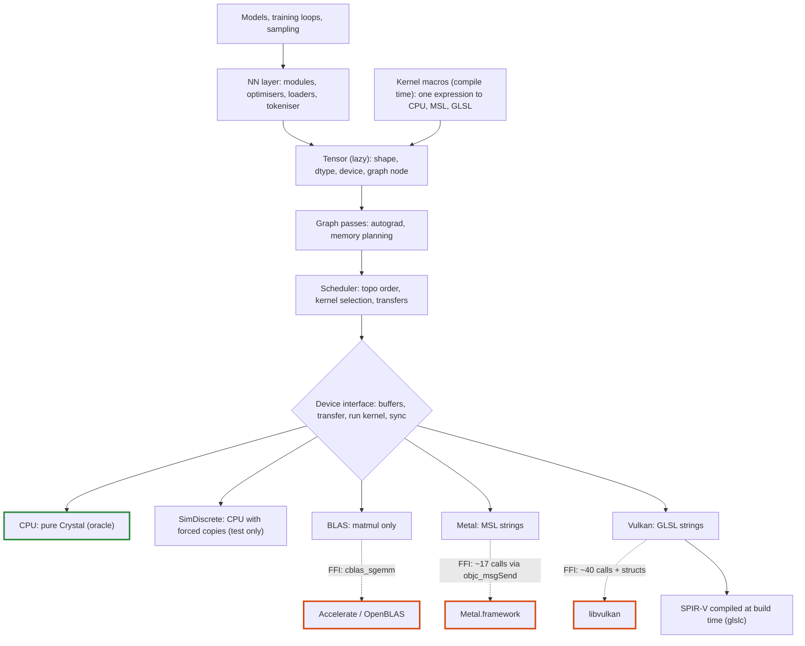
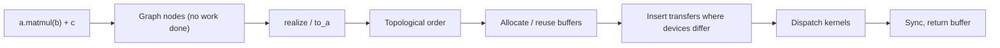

# Tensomite: plan

Oct 22, 2026

## Goal and principles

The aim is a minimal Crystal shard for tensor maths, inference and training on macOS and Linux, written almost entirely in Crystal. It must be fast by design, not fast later by rewrite. So the hard parts of a production runtime (lazy execution, device-owned memory, runtime dtypes) come first, in small steps.

- **Lazy by default.** Ops build a graph and `realize` executes it. This gives one place to schedule, plan memory and differentiate.
- **Memory belongs to devices.** A tensor never assumes it can read its own bytes. Unified memory (Apple Silicon) is an optimisation of the discrete case, not the default.
- **Narrow FFI waist.** Native calls go through two seams only: CPU BLAS and a GPU driver. Adding an op never adds an FFI binding.
- **Kernels live in Crystal.** GPU kernel source is written in Crystal, or generated from Crystal expressions by kernel macros at compile time. MSL is compiled by the Metal driver at runtime, and GLSL is compiled to SPIR-V at build time.
- **CPU backend is the oracle.** Every other backend is tested against the naive pure-Crystal implementation. Library ops keep a hand-written CPU version, so a mistake in a kernel macro's expression cannot pass its own parity test.
- **Always runnable.** Each milestone ends with something that runs end to end and has a measurable exit.

## Architecture

### Core types

- **`DType`:** a runtime enum (`F32`, `F16`, `BF16`, `I32`, `U8`, then block formats `Q8_0`, `Q4_0`). Block formats have a block size and bytes per block rather than an element size, so every byte size comes from `DType#bytes_for(count)` (Decision N).
- **`Buffer`:** an opaque, device-owned allocation with a byte size. Only its device can read it. `Buffer#map` returns a host `Bytes` view when the device has unified memory, and `nil` otherwise.
- **`View`:** shape, strides and offset. It is pure metadata, so reshape, transpose, slice and broadcast never touch data.
- **`Node`:** a graph vertex producing one contiguous array, with a shape, `DType` and `Device`. It holds an op and its source tensors until realised, then only its `Buffer`.
- **`Tensor`:** non-generic. It is a `View` over a `Node`, so view operations share the node. Typed host access is explicit: `t.to_a(Float32)`.
- **Ownership:** a `Buffer` is released by its device, via a finaliser and an explicit `release`. Views keep their buffer alive. mmap'd files are a `Buffer` on the CPU device.

### Execution flow

Fusion happens before the graph exists. A kernel macro turns a whole expression into one node, and `realize` dispatches one kernel per node.

### Memory model

Discrete GPUs (CUDA, or Vulkan on a graphics card) have their own memory across a PCIe bus. Unified GPUs (Apple Silicon, integrated Intel/AMD) share RAM with the CPU. The device interface always speaks in transfers. A unified device implements a transfer as a no-op, or as a `map`.

The `SimDiscrete` device runs CPU kernels on private buffers and refuses host access except through explicit transfers. It finds residency bugs on any laptop, long before a Vulkan GPU is involved.

## Milestones

Each milestone is done when its exit criterion passes.

1. **Skeleton.** Build `DType`, `View`, `Buffer`, the device interface, the CPU device, lazy `Tensor`, and a `realize` that interprets the graph node by node. Implement elementwise add/mul and `sum`.
   - Exit: `(a + b).sum.to_a(Float32)` matches by hand, including over transposed and broadcast views.
2. **CPU op set and SimDiscrete.**
   - Elementwise and unary ops: exp, log, tanh, GELU (tanh approximation).
   - Reductions: sum, max, mean over an axis.
   - Composite ops: softmax, layernorm, embedding gather, causal mask, slice/concat, and naive matmul.
   - Exit: specs pass against hand-computed values, and the same suite passes unchanged on `SimDiscrete`.
3. **BLAS seam.** Bind `cblas_sgemm` for Accelerate and OpenBLAS, behind an opt-in `require "tensomite/blas"` so the core stays pure Crystal. Operands whose strides BLAS cannot describe are packed first. Devices gain `shape_invariant?` (Decision L).
   - Exit: results are within a relative error of 1e-5 of the naive matmul, and the speedup is benchmarked.
4. **GPT-2 inference.** Write a safetensors loader (mmap as a CPU `Buffer`), a byte-level BPE tokeniser, and the GPT-2 small forward pass with a KV cache and sampling.
   - Fixtures (logits and tokens) are generated once from a PyTorch reference and committed, so CI needs no Python. A tiny randomly initialised GPT-2 and a small trained BPE vocabulary, both built from PyPI packages alone, check the same code paths without GPT-2 small's files.
   - Exit: logits are within tolerance of the fixture, greedy decoding matches for 64 tokens, the tokeniser matches the reference on a Unicode corpus, logits for a position are bit-identical whether computed in prefill or in decode (CPU device), and baseline tokens/s is recorded.
5. **Autograd and training.** Implement reverse mode as a graph transform: `grad(loss, params)` returns new lazy tensors. Add SGD, AdamW and cross-entropy.
   - Exit: gradients pass finite-difference checks, and a char-level Shakespeare model reaches a validation loss below 1.8 nats/char within an hour of training in the 4-core Linux container (Decision R).
6. **Metal backend.** Bind the driver through `objc_msgSend` (one declaration per selector signature) with autorelease pools around dispatch. Add a pipeline cache, then hand-written MSL kernels, ported one op at a time.
   - Exit: every op matches the CPU oracle, GPT-2 tokens/s is recorded against BLAS (Decision O), prefill and decode logits are bit-identical on Metal, and the cost of the deterministic split-K matvec against an atomic version is measured.
7. **Kernel macros and memory planning.** `Tensomite.kernel` takes an elementwise expression block and generates, at compile time, a CPU loop and an MSL kernel, plus a backward kernel per input by symbolic differentiation. `softmax`, `log_softmax` and `layernorm` become fused row ops (Decision T). Matmul gains bias and activation epilogues. Buffers are reused through a pool (Decision U). GPT-2's and the trainer's elementwise chains (GELU, scale and mask, residual adds) move onto macros. In PRs:
   1. Profile Metal decode: GPU time per op, and the host's share of each token.
   2. Parallel reductions on Metal (Decision X): the profile put 57% of a decoded token's GPU time in one-thread-per-row sums.
   3. A buffer pool, on host devices and Metal, and batched commits on Metal so the GPU starts before the host has encoded the whole graph.
   4. Kernel macros for elementwise expressions. The spike settled it: pure macros suffice, flattening the block into a tape with an explicit stack and differentiating by a reverse sweep over it. No `{{ run(...) }}` helper is needed.
   5. Fused row ops.
   6. GPT-2 and the trainer on fused kernels, measured.
   7. Matmul epilogues, and tiling for square products on Metal.
   8. The exit runs.
   - Exit: dispatch count per GPT-2 token falls measurably, GPT-2 tokens/s on Metal beats BLAS (Decision O), macro kernels match their hand-written CPU oracles, macro gradients pass finite-difference checks, and the char-level Shakespeare model reaches a validation loss below 1.6 nats/char within an hour of training in the 4-core Linux container (Decision R).
8. **Vulkan backend.** Bind Vulkan compute, and port the hand-written kernels to GLSL compiled at build time. Kernel macros gain a GLSL backend beside Crystal and MSL (Decision V), so fused kernels come with it.
   - Exit: the full op suite matches the oracle on a Linux discrete GPU, and GPT-2 runs there.
9. **Quantisation.** Add `F16`, block dtypes, a GGUF loader, and Q8_0/Q4_0 matmul kernels for CPU, Metal and Vulkan.
   - `F16` and `BF16` are tensomite's own `UInt16`-backed structs with conversions to and from `Float32`, because Crystal has no half-precision float. GGUF block scales are `F16`, so M9 needs them at the latest.
   - Host kernels read blocks as `Slice` of a block struct (`BlockQ4_0` is 18 bytes: an `F16` scale and 16 bytes of packed weights).
   - Block tensors follow the rules of Decision N: leaves only, sliced by whole rows, and consumed only by `MatMul` (as the weight) and `Gather` (as the table).
   - The CPU kernel quantises activations to Q8 per block, takes the Q4 × Q8 dot product in integers, then applies both scales once per block. This is the oracle version, naive and exact within each block.
   - Exit: a quantised GPT-2 stays within a perplexity budget of f32.
10. **Llama-family model.** Add RoPE, RMSNorm, SwiGLU and grouped-query attention.
    - Exit: TinyLlama runs from GGUF on macOS and Linux, and matches reference fixtures.
11. **Fast quantised CPU kernels (Decision M).** Add a CPU device whose kernels are built for speed, tested against the oracle.
    - Contiguous fast paths loop directly over `Slice`s, so LLVM can vectorise them.
    - Float reductions use a fixed number of accumulators combined in a fixed order, so they vectorise and stay shape-invariant.
    - Quantised matmul uses the integer Q4 × Q8 block dot product.
    - Exit: a quantised small model runs on the CPU faster than with f32 weights, its results match the oracle within tolerance, and prefill and decode logits stay bit-identical.

## Decisions

- **Decision A, own backends or bind ggml:** own backends (decided).
- **Decision B, Linux GPU:** Vulkan (decided). It covers AMD, Intel and NVIDIA. CUDA can follow later through the same device interface.
- **Decision C, first model:** GPT-2 small, then TinyLlama (decided).
- **Decision D, CPU parallelism:** `-Dpreview_mt` or execution contexts. Defer until profiling shows the CPU path matters.
- **Decision E, execution model:** lazy graph with `realize` (decided).
- **Decision F, tensor typing:** non-generic `Tensor` with a runtime `DType` (decided).
- **Decision G, Metal plus Vulkan, or Vulkan everywhere via MoltenVK:** native Metal (decided). Revisit after M8, when keeping two codegen emitters has a known cost.
- **Decision H, Vulkan shader compilation:** compile at build time (decided). A Crystal macro runs `glslc` during `crystal build` and embeds the SPIR-V, so users need no compiler and there is no shaderc seam.
- **Decision I, fused kernels on Vulkan:** settled by Decision J. Macro kernels emit GLSL at compile time, from M8 (Decision V).
- **Decision J, how kernels are fused:** compile-time kernel macros (decided). Fusion is explicit: only what is written inside one macro is fused. Runtime auto-fusion over the graph is added only if measurements after M8 show a need for it. That would bring back the shader-compiler question for Vulkan (shaderc or a SPIR-V emitter in Crystal).
- **Decision K, determinism:** three levels (decided).
  1. Run to run: the same inputs, shapes and device give the same bits. Guaranteed everywhere, including parallel CPU code, which splits work independently of thread count.
  2. Shape invariance: a position's logits do not depend on batch size or prompt chunking. A goal for tensomite's own inference kernels, tested by exact comparison of prefill and decode. It makes prefix caching and chunked prefill reproducible: a cache hit gives the same bits as recomputing. The BLAS backend is exempt, because vendor libraries choose strategies by shape.
  3. Across devices: never promised. Comparisons use tolerances.
- **Decision L, level 2 on CPU:** devices report `shape_invariant?` (decided, lands in M3). BLAS reports false, and features that need level 2 fall back to tensomite's own matmul or warn. A cache-blocked CPU matmul in Crystal, shape-invariant by construction, is an optional later milestone if CPU inference matters.

- **Decision M, a fast CPU path:** own quantised CPU kernels after M9 (decided), as milestone 11. Quantised small models make the CPU worth running fast, and BLAS cannot help with them: `sgemm` takes `f32` only. The oracle stays naive.
- **Decision N, modelling dtypes for quantisation:** settled early so M9 adds code rather than refactoring it (decided).
  1. Byte sizes come only from `DType#bytes_for(count)`, never from a per-element size.
  2. Each op declares the dtype combinations it accepts. Today every op requires one dtype for all sources. From M9, `MatMul` accepts a block-format weight with `F32` activations and output, and `Gather` a block-format table. Host kernels then dispatch on the source dtypes as well as the output dtype.
  3. Block-format tensors are leaves loaded from files, stored row by row, sliced only by whole rows, and never produced by an op. `View` stays in logical elements.
  4. `F16` and `BF16` are tensomite's own types, stored as `UInt16` and computed in `Float32`.
- **Decision O, when Metal must beat BLAS:** measured in M6, required in M7 (decided). On Apple Silicon, Accelerate reaches about 1 TFLOP/s on a 512 matmul (M5 Pro), and GPT-2 decoding is a run of small matrix-vector products where a GPU's dispatch overhead and the shared memory bandwidth erode its advantage. Fewer dispatches per token, from kernel macros, are what is expected to give the GPU the lead.
- **Decision R, the M5 training exit:** below 1.8 nats/char within an hour in M5, and below 1.6 within an hour in M7 (decided). Training works: the 0.8M-param model reaches 1.80 by step 2,250 (27 minutes) and 1.726 after 3,000 steps (36 minutes) in the 4-core container. Reaching 1.6 needs a larger model and a longer context, about 1.6 s a step and two to three hours here, because training is bound by elementwise passes. Fusion and buffer reuse in M7 attack exactly that, so the 1.6 target becomes a measure of what they buy. The alternatives were a multi-hour run, which an idle cloud container does not survive, and bringing Decision D (CPU threads) forward into M5, which deserves its own design for deterministic work splitting.
- **Decision S, Metal matmul against the CPU's bits:** Metal's default matmul splits `k` across threads, so it may differ from the CPU in the last bits (decided). Level 3 of Decision K never promised otherwise. Levels 1 and 2 still hold: each output's sum is cut into chunks at fixed offsets and combined in chunk order, so the bits repeat from run to run and do not depend on the number of rows or on zero-padding of `k`. A serial mode, bit-identical to the CPU, remains for checking.
- **Decision T, how row ops are fused:** `softmax`, `log_softmax` and `layernorm` are hand-written fused ops, with the existing composites as their oracles and hand-derived backward rules checked by finite differences (decided). Kernel macros stay elementwise. Revisit after M8 if more row ops appear.
- **Decision U, how buffers are reused:** a pool fed by finalizers (decided). When the collector frees a buffer, its memory joins a free list by size, and allocation takes from that list first. On Metal, a buffer re-enters the pool only after the command buffer that last used it has completed. Freeing intermediates at their last use within a realisation would be tighter, but is unsafe while a user can hold a `Tensor` over any node.
- **Decision V, when kernel macros emit GLSL:** in M8, when a Vulkan device can run it (decided). Emitting code that nothing runs invites drift. The emitter is designed with GLSL as a third backend.
- **Decision W, if M7's training is still too slow:** decided after the fused models are measured in M7. The next lever would be Decision D, CPU threads, with work split independently of thread count.
- **Decision X, Metal reductions against the CPU's bits:** Metal's `Sum` of a long run folds it in chunks of 64 in parallel, so it may differ from the CPU in the last bits (decided). The rules of Decision S apply: chunks sit at fixed offsets and combine in chunk order, so bits repeat from run to run and do not change when a row is padded with zeros. `Max` is exact in any order, and runs of one chunk keep the host's arithmetic.

## Risks

- **Lazy debugging.** Shape and dtype errors are raised as soon as a node is built. Only execution errors (NaN, out of memory, kernel failures) surface at `realize`, far from their cause. Mitigate by recording the call site on each node and adding an eager debug mode that realises after every op.
- **No portable SIMD in Crystal.** CPU speed relies on LLVM auto-vectorisation under `--release`. Measured on x86-64 with Crystal 1.22:
  - Loops over a `Slice` vectorise. Loops over an `Array` do not, because its size and data pointer live in memory that LLVM cannot prove the loop leaves alone. Taking a `Slice` or pointer before the loop fixes it.
  - Float sums do not vectorise, because that would reorder additions. Integer sums do.
  - A Q4 × Q8 block dot product vectorises, because its inner sums are integers, but LLVM emits generic 4-lane code rather than dedicated dot-product instructions (`vpdpbusd`, `sdot`).

  The fallback is a small C file of SIMD kernels. That would be a third seam, so it needs a benchmark to justify it.
- **`objc_msgSend` signatures.** A mistyped selector signature crashes without a useful error. Mitigate by binding each selector once and covering each with a spec.
- **Vulkan surface.** Vulkan compute needs far more ceremony than Metal (descriptor sets, pipeline layouts, fences, memory types). Keep it behind one file per concern and port only after the Metal path has settled the device interface.
- **Kernel drift.** Hand-written and generated kernels can diverge from the oracle silently. Mitigate by running every op on every available device against the CPU in specs.
- **Macro limits.** Crystal's macro language is small. Kernel generation that outgrows it moves into a compile-time helper program called with `{{ run(...) }}`, at some cost to build time.
- **GPU CI.** Hosted macOS runners do run Metal compute, including GPT-2 small, so every PR exercises the Metal device. Hosted Linux runners have no GPU, so Vulkan specs in M8 need a local machine or a self-hosted runner.
- **Scope creep.** Multi-GPU, CUDA and new architectures stay out until M10 passes.
