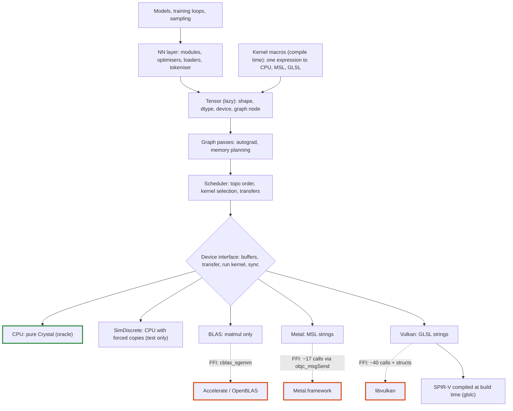
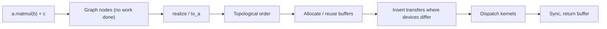

# Tensomite: plan

Oct 22, 2026

## Goal and principles

The aim is a minimal Crystal shard for tensor maths, inference and training on macOS and Linux, written almost entirely in Crystal. It must be fast by design, not fast later by rewrite. So the hard parts of a production runtime (lazy execution, device-owned memory, runtime dtypes) come first, in small steps.

- **Lazy by default.** Ops build a graph and `realize` executes it. This gives one place to schedule, plan memory and differentiate.
- **Memory belongs to devices.** A tensor never assumes it can read its own bytes. Unified memory (Apple Silicon) is an optimisation of the discrete case, not the default.
- **Narrow FFI waist.** Native calls go through two seams only: CPU BLAS and a GPU driver. Adding an op never adds an FFI binding.
- **Kernels live in Crystal.** GPU kernel source is written in Crystal, or generated from Crystal expressions by kernel macros at compile time. MSL is compiled by the Metal driver at runtime, and GLSL is compiled to SPIR-V at build time.
- **CPU backend is the oracle.** Every other backend is tested against the naive pure-Crystal implementation. Library ops keep a hand-written CPU version, so a mistake in a kernel macro's expression cannot pass its own parity test.
- **Always runnable.** Each milestone ends with something that runs end to end and has a measurable exit.

## Architecture

### Core types

- **`DType`:** a runtime enum (`F32`, `F16`, `BF16`, `I32`, `U8`, then block formats `Q8_0`, `Q4_0`). Block formats have a block size and bytes per block rather than an element size.
- **`Buffer`:** an opaque, device-owned allocation with a byte size. Only its device can read it. `Buffer#map` returns a host `Bytes` view when the device has unified memory, and `nil` otherwise.
- **`View`:** shape, strides and offset. It is pure metadata, so reshape, transpose, slice and broadcast never touch data.
- **`Node`:** a graph vertex producing one contiguous array, with a shape, `DType` and `Device`. It holds an op and its source tensors until realised, then only its `Buffer`.
- **`Tensor`:** non-generic. It is a `View` over a `Node`, so view operations share the node. Typed host access is explicit: `t.to_a(Float32)`.
- **Ownership:** a `Buffer` is released by its device, via a finaliser and an explicit `release`. Views keep their buffer alive. mmap'd files are a `Buffer` on the CPU device.

### Execution flow

Fusion happens before the graph exists. A kernel macro turns a whole expression into one node, and `realize` dispatches one kernel per node.

### Memory model

Discrete GPUs (CUDA, or Vulkan on a graphics card) have their own memory across a PCIe bus. Unified GPUs (Apple Silicon, integrated Intel/AMD) share RAM with the CPU. The device interface always speaks in transfers. A unified device implements a transfer as a no-op, or as a `map`.

The `SimDiscrete` device runs CPU kernels on private buffers and refuses host access except through explicit transfers. It finds residency bugs on any laptop, long before a Vulkan GPU is involved.

## Milestones

Each milestone is done when its exit criterion passes.

1. **Skeleton.** Build `DType`, `View`, `Buffer`, the device interface, the CPU device, lazy `Tensor`, and a `realize` that interprets the graph node by node. Implement elementwise add/mul and `sum`.
   - Exit: `(a + b).sum.to_a(Float32)` matches by hand, including over transposed and broadcast views.
2. **CPU op set and SimDiscrete.**
   - Elementwise and unary ops: exp, log, tanh, GELU (tanh approximation).
   - Reductions: sum, max, mean over an axis.
   - Composite ops: softmax, layernorm, embedding gather, causal mask, slice/concat, and naive matmul.
   - Exit: specs pass against hand-computed values, and the same suite passes unchanged on `SimDiscrete`.
3. **BLAS seam.** Bind `cblas_sgemm` for Accelerate and OpenBLAS. Non-contiguous inputs are made contiguous first. Devices gain `shape_invariant?` (Decision L).
   - Exit: results are within a relative error of 1e-5 of the naive matmul, and the speedup is benchmarked.
4. **GPT-2 inference.** Write a safetensors loader (mmap as a CPU `Buffer`), a byte-level BPE tokeniser, and the GPT-2 small forward pass with a KV cache and sampling.
   - Fixtures (logits and tokens) are generated once from a PyTorch reference and committed, so CI needs no Python.
   - Exit: logits are within tolerance of the fixture, greedy decoding matches for 64 tokens, the tokeniser matches the reference on a Unicode corpus, logits for a position are bit-identical whether computed in prefill or in decode (CPU device), and baseline tokens/s is recorded.
5. **Autograd and training.** Implement reverse mode as a graph transform: `grad(loss, params)` returns new lazy tensors. Add SGD, AdamW and cross-entropy.
   - Exit: gradients pass finite-difference checks, and a char-level Shakespeare model reaches a validation loss below 1.6 nats/char.
6. **Metal backend.** Bind the driver through `objc_msgSend` (one declaration per selector signature) with autorelease pools around dispatch. Add a pipeline cache, then hand-written MSL kernels, ported one op at a time.
   - Exit: every op matches the CPU oracle, GPT-2 tokens/s beats BLAS, prefill and decode logits are bit-identical on Metal, and the cost of the deterministic split-K matvec against an atomic version is measured.
7. **Kernel macros and memory planning.** `Tensomite.kernel` takes an expression block and generates, at compile time, a CPU loop, an MSL kernel and a GLSL kernel, plus a backward kernel by symbolic differentiation. Matmul gains bias and activation epilogues. Buffers are reused across the graph. GPT-2's elementwise chains (GELU, residual adds) move onto macros.
   - Exit: dispatch count per GPT-2 token falls measurably, tokens/s rises, macro kernels match their hand-written CPU oracles, and macro gradients pass finite-difference checks.
8. **Vulkan backend.** Bind Vulkan compute, and port the hand-written kernels to GLSL compiled at build time. Kernel macros already emit GLSL, so fused kernels come for free.
   - Exit: the full op suite matches the oracle on a Linux discrete GPU, and GPT-2 runs there.
9. **Quantisation.** Add block dtypes, a GGUF loader, and Q8_0/Q4_0 dequant-matmul kernels for CPU, Metal and Vulkan.
   - Exit: a quantised GPT-2 stays within a perplexity budget of f32.
10. **Llama-family model.** Add RoPE, RMSNorm, SwiGLU and grouped-query attention.
    - Exit: TinyLlama runs from GGUF on macOS and Linux, and matches reference fixtures.

## Decisions

- **Decision A, own backends or bind ggml:** own backends (decided).
- **Decision B, Linux GPU:** Vulkan (decided). It covers AMD, Intel and NVIDIA. CUDA can follow later through the same device interface.
- **Decision C, first model:** GPT-2 small, then TinyLlama (decided).
- **Decision D, CPU parallelism:** `-Dpreview_mt` or execution contexts. Defer until profiling shows the CPU path matters.
- **Decision E, execution model:** lazy graph with `realize` (decided).
- **Decision F, tensor typing:** non-generic `Tensor` with a runtime `DType` (decided).
- **Decision G, Metal plus Vulkan, or Vulkan everywhere via MoltenVK:** native Metal (decided). Revisit after M8, when keeping two codegen emitters has a known cost.
- **Decision H, Vulkan shader compilation:** compile at build time (decided). A Crystal macro runs `glslc` during `crystal build` and embeds the SPIR-V, so users need no compiler and there is no shaderc seam.
- **Decision I, fused kernels on Vulkan:** settled by Decision J. Macro kernels emit GLSL at compile time.
- **Decision J, how kernels are fused:** compile-time kernel macros (decided). Fusion is explicit: only what is written inside one macro is fused. Runtime auto-fusion over the graph is added only if measurements after M8 show a need for it. That would bring back the shader-compiler question for Vulkan (shaderc or a SPIR-V emitter in Crystal).
- **Decision K, determinism:** three levels (decided).
  1. Run to run: the same inputs, shapes and device give the same bits. Guaranteed everywhere, including parallel CPU code, which splits work independently of thread count.
  2. Shape invariance: a position's logits do not depend on batch size or prompt chunking. A goal for tensomite's own inference kernels, tested by exact comparison of prefill and decode. It makes prefix caching and chunked prefill reproducible: a cache hit gives the same bits as recomputing. The BLAS backend is exempt, because vendor libraries choose strategies by shape.
  3. Across devices: never promised. Comparisons use tolerances.
- **Decision L, level 2 on CPU:** devices report `shape_invariant?` (decided, lands in M3). BLAS reports false, and features that need level 2 fall back to tensomite's own matmul or warn. A cache-blocked CPU matmul in Crystal, shape-invariant by construction, is an optional later milestone if CPU inference matters.

## Risks

- **Lazy debugging.** Shape and dtype errors are raised as soon as a node is built. Only execution errors (NaN, out of memory, kernel failures) surface at `realize`, far from their cause. Mitigate by recording the call site on each node and adding an eager debug mode that realises after every op.
- **No portable SIMD in Crystal.** CPU speed relies on LLVM auto-vectorisation under `--release`, which is weak for quantised dot products. The fallback is a small C file of SIMD kernels. That would be a third seam, so it needs a benchmark to justify it.
- **`objc_msgSend` signatures.** A mistyped selector signature crashes without a useful error. Mitigate by binding each selector once and covering each with a spec.
- **Vulkan surface.** Vulkan compute needs far more ceremony than Metal (descriptor sets, pipeline layouts, fences, memory types). Keep it behind one file per concern and port only after the Metal path has settled the device interface.
- **Kernel drift.** Hand-written and generated kernels can diverge from the oracle silently. Mitigate by running every op on every available device against the CPU in specs.
- **Macro limits.** Crystal's macro language is small. Kernel generation that outgrows it moves into a compile-time helper program called with `{{ run(...) }}`, at some cost to build time.
- **GPU CI.** It is unverified whether hosted macOS runners give usable Metal compute, and hosted Linux runners have no GPU. CI runs CPU and `SimDiscrete` on every push. GPU specs run locally, or on a self-hosted runner if one appears.
- **Scope creep.** Multi-GPU, CUDA and new architectures stay out until M10 passes.
