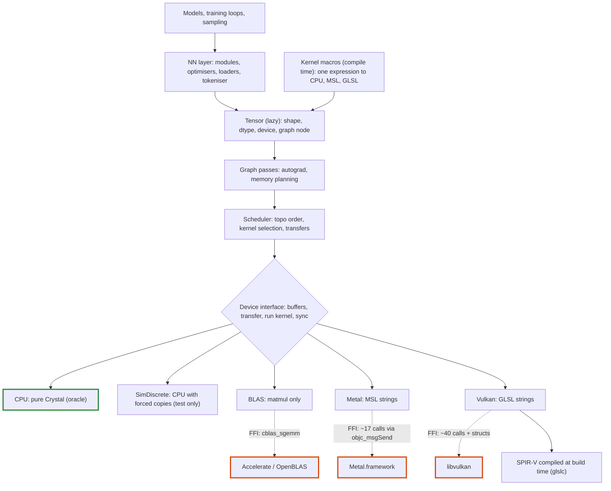
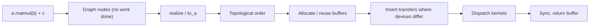

# Tensomite: plan

Oct 22, 2026; milestones revised Nov 7 (Decision CG)

## Goal and principles

The aim is a minimal Crystal shard for tensor maths, inference and training on macOS and Linux, written almost entirely in Crystal. It must be fast by design, not fast later by rewrite. So the hard parts of a production runtime (lazy execution, device-owned memory, runtime dtypes) come first, in small steps.

- **Lazy by default.** Ops build a graph and `realize` executes it. This gives one place to schedule, plan memory and differentiate.
- **Memory belongs to devices.** A tensor never assumes it can read its own bytes. Unified memory (Apple Silicon) is an optimisation of the discrete case, not the default.
- **Narrow FFI waist.** Native calls go through two seams only: CPU BLAS and a GPU driver. Adding an op never adds an FFI binding.
- **Kernels live in Crystal.** GPU kernel source is written in Crystal, or generated from Crystal expressions by kernel macros at compile time. MSL is compiled by the Metal driver at runtime, and GLSL is compiled to SPIR-V at build time.
- **CPU backend is the oracle.** Every other backend is tested against the naive pure-Crystal implementation. Library ops keep a hand-written CPU version, so a mistake in a kernel macro's expression cannot pass its own parity test.
- **Always runnable.** Each milestone ends with something that runs end to end and has a measurable exit.
- **Inspectable.** A running model can be looked into: its graph drawn, and in time its activations, attention and gradients read, by the names of its parts (scopes), without changing its code.

## Architecture

### Core types

- **`DType`:** a runtime enum (`F32`, `F16`, `BF16`, `I32`, `U8`, then block formats `Q8_0`, `Q4_0`). Block formats have a block size and bytes per block rather than an element size, so every byte size comes from `DType#bytes_for(count)` (Decision N).
- **`Buffer`:** an opaque, device-owned allocation with a byte size. Only its device can read it. `Buffer#map` returns a host `Bytes` view when the device has unified memory, and `nil` otherwise.
- **`View`:** shape, strides and offset. It is pure metadata, so reshape, transpose, slice and broadcast never touch data.
- **`Node`:** a graph vertex producing one contiguous array, with a shape, `DType` and `Device`. It holds an op and its source tensors until realised, then only its `Buffer`.
- **`Tensor`:** non-generic. It is a `View` over a `Node`, so view operations share the node. Typed host access is explicit: `t.to_a(Float32)`.
- **Ownership:** a `Buffer` is released by its device, via a finaliser and an explicit `release`. Views keep their buffer alive. mmap'd files are a `Buffer` on the CPU device.

### Execution flow

Fusion happens before the graph exists. A kernel macro turns a whole expression into one node, and `realize` dispatches one kernel per node.

### Memory model

Discrete GPUs (CUDA, or Vulkan on a graphics card) have their own memory across a PCIe bus. Unified GPUs (Apple Silicon, integrated Intel/AMD) share RAM with the CPU. The device interface always speaks in transfers. A unified device implements a transfer as a no-op, or as a `map`.

The `SimDiscrete` device runs CPU kernels on private buffers and refuses host access except through explicit transfers. It finds residency bugs on any laptop, long before a Vulkan GPU is involved.

## Milestones

Each milestone is done when its exit criterion passes.

1. **Skeleton.** Build `DType`, `View`, `Buffer`, the device interface, the CPU device, lazy `Tensor`, and a `realize` that interprets the graph node by node. Implement elementwise add/mul and `sum`.
   - Exit: `(a + b).sum.to_a(Float32)` matches by hand, including over transposed and broadcast views.
2. **CPU op set and SimDiscrete.**
   - Elementwise and unary ops: exp, log, tanh, GELU (tanh approximation).
   - Reductions: sum, max, mean over an axis.
   - Composite ops: softmax, layernorm, embedding gather, causal mask, slice/concat, and naive matmul.
   - Exit: specs pass against hand-computed values, and the same suite passes unchanged on `SimDiscrete`.
3. **BLAS seam.** Bind `cblas_sgemm` for Accelerate and OpenBLAS, behind an opt-in `require "tensomite/blas"` so the core stays pure Crystal. Operands whose strides BLAS cannot describe are packed first. Devices gain `shape_invariant?` (Decision L).
   - Exit: results are within a relative error of 1e-5 of the naive matmul, and the speedup is benchmarked.
4. **GPT-2 inference.** Write a safetensors loader (mmap as a CPU `Buffer`), a byte-level BPE tokeniser, and the GPT-2 small forward pass with a KV cache and sampling.
   - Fixtures (logits and tokens) are generated once from a PyTorch reference and committed, so CI needs no Python. A tiny randomly initialised GPT-2 and a small trained BPE vocabulary, both built from PyPI packages alone, check the same code paths without GPT-2 small's files.
   - Exit: logits are within tolerance of the fixture, greedy decoding matches for 64 tokens, the tokeniser matches the reference on a Unicode corpus, logits for a position are bit-identical whether computed in prefill or in decode (CPU device), and baseline tokens/s is recorded.
5. **Autograd and training.** Implement reverse mode as a graph transform: `grad(loss, params)` returns new lazy tensors. Add SGD, AdamW and cross-entropy.
   - Exit: gradients pass finite-difference checks, and a char-level Shakespeare model reaches a validation loss below 1.8 nats/char within an hour of training in the 4-core Linux container (Decision R).
6. **Metal backend.** Bind the driver through `objc_msgSend` (one declaration per selector signature) with autorelease pools around dispatch. Add a pipeline cache, then hand-written MSL kernels, ported one op at a time.
   - Exit: every op matches the CPU oracle, GPT-2 tokens/s is recorded against BLAS (Decision O), prefill and decode logits are bit-identical on Metal, and the cost of the deterministic split-K matvec against an atomic version is measured.
7. **Kernel macros and memory planning.** `Tensomite.kernel` takes an elementwise expression block and generates, at compile time, a CPU loop and an MSL kernel, plus a backward kernel per input by symbolic differentiation. `softmax`, `log_softmax` and `layernorm` become fused row ops (Decision T). Matmul is tiled on Metal; bias and activation epilogues were measured and dropped (Decision AE). Buffers are reused through a pool (Decision U). GPT-2's and the trainer's elementwise chains (GELU, scale and mask, residual adds) move onto macros. In PRs:
   1. Profile Metal decode: GPU time per op, and the host's share of each token.
   2. Parallel reductions on Metal (Decision X): the profile put 57% of a decoded token's GPU time in one-thread-per-row sums.
   3. A buffer pool, on host devices and Metal, and batched commits on Metal so the GPU starts before the host has encoded the whole graph.
   4. Kernel macros for elementwise expressions. The spike settled it: pure macros suffice, flattening the block into a tape with an explicit stack and differentiating by a reverse sweep over it. No `{{ run(...) }}` helper is needed.
   5. Fused row ops.
   6. GPT-2 and the trainer on fused kernels, measured. Vectorised host loops and own maths (Decision Y) halved a training step, which met the training exit; the remaining fusions (attention's scale and mask, AdamW, bias adds) became optional.
   7. Graph diagrams (Decisions AB and AC): `Tensor#to_mermaid` renders the graph behind a tensor as a Mermaid flowchart, with ops as nodes, views as edge labels and a node limit for large graphs; with a depth, it summarises the graph by scope, folding repeated blocks.
   8. A tiled Metal matmul with split-K's bits (Decisions AD to AG): a 128-token prefill went from 69 to 22 ms of GPU time, 5,539 tokens/s against BLAS's 2,010, and decode is unchanged. Products with 768 output columns remain slower than Accelerate.
   9. The exit runs, recorded below and in "Performance baselines" in `DESIGN.md`.
   - Exit: dispatch count per GPT-2 token falls measurably, GPT-2 tokens/s on Metal beats BLAS (Decision O), macro kernels match their hand-written CPU oracles, macro gradients pass finite-difference checks, and the char-level Shakespeare model reaches a validation loss below 1.6 nats/char within an hour of training in the 4-core Linux container (Decision R).
   - Met (24 Oct 2026, M5 Pro and the Linux container):
     - dispatches per decoded GPT-2 token fell from 710 to 316;
     - Metal decodes at 186 tokens/s against BLAS's 166, and prefills 64 tokens at 3,684 tokens/s against 2,419, in the same run (`bench/gpt2.cr`);
     - `gelu`'s kernel gives its composite's bits on host devices, and kernel and fused-row-op gradients pass finite differences (`spec/kernel_spec.cr`, `spec/row_ops_spec.cr`);
     - the Shakespeare model reached 1.573 nats/char at step 2,749 (20 minutes) and 1.494 after 5,000 steps (36 minutes).
     - Memory is planned by a pool fed by the collector (Decision U); releasing buffers as soon as their last reader has run is Decision AA, done for training steps by Decision CD.

**7b. Modules and a model DSL (Decisions AH to AR).** Models are written as `Tensomite::Module`s: classes whose instance variables hold `Parameter`s and other modules, found and named at compile time, with a `forward` that combines them. Then a DSL over the modules, iterated with them. In PRs:

1. `Parameter`, `Module`, `Linear`, `Embedding`, `LayerNorm`, `Activation`, `Sequential`, and optimizers over parameters; the tutorial's model on modules.
2. A safetensors writer, and `save` and `load` by name (Decision AM). Files round-trip with Hugging Face's `safetensors` package, and saving over a file that a loaded model still maps leaves the model's weights unchanged.
3. The Shakespeare model on modules, with a `CausalSelfAttention`; its trainer simplified to one optimizer and one `step(loss)`. Training and validation losses are bit-identical to the hand-written model's, at the same speed.
4. DSL candidates, a builder in plain Crystal (`with ... yield`) and a declarative macro, written against the same models; then a choice, and changes to the modules that the DSL shows a need for. The builder was adopted, and the tutorial's and the Shakespeare models moved onto it with the same bits (Decision AN).
5. GPT-2 on modules, loading Hugging Face's weights by name, if step 3 shows that its KV cache fits. The cache fits as an argument to `CausalSelfAttention#call`, and the logits are bit-identical to the hand-written model's (Decisions AO to AQ). The second look at a declarative macro became a follow-up (Decision AR).

Exit of 7b: the tutorial, Shakespeare and GPT-2 models on modules, with training losses bit-identical to the hand-written versions; `GUIDE.md` and `TUTORIAL.md` updated; a DSL chosen and recorded.

Met (25 Oct 2026, the Linux container and the M5 Pro):
- the tutorial's model gives the same output, byte for byte, and the Shakespeare model the same training and validation losses, as hex, in two shapes, on modules and on the `Builder`; a 5,000-step run on the M5 Pro ended at 1.4936 nats/char, as the hand-written model's did;
- GPT-2's logits, over a 64-token prefill and 8 decoded tokens, have the same SHA-256 digest as the hand-written model's on CPU and BLAS in the container, and on CPU, Accelerate and Metal on the M5 Pro (`bench/gpt2_digest.cr`);
- `GUIDE.md` and `TUTORIAL.md` describe modules and the `Builder`;
- the `Builder` is the DSL (Decisions AN and AR).

8. **CUDA backend (Decisions AS to AV).** A `CUDA` device on NVIDIA GPUs, through the driver API, with kernels in CUDA C++ compiled by NVRTC when first used, with fused multiply-adds off. It is opt-in: `require "tensomite/cuda"` and build with `-Dcuda`. Developed on a DGX Spark (ARM64, memory shared with the CPU), and proven on a T4 (x86-64, a discrete card). The device always copies between host and device memory explicitly, so the Spark runs the discrete code path. In PRs:
   1. Bindings to `libcuda` and `libnvrtc`, a probe (`examples/cuda_info.cr`), and compiler specs that CI runs without a GPU.
   2. The `CUDA` device: buffers, transfers, a stream, and the device specs `SimDiscrete` and `Metal` pass, with ops not yet ported run on the host. Done without a stream, which arrives with the first kernels, since host ops are synchronous; CI runs the device on a stand-in driver in host memory.
   3. Elementwise and reduction kernels, ported from the MSL ones, matching the oracle. With them, the stub runs the kernels compiled as host C++, so CI compares each with the CPU.
   4. Matmul, split and tiled, in split-K's order, so prefill and decode stay bit-identical; fused row ops; kernel macros emitting CUDA C++. With them, GPT-2's forward pass runs no host ops on CUDA.
   - Profiling decode (Decision AW), then a two-pass matmul for decode (Decision AX).
   5. GPT-2 and the Shakespeare trainer on CUDA; the exit runs on the Spark and a T4. The trainer takes `--device cuda` (and `metal`), and every op of a training step runs on the GPU, repeatably to the bit; on the GB10 it trains Decision R's larger model at 110 ms a step, against 410 on `BLAS`. The T4 run waits for a T4.
   - Exit: the full op suite matches the oracle on a discrete GPU (a T4), GPT-2 runs there and on the Spark, and prefill equals decode bit for bit on both.
9. **Llama-family model, at F32 (Decision BW).** Add RoPE, RMSNorm, SwiGLU and grouped-query attention, and load Hugging Face's weights and tokenisers as they are published.
   - `BF16` weights, as most small instruct models ship, load and widen to `F32`; `BF16` is a `UInt16`-backed struct, as `F16` will be in M10.
   - `tokenizer.json`: the byte-level BPE GPT-2 uses, read from Hugging Face's format, with its special tokens.
   - A chat template (ChatML) and a chat endpoint in `apps/server`, so the first instruct model, SmolLM2-135M-Instruct, can be served.
   - Exit: SmolLM2-135M-Instruct runs on every device and matches reference fixtures from PyTorch, prefill and decode logits are bit-identical on each device, and `apps/server` serves it.
   - Parts 1 to 4 of Decision CJ, in the container: SmolLM2-135M-Instruct's logits are within 2e-3 of PyTorch's, and its 32-token greedy answer matches, on CPU, SimDiscrete and BLAS; a tiny random Llama matches within 1e-4 on those and on the CUDA stub. Prefill equals decode bit for bit wherever the device is shape-invariant. Part 5: `apps/server` serves Llama-family models, chats in ChatML over `/v1/chat/completions` and in the terminal, and keeps SmolLM2's context across turns.
   - Met (8 Nov 2026): SmolLM2-135M-Instruct's spec passes on the M5 Pro (CPU, SimDiscrete, BLAS and Metal) and on the GB10 (CUDA): logits within 2e-3 of PyTorch's, the same greedy answer, and prefill equal to decode bit for bit on each shape-invariant device.
10. **Quantisation (Decision CL).** Add `F16`, block dtypes, a GGUF loader, and Q8_0/Q4_0/Q4_1 matmul kernels for CPU, Metal and CUDA.
    - `F16` is tensomite's own `UInt16`-backed struct with conversions to and from `Float32`, as `BF16` is from M9, because Crystal has no half-precision float. GGUF block scales are `F16`, so M10 needs them at the latest.
    - Host kernels read blocks as `Slice` of a block struct (`BlockQ4_0` is 18 bytes: an `F16` scale and 16 bytes of packed weights).
    - Block tensors follow the rules of Decision N: leaves only, sliced by whole rows, and consumed only by `MatMul` (as the weight) and `Gather` (as the table).
    - The CPU kernel quantises activations to Q8 per block, takes the Q4 × Q8 dot product in integers, then applies both scales once per block. This is the oracle version, naive and exact within each block.
    - Exit: quantised GPT-2 and M9's model stay within a perplexity budget of their F32 versions (Decision BW).
    - Parts 1 and 2 of Decision CL: GGUF files load, F32 to the bit and SmolLM2's F16 to PyTorch's greedy answer; Q8_0, Q4_0 and Q4_1 quantise to ggml's reference bytes and dequantise to its values, both on fixed rows and on SmolLM2's published Q4_0 file. Part 3: `BlockMatMul` and block gathers on the CPU, as ggml's reference code computes them, and `bench/perplexity.cr`. SmolLM2's KL divergence from F32 is 0.005 nats a token at Q8_0 and 0.154 at llama.cpp's Q4_0; on 20 greedy tokens it writes what llama.cpp writes from both files. Part 4: Metal kernels for `BlockMatMul` (a pass that quantises activations, then one thread per output, blocks in order) and block gathers, which give the host's bits in `scripts/emulate_metal/blocks.sh`. On the M5 Pro, Metal measures SmolLM2's published Q4_0 at a KL divergence of 0.1536 against the CPU's 0.1539, in 1.2 s for 16 windows, and decodes it at 113 tokens a second against F32's 77. Part 5: the same kernels in CUDA, which give the host's bits on the stand-in driver, since CUDA's division is IEEE's and NVRTC runs with `--fmad=false`.
    - Met (9 Nov 2026), by Decision CM: SmolLM2's published Q4_0 has a KL divergence from F32 of 0.1539 on the CPU, 0.1536 on Metal (M5 Pro) and 0.1540 on CUDA (GB10), and Q8_0 0.005 on the CPU, all within budget; GPT-2's matrices at Q8_0 and Q4_0 measure 0.001 and 0.080. On the GB10, CUDA's quantised matmul gives the CPU's bits, and Q4_0 decodes at 93 tokens a second.
11. **Fast quantised CPU kernels (Decision M).** Add a CPU device whose kernels are built for speed, tested against the oracle.
    - Contiguous fast paths loop directly over `Slice`s, so LLVM can vectorise them.
    - Float reductions use a fixed number of accumulators combined in a fixed order, so they vectorise and stay shape-invariant.
    - Quantised matmul uses the integer Q4 × Q8 block dot product.
    - Exit: a quantised small model runs on the CPU faster than with f32 weights, its results match the oracle within tolerance, and prefill and decode logits stay bit-identical.
    - Done by Decisions DD to DF: a CPU decode profiler, `Quant.matmul` with the oracle's bits, its outputs shared among threads by a spinning pool, RoPE along strides, and the serial work and the Q4 loop reworked. The kernels serve `CPU` and `BLAS` alike. `ops bn` and `ops run-native` build for the CPU at hand (Decision DE).
    - Met (14 Nov 2026): SmolLM2-135M-Instruct decodes at Q4_0 in 8.2–8.3 ms a token on the container's 4 threads, against 27–31 ms in `F32` on `BLAS`, and 16 ms at Q8_0. `Quant.matmul` gives `Quant.matmul_reference`'s bits on 1, 3 and 8 threads (`spec/quant_spec.cr`), so the results match the oracle exactly, and SmolLM2's Q4_0 gives the same logits in prefill and in one-by-one decode on the host devices (`spec/block_matmul_spec.cr`). SmolLM2-1.7B at Q4_0 decodes in 7.17 ms a token on the M5 Pro (6.36 native) and 12.8 on the GB10 (11.2 native), from 365 and 414 ms before M11; llama.cpp takes 6.7 and 11.4.
12. **Vulkan backend.** Bind Vulkan compute, and port the hand-written kernels to GLSL compiled at build time. Kernel macros gain a GLSL backend beside Crystal, MSL and CUDA C++ (Decision V), so fused kernels come with it. It follows CUDA (Decision AT), for AMD and Intel GPUs.
    - Exit: the full op suite matches the oracle on a Linux discrete GPU, and GPT-2 runs there.

**Apps (Decisions BT to CF).** Not a milestone: apps under `apps/` that use tensomite as a library on real work, and find what the library still lacks. Two so far.

- `apps/server` serves GPT-2 and Llama-family models over HTTP (`/v1/completions` and `/v1/chat/completions`, streamed) and in the terminal (`generate` and `chat`), one request at a time (Decisions BT, BU and CJ).
- `apps/finetune` fine-tunes GPT-2 on a text, with checkpoints that resume bit for bit, dropout, a warm-up and cosine schedule, and early stopping, and exports models the server serves (Decisions BV and BY). It has fine-tuned GPT-2 small and large on Crystal's standard library, measured on held-out methods by `bench/code_eval.cr` (Decisions BZ, CB, CE and CF).

Next: requests batched step by step (Q-BA).

## Decisions

Recorded in full, with their reasoning and measurements, in [`DECISIONS.md`](DECISIONS.md). One line each, in label order:

- [A](DECISIONS.md#decision-a): own backends or bind ggml (decided).
- [B](DECISIONS.md#decision-b): Linux GPU (decided, then superseded by Decision AT).
- [C](DECISIONS.md#decision-c): first model (decided).
- [D](DECISIONS.md#decision-d): CPU parallelism (open).
- [E](DECISIONS.md#decision-e): execution model (decided).
- [F](DECISIONS.md#decision-f): tensor typing (decided).
- [G](DECISIONS.md#decision-g): Metal plus Vulkan, or Vulkan everywhere via MoltenVK (decided).
- [H](DECISIONS.md#decision-h): Vulkan shader compilation (decided).
- [I](DECISIONS.md#decision-i): fused kernels on Vulkan (open).
- [J](DECISIONS.md#decision-j): how kernels are fused (decided).
- [K](DECISIONS.md#decision-k): determinism (decided).
- [L](DECISIONS.md#decision-l): level 2 on CPU (decided, lands in M3).
- [M](DECISIONS.md#decision-m): a fast CPU path (decided).
- [N](DECISIONS.md#decision-n): modelling dtypes for quantisation (decided).
- [O](DECISIONS.md#decision-o): when Metal must beat BLAS (decided).
- [R](DECISIONS.md#decision-r): the M5 training exit (decided).
- [S](DECISIONS.md#decision-s): Metal matmul against the CPU's bits (decided).
- [T](DECISIONS.md#decision-t): how row ops are fused (decided).
- [U](DECISIONS.md#decision-u): how buffers are reused (decided).
- [V](DECISIONS.md#decision-v): when kernel macros emit GLSL (decided).
- [W](DECISIONS.md#decision-w): if M7's training is still too slow (open).
- [X](DECISIONS.md#decision-x): Metal reductions against the CPU's bits (decided).
- [Y](DECISIONS.md#decision-y): transcendental functions on host devices (decided).
- [Z](DECISIONS.md#decision-z): after part 6's speed-up (decided).
- [AA](DECISIONS.md#decision-aa): planned release of intermediate buffers (decided; done for training steps by Decision CD, still open for inference).
- [AB](DECISIONS.md#decision-ab): a Mermaid view of the graph (decided).
- [AC](DECISIONS.md#decision-ac): model summaries (decided).
- [AD](DECISIONS.md#decision-ad): how Metal's matmul is tiled (decided).
- [AE](DECISIONS.md#decision-ae): matmul epilogues (decided).
- [AF](DECISIONS.md#decision-af): part 8's target (decided, met).
- [AG](DECISIONS.md#decision-ag): after the target was met (decided).
- [AH](DECISIONS.md#decision-ah): how models are defined (decided).
- [AI](DECISIONS.md#decision-ai): how parameters change (decided).
- [AJ](DECISIONS.md#decision-aj): how parts are found (decided).
- [AK](DECISIONS.md#decision-ak): initial weights (decided).
- [AL](DECISIONS.md#decision-al): where modules sit in the plan (decided).
- [AM](DECISIONS.md#decision-am): saving (decided).
- [AN](DECISIONS.md#decision-an): the model DSL (decided).
- [AO](DECISIONS.md#decision-ao): names of GPT-2's parts (decided).
- [AP](DECISIONS.md#decision-ap): loading files with other tensors or prefixes (decided).
- [AQ](DECISIONS.md#decision-aq): where the KV cache lives (decided).
- [AR](DECISIONS.md#decision-ar): closing 7b (decided).
- [AS](DECISIONS.md#decision-as): where M8 runs (decided).
- [AT](DECISIONS.md#decision-at): the first Linux GPU backend (decided).
- [AU](DECISIONS.md#decision-au): how CUDA kernels are compiled (decided).
- [AV](DECISIONS.md#decision-av): how the CUDA libraries are reached (decided).
- [AW](DECISIONS.md#decision-aw): CUDA's decode speed (decided).
- [AX](DECISIONS.md#decision-ax): the first decode fix (decided).
- [AY](DECISIONS.md#decision-ay): which products get two passes (decided).
- [AZ](DECISIONS.md#decision-az): decode's remaining costs (decided).
- [BA](DECISIONS.md#decision-ba): AMD GPUs (decided).
- [BB](DECISIONS.md#decision-bb): the first of decode's remaining costs (decided).
- [BC](DECISIONS.md#decision-bc): how the KV cache is allocated (decided).
- [BD](DECISIONS.md#decision-bd): after the cache (decided).
- [BE](DECISIONS.md#decision-be): after narrower blocks were slower (decided).
- [BF](DECISIONS.md#decision-bf): decode's next costs (decided).
- [BG](DECISIONS.md#decision-bg): CUDA training speed (decided).
- [BH](DECISIONS.md#decision-bh): profiling Metal training (decided).
- [BI](DECISIONS.md#decision-bi): Metal training speed (decided).
- [BJ](DECISIONS.md#decision-bj): after Decision BI (decided).
- [BK](DECISIONS.md#decision-bk): after Decision BJ (decided).
- [BL](DECISIONS.md#decision-bl): after Decision BK (decided).
- [BM](DECISIONS.md#decision-bm): which elementwise ops to fuse first (decided).
- [BN](DECISIONS.md#decision-bn): after the fused AdamW (decided).
- [BO](DECISIONS.md#decision-bo): attention's softmax (decided).
- [BP](DECISIONS.md#decision-bp): layer norm's backward (decided).
- [BQ](DECISIONS.md#decision-bq): Metal's slower fused softmax (decided).
- [BR](DECISIONS.md#decision-br): after the fusions (decided).
- [BS](DECISIONS.md#decision-bs): a first release (decided).
- [BT](DECISIONS.md#decision-bt): an inference app (decided).
- [BU](DECISIONS.md#decision-bu): the inference app's first scope (decided).
- [BV](DECISIONS.md#decision-bv): training something worth serving (decided).
- [BW](DECISIONS.md#decision-bw): real models and quantisation (decided).
- [BY](DECISIONS.md#decision-by): after the first fine-tune (decided).
- [BZ](DECISIONS.md#decision-bz): a corpus of code (decided).
- [CA](DECISIONS.md#decision-ca): the CUDA context across threads (decided).
- [CB](DECISIONS.md#decision-cb): a bigger model to fine-tune on code (decided).
- [CC](DECISIONS.md#decision-cc): memory in the progress lines (decided).
- [CD](DECISIONS.md#decision-cd): deterministic release of a step's memory (decided).
- [CE](DECISIONS.md#decision-ce): the schedule for a bigger model (decided).
- [CF](DECISIONS.md#decision-cf): recording the code fine-tunes (decided).
- [CG](DECISIONS.md#decision-cg): after the review of 7 November (decided).
- [CH](DECISIONS.md#decision-ch): after the XL fine-tune (decided).
- [CI](DECISIONS.md#decision-ci): coalesced row ops on CUDA (decided).
- [CJ](DECISIONS.md#decision-cj): M9 in five PRs (decided).
- [CK](DECISIONS.md#decision-ck): after M9 (decided).
- [CL](DECISIONS.md#decision-cl): M10 in five PRs (decided).
- [CM](DECISIONS.md#decision-cm): measuring quantisation (decided).
- [CN](DECISIONS.md#decision-cn): quantised kernels correct first (decided).
- [CO](DECISIONS.md#decision-co): after M10 (decided).
- [CP](DECISIONS.md#decision-cp): profiling before M11 (decided).
- [CQ](DECISIONS.md#decision-cq): fusing Llama's composites (decided).
- [CR](DECISIONS.md#decision-cr): joining projections that share an input (decided).
- [CS](DECISIONS.md#decision-cs): a larger model before choosing (decided).
- [CT](DECISIONS.md#decision-ct): writing quantised models (decided).
- [CU](DECISIONS.md#decision-cu): the GPUs before M11 (decided).
- [CV](DECISIONS.md#decision-cv): RMSNorm's order (decided).
- [CW](DECISIONS.md#decision-cw): the quantised products (decided).
- [CX](DECISIONS.md#decision-cx): Metal's lanes kernel (decided).
- [CY](DECISIONS.md#decision-cy): after the quantised products (decided).
- [CZ](DECISIONS.md#decision-cz): how attention fuses (decided).
- [DA](DECISIONS.md#decision-da): after fused attention (decided, then revised by Decisions DB and DC).
- [DB](DECISIONS.md#decision-db): quantising inside the product (decided).
- [DC](DECISIONS.md#decision-dc): CUDA graphs (decided).
- [DD](DECISIONS.md#decision-dd): M11 in four parts (decided).
- [DE](DECISIONS.md#decision-de): building for the CPU at hand (decided).
- [DF](DECISIONS.md#decision-df): after reviewing issues #113–#127 (decided).
- [DG](DECISIONS.md#decision-dg): after M11 (decided).
- [DH](DECISIONS.md#decision-dh): the understanding checks since Q-BO (decided).
- [DI](DECISIONS.md#decision-di): what the design keeps of its history (decided).

## Risks

- **Lazy debugging.** Shape and dtype errors are raised as soon as a node is built. Only execution errors (NaN, out of memory, kernel failures) surface at `realize`, far from their cause. Mitigate by recording the call site on each node and adding an eager debug mode that realises after every op.
- **No portable SIMD in Crystal.** CPU speed relies on LLVM auto-vectorisation under `--release`. Measured on x86-64 with Crystal 1.22:
  - Loops over a `Slice` vectorise. Loops over an `Array` do not, because its size and data pointer live in memory that LLVM cannot prove the loop leaves alone. Taking a `Slice` or pointer before the loop fixes it.
  - Float sums do not vectorise, because that would reorder additions. Integer sums do.
  - A Q4 × Q8 block dot product vectorises, because its inner sums are integers. LLVM emits ARM's `sdot` when the target has it (`+dotprod`, or `native`) and both operands are signed bytes (Decision DF); portable builds, which assume neither ARMv8.2 nor x86's VNNI, get widening multiplies.

  The fallback is a small C file of SIMD kernels. That would be a third seam, so it needs a benchmark to justify it.
- **`objc_msgSend` signatures.** A mistyped selector signature crashes without a useful error. Mitigate by binding each selector once and covering each with a spec.
- **Vulkan surface.** Vulkan compute needs far more ceremony than Metal (descriptor sets, pipeline layouts, fences, memory types). Keep it behind one file per concern and port only after the Metal path has settled the device interface.
- **Kernel drift.** Hand-written and generated kernels can diverge from the oracle silently. Mitigate by running every op on every available device against the CPU in specs.
- **Macro limits.** Crystal's macro language is small. Kernel generation that outgrows it moves into a compile-time helper program called with `{{ run(...) }}`, at some cost to build time.
- **GPU CI.** Hosted macOS runners do run Metal compute, including GPT-2 small, so every PR exercises the Metal device. Hosted Linux runners have no GPU: they compile every CUDA kernel with NVRTC, which needs none, but CUDA specs that run kernels need the Spark, a T4, or a self-hosted runner on one.
- **Scope creep.** Multi-GPU and new architectures stay out until M9 passes.
