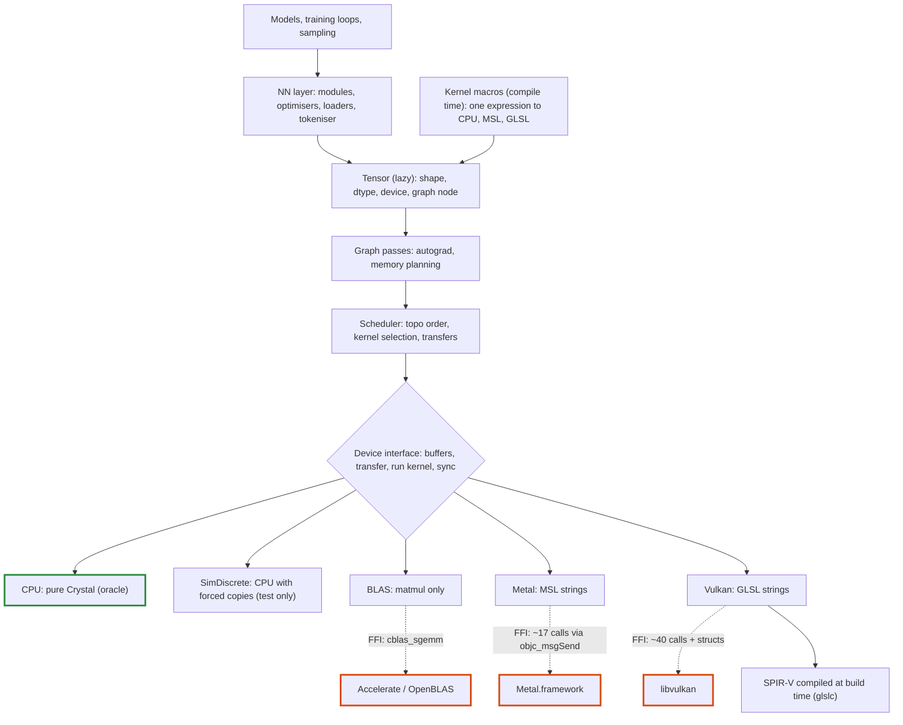
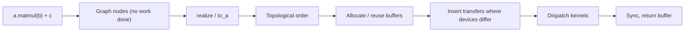

# Tensomite: plan

Oct 22, 2026; milestones revised Nov 7 (Decision CG)

## Goal and principles

The aim is a minimal Crystal shard for tensor maths, inference and training on macOS and Linux, written almost entirely in Crystal. It must be fast by design, not fast later by rewrite. So the hard parts of a production runtime (lazy execution, device-owned memory, runtime dtypes) come first, in small steps.

- **Lazy by default.** Ops build a graph and `realize` executes it. This gives one place to schedule, plan memory and differentiate.
- **Memory belongs to devices.** A tensor never assumes it can read its own bytes. Unified memory (Apple Silicon) is an optimisation of the discrete case, not the default.
- **Narrow FFI waist.** Native calls go through two seams only: CPU BLAS and a GPU driver. Adding an op never adds an FFI binding.
- **Kernels live in Crystal.** GPU kernel source is written in Crystal, or generated from Crystal expressions by kernel macros at compile time. MSL is compiled by the Metal driver at runtime, and GLSL is compiled to SPIR-V at build time.
- **CPU backend is the oracle.** Every other backend is tested against the naive pure-Crystal implementation. Library ops keep a hand-written CPU version, so a mistake in a kernel macro's expression cannot pass its own parity test.
- **Always runnable.** Each milestone ends with something that runs end to end and has a measurable exit.
- **Inspectable.** A running model can be looked into: its graph drawn, and in time its activations, attention and gradients read, by the names of its parts (scopes), without changing its code.

## Architecture

### Core types

- **`DType`:** a runtime enum (`F32`, `F16`, `BF16`, `I32`, `U8`, then block formats `Q8_0`, `Q4_0`). Block formats have a block size and bytes per block rather than an element size, so every byte size comes from `DType#bytes_for(count)` (Decision N).
- **`Buffer`:** an opaque, device-owned allocation with a byte size. Only its device can read it. `Buffer#map` returns a host `Bytes` view when the device has unified memory, and `nil` otherwise.
- **`View`:** shape, strides and offset. It is pure metadata, so reshape, transpose, slice and broadcast never touch data.
- **`Node`:** a graph vertex producing one contiguous array, with a shape, `DType` and `Device`. It holds an op and its source tensors until realised, then only its `Buffer`.
- **`Tensor`:** non-generic. It is a `View` over a `Node`, so view operations share the node. Typed host access is explicit: `t.to_a(Float32)`.
- **Ownership:** a `Buffer` is released by its device, via a finaliser and an explicit `release`. Views keep their buffer alive. mmap'd files are a `Buffer` on the CPU device.

### Execution flow

Fusion happens before the graph exists. A kernel macro turns a whole expression into one node, and `realize` dispatches one kernel per node.

### Memory model

Discrete GPUs (CUDA, or Vulkan on a graphics card) have their own memory across a PCIe bus. Unified GPUs (Apple Silicon, integrated Intel/AMD) share RAM with the CPU. The device interface always speaks in transfers. A unified device implements a transfer as a no-op, or as a `map`.

The `SimDiscrete` device runs CPU kernels on private buffers and refuses host access except through explicit transfers. It finds residency bugs on any laptop, long before a Vulkan GPU is involved.

## Milestones

Each milestone is done when its exit criterion passes.

1. **Skeleton.** Build `DType`, `View`, `Buffer`, the device interface, the CPU device, lazy `Tensor`, and a `realize` that interprets the graph node by node. Implement elementwise add/mul and `sum`.
   - Exit: `(a + b).sum.to_a(Float32)` matches by hand, including over transposed and broadcast views.
2. **CPU op set and SimDiscrete.**
   - Elementwise and unary ops: exp, log, tanh, GELU (tanh approximation).
   - Reductions: sum, max, mean over an axis.
   - Composite ops: softmax, layernorm, embedding gather, causal mask, slice/concat, and naive matmul.
   - Exit: specs pass against hand-computed values, and the same suite passes unchanged on `SimDiscrete`.
3. **BLAS seam.** Bind `cblas_sgemm` for Accelerate and OpenBLAS, behind an opt-in `require "tensomite/blas"` so the core stays pure Crystal. Operands whose strides BLAS cannot describe are packed first. Devices gain `shape_invariant?` (Decision L).
   - Exit: results are within a relative error of 1e-5 of the naive matmul, and the speedup is benchmarked.
4. **GPT-2 inference.** Write a safetensors loader (mmap as a CPU `Buffer`), a byte-level BPE tokeniser, and the GPT-2 small forward pass with a KV cache and sampling.
   - Fixtures (logits and tokens) are generated once from a PyTorch reference and committed, so CI needs no Python. A tiny randomly initialised GPT-2 and a small trained BPE vocabulary, both built from PyPI packages alone, check the same code paths without GPT-2 small's files.
   - Exit: logits are within tolerance of the fixture, greedy decoding matches for 64 tokens, the tokeniser matches the reference on a Unicode corpus, logits for a position are bit-identical whether computed in prefill or in decode (CPU device), and baseline tokens/s is recorded.
5. **Autograd and training.** Implement reverse mode as a graph transform: `grad(loss, params)` returns new lazy tensors. Add SGD, AdamW and cross-entropy.
   - Exit: gradients pass finite-difference checks, and a char-level Shakespeare model reaches a validation loss below 1.8 nats/char within an hour of training in the 4-core Linux container (Decision R).
6. **Metal backend.** Bind the driver through `objc_msgSend` (one declaration per selector signature) with autorelease pools around dispatch. Add a pipeline cache, then hand-written MSL kernels, ported one op at a time.
   - Exit: every op matches the CPU oracle, GPT-2 tokens/s is recorded against BLAS (Decision O), prefill and decode logits are bit-identical on Metal, and the cost of the deterministic split-K matvec against an atomic version is measured.
7. **Kernel macros and memory planning.** `Tensomite.kernel` takes an elementwise expression block and generates, at compile time, a CPU loop and an MSL kernel, plus a backward kernel per input by symbolic differentiation. `softmax`, `log_softmax` and `layernorm` become fused row ops (Decision T). Matmul is tiled on Metal; bias and activation epilogues were measured and dropped (Decision AE). Buffers are reused through a pool (Decision U). GPT-2's and the trainer's elementwise chains (GELU, scale and mask, residual adds) move onto macros. In PRs:
   1. Profile Metal decode: GPU time per op, and the host's share of each token.
   2. Parallel reductions on Metal (Decision X): the profile put 57% of a decoded token's GPU time in one-thread-per-row sums.
   3. A buffer pool, on host devices and Metal, and batched commits on Metal so the GPU starts before the host has encoded the whole graph.
   4. Kernel macros for elementwise expressions. The spike settled it: pure macros suffice, flattening the block into a tape with an explicit stack and differentiating by a reverse sweep over it. No `{{ run(...) }}` helper is needed.
   5. Fused row ops.
   6. GPT-2 and the trainer on fused kernels, measured. Vectorised host loops and own maths (Decision Y) halved a training step, which met the training exit; the remaining fusions (attention's scale and mask, AdamW, bias adds) became optional.
   7. Graph diagrams (Decisions AB and AC): `Tensor#to_mermaid` renders the graph behind a tensor as a Mermaid flowchart, with ops as nodes, views as edge labels and a node limit for large graphs; with a depth, it summarises the graph by scope, folding repeated blocks.
   8. A tiled Metal matmul with split-K's bits (Decisions AD to AG): a 128-token prefill went from 69 to 22 ms of GPU time, 5,539 tokens/s against BLAS's 2,010, and decode is unchanged. Products with 768 output columns remain slower than Accelerate.
   9. The exit runs, recorded below and in "Performance baselines" in `DESIGN.md`.
   - Exit: dispatch count per GPT-2 token falls measurably, GPT-2 tokens/s on Metal beats BLAS (Decision O), macro kernels match their hand-written CPU oracles, macro gradients pass finite-difference checks, and the char-level Shakespeare model reaches a validation loss below 1.6 nats/char within an hour of training in the 4-core Linux container (Decision R).
   - Met (24 Oct 2026, M5 Pro and the Linux container):
     - dispatches per decoded GPT-2 token fell from 710 to 316;
     - Metal decodes at 186 tokens/s against BLAS's 166, and prefills 64 tokens at 3,684 tokens/s against 2,419, in the same run (`bench/gpt2.cr`);
     - `gelu`'s kernel gives its composite's bits on host devices, and kernel and fused-row-op gradients pass finite differences (`spec/kernel_spec.cr`, `spec/row_ops_spec.cr`);
     - the Shakespeare model reached 1.573 nats/char at step 2,749 (20 minutes) and 1.494 after 5,000 steps (36 minutes).
     - Memory is planned by a pool fed by the collector (Decision U); releasing buffers as soon as their last reader has run is Decision AA, done for training steps by Decision CD.

**7b. Modules and a model DSL (Decisions AH to AR).** Models are written as `Tensomite::Module`s: classes whose instance variables hold `Parameter`s and other modules, found and named at compile time, with a `forward` that combines them. Then a DSL over the modules, iterated with them. In PRs:

1. `Parameter`, `Module`, `Linear`, `Embedding`, `LayerNorm`, `Activation`, `Sequential`, and optimizers over parameters; the tutorial's model on modules.
2. A safetensors writer, and `save` and `load` by name (Decision AM). Files round-trip with Hugging Face's `safetensors` package, and saving over a file that a loaded model still maps leaves the model's weights unchanged.
3. The Shakespeare model on modules, with a `CausalSelfAttention`; its trainer simplified to one optimizer and one `step(loss)`. Training and validation losses are bit-identical to the hand-written model's, at the same speed.
4. DSL candidates, a builder in plain Crystal (`with ... yield`) and a declarative macro, written against the same models; then a choice, and changes to the modules that the DSL shows a need for. The builder was adopted, and the tutorial's and the Shakespeare models moved onto it with the same bits (Decision AN).
5. GPT-2 on modules, loading Hugging Face's weights by name, if step 3 shows that its KV cache fits. The cache fits as an argument to `CausalSelfAttention#call`, and the logits are bit-identical to the hand-written model's (Decisions AO to AQ). The second look at a declarative macro became a follow-up (Decision AR).

Exit of 7b: the tutorial, Shakespeare and GPT-2 models on modules, with training losses bit-identical to the hand-written versions; `GUIDE.md` and `TUTORIAL.md` updated; a DSL chosen and recorded.

Met (25 Oct 2026, the Linux container and the M5 Pro):
- the tutorial's model gives the same output, byte for byte, and the Shakespeare model the same training and validation losses, as hex, in two shapes, on modules and on the `Builder`; a 5,000-step run on the M5 Pro ended at 1.4936 nats/char, as the hand-written model's did;
- GPT-2's logits, over a 64-token prefill and 8 decoded tokens, have the same SHA-256 digest as the hand-written model's on CPU and BLAS in the container, and on CPU, Accelerate and Metal on the M5 Pro (`bench/gpt2_digest.cr`);
- `GUIDE.md` and `TUTORIAL.md` describe modules and the `Builder`;
- the `Builder` is the DSL (Decisions AN and AR).

8. **CUDA backend (Decisions AS to AV).** A `CUDA` device on NVIDIA GPUs, through the driver API, with kernels in CUDA C++ compiled by NVRTC when first used, with fused multiply-adds off. It is opt-in: `require "tensomite/cuda"` and build with `-Dcuda`. Developed on a DGX Spark (ARM64, memory shared with the CPU), and proven on a T4 (x86-64, a discrete card). The device always copies between host and device memory explicitly, so the Spark runs the discrete code path. In PRs:
   1. Bindings to `libcuda` and `libnvrtc`, a probe (`examples/cuda_info.cr`), and compiler specs that CI runs without a GPU.
   2. The `CUDA` device: buffers, transfers, a stream, and the device specs `SimDiscrete` and `Metal` pass, with ops not yet ported run on the host. Done without a stream, which arrives with the first kernels, since host ops are synchronous; CI runs the device on a stand-in driver in host memory.
   3. Elementwise and reduction kernels, ported from the MSL ones, matching the oracle. With them, the stub runs the kernels compiled as host C++, so CI compares each with the CPU.
   4. Matmul, split and tiled, in split-K's order, so prefill and decode stay bit-identical; fused row ops; kernel macros emitting CUDA C++. With them, GPT-2's forward pass runs no host ops on CUDA.
   - Profiling decode (Decision AW), then a two-pass matmul for decode (Decision AX).
   5. GPT-2 and the Shakespeare trainer on CUDA; the exit runs on the Spark and a T4. The trainer takes `--device cuda` (and `metal`), and every op of a training step runs on the GPU, repeatably to the bit; on the GB10 it trains Decision R's larger model at 110 ms a step, against 410 on `BLAS`. The T4 run waits for a T4.
   - Exit: the full op suite matches the oracle on a discrete GPU (a T4), GPT-2 runs there and on the Spark, and prefill equals decode bit for bit on both.
9. **Llama-family model, at F32 (Decision BW).** Add RoPE, RMSNorm, SwiGLU and grouped-query attention, and load Hugging Face's weights and tokenisers as they are published.
   - `BF16` weights, as most small instruct models ship, load and widen to `F32`; `BF16` is a `UInt16`-backed struct, as `F16` will be in M10.
   - `tokenizer.json`: the byte-level BPE GPT-2 uses, read from Hugging Face's format, with its special tokens.
   - A chat template (ChatML) and a chat endpoint in `apps/server`, so the first instruct model, SmolLM2-135M-Instruct, can be served.
   - Exit: SmolLM2-135M-Instruct runs on every device and matches reference fixtures from PyTorch, prefill and decode logits are bit-identical on each device, and `apps/server` serves it.
   - Parts 1 to 4 of Decision CJ, in the container: SmolLM2-135M-Instruct's logits are within 2e-3 of PyTorch's, and its 32-token greedy answer matches, on CPU, SimDiscrete and BLAS; a tiny random Llama matches within 1e-4 on those and on the CUDA stub. Prefill equals decode bit for bit wherever the device is shape-invariant. Part 5: `apps/server` serves Llama-family models, chats in ChatML over `/v1/chat/completions` and in the terminal, and keeps SmolLM2's context across turns.
   - Met (8 Nov 2026): SmolLM2-135M-Instruct's spec passes on the M5 Pro (CPU, SimDiscrete, BLAS and Metal) and on the GB10 (CUDA): logits within 2e-3 of PyTorch's, the same greedy answer, and prefill equal to decode bit for bit on each shape-invariant device.
10. **Quantisation (Decision CL).** Add `F16`, block dtypes, a GGUF loader, and Q8_0/Q4_0/Q4_1 matmul kernels for CPU, Metal and CUDA.
    - `F16` is tensomite's own `UInt16`-backed struct with conversions to and from `Float32`, as `BF16` is from M9, because Crystal has no half-precision float. GGUF block scales are `F16`, so M10 needs them at the latest.
    - Host kernels read blocks as `Slice` of a block struct (`BlockQ4_0` is 18 bytes: an `F16` scale and 16 bytes of packed weights).
    - Block tensors follow the rules of Decision N: leaves only, sliced by whole rows, and consumed only by `MatMul` (as the weight) and `Gather` (as the table).
    - The CPU kernel quantises activations to Q8 per block, takes the Q4 × Q8 dot product in integers, then applies both scales once per block. This is the oracle version, naive and exact within each block.
    - Exit: quantised GPT-2 and M9's model stay within a perplexity budget of their F32 versions (Decision BW).
    - Parts 1 and 2 of Decision CL: GGUF files load, F32 to the bit and SmolLM2's F16 to PyTorch's greedy answer; Q8_0, Q4_0 and Q4_1 quantise to ggml's reference bytes and dequantise to its values, both on fixed rows and on SmolLM2's published Q4_0 file. Part 3: `BlockMatMul` and block gathers on the CPU, as ggml's reference code computes them, and `bench/perplexity.cr`. SmolLM2's KL divergence from F32 is 0.005 nats a token at Q8_0 and 0.154 at llama.cpp's Q4_0; on 20 greedy tokens it writes what llama.cpp writes from both files. Part 4: Metal kernels for `BlockMatMul` (a pass that quantises activations, then one thread per output, blocks in order) and block gathers, which give the host's bits in `scripts/emulate_metal/blocks.sh`. On the M5 Pro, Metal measures SmolLM2's published Q4_0 at a KL divergence of 0.1536 against the CPU's 0.1539, in 1.2 s for 16 windows, and decodes it at 113 tokens a second against F32's 77. Part 5: the same kernels in CUDA, which give the host's bits on the stand-in driver, since CUDA's division is IEEE's and NVRTC runs with `--fmad=false`.
    - Met (9 Nov 2026), by Decision CM: SmolLM2's published Q4_0 has a KL divergence from F32 of 0.1539 on the CPU, 0.1536 on Metal (M5 Pro) and 0.1540 on CUDA (GB10), and Q8_0 0.005 on the CPU, all within budget; GPT-2's matrices at Q8_0 and Q4_0 measure 0.001 and 0.080. On the GB10, CUDA's quantised matmul gives the CPU's bits, and Q4_0 decodes at 93 tokens a second.
11. **Fast quantised CPU kernels (Decision M).** Add a CPU device whose kernels are built for speed, tested against the oracle.
    - Contiguous fast paths loop directly over `Slice`s, so LLVM can vectorise them.
    - Float reductions use a fixed number of accumulators combined in a fixed order, so they vectorise and stay shape-invariant.
    - Quantised matmul uses the integer Q4 × Q8 block dot product.
    - Exit: a quantised small model runs on the CPU faster than with f32 weights, its results match the oracle within tolerance, and prefill and decode logits stay bit-identical.
12. **Vulkan backend.** Bind Vulkan compute, and port the hand-written kernels to GLSL compiled at build time. Kernel macros gain a GLSL backend beside Crystal, MSL and CUDA C++ (Decision V), so fused kernels come with it. It follows CUDA (Decision AT), for AMD and Intel GPUs.
    - Exit: the full op suite matches the oracle on a Linux discrete GPU, and GPT-2 runs there.

**Apps (Decisions BT to CF).** Not a milestone: apps under `apps/` that use tensomite as a library on real work, and find what the library still lacks. Two so far.

- `apps/server` serves GPT-2 and Llama-family models over HTTP (`/v1/completions` and `/v1/chat/completions`, streamed) and in the terminal (`generate` and `chat`), one request at a time (Decisions BT, BU and CJ).
- `apps/finetune` fine-tunes GPT-2 on a text, with checkpoints that resume bit for bit, dropout, a warm-up and cosine schedule, and early stopping, and exports models the server serves (Decisions BV and BY). It has fine-tuned GPT-2 small and large on Crystal's standard library, measured on held-out methods by `bench/code_eval.cr` (Decisions BZ, CB, CE and CF).

Next: requests batched step by step (Q-BA).

## Decisions

- **Decision A, own backends or bind ggml:** own backends (decided).
- **Decision B, Linux GPU:** Vulkan (decided), then superseded by Decision AT: CUDA first, Vulkan as M12. Vulkan still covers AMD, Intel and NVIDIA through one device.
- **Decision C, first model:** GPT-2 small, then TinyLlama (decided).
- **Decision D, CPU parallelism:** `-Dpreview_mt` or execution contexts. Defer until profiling shows the CPU path matters.
- **Decision E, execution model:** lazy graph with `realize` (decided).
- **Decision F, tensor typing:** non-generic `Tensor` with a runtime `DType` (decided).
- **Decision G, Metal plus Vulkan, or Vulkan everywhere via MoltenVK:** native Metal (decided). Revisit after M8, when keeping two codegen emitters has a known cost.
- **Decision H, Vulkan shader compilation:** compile at build time (decided). A Crystal macro runs `glslc` during `crystal build` and embeds the SPIR-V, so users need no compiler and there is no shaderc seam.
- **Decision I, fused kernels on Vulkan:** settled by Decision J. Macro kernels emit GLSL at compile time, from M8 (Decision V).
- **Decision J, how kernels are fused:** compile-time kernel macros (decided). Fusion is explicit: only what is written inside one macro is fused. Runtime auto-fusion over the graph is added only if measurements after M8 show a need for it. That would bring back the shader-compiler question for Vulkan (shaderc or a SPIR-V emitter in Crystal).
- **Decision K, determinism:** three levels (decided).
  1. Run to run: the same inputs, shapes and device give the same bits. Guaranteed everywhere, including parallel CPU code, which splits work independently of thread count.
  2. Shape invariance: a position's logits do not depend on batch size or prompt chunking. A goal for tensomite's own inference kernels, tested by exact comparison of prefill and decode. It makes prefix caching and chunked prefill reproducible: a cache hit gives the same bits as recomputing. The BLAS backend is exempt, because vendor libraries choose strategies by shape.
  3. Across devices: never promised. Comparisons use tolerances.
- **Decision L, level 2 on CPU:** devices report `shape_invariant?` (decided, lands in M3). BLAS reports false, and features that need level 2 fall back to tensomite's own matmul or warn. A cache-blocked CPU matmul in Crystal, shape-invariant by construction, is an optional later milestone if CPU inference matters.

- **Decision M, a fast CPU path:** own quantised CPU kernels after quantisation (M10) (decided), as milestone 11. Quantised small models make the CPU worth running fast, and BLAS cannot help with them: `sgemm` takes `f32` only. The oracle stays naive.
- **Decision N, modelling dtypes for quantisation:** settled early so quantisation (M10) adds code rather than refactoring it (decided).
  1. Byte sizes come only from `DType#bytes_for(count)`, never from a per-element size.
  2. Each op declares the dtype combinations it accepts. Today every op requires one dtype for all sources. From M10, `MatMul` accepts a block-format weight with `F32` activations and output, and `Gather` a block-format table. Host kernels then dispatch on the source dtypes as well as the output dtype.
  3. Block-format tensors are leaves loaded from files, stored row by row, sliced only by whole rows, and never produced by an op. `View` stays in logical elements.
  4. `F16` and `BF16` are tensomite's own types, stored as `UInt16` and computed in `Float32`.
- **Decision O, when Metal must beat BLAS:** measured in M6, required in M7 (decided). On Apple Silicon, Accelerate reaches about 1 TFLOP/s on a 512 matmul (M5 Pro), and GPT-2 decoding is a run of small matrix-vector products where a GPU's dispatch overhead and the shared memory bandwidth erode its advantage. Fewer dispatches per token, from kernel macros, are what is expected to give the GPU the lead.
- **Decision R, the M5 training exit:** below 1.8 nats/char within an hour in M5, and below 1.6 within an hour in M7 (decided). Training works: the 0.8M-param model reaches 1.80 by step 2,250 (27 minutes) and 1.726 after 3,000 steps (36 minutes) in the 4-core container. Reaching 1.6 needs a larger model and a longer context, about 1.6 s a step and two to three hours here, because training is bound by elementwise passes. Fusion and buffer reuse in M7 attack exactly that, so the 1.6 target becomes a measure of what they buy. The alternatives were a multi-hour run, which an idle cloud container does not survive, and bringing Decision D (CPU threads) forward into M5, which deserves its own design for deterministic work splitting.
- **Decision S, Metal matmul against the CPU's bits:** Metal's default matmul splits `k` across threads, so it may differ from the CPU in the last bits (decided). Level 3 of Decision K never promised otherwise. Levels 1 and 2 still hold: each output's sum is cut into chunks at fixed offsets and combined in chunk order, so the bits repeat from run to run and do not depend on the number of rows or on zero-padding of `k`. A serial mode, bit-identical to the CPU, remains for checking.
- **Decision T, how row ops are fused:** `softmax`, `log_softmax` and `layernorm` are hand-written fused ops, with the existing composites as their oracles and hand-derived backward rules checked by finite differences (decided). Kernel macros stay elementwise. Revisit after M8 if more row ops appear.
- **Decision U, how buffers are reused:** a pool fed by finalizers (decided). When the collector frees a buffer, its memory joins a free list by size, and allocation takes from that list first. On Metal, a buffer re-enters the pool only after the command buffer that last used it has completed. Freeing intermediates at their last use within a realisation would be tighter, but is unsafe while a user can hold a `Tensor` over any node.
- **Decision V, when kernel macros emit GLSL:** in M8, when a Vulkan device can run it (decided). Emitting code that nothing runs invites drift. The emitter is designed with GLSL as a third backend.
- **Decision W, if M7's training is still too slow:** decided after the fused models are measured in M7. The next lever would be Decision D, CPU threads, with work split independently of thread count.
- **Decision X, Metal reductions against the CPU's bits:** Metal's `Sum` of a long run folds it in chunks of 64 in parallel, so it may differ from the CPU in the last bits (decided). The rules of Decision S apply: chunks sit at fixed offsets and combine in chunk order, so bits repeat from run to run and do not change when a row is padded with zeros. `Max` is exact in any order, and runs of one chunk keep the host's arithmetic.
- **Decision Y, transcendental functions on host devices:** tensomite's own `Float32` `exp`, `log` and `tanh` (`Tensomite::Maths`), not the C library's (decided). A call into libm cannot be vectorised, and `tanhf` alone cost 12 ns per element, most of `gelu`'s time in training. Each function is range reduction and a polynomial written with selects, within 2 ulp of the correctly rounded result. They pay only in loops that vectorise, so host loops read unit-stride runs through pointers after checking each run's bounds once. Together they halve a training step. Host results no longer depend on the platform's maths library, so Linux and macOS give the same bits; they differ from libm's in the last bits, within the fixtures' tolerances.
- **Decision Z, after part 6's speed-up:** run the training exit at once, and treat the remaining fusions as optional (decided). It passed, so Decision W's CPU threads are not needed for M7.
- **Decision AA, planned release of intermediate buffers:** after M7 part 8 (decided; done for training steps by Decision CD, still open for inference). The scheduler would return a node's buffer to its pool once its last consumer has run, rather than when the collector finalizes it, which would lower a step's peak memory and make buffer lifetimes independent of the collector and its threads. Only nodes internal to the realised graph qualify, since a tensor the caller holds must stay valid. On Metal a buffer would be released when its consumer's command buffer completes, not when it is encoded, because the CPU may write a reused buffer before the GPU has read it.
- **Decision AB, a Mermaid view of the graph:** `Tensor#to_mermaid`, as its own PR between M7 parts 6 and 8 (decided). Node ids follow topological order, so the same graph gives the same text.
- **Decision AC, model summaries:** scopes (`Tensomite.scope`) and summaries by scope in the same PR as Decision AB (decided). Scopes are designed for inspection too: each call makes a new instance, so one of several repeated blocks stays addressable, and gradient nodes take the scope of the node they differentiate.
- **Decision AD, how Metal's matmul is tiled:** blocks of outputs per threadgroup, operands shared through threadgroup memory, adding in split-K's exact order (decided). Tiled and split products then have the same bits, so prefill and decode stay bit-identical (Decision K, level 2), and the choice between them is speed alone. Apple's 8×8 matrix instructions, whose order of addition is unspecified, are ruled out; they could return as an opt-in mode with relaxed determinism.
- **Decision AE, matmul epilogues:** dropped from M7 (decided). Fusing the bias adds into the matmul would save under 1% of a prefill's GPU time and about 5% of a decoded token's.
- **Decision AF, part 8's target:** Metal prefill faster than BLAS in the same run, with decode no slower (decided, met).
- **Decision AG, after the target was met:** stop tuning; products with 768 output columns stay slower than Accelerate (decided). Speeding them up needs split-K across threadgroups, and keeping split-K's order then means storing every chunk's sum.
- **Decision AH, how models are defined:** modules in plain Crystal first, then a DSL that builds on them, iterated together (decided). The DSL may need no macros, or may not be needed at all once the modules settle.
- **Decision AI, how parameters change:** a mutable `Parameter` slot holding an immutable tensor (decided). Optimizers replace each slot's tensor, so training loops do not reassemble parameter lists. The alternative, functional modules returning updated copies as in JAX, keeps everything immutable at the cost of rebuilding the model every step.
- **Decision AJ, how parts are found:** instance variables listed at compile time, named after the variables (decided), rather than explicit registration calls.
- **Decision AK, initial weights:** each module takes an `rng:`, defaulting to `Tensomite.rng`, seeded, so runs repeat unless asked otherwise (decided). `Linear` follows PyTorch (uniform, ±1/√inputs) and `Embedding` GPT-2 (normal, 0.02).
- **Decision AL, where modules sit in the plan:** milestone 7b, before Vulkan, so that later milestones keep their numbers (decided).
- **Decision AM, saving:** a safetensors writer, so models save and load in the format GPT-2 already loads from (decided).
- **Decision AN, the model DSL:** a `Builder` in plain Crystal now; a declarative macro reconsidered after GPT-2 is on modules (decided). The macro tried in M7b part 4 (`parts(...) do ln1 = layernorm(width) end`) gave `forward` the shorter `ln1(x)`, but ameba flags each part line as a useless assignment. A macro that returns must pass ameba without suppressing any rule.
- **Decision AO, names of GPT-2's parts:** Hugging Face's, in the modules themselves (decided): `CausalSelfAttention` holds `c_attn` and `c_proj`, and `GPT2` holds `wte`, `wpe`, `h`, `ln_f`, with `ln_1`, `attn`, `ln_2` and `mlp` (`c_fc`, `c_proj`) in each block. The file then loads by name with no table of renamings, and diagrams use the file's names.
- **Decision AP, loading files with other tensors or prefixes:** `Module#load(prefix:, ignore:)` (decided), so strict loading still catches real mismatches while skipping stored masks such as `attn.bias` and adding prefixes such as `transformer.`.
- **Decision AQ, where the KV cache lives:** one `CausalSelfAttention::Cache` per block, passed to `call` (decided). `GPT2` keeps its API: `load`, `new_cache`, `forward(ids, cache)` and `generate`.
- **Decision AR, closing 7b:** the `Builder` stands as the model DSL, and the declarative macro's second look is a follow-up rather than part of 7b (decided). The builder removed the repetition that prompted a DSL; what a macro would still add is `ln1(x)` for `@ln1.call(x)` in `forward`.
- **Decision AS, where M8 runs:** developed on the maintainer's DGX Spark, with the exit on a cloud T4 (decided). The Spark's GPU shares its memory with the CPU, but the device copies explicitly between host and device memory anyway, so the Spark exercises the discrete path and the T4 proves it on a PCIe card.
- **Decision AT, the first Linux GPU backend:** CUDA, ahead of Vulkan (decided). Both machines are NVIDIA's and already run CUDA, while the Spark's compute-only driver lacks Vulkan's part (`libnvidia-gl`). AMD and Intel GPUs wait for Vulkan, M12.
- **Decision AU, how CUDA kernels are compiled:** by NVRTC when first used, as Metal compiles MSL (decided). Building needs no CUDA toolkit, running needs `libnvrtc` beside the driver, and CI compiles every kernel without a GPU. Kernels are compiled with `--fmad=false`, so `a * b + c` rounds as on the host. PTX is built for the newest architecture NVRTC knows at or below the GPU's, and the driver compiles it for the GPU.
- **Decision AV, how the CUDA libraries are reached:** linked at build time behind `-Dcuda` (decided), as BLAS and Metal are, rather than loaded with `dlopen`. A program is built for the machine it runs on; one built with `-Dcuda` needs the driver and NVRTC to start.
- **Decision AW, CUDA's decode speed:** profile before changing anything, then fix the largest cost (decided). On the GB10, GPT-2 small decodes at 171 tokens/s, about three times the floor its memory bandwidth sets, as Metal on the M5 Pro does; the suspects are host overhead per launch, the output head reading its weights through a transpose, and small synchronous copies each token. The preallocated KV cache is a separate change, for every device.
- **Decision AX, the first decode fix:** a two-pass matmul for products of fewer than 16 rows, bit-identical to `Split` (decided). The profile put 3.8 of a decoded token's 6.4 ms in matmuls reading weights at about 129 GB/s, the output head at 94: `Split` launches too few blocks for one row and reads the transposed head across its rows. The first pass sums each chunk of 64 along `k` in its own block, with the weights staged in shared memory along their contiguous axis; the second adds the chunk sums in chunk order. Estimated 4.8 ms a token, 210 tokens/s; measured 5.0 ms, 198 tokens/s, all of the gain from the head.
- **Decision AY, which products get two passes:** only those whose `b` has non-contiguous columns, as GPT-2's output head does; `Split` keeps the rest (decided). Two passes made the head 2.2 times faster but slowed qkv and attention out, whose reads already coalesced under `Split`, and added a launch per matmul. Estimated about 4.7 ms a token; the profile measured 4.71, about 212 tokens/s. Reworking the two-pass kernel for contiguous weights is left for later.
- **Decision AZ, decode's remaining costs:** measure GPU time per op whatever the shape, then fix the largest (decided). Each small kernel costs about 4.6 µs however little it does, and the KV cache's `Cat` is split across many shapes in the profile, so its total is hidden.
- **Decision BG, CUDA training speed:** profile a training step, then fix its largest cost (decided). On the GB10 the larger Shakespeare model trains at 110 ms a step, slower than Metal's 76 on the M5 Pro though the GB10's GPU is the larger; decode on the GB10 already beats the M5 Pro. The profile put a third of the GPU time in `Unview`, whose index arithmetic was rewritten, and 17 ms of host time in allocation, which was missing the buffer pool because finalizers ran inside one another and freed their memory; and kernels copied their view arguments to per-thread local memory, which unrolled loops now avoid. With the first two fixes a step took 83.4 ms on the GB10, and Metal, which shared the pool bug, 59 on the M5 Pro, from 76; with the third, about 20 ms on the GB10.
- **Decision BH, profiling Metal training:** `--profile` for `--device metal` in the trainer, sharing the report with CUDA (decided). `ProfileReport` prints the tables for both devices from the parts each one measures; `Metal::Profile` gained the pool's counters, and `bench/profile_decode.cr` prints the shared report. With CUDA at about 20 ms a step on the GB10 and Metal at 59 on the M5 Pro, the profile is to show where Metal's time goes. It put 37% of the GPU time in `Unview` and 7% in `ScatterAdd`, and left 17 ms of a 59 ms step outside any op.
- **Decision BI, Metal training speed:** port CUDA's `Unview` to Metal, and zero `ScatterAdd`'s output in parallel on both GPUs, with the same bits; then, in a separate PR, find why a step commits 114 command buffers rather than about 14 (decided). `Unview [192]` took 0.83 ms a call on the M5 Pro, as it took 0.74 on the GB10 before Decision BG, and a one-column `ScatterAdd` zeroed 133,120 elements on one thread.
- **Decision BI's second part, the waits in a training step:** the 114 command buffers came from the optimizer, not from Metal: `Scheduler.realize` waits for the device, and AdamW detached `m`, `v` and each parameter's new value separately, so a step waited three times per parameter and realised the backward pass a piece at a time. The optimizer now realises the loss, its state and every update with one `Tensor.realize`, with the same bits. On the M5 Pro a step commits 15 command buffers, and takes 40.0 ms from 59.1 without the first part; CUDA should gain too, since it waited as often.
- **Decision BJ, after Decision BI:** first a dense path in Metal's `Unview` that loads 32 elements ahead of adding them, in order; then, in a separate PR, long-`k` products with few output tiles split across blocks along `k`, with split-K's bits, on both GPUs (decided). With both parts of Decision BI, the larger Shakespeare model trains at 30.7 ms a step on the M5 Pro and 20.5 on the GB10. `Unview [192]` takes 0.40 ms a call on Metal and 0.032 on CUDA with the same algorithm, I think because Metal waits for each load in turn; weight gradients such as `[192,2048]·[2048,192]` run at 330 and 468 GFLOP/s, in nine tiles of 64 by 64, against 2,100 to 5,300 for forward products. Measured: eight loads ahead took `Unview [192]` to 0.058 ms a call, and 32 to 0.027, with a Metal step at 25.9 ms; 1, 8 and 32 were measured, with threadgroups of 256 and 32. The second part is `MatMulMode::TiledTwoPass`, which `Auto` picks for fewer than 64 blocks of outputs and at least four chunks of `k`: a training step takes 22.4 ms on the M5 Pro, from 25.9, and 17.2 on the GB10, from 20.5.
- **Decision BK, after Decision BJ:** share the scalar constants arithmetic with numbers makes, by device, dtype, value and scope; then speed up cross-entropy's gradient, its `ScatterAdd` into one column (decided). With `TiledTwoPass`, a training step uploaded 363 constants on the GB10, 1.26 ms of synchronous copies, and `ScatterAdd [133120,1]`, a single-thread chain of 2,048 adds, took 0.66 ms on the M5 Pro and 0.82 on the GB10.
- **Decision BK's second part, cross-entropy's gradient:** a `ScatterAdd` into one column runs a thread per id rather than one thread in all, with the same bits; no change to autograd. Its gradient was `ScatterAdd [133120,1]`, 0.66 ms on the M5 Pro and 0.82 on the GB10; it now takes about 0.1 on each. With both parts on `main`, a training step of the larger model takes 21.8 ms on the M5 Pro and 15.0 on the GB10, from 59.1 and 20.5 before Decision BI.
- **Decision BL, after Decision BK:** an FAQ of the understanding checks, then fusing elementwise ops; M8's exit runs wait for a T4 (decided). The FAQ is `faq/`, a page per question in ten themes.
- **Decision BM, which elementwise ops to fuse first:** AdamW's, with kernel macros, three per parameter (decided). A training step of the larger model launched 925 kernels, over half of them AdamW's primitive ops, about fifteen for each of 36 parameters. Its step becomes three macro kernels, for `m`, `v` and the new value, whose per-step numbers are scalar inputs; each does the composite's operations in its order, so the bits are unchanged. Measured: 511 launches a step, with the same bits; a step takes 20.8 ms on the M5 Pro, from 21.8, and 14.1 on the GB10, from 15.0. Runtime fusion over the graph (Decision J) stays unneeded: the remaining launches are spread over the forward and backward passes, where attention's scale and mask are the next candidates.
- **Decision BN, after the fused AdamW:** a fast path for the inputs of kernel macros and elementwise ops, then attention's scale and softmax's backward, then layer norm's backward (decided). A fused kernel on `[192]` took 4.7 µs against 2.8 for a `Mul`, I think from finding each of its five broadcast scalars by integer divisions per element. Those kernels now receive a view without its leading dimensions of stride 0, which add nothing to a position: a broadcast scalar becomes a view of no dimensions, read with no arithmetic. The bits are unchanged. Measured: 20.5 ms a step on the M5 Pro, from 20.8, most of it from attention's scale by a scalar; no change beyond noise on the GB10, whose elementwise ops were already bound by memory.
- **Decision BO, attention's softmax:** fuse the scale and mask into `Softmax`, and softmax's backward into one op, `SoftmaxGrad`, with the bits of the primitives they replace (decided). Per layer of the larger model, attention's scores `[16,6,128,128]` went through a `Mul` by the scale and an `Add` of the mask before the softmax, and through five ops after it in the backward pass: 16 `Mul`s, 4 `Sub`s and 4 `Sum`s a step, and on the GB10, which is bound by memory for these, about ten passes over 6.3 MB per layer. `SoftmaxGrad` adds `g · y` in the order `Sum` does, so the losses keep their bits. On the CUDA stub a step launches 487 kernels, from 511, and uploads 25 constants, from 29. Measured: 19.6 ms a step on the M5 Pro, from 20.5, and 13.6 on the GB10, from 14.3; estimated for the GB10 from its traffic, 0.9 ms.
- **Decision BP, layer norm's backward:** one fused op, `LayerNormGrad`, for the input's gradient, and the same op with `x` alone for `x̂`, which the weight's gradient multiplies by `g` (decided). The composite recomputed each row's statistics and took about sixteen primitives over `[2048,192]` per layer norm, nine layer norms a step; most of the step's remaining `Mul`, `Sub`, `Div` and `Sum [2048]` launches were these. Each row's sums are added in `Sum`'s order, so the losses keep their bits. On the CUDA stub a step launches 334 kernels, from 487, and uploads 7 constants, from 25. Measured: 18.7 ms a step on the M5 Pro, from 19.6, and 12.9 on the GB10, from 13.6; `LayerNormGrad` takes about 37 µs a call on both, about 0.7 ms for its eighteen calls, against about 1.4 ms for the primitives it replaced. The Metal mask fix of Decision BO follows in its own PR.
- **Decision BQ, Metal's slower fused softmax:** keep both GPUs' kernels as they are (decided). With the scale and mask fused in, `Softmax [16,6,128,128]` took 0.59 ms on the M5 Pro, from 0.43, and was unchanged on the GB10, because each of its passes loads `x` and the mask again. Computing the values once, in the max pass, and storing them in the output row for the exponential pass, took Metal to 0.54 ms but the GB10 to 0.94, from 0.65: an extra write and read of 6.3 MB per layer on a GPU bound by memory. A gain of 0.05 ms on one GPU did not justify kernels that differ between them. An earlier guess, that the mask was found through `offset_of` per element, was wrong: its row's start is found once.
- **Decision BR, after the fusions:** measure larger patches per thread in Metal's tiled matmul, then keep `T64x64` (decided). With the fusions of Decisions BM to BP, `MatMul` is 71% of a training step's GPU time on the M5 Pro and 54% on the GB10, at about 2,100–2,300 GFLOP/s forward on Metal against 4,700–5,300 on CUDA with the same kernel; memory bandwidth is not the difference, as Metal's elementwise ops are as fast as the GB10's. Each thread's 4 x 4 patch reads 8 values from threadgroup memory for 16 multiply-adds, so patches of 8 x 4 and 8 x 8, in blocks of 64 x 64, 128 x 64 and 64 x 128, were tried. All were bit-identical to `Split`, but 8 x 8 ran 2–3 times slower on every product, I think because 128 accumulators per thread cost the GPU its threads in flight, and 8 x 4 gained 3–9% on forward products, within the noise of a bench that waits for the GPU after each product. The next lever would be a different kernel, with double-buffered tiles or wider loads from device memory.
- **Decision BS, a first release:** tag v0.1.0 (decided): GPT-2 inference and training, on the CPU, BLAS, Metal and CUDA, with bit-identical results across their modes. M8's exit runs on a T4 are still to come.
- **Decision BT, an inference app:** a CLI app and server inside this repo, under `apps/`, using tensomite as a library (decided). It is narrow at first and moves to its own repository once the API it uses has settled. The small instruct models on Hugging Face need BF16 weights, the Llama family's RMSNorm, RoPE, SwiGLU and grouped-query attention, and their `tokenizer.json`, none of which tensomite has yet.
- **Decision BU, the inference app's first scope:** `apps/server`, serving GPT-2 small or a GPT-2 tensomite saved, before any Llama-family model (decided). With no arguments it is an HTTP server with OpenAI's `/v1/completions`, streamed or whole, and `/health`; `server generate PROMPT` runs the same engine once in the terminal. Requests run one at a time; text is streamed only up to whole characters and held back while it could begin a stop string. GPT-2 is a base model, so it completes text rather than chatting; a chat endpoint comes with the first instruct model.
- **Decision BV, training something worth serving:** fine-tune pretrained GPT-2 small on a chosen corpus, rather than train from scratch (decided). It needs a trainer for `GPT2` with BPE, the corpus tokenised once and read through a memory map, checkpoints of the model and AdamW's state with resume, and periodic validation and samples; Tiny Shakespeare in GPT-2's tokens for tests, a larger corpus overnight. First `bench/train_gpt2.cr` measures a step of GPT-2 small on each GPU; `GPT2#forward` gains a batched form without a cache for it, whose rows give each sequence's own prefill bit for bit. Measured at batch 8 × 256: 402 ms a step on the GB10, 5,089 tokens/s, and 768 ms on the M5 Pro, 2,665 tokens/s, with the same losses on both; validation loss on Tiny Shakespeare fell from 4.16 to 3.60 in 20 steps. `MatMul` is 72% and 88% of the GPU time, a third of it the head's three products with the 50,257-token vocabulary. A night is about 147M tokens on the GB10, so Tiny Shakespeare (304K tokens) would be seen about 1,200 times: the trainer needs early stopping on validation loss for small corpora, and a corpus of tens of millions of tokens for overnight runs. Metal allocates 673 buffers a step outside its pool, 22 ms, where CUDA allocates none. Then `apps/finetune`: the text tokenised once into a file of 16-bit ids read through a memory map; each step's batch drawn by a generator seeded with the seed and the step, so a checkpoint needs no generator state; checkpoints of the weights, AdamW's state (`Optimizer#state` and `#restore`) and the step, written whole and then swapped in; a warm-up and cosine learning rate; validation on fixed windows of the text's last tenth, keeping the best weights and stopping after a patience; and `best/` and `model/` directories that `apps/server` serves. A run resumed from a checkpoint matches one that never stopped, bit for bit.
- **Decision BW, real models and quantisation:** a Llama-family instruct model at F32 first (BF16 loading, RMSNorm, RoPE, SwiGLU, grouped-query attention, `tokenizer.json`, a ChatML template), then `Q8_0` and `Q4_0` (M10), measured against that F32 baseline by perplexity; FP4 formats later, if a model needs them (decided). Tensor cores, if ever, would be a precision setting on the existing GPU devices, not a device of their own, as they give up bit-identity.
- **Decision BY, after the first fine-tune:** time only the training steps in `finetune`'s progress, then add dropout (decided). Fine-tuning GPT-2 small on Tiny Shakespeare found its best validation loss, 3.34 from about 4.16, at step 200, after about 1.3 passes over the text; by step 700 training loss was 2.3 and validation 3.76, and patience stopped the run. Dropout is a primitive, `Op::Dropout`, whose mask is a hash of the seed and each element's position in 32-bit integer arithmetic, so every device makes the same mask and no random numbers are uploaded; its gradient is the same mask on the gradient. GPT-2 takes a `Dropout` in training and applies it where Hugging Face's does, and `finetune` uses 0.1 by default, seeded by the step, so resumes keep their bits. Measured on the same run with dropout 0.1, validated every 50 steps: the best validation loss came at step 500, 3.315, against step 200 and 3.344 without; by step 700 it had risen 0.03 from its best, against 0.41, and the gap between training and validation loss was about 0.35 rather than 1.45. Overfitting nearly stops, but the best loss barely moves, so the size of the text, 300K tokens, is now the limit.
- **Decision BZ, a corpus of code:** fine-tune GPT-2 small on the Crystal standard library and measure it on held-out methods (decided). `scripts/make_code_corpus.sh` concatenates the library's 1,646 files, 9.1 MB or 4.1M tokens (2.2 bytes a token, since GPT-2's vocabulary has few tokens for runs of spaces), in an order shuffled by a checksum of each path, so the validation tenth is whole files from every part of the library. `bench/code_eval.cr` takes about 40 methods from those files. Each model is shown the file up to a `def` line and measured four ways: the loss of the real body; whether its greedy completion closes with an `end` at the `def`'s indent; whether the file with that completion parses; and whether the first line, or the whole completion, matches the real one. It doesn't type-check, because Crystal checks only methods a program calls, so a type check would pass any body; tests to run would need code written for them. Measured on 40 held-out methods after 6,000 steps on the GB10 (batch 4 × 512, dropout 0.1, 3.3 passes over the text; validation loss 1.22 at step 250 and 0.99 at the end, still falling, with training loss level with it): body loss fell from 2.03 to 1.09; completions that close went from 6 to 30, that parse from 6 to 29, and first lines that match from 1 to 8; none matched exactly. GPT-2 small mostly repeats comments or writes other languages; the fine-tuned model writes Crystal's grammar but often the wrong logic, and its failures are mostly loops of greedy decoding, such as `builder.builder.builder…`. A sample prompt that ends in a space, such as `"  def "`, gives samples of only spaces: GPT-2 attaches a space to the word after it, so a lone space token is almost always indentation, and after one the next token is another space 77% of the time in this corpus.
- **Decision CA, the CUDA context across threads:** make the context current on whichever thread calls the driver, rather than run GPU work in an `Isolated` execution context (decided). Crystal 1.22 moves a fiber to another thread after a file write, and a CUDA context is current per thread, so a fine-tune failed with `CUDA_ERROR_INVALID_CONTEXT` after exporting its best weights. Each `CUDA::Context` call now binds the context when the calling thread differs from the last one's, a thread-local read of 3.8 ns, and the host stub keeps a context per thread so the specs catch a call that skips it. Pinning the work with `Isolated` would have made correctness depend on every caller, and finalizers, which free device memory on whatever thread collects, would still need the check.
- **Decision CB, a bigger model to fine-tune on code:** GPT-2 large rather than XL (decided). XL's first step took 5.0 s on the GB10, but its memory ran out early in the second; large measured 2.6 s a step with about 67 GB in use. Its runs were then killed for memory too, every few hundred steps, which Decisions CC and CD address.
- **Decision CC, memory in the progress lines:** `finetune` reports the system's memory in use, on CUDA the device memory tensomite holds (`CUDA#device_bytes`) and its pool's share, and the collector's heap (decided). The large runs were killed by the kernel with nothing in the logs to say what had grown; the lines then showed memory flat for hundreds of steps and the process killed holding about 131 GB, the state plus two steps' worth.
- **Decision CD, deterministic release of a step's memory:** free each intermediate buffer as soon as the last node of the same realize that reads it has run, opt-in through `Tensor.realize(tensors, release: true)`, which `Optimizer#step(loss)` uses (decided). The collector cannot see device memory, and it is conservative: a stale pointer to any of the step's collections of nodes, such as the scheduler's list or autograd's table of gradients, keeps every buffer of the step, about 60 GB on GPT-2 large, and the next step's 60 GB then exceeds the GB10. Emptying those collections would patch the holders found so far; releasing at the end of the step would be deterministic but leave the peak; releasing as the step goes is both, since the forward pass's activations go back to the pool as the backward pass finishes with them. Roots keep their buffers, as do `Write` nodes and the buffers they write into, and a released node raises when read. Reuse within the step relies on each device running work in the order it is submitted: one CUDA stream, one Metal queue. Inference still realises without it.
- **Decision CE, the schedule for a bigger model:** end the learning-rate schedule near where validation peaks, 3,500 steps for GPT-2 large on the Crystal corpus (decided). With the 9,000-step schedule large's best validation loss, 0.885, came at step 3,250, while the learning rate was still 3.2e-5, and patience stopped it at 4,750. Ending the cosine decay at 3,500 gave 0.868, and a body loss of 0.786 on 200 held-out methods against 0.807. Large still began to memorise within the last few hundred steps, after about 1.8 passes over the text, where small did not in 3.3.
- **Decision CF, recording the code fine-tunes:** the 200-method results, the schedule finding and an analysis of first lines, with `scripts/compare_first_lines.py` to repeat it (decided). On 200 held-out methods, fine-tuned large closes 84–87% of completions and parses 82.5–85%, against small's 80.5% and 79.5%, with a lower body loss, but matches the real first line of 14–16 methods against small's 23. Of the methods only one model matched, 11 went to small and 4 to large; at least 7 of small's 11 copy the opening of a neighbouring method in the prompt, such as `check_division_by_zero other` in `BigRational#%`, where large writes plausible code of its own. Continuing the `def` line, which can never match, does not explain it: large does so less often than small. Why the larger model copies less is not known; it saw the text 1.9 times against small's 3.3.
- **Decision CG, after the review of 7 November:** Llama-family models at F32 become M9 and quantisation M10, renumbered rather than only reordered, as Decision BW decided; the apps get a section of their own; Decision AA is recorded as done for training (decided). References to M9 and M10 in earlier decisions were renumbered with them. Before M9: a GPT-2 XL fine-tune on the GB10, then Metal's allocations that miss its pool (673 a step) and a fused `LogSoftmaxGrad` (about 13 ms a step on the GB10, the same for any GPT-2 size, so it does not hold up the XL run). M8's T4 exit stays open until a T4 is at hand.
- **Decision CH, after the XL fine-tune:** record it, then start M9 (decided). GPT-2 XL on the Crystal corpus, 3,000 steps at 5.1 s each with about 65 GB in use throughout, reached a best validation loss of 0.855 at step 2,750, against large's 0.868; on 200 held-out methods its body loss is 0.764 against large's 0.786, with 165 that parse against 165, 20 first lines against 16 and 5 exact against 2. Doubling the model again bought a fifth of what going from small to large did (0.148 then 0.022), so the 3.7M tokens of text, not the model, now set the limit.
- **Decision CI, coalesced row ops on CUDA:** in the pass of a fused row op that writes each element, thread `t` takes elements `t`, `t + threads` and so on, rather than its own chunks of 16 (decided). A warp's 32 threads read addresses 64 bytes apart in the chunked order, which the GB10 served at about 91 GB/s for `LogSoftmaxGrad` where a plain `Sub` over the same rows ran at about 241; the Apple GPU's caches absorb it, at 213 GB/s. Each element's result depends only on its inputs and the row's totals, so the order changes no bits; the sums keep their chunked order. Measured on the GB10 for GPT-2 small: the six row ops went from 57.2 to 44.3 ms a step, and the step from 401.3 to 388.4 ms. `LayerNormGrad` fell from 8.0 to 4.6, `Softmax` from 8.0 to 4.8, `LogSoftmaxGrad` from 13.1 to 10.8, `LogSoftmax` from 16.7 to 14.6 and `LayerNorm` from 4.9 to 3.0; `SoftmaxGrad`, whose rows of 256 run 16 threads a block, did not move. The cross-entropy pair still moves about 140–150 GB/s against about 240 for a plain elementwise op, which is the sums' chunked reads; coalescing those, through shared memory to keep their order, is left as a follow-up.
- **Decision CJ, M9 in five PRs:** `BF16` loading; Llama's pieces (SiLU, RMSNorm, RoPE, grouped-query attention) as composites of existing ops, fused only where a profile shows the need; `tokenizer.json`; the Llama model with fixtures from PyTorch; then ChatML and a chat endpoint (decided). `BF16` weights widen to `F32` in `SafeTensors#[]`, so every device and op sees `F32` as before; SmolLM2-135M-Instruct's 134.5M weights widen in half a second.
- **Decision CK, after M9:** tag v0.2.0, then M10 (decided). v0.2.0 holds everything since v0.1.0: fused training, `apps/server` and `apps/finetune`, fine-tuning on code, a training step's buffers released as it runs (Decision CD), and M9, Llama-family models at F32 with chat. A chat without a system message gets the one its chat template adds, as Hugging Face's own template does (Q-BQ, decided), so SmolLM2 answers as it was tuned to; `--system` overrides it.
- **Decision CL, M10 in five PRs:** the GGUF reader with `F16`, the tokeniser from GGUF metadata and `Llama` from GGUF; block dtypes Q8_0, Q4_0 and Q4_1 for leaves stored `[outputs, inputs]`, from GGUF and from `Tensor#quantize`; the CPU oracle kernels, matmul with activations quantised to Q8 and integer dot products as ggml does, and a perplexity bench; Metal kernels; CUDA kernels (decided). Q4_1 joins the plan because the published Q4_0 SmolLM2 holds 3 Q4_1 tensors and a Q8_0 embedding. Quantised weights keep GGUF's `[outputs, inputs]`, with blocks along the inputs, because each output is then a dot product along whole blocks. llama.cpp's converter reorders query and key rows for its rotary layout, and loading reorders them back.
- **Decision CM, measuring quantisation:** M10's exit is judged by the mean KL divergence from the F32 model, over 16 windows of 128 tokens of Tiny Shakespeare, not by perplexity (decided). On a text a model is too sure of, quantisation noise lowers perplexity: GPT-2 "improves" from 139.4 to 126.6 with its matrices at Q4_0, while its KL divergence is 0.080. Two rules:
  1. A format's budget, as a guard rail: at most 0.01 nats a token at Q8_0, and 0.3 at Q4_0, with embeddings at Q8_0 or better. Measured on the CPU: SmolLM2 0.005 (Q8_0), 0.154 (llama.cpp's Q4_0) and 0.252 (tensomite's plain Q4_0); GPT-2 0.001 (Q8_0) and 0.080 (Q4_0), with embeddings at F32, since its tied embeddings at Q8_0 add about 0.05. Small models suffer most from 4 bits, and better quantisers, such as llama.cpp's importance matrix, are a later project.
  2. A kernel's budget: a GPU's predictions stay within 0.001 nats a token of the CPU's on the same quantised model, so GPU kernels add next to nothing to what quantisation costs.
- **Decision CN, quantised kernels correct first:** M10's GPU kernels take one thread per output, summing its blocks in the host's order, and a follow-up makes decode fast on both GPUs (decided). On the M5 Pro, Q4_0 decodes only 1.5 times faster than F32, though it reads 7 times fewer bytes: about 9 GB/s of weights, against 41 at F32. Too few threads share each output, and every token pays for hundreds of dispatches. The follow-up gives each output a SIMD group of 32 threads that share its blocks and add their sums at the end, which changes the order of additions, as Decision CM's kernel budget allows.
- **Decision CO, after M10:** first the decode follow-up of Decision CN, then M11 (decided). A first try gave each block's 32 elements to 32 lanes and added their integer products across the warp: exact, but five shuffles per lane per block made decode on the GB10 slower, 44 tokens a second against 93. The second gives each lane whole blocks instead, lane l taking blocks l, l + 32 and so on, and adds the lanes' contributions in block order, so it keeps the host's bits and does no more integer work than one thread per output. `BlockMatMulMode` picks lanes for products of fewer than 65,536 outputs and threads otherwise; `TENSOMITE_BLOCK_MATMUL` sets the mode, so the modes can be timed against each other. On the GB10, SmolLM2's Q4_0 decodes at 88.5 tokens a second on threads and 169.4 on lanes; with a threshold of 8,192 outputs, which gave its 49,152-word head threads, at 163.8, so the threshold rose to 65,536, and every product of one-token decode runs on lanes. On 16 windows of 128 tokens, where most products are wide, the modes are within noise of each other: 1.3 s on threads, 1.4 on lanes and 1.2 on `Auto`. On the M5 Pro, the modes make no difference: about 120 tokens a second in decode and 1.2 s for the 16 windows, in each mode, so its decode is bound by something other than the quantised matmul.
- **Decision CP, profiling before M11:** the profilers take Llama-family models and GGUF files as well as GPT-2, as `bench/profile_decode.cr` (Metal) and `bench/profile_decode_cuda.cr` (CUDA), before any work on M11 (decided). On the M5 Pro, quantised decode runs at the same 120 tokens a second whether its matmul runs on threads or lanes, so something else bounds it there; the profile, which splits a decoded token into encoding, allocation, waiting for the GPU and host ops, and GPU time by op, says what.
- **Decision CQ, fusing Llama's composites:** RMSNorm becomes one row op and RoPE one elementwise op, before M11 (decided). The profiles of SmolLM2's Q4_0 decode show 1,450 dispatches a token on the M5 Pro and 1,480 launches on the GB10, each costing about 3 µs however little it does: 4.3 ms of a 6.0 ms token waiting for the GPU on the M5 Pro, 2.9 ms of 5.2 launching on the GB10. RMSNorm's composite was 7 ops and RoPE's 5, run 61 and 60 times a token. Fused, the tiny Llama's decode goes from 87 ops a token to 41. The fused ops compute what the composites compute, operation for operation, on host devices, so the host's logits do not change; RoPE, which only multiplies, negates and adds, gives the same bits on GPUs, and RMSNorm sums its rows in chunks there, as LayerNorm does. Both keep gradients: RMSNorm's as a composite, and RoPE's as `g · cos` plus the transpose of `rotate_half` applied to `g · sin`.
- **Decision BA, AMD GPUs:** Vulkan as M12, then HIP, ROCm's CUDA-like API, as a later and smaller milestone (decided). HIP mirrors the CUDA driver API and has a run-time compiler, `hiprtc`, so a HIP device would be largely a port of the CUDA one; Vulkan reaches GPUs ROCm does not support. Revisit when an AMD machine with ROCm is at hand.
- **Decision BB, the first of decode's remaining costs:** a preallocated KV cache, written in place, then a few-row kernel for contiguous weights (decided). The cache's `Cat` was 0.52 ms of a decoded token's 4.75 ms of GPU time on the GB10, copying each layer's whole cache to add one position; writing in place helps every device and keeps shapes fixed, which CUDA graphs would need. It is done with `Tensor#write`, the one op that changes a buffer, rather than by making tensors mutable in general. Measured: `Auto` decodes at 246 tokens/s on the GB10, from 204, and `BLAS` at 94.6, from 71.2.
- **Decision BC, how the KV cache is allocated:** its whole capacity on the first append (decided), accepting about 1.6 ms more before the first token on the GB10: 1.3 ms allocating the buffers and 0.4 ms copying the prompt into them. Growing by doubling would avoid that, but a doubling briefly holds the old buffer beside one twice its size, and frees it only when the collector runs (Decision AA). That matters for larger models on smaller GPUs, where the cache, not GPT-2's 75 MB, is gigabytes; a fixed allocation also keeps memory predictable and shapes fixed.
- **Decision BD, after the cache:** the few-row kernel for contiguous weights, as Decision BB planned, then perhaps bias adds fused into matmuls (decided). The four contiguous decode products read 339 MB a token at 136–200 GB/s; at 210 to 240 GB/s they would save 0.27 to 0.47 ms of 4.0. The kernel is split-K with narrower blocks, so that a product with few columns has enough of them, keeping its bits.
- **Decision BE, after narrower blocks were slower:** keep 32-column split blocks, drop the narrower ones and keep their benchmark (decided). On the GB10, 16- and 8-column blocks read the decode weights at 71–202 GB/s against 160–209 for 32 columns; 32 columns already reads at about 200 GB/s alone, so the few-row kernel has about 0.15 ms a token left to win, not 0.27–0.47.
- **Decision BF, decode's next costs:** the 48 copies of a decoded token, then bias adds fused into matmuls, then part 5 (decided). The copies were `reshape`s of views that strides could express, so `reshape` now returns a view whenever strides allow, as PyTorch's `view` does; the bits are unchanged. Bias adds became a third source of `MatMul`: a contiguous `[N]` bias, which each kernel adds after its sum as `bias[col]`, with the bits of a separate `Add`; any other bias is added after the product. A first version read the bias through a general view, with integer divisions per output, and cut prefill on the GB10 by a third. Measured with both changes: `Auto` decodes at 268 tokens/s on the GB10, from 246, and prefills 64 tokens at 5,050 tokens/s, from 4,134.

## Risks

- **Lazy debugging.** Shape and dtype errors are raised as soon as a node is built. Only execution errors (NaN, out of memory, kernel failures) surface at `realize`, far from their cause. Mitigate by recording the call site on each node and adding an eager debug mode that realises after every op.
- **No portable SIMD in Crystal.** CPU speed relies on LLVM auto-vectorisation under `--release`. Measured on x86-64 with Crystal 1.22:
  - Loops over a `Slice` vectorise. Loops over an `Array` do not, because its size and data pointer live in memory that LLVM cannot prove the loop leaves alone. Taking a `Slice` or pointer before the loop fixes it.
  - Float sums do not vectorise, because that would reorder additions. Integer sums do.
  - A Q4 × Q8 block dot product vectorises, because its inner sums are integers, but LLVM emits generic 4-lane code rather than dedicated dot-product instructions (`vpdpbusd`, `sdot`).

  The fallback is a small C file of SIMD kernels. That would be a third seam, so it needs a benchmark to justify it.
- **`objc_msgSend` signatures.** A mistyped selector signature crashes without a useful error. Mitigate by binding each selector once and covering each with a spec.
- **Vulkan surface.** Vulkan compute needs far more ceremony than Metal (descriptor sets, pipeline layouts, fences, memory types). Keep it behind one file per concern and port only after the Metal path has settled the device interface.
- **Kernel drift.** Hand-written and generated kernels can diverge from the oracle silently. Mitigate by running every op on every available device against the CPU in specs.
- **Macro limits.** Crystal's macro language is small. Kernel generation that outgrows it moves into a compile-time helper program called with `{{ run(...) }}`, at some cost to build time.
- **GPU CI.** Hosted macOS runners do run Metal compute, including GPT-2 small, so every PR exercises the Metal device. Hosted Linux runners have no GPU: they compile every CUDA kernel with NVRTC, which needs none, but CUDA specs that run kernels need the Spark, a T4, or a self-hosted runner on one.
- **Scope creep.** Multi-GPU and new architectures stay out until M9 passes.
