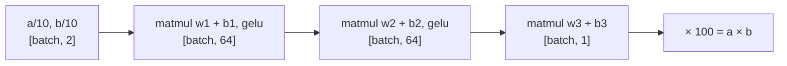
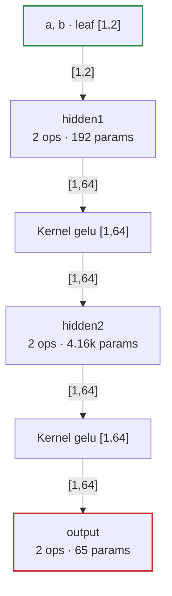

# Tutorial: teaching a network to multiply

This tutorial trains a small neural network to multiply two numbers between 0 and 10, then uses it for inference: asking it questions it has not seen, saving it, and loading it back. It uses only the CPU and takes about 15 seconds to train. The whole program is [`examples/multiply.cr`](examples/multiply.cr); run it with:

```sh
crystal run --release examples/multiply.cr
```

The [user's guide](GUIDE.md) explains each part of the API used here.

## 1. The problem

We want a function `f(a, b) ≈ a × b` for `a` and `b` between 0 and 10, learned from examples rather than written down. A network does not know what multiplication is. It sees many pairs and their products and adjusts its weights until its answers are close. That makes multiplication a good first task: the right answer is never in doubt, so it is easy to see how well the network has learned, and where it fails.

**Scaling the data.** Networks learn best when inputs and outputs are small numbers, roughly between -1 and 1. So the inputs are `a / 10` and `b / 10`, both in `[0, 1]`, and the target is `a × b / 100`, also in `[0, 1]`. To read an answer, multiply the output by 100.

```crystal
# Returns a batch of *size* random pairs from 0 to 10, scaled to [0, 1], and
# their products, scaled to [0, 1] too.
def batch(rng : Random, size : Int32) : {Tensor, Tensor}
  pairs = Array.new(size) { {rng.rand(10.0), rng.rand(10.0)} }
  inputs = pairs.flat_map { |(a, b)| [(a / 10).to_f32, (b / 10).to_f32] }
  targets = pairs.map { |(a, b)| (a * b / 100).to_f32 }
  {Tensor.from(inputs, [size, 2]), Tensor.from(targets, [size, 1])}
end
```

Each batch is fresh random pairs, so the network never sees the same question twice. The inputs are a `[256, 2]` tensor, one row per pair, and the targets `[256, 1]`.

## 2. The model

The network is a **multilayer perceptron**: layers that each multiply by a weight matrix, add a bias, and pass the result through a non-linear function, here `gelu`.



Why the non-linear function? Without it, three matrix products in a row equal a single matrix product, which can only compute a linear function of `a` and `b`, of the form `p·a + q·b + r`. `a × b` is not linear, so the network needs `gelu` between the layers to represent it.

```crystal
class Multiplier < Tensomite::Module
  def initialize(rng : Random)
    @hidden1 = Linear.new(2, 64, rng: rng)
    @hidden2 = Linear.new(64, 64, rng: rng)
    @output = Linear.new(64, 1, rng: rng)
  end

  # Returns predictions [batch, 1] for inputs [batch, 2], lazily.
  def forward(x : Tensor) : Tensor
    h = @hidden1.call(x).gelu
    h = @hidden2.call(h).gelu
    @output.call(h)
  end
end
```

`Tensomite::Module` is the base class for models and their parts, and `Linear` is one of the parts it provides: `x.matmul(weight) + bias`, with the weight and bias as parameters. Four details:

1. **Parameters are found and named for you.** The model's parameters are whatever its instance variables hold, named after the variables: `model.named_params.keys` is `["hidden1.weight", "hidden1.bias", "hidden2.weight", "hidden2.bias", "output.weight", "output.bias"]`. Nothing is listed by hand.
2. **Random starting weights.** If every weight began equal, every hidden unit would compute the same value and receive the same gradient, so they would stay identical. Random weights make them differ from the start. `Linear` draws its weight uniformly from ±1/√inputs, which keeps the numbers from growing or shrinking layer by layer. All three layers draw from the one generator `rng`, so the same seed gives the same model.
3. **Broadcasting does the bias.** `x.matmul(weight)` is `[batch, 64]` and the bias is `[64]`, so adding it adds the bias to every row.
4. **`forward` defines the model; `call` runs it.** `@hidden1.call(x)` runs `Linear`'s `forward` inside a scope named `hidden1`, which is what names the boxes in the diagram in step 7.

## 3. The loss

The loss is one number that says how wrong the network is: here the **mean squared error**, the average of `(prediction - target)²` over the batch. Squaring makes every miss positive, and big misses count for more than small ones.

```crystal
error = model.call(inputs) - targets
loss = (error * error).mean
```

## 4. The training loop

Training repeats four steps. Each asks the loss how it would change if each weight changed a little (the gradient), then moves every weight a little in the direction that lowers it.

```crystal
rng = Random.new(42)
model = Multiplier.new(rng: Random.new(1))
optimizer = AdamW.new(model.params, lr: 3e-3, weight_decay: 0.0)

2000.times do |step|
  inputs, targets = batch(rng, 256)
  error = model.call(inputs) - targets
  loss = optimizer.step((error * error).mean)
  puts "step #{step}: loss #{loss.round(6)}" if step % 250 == 0 || step == 1999
end
```

The optimizer is given the model's parameters once. Then `optimizer.step(loss)` does four things in order:

1. **Forward:** `model.call(inputs)` has only built a graph. Tensomite is lazy, so nothing is computed yet.
2. **Gradients:** `step` calls `Tensomite.grad`, which extends the graph backwards from the loss to every parameter. That has to happen before the loss is read, because reading it runs the graph and frees the intermediate results the gradients need.
3. **Read the loss,** which runs the forward graph. `step` returns its value, for the log.
4. **Update:** `AdamW` computes each parameter's new value from its gradient, which runs the rest of the graph, and puts it in the parameter's slot. Tensors never change in place; a parameter is a slot that holds one, and the optimizer replaces it.

`AdamW` adapts the step size of each weight to the history of its gradients, so it works well over a wider range of learning rates (`lr`) than plain gradient descent. Weight decay, which shrinks every weight slightly at each step and helps large models generalise, is switched off: a model this small does not need it.

## 5. Watching it learn

```
step 0: loss 0.11273
step 250: loss 3.4e-5
step 500: loss 5.0e-6
step 750: loss 4.0e-6
step 1000: loss 4.0e-6
step 1250: loss 3.0e-6
step 1500: loss 3.0e-6
step 1750: loss 2.0e-6
step 1999: loss 2.0e-6
```

The loss falls by a factor of 3,000 in the first 250 steps, then falls slowly. A loss of 2e-6 on the scaled targets is a root-mean-square error of about `√(2e-6) × 100 ≈ 0.14` in the products: on average, the network is off by about a seventh.

## 6. Asking questions

Inference is the forward pass alone, on one pair at a time, scaled in and out:

```crystal
# Returns the predicted product of *a* and *b*.
def multiply(a : Float64, b : Float64) : Float64
  x = Tensor.from([(a / 10).to_f32, (b / 10).to_f32], [1, 2])
  call(x).to_a(Float32).first.to_f64 * 100
end
```

```
3.0 × 4.0 = 12.0, model says 11.96
7.0 × 8.0 = 56.0, model says 56.26
9.5 × 2.0 = 19.0, model says 18.93
0.5 × 0.5 = 0.25, model says -0.12
12.0 × 12.0 = 144.0, model says 137.92
```

The first three are good: pairs it never saw, answered to within a few tenths. The last two show what the network has really learned:

- **`0.5 × 0.5` comes out negative.** The loss counts *absolute* errors, so an error of 0.37 costs the same whether the true product is 0.25 or 56, though it is large relative to 0.25 and small relative to 56. The network has no reason to be precise about small products. Training on the error relative to the product would change that.
- **`12 × 12` is outside the training range,** and the answer is off by 6. The network learned to approximate `a × b` for inputs between 0 and 10, not the rule of multiplication. Outside that range nothing was trained, and its answers become less accurate the further out the inputs are. This is the main lesson of the tutorial: a network is reliable within the range of its training data, and not outside it.

## 7. Saving, loading and drawing the model

A model saves its parameters to a safetensors file, the format Hugging Face uses, under their names. Loading matches them by name, so a model can load what a model of the same structure saved:

```crystal
model.save("multiplier.safetensors")
reloaded = Multiplier.new(rng: Random.new(2)).load("multiplier.safetensors")
```

```
reloaded from multiplier.safetensors: 3 × 4 = 11.96
```

The reloaded model starts from different random weights (seed 2) and gives exactly the same answer once loaded: the weights are the same bits, and tensomite's results repeat exactly.

Finally, because each layer runs in a scope named after it, tensomite can draw the model, one box per layer with its parameter count:

```crystal
puts model.call(Tensor.zeros([1, 2]).named("a, b")).to_mermaid(model: model, depth: 1)
```



Each `Linear` is two operations, the product and the bias. The two `gelu`s are drawn on their own, between the layers, because `forward` applies them outside the `Linear` modules.

The counts check out by hand: the first layer has a `2 × 64` weight and 64 biases (192), the second `64 × 64 + 64` (4,160), and the output `64 × 1 + 1` (65). That is 4,417 numbers in all, to multiply two numbers. Multiplication is only a test case: the same training loop, with a larger model and more data, is how models learn tasks that have no simple formula.

## Things to try

1. **Relative error.** Divide each error by its target plus a small constant, such as `targets + 0.01`, before squaring. Do small products improve, and large ones get worse?
2. **A wider range.** Train on pairs from 0 to 20, and ask `12 × 12` again.
3. **A smaller model.** Make the hidden layers 8 wide instead of 64. How low does the loss go now?
4. **Speed.** Add `require "../src/tensomite/blas"` and pass `device: BLAS.default` to each `Linear.new` and to the `Tensor.from` calls. The model is too small for it to help much; try it with hidden layers 512 wide.
5. **A `Sequential`.** Replace the class with `Sequential.new(Linear.new(2, 64), Activation.gelu, Linear.new(64, 64), Activation.gelu, Linear.new(64, 1))`. The arithmetic is the same; how do the parameter names and the diagram change?
6. **Something new.** Change `batch` to teach another function: `a + b`, `max(a, b)`, or `sin(a)`. Which are easy to learn, and which are hard?

For a larger model trained the same way, see `examples/shakespeare.cr`, which learns to write in the style of Shakespeare one character at a time.
