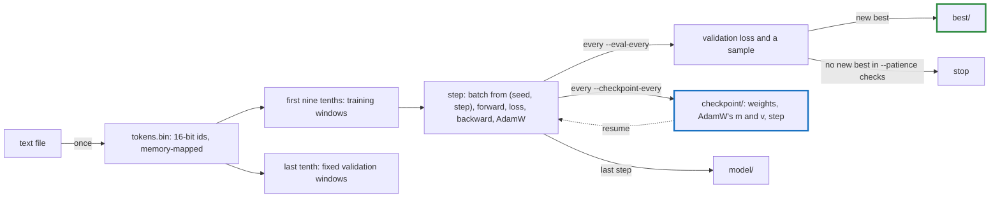

# finetune

Fine-tunes a pretrained GPT-2 on a text file, built on tensomite. A run lives in its own directory, checkpoints as it goes, resumes where it stopped, and exports a model `apps/server` serves.

```sh
scripts/fetch_gpt2.sh                                    # GPT-2 small; `medium`, `large` or `xl` for larger
ops br finetune                                          # builds bin/release/finetune
bin/release/finetune --out runs/mine --data my-text.txt --device metal --steps 2000 --patience 5
bin/release/finetune --out runs/mine --device metal      # after an interruption: resumes
bin/release/server --model runs/mine/best                # serves the best weights
```

`ops run-finetune ARGS` builds and runs it in one step. `--device` picks `cpu`, `blas` (the default), `metal` on Apple Silicon, or `cuda` in a build with `-Dcuda`.

## A run



The run directory holds:

File or directory         |What it is                                                                                                         
--------------------------|-------------------------------------------------------------------------------------------------------------------
`settings.json`           |every setting, written by the first run; a resumed run reads it, and only `--device` and `--checkpoint-every` apply
`tokens.bin`, `split.json`|the text, tokenised once, and where its validation tenth begins                                                    
`checkpoint/`             |the weights, AdamW's state and the progress: step, best validation loss, checks since the best                     
`best/`                   |the weights at the best validation loss, with the tokeniser and config: a model directory                          
`model/`                  |the weights at the end, the same way                                                                               
`log.txt`                 |the lines printed, appended across resumes                                                                         

## Resuming exactly

A checkpoint holds the weights, AdamW's `m` and `v`, and the step. The rest of what decides the next step is already fixed. The batch of step *n* comes from a generator seeded with the run's seed and *n*, and so does its dropout, so no generator state needs saving. The learning rate is a function of the step and the settings. The text is the saved `tokens.bin`, not the text file, which may since have changed. So on one device, a run resumed from a checkpoint takes the same steps, to the bit, as one that never stopped; the specs check this. Each checkpoint is written to `checkpoint.new/` and then swapped in, so an interruption leaves one whole checkpoint.

## Settings

Option                          |Default         |Meaning                                                                                
--------------------------------|----------------|---------------------------------------------------------------------------------------
`--model`                       |`models/gpt2`   |the pretrained GPT-2; its heads come from its `config.json`                            
`--data`                        |Tiny Shakespeare|the text to fine-tune on                                                               
`--batch`, `--context`          |8, 256          |sequences per step, and tokens per sequence                                            
`--steps`                       |1000            |training steps                                                                         
`--lr`, `--min-lr`, `--warmup`  |1e-4, 1e-5, 50  |a linear warm-up to the peak, then a cosine decay to the minimum                       
`--weight-decay`                |0.01            |AdamW's pull of the weights towards zero                                               
`--dropout`                     |0.1             |the share of activations zeroed at each training step, as GPT-2 was trained; 0 for none
`--eval-every`, `--eval-batches`|100, 8          |steps between validations, and batches in each                                         
`--patience`                    |0               |validations without a new best before stopping; 0 never stops early                    
`--prompt`                      |a newline       |what each validation's sample continues                                                

**How long a run takes.** GPT-2 small at batch 8 × 256 trains at about 5,000 tokens/s on a GB10 and 2,700 on an M5 Pro, so a night is roughly 150M and 75M tokens. A small text is seen many times over: Tiny Shakespeare's 300K tokens would pass about 1,200 times in a night on the GB10. Set `--patience` so the run stops when validation stops improving, rather than memorising the text. On Tiny Shakespeare with GPT-2 small, the best validation loss came at step 200 without dropout and at step 500 with 0.1, which also kept validation loss nearly level for hundreds of steps after its best.

## Fine-tuning on code

`scripts/make_code_corpus.sh` writes the Crystal standard library's source, by default from the installed compiler, as one text: 1,646 files and 9.1 MB, or 4.1M GPT-2 tokens. Each file follows a `# File: path` line, in an order shuffled by a checksum of its path, so the validation tenth is whole files from every part of the library. `bench/code_eval.cr` then compares models on methods from those held-out files.

```sh
scripts/make_code_corpus.sh                              # data/crystal/input.txt
bin/release/finetune --out runs/crystal --data data/crystal/input.txt --device cuda \
  --batch 4 --context 512 --steps 6000 --eval-every 250 --patience 4 --prompt "  def "
crystal run --release -Dcuda bench/code_eval.cr -- --run runs/crystal --device cuda --verbose
```

The run uses the same 2,048 tokens a step as the default, but in windows of 512, since the evaluation's prompts and bodies run to 512 positions. 6,000 steps is about 3.3 passes over the training text.

For each method, the evaluation shows a model the file up to the `def` line, at most 320 tokens of it, and asks for a greedy completion of at most 192 tokens. It reports five things:

- **body loss:** the loss of the real body;
- **closes:** whether the completion reached an `end` at the `def`'s indent;
- **parses:** whether the file, with the completion in place, is valid Crystal according to `crystal tool format`;
- **first line:** whether the completion's first line matches the real one;
- **exact:** whether the whole completion matches the real body.

It doesn't check types: the compiler checks only the methods a program calls, so a type check of the file would pass any body. On 8 methods, GPT-2 small closes 1 and parses 1, with a body loss of 2.19; most of its completions repeat a comment until they run out of tokens.

## Specs

```sh
crystal spec apps/finetune/spec
```

They train the tiny GPT-2 of `spec/fixtures/tiny_gpt2` on the CPU on a generated text: the corpus file, the learning-rate schedule, batches drawn from the seed and step alone, a resumed run equal bit for bit to an uninterrupted one, the loss falling, and the best weights kept and exported with early stopping.
