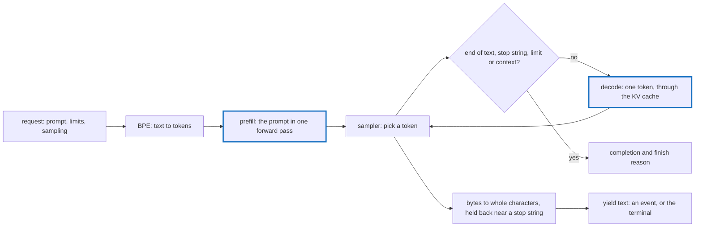

# server

An inference server for GPT-2 models, built on tensomite: OpenAI-style text completions over HTTP, streamed or whole, and the same engine in the terminal.

```sh
scripts/fetch_gpt2.sh models/gpt2                       # GPT-2 small, once
ops br server                                           # builds bin/release/server
bin/release/server --model models/gpt2                  # serves on http://127.0.0.1:8080
bin/release/server generate --model models/gpt2 "Once upon a time" --max-tokens 40 --temperature 0.8
```

`ops run-server ARGS` builds and runs it in one step, and `ops run-debug-server ARGS` does the same with a debug build in `bin/debug/`. Without `ops`, `SHARDS_BIN_PATH=bin/release shards build --release server` builds the same binary. For CUDA, add `-Dcuda` to the build, as in `shards build --release -Dcuda server`.

`--device` picks `cpu`, `blas` (the default), `metal` on Apple Silicon, or `cuda` in a build with `-Dcuda`. `--heads` gives the attention heads, 12 for GPT-2 small. Any directory holding `model.safetensors`, `vocab.json` and `merges.txt` works, including a GPT-2 tensomite has fine-tuned and saved.

## How a request runs



`Server::Engine` holds the model and tokeniser and runs one request at a time; `Server::Handler` turns HTTP requests into engine calls; `server.cr` parses the command line. `generate` calls the engine directly, without HTTP.

## HTTP API

`GET /health` answers `{"status": "ok", "model": "gpt2"}`, the model named after its directory.

`POST /v1/completions` takes JSON:

Field        |Type                     |Default|Meaning                                                      
-------------|-------------------------|-------|-------------------------------------------------------------
`prompt`     |string                   |       |the text to continue; required                               
`max_tokens` |integer                  |16     |tokens to write at most, cut to what the context has room for
`temperature`|number                   |1      |0 picks the likeliest token every time                       
`top_k`      |integer                  |0      |sample among the k likeliest tokens; 0 for all               
`stop`       |string or up to 4 strings|none   |end before the first of these, which is not returned         
`seed`       |integer                  |0      |the same seed gives the same text                            
`stream`     |boolean                  |false  |send server-sent events as text is written                   

```sh
curl -s localhost:8080/v1/completions -H 'Content-Type: application/json' \
  -d '{"prompt": "The meaning of life is", "max_tokens": 20, "temperature": 0}'
```

```json
{"id": "cmpl-1", "object": "text_completion", "created": 1793729048, "model": "gpt2",
 "choices": [{"text": " not the same as the meaning of death.\n\nThe meaning of life is not the same as", "index": 0, "finish_reason": "length"}],
 "usage": {"prompt_tokens": 5, "completion_tokens": 20, "total_tokens": 25}}
```

With `"stream": true` the answer is `text/event-stream`: one `data:` event per piece of text, each a `text_completion` with `finish_reason` null, then one with empty text and the finish reason, then `data: [DONE]`. `finish_reason` is `stop` after the end-of-text token or a stop string, and `length` at the token limit or the end of the context. A malformed request gets status 400 and an unknown path 404, each with `{"error": {"message": …}}`.

## Specs

```sh
crystal spec apps/server/spec
```

They run the tiny GPT-2 of `spec/fixtures/tiny_gpt2` on the CPU, so they need no download: completions against the model's own greedy tokens, streaming, stop strings, the end-of-text token, the context limit, and the HTTP API on a local port.
