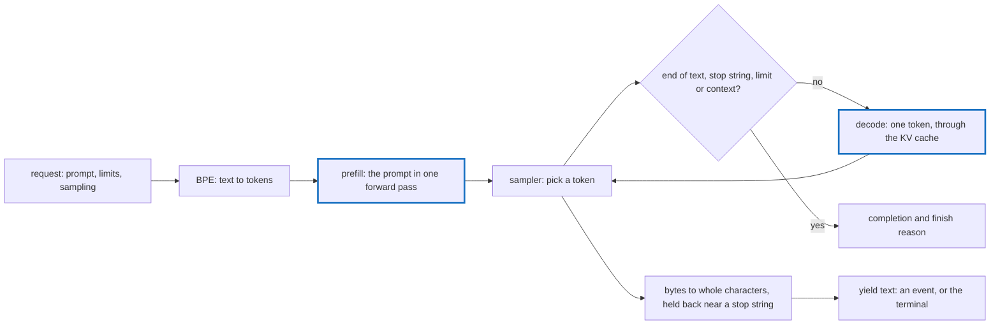

# server

An inference server for GPT-2 and Llama-family models, built on tensomite: OpenAI-style text completions and chats over HTTP, streamed or whole, and the same engine in the terminal.

```sh
scripts/fetch_gpt2.sh models/gpt2                       # GPT-2 small, once
ops br server                                           # builds bin/release/server
bin/release/server --model models/gpt2                  # serves on http://127.0.0.1:8080
bin/release/server generate --model models/gpt2 "Once upon a time" --max-tokens 40 --temperature 0.8

scripts/fetch_smollm2.sh                                # SmolLM2-135M-Instruct, once
bin/release/server chat --model models/smollm2-135m-instruct --temperature 0
```

`ops run-server ARGS` builds and runs it in one step, and `ops run-debug-server ARGS` does the same with a debug build in `bin/debug/`. Without `ops`, `SHARDS_BIN_PATH=bin/release shards build --release server` builds the same binary. For CUDA, add `-Dcuda` to the build, as in `shards build --release -Dcuda server`.

`--device` picks `cpu`, `blas` (the default), `metal` on Apple Silicon, or `cuda` in a build with `-Dcuda`. The attention heads come from `n_head` in the model's `config.json`, or `--heads`; 12 without either, as in GPT-2 small. `scripts/fetch_gpt2.sh medium` (or `large`, `xl`) downloads a larger GPT-2 into `models/gpt2-medium`. Any directory holding `model.safetensors`, `vocab.json` and `merges.txt` works, including a GPT-2 tensomite has fine-tuned and saved. A directory whose `config.json` has `"model_type": "llama"` holds a Llama-family model instead, with `model.safetensors` and `tokenizer.json`, as Hugging Face publishes them; its weights may be `BF16`.

## How a request runs



`Server::Engine` holds the model and tokeniser and runs one request at a time; `Server::Handler` turns HTTP requests into engine calls; `server.cr` parses the command line. `generate` calls the engine directly, without HTTP.

## HTTP API

`GET /health` answers `{"status": "ok", "model": "gpt2"}`, the model named after its directory.

`POST /v1/completions` takes JSON:

Field        |Type                     |Default|Meaning                                                      
-------------|-------------------------|-------|-------------------------------------------------------------
`prompt`     |string                   |       |the text to continue; required                               
`max_tokens` |integer                  |16     |tokens to write at most, cut to what the context has room for
`temperature`|number                   |1      |0 picks the likeliest token every time                       
`top_k`      |integer                  |0      |sample among the k likeliest tokens; 0 for all               
`stop`       |string or up to 4 strings|none   |end before the first of these, which is not returned         
`seed`       |integer                  |0      |the same seed gives the same text                            
`stream`     |boolean                  |false  |send server-sent events as text is written                   

```sh
curl -s localhost:8080/v1/completions -H 'Content-Type: application/json' \
  -d '{"prompt": "The meaning of life is", "max_tokens": 20, "temperature": 0}'
```

```json
{"id": "cmpl-1", "object": "text_completion", "created": 1793729048, "model": "gpt2",
 "choices": [{"text": " not the same as the meaning of death.\n\nThe meaning of life is not the same as", "index": 0, "finish_reason": "length"}],
 "usage": {"prompt_tokens": 5, "completion_tokens": 20, "total_tokens": 25}}
```

With `"stream": true` the answer is `text/event-stream`: one `data:` event per piece of text, each a `text_completion` with `finish_reason` null, then one with empty text and the finish reason, then `data: [DONE]`. `finish_reason` is `stop` after the end-of-text token or a stop string, and `length` at the token limit or the end of the context. A malformed request gets status 400 and an unknown path 404, each with `{"error": {"message": …}}`.

## Chat

A model whose tokeniser has ChatML's tokens, `<|im_start|>` and `<|im_end|>`, can chat, as SmolLM2-135M-Instruct does. The engine renders the messages in ChatML, then starts the assistant's turn:

```text
<|im_start|>system
You are a helpful AI assistant named SmolLM, trained by Hugging Face<|im_end|>
<|im_start|>user
What is the capital of France?<|im_end|>
<|im_start|>assistant
```

- **The system message** comes first. When a chat has none, the engine uses the default from the chat template in `tokenizer_config.json`, if the template has one, or `--system TEXT`.
- **Roles and contents are encoded as plain text,** so a message holding `<|im_end|>` cannot end its turn early or forge another.
- **The reply ends** at `<|im_end|>`, `<|endoftext|>` or the model's `eos_token_id`, none of which is returned.

`server chat` does the same in the terminal: each line is a message, the reply streams after it, and the conversation is kept until the end of input.

```text
> What is the capital of France?
The capital of France is Paris.
> And of Italy?
The capital of Italy is Rome.
```

`POST /v1/chat/completions` takes `messages`, each with a `role` of `system`, `user` or `assistant` and a string `content`, in place of `prompt`. It takes the same options as completions, but with `max_tokens` 512 unless given. It answers with a `chat.completion`, whose choice holds `message: {role: "assistant", content: …}`. Streamed, it sends `chat.completion.chunk` events whose choices hold a `delta`: the first names the role, and the last is empty and carries the finish reason. A model that cannot chat answers 400.

```sh
curl -s localhost:8080/v1/chat/completions -H 'Content-Type: application/json' \
  -d '{"messages": [{"role": "user", "content": "Say hi."}], "temperature": 0}'
```

## Specs

```sh
crystal spec apps/server/spec
```

They run the tiny GPT-2 of `spec/fixtures/tiny_gpt2` and the tiny Llama of `spec/fixtures/tiny_llama` on the CPU, so they need no download. They cover completions against the model's own greedy tokens, streaming, stop strings, the end-of-text token, the context limit, ChatML as Hugging Face's tokeniser encodes it, chats, and the HTTP API on a local port.
