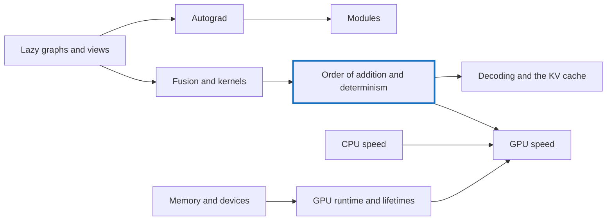

# Understanding FAQ

The questions labelled Q-A, Q-B and so on that came up while building tensomite, each in its own page with an answer, an analogy, a worked example and a diagram. They are grouped by theme rather than by the order they were asked.

**How to read a page.** Each opens with the question and a hint. The answer sits in a folded section: try the question first, then open it. Pages within a theme build on each other's examples, so reading a theme in order pays off.

## Order of addition and determinism

One running example threads through this theme: three float32 numbers, `1`, `1e8` and `−1e8`, whose sum depends on the order they are added in.

Question                           |In one line                                                                                                                      
-----------------------------------|---------------------------------------------------------------------------------------------------------------------------------
[Q-H](q-h-tile-order.md)           |Does the order of tiles matter to online softmax? Not to the maths, but to the last bits.                                        
[Q-AG](q-ag-fused-multiply-add.md) |Why does a more accurate fused multiply-add break bit-matching? Because the oracle rounds twice.                                 
[Q-S](q-s-fused-gelu.md)           |Why can a fused CPU `gelu` match bit for bit, but Metal's not? `tanh` comes from a different maths library.                      
[Q-I](q-i-exact-prefill-decode.md) |Why test prefill against decode exactly, not with a tolerance? Same device, same operations, same order: any difference is a bug.
[Q-R](q-r-split-depends-on-k.md)   |Why must split-K's split depend only on `k`? So that a row is summed the same way whatever the batch.                            
[Q-Z](q-z-modules-match-exactly.md)|Why should a refactor match exactly rather than roughly? Same operations, same order, same draws.                                
[Q-AR](q-ar-splitting-a-sum.md)    |Why not split one long sum across 32 threads? It regroups the additions, and the bits change.                                    
[Q-AT](q-at-chunk-sums.md)         |Why write every chunk sum rather than one per run? Adding a run first regroups the sum, as in Q-AR.                              

## Lazy graphs and views

The running example: `a = [[1, 2, 3], [4, 5, 6]]` and a bias `b = [10, 20, 30]`, added as `a + b`.

Question                      |In one line                                                                                                  
------------------------------|-------------------------------------------------------------------------------------------------------------
[Q-A](q-a-lazy-errors.md)     |Why does an error in a lazy graph surface far from its cause? Building and running happen at different times.
[Q-K](q-k-stride-zero.md)     |What does a stride of 0 mean? Move nowhere: every row reads the same storage, so broadcasting copies nothing.
[Q-J](q-j-reduce-axis-last.md)|Why does `sum(axis)` move the summed axis to the end? So each output's inputs are one run of neighbours.     
[Q-L](q-l-cat-slice-views.md) |Why does `Cat` write through slice views? A slice is a view, so writing is just a copy through two views.    
[Q-M](q-m-max-start.md)       |Why does `max` start from the first element? Zero is not neutral for maximum; all-negative rows would give 0.

## Memory and devices

The running example: the bias `b = [10, 20, 30]` from the previous theme, followed onto each kind of device.

Question                                         |In one line                                                                                                                                 
-------------------------------------------------|--------------------------------------------------------------------------------------------------------------------------------------------
[Q-B](q-b-unified-as-special-case.md)            |Why is unified memory a special case of discrete? Code that always copies works on both; code that reads directly breaks on discrete.       
[Q-AE](q-ae-mapped-memory-on-a-discrete-card.md) |Why can device-local, host-visible memory fail on a discrete card? On a card it is a small window, and allocations past it cannot be mapped.
[Q-AF](q-af-compute-and-graphics-capabilities.md)|Why does Vulkan need the `graphics` capability? Its driver is in the graphics library, which a container gets only from the host.           
[Q-AJ](q-aj-host-copy-after-upload.md)           |Why may a host copy stay valid after an upload? It equals the GPU's memory until something writes that memory.                              

## Fusion and kernels

Two running examples: GPT-2's `gelu` on a `[1024, 3072]` activation, and the softmax row `[1, 2, 3, 4]`.

Question                        |In one line                                                                                                           
--------------------------------|----------------------------------------------------------------------------------------------------------------------
[Q-D](q-d-spir-v-writer.md)     |Why would a SPIR-V writer need no compiler? It writes the bytecode itself; the driver always does the rest.           
[Q-E](q-e-matmul-fusion.md)     |Why is matmul not fused like elementwise ops? It reuses every input many times, so tiling rules; only its edges fuse. 
[Q-F](q-f-epilogue-fusion.md)   |Which ops ride along at the end of a matmul? Those that need only their own element; not softmax or layernorm.        
[Q-G](q-g-online-softmax.md)    |How can softmax work a tile at a time? Rescale the running sum by `exp(m − m')` when the maximum grows.               
[Q-T](q-t-softmax-two-passes.md)|Why can softmax's `exp` pass vectorise and keep the bits? The `exp`s are independent; only the sum must stay in order.

## CPU speed

The running example: a 512 × 512 matmul, measured one change at a time.

Question                                 |In one line                                                                                                                                            
-----------------------------------------|-------------------------------------------------------------------------------------------------------------------------------------------------------
[Q-N](q-n-where-blas-speed-comes-from.md)|Why does a naive matmul lose to BLAS by thousands of times? Several factors of 5 to 20, multiplied: bookkeeping, loop order, reuse, wider instructions.
[Q-O](q-o-which-loop-vectorises.md)      |Why does `c[j] += …` vectorise when `acc += …` cannot? Independent outputs can run side by side; one running sum cannot without regrouping.            

## Autograd

The running example: the bias `b = [10, 20, 30]` again, in `loss = ((a + b) · w).sum`.

Question                                |In one line                                                                                             
----------------------------------------|--------------------------------------------------------------------------------------------------------
[Q-Q](q-q-gradient-of-a-broadcast.md)   |What is a broadcast tensor's gradient? The sum over every place it was copied to: `[5, 7, 9]`.          
[Q-W](q-w-gradient-node-of-an-expand.md)|What does that gradient look like in the graph? An `Unview` node, the one backward rule all views share.

## Modules

The running example: one transformer block of the tiny GPT-2, by its parameter names, from `h.0.ln_1.weight` to `h.0.mlp.c_proj.bias`.

Question                               |In one line                                                                                                              
---------------------------------------|-------------------------------------------------------------------------------------------------------------------------
[Q-Y](q-y-decay-by-parameter.md)       |How do named parameters simplify AdamW's split? A rule replaces a list; tensomite puts a `decay?` flag on each parameter.
[Q-AA](q-aa-what-a-macro-buys.md)      |What would a `parts` macro buy over a builder? A shorter call, at the cost of worse errors and lint exclusions.          
[Q-AB](q-ab-instance-variable-types.md)|Why must the builder be an argument? Instance variable types come from declarations, before any local exists.            
[Q-AC](q-ac-stored-attention-mask.md)  |Why does GPT-2's file hold `attn.bias`? PyTorch saves buffers, and the causal mask is one.                               

## GPU runtime and lifetimes

Two running examples: the bias `b`'s buffer on its way back to the pool, and CUDA's first probe, which squares a million floats.

Question                             |In one line                                                                                                              
-------------------------------------|-------------------------------------------------------------------------------------------------------------------------
[Q-U](q-u-finalizer-and-lock.md)     |Why can't a finalizer wait for a lock? The thread holding it may be its own, two frames up.                              
[Q-V](q-v-encoded-is-not-executed.md)|When is reusing a buffer unsafe on Metal but not the CPU? When its consumer is encoded but not yet run.                  
[Q-AH](q-ah-v2-symbols.md)           |Why does `libcuda` export both `cuMemAlloc` and `cuMemAlloc_v2`? Old binaries keep their old names; new code wants `_v2`.
[Q-AI](q-ai-asynchronous-errors.md)  |Why did a bad launch fail at the copy? A launch only queues; the next wait reports the fault.                            
[Q-AK](q-ak-emulating-barriers.md)   |Why can't the emulator loop over every kernel's threads? Threads that share memory across a barrier must run together.   

## GPU speed

Two running examples: GPT-2's decode products, `qkv [768, 2304]` beside the transposed head; and the Metal training profile, with `Unview [192]`.

Question                                   |In one line                                                                                                                
-------------------------------------------|---------------------------------------------------------------------------------------------------------------------------
[Q-X](q-x-patch-per-thread.md)             |Why does a 4 × 4 patch per thread cut reads? Each loaded value is used 4 times: 8 loads for 16 multiply-adds.              
[Q-AL](q-al-storing-the-head-transposed.md)|What if the head's weights were stored transposed? The head would read well, and the embedding lookup badly.               
[Q-AM](q-am-which-gains-from-two-passes.md)|Which decode products gain from two passes? The head, whose reads were strided; not those already side by side.            
[Q-AN](q-an-which-way-the-weights-run.md)  |What makes the head's reads slow? 32 threads read 32 rows 3 KB apart, not one row.                                         
[Q-AP](q-ap-narrower-blocks.md)            |Why did narrower blocks hurt mlp in but not mlp out? More blocks help only a product short of them; shorter reads hurt all.
[Q-AQ](q-aq-predicting-the-profile.md)     |Where would Metal's 59 ms go? One slow kernel, matmuls spread wide, and the GPU waiting on the host.                       
[Q-AS](q-as-loading-ahead.md)              |How can loading ahead help if no addition happens sooner? The time was waiting for memory, not adding.                     

## Decoding and the KV cache

The running example: decoding GPT-2 small's 80th token, with a cache of capacity 1,024.

Question                              |In one line                                                                                                           
--------------------------------------|----------------------------------------------------------------------------------------------------------------------
[Q-AD](q-ad-cache-written-in-place.md)|What does a cache written in place save? A fixed 72 KB a token, where `cat` copied everything, about 6 MB at token 80.
[Q-AO](q-ao-the-empty-slots.md)       |How does attention avoid the empty slots? It reads a slice of the filled positions; the rest are never touched.       

Q-C and Q-P were labels on a decision and a list, not questions, so they have no page.
