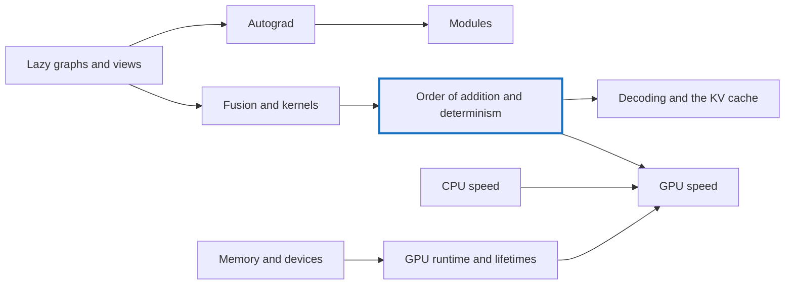

# Understanding FAQ

The questions labelled Q-A, Q-B and so on that came up while building tensomite, each in its own page with an answer, an analogy, a worked example and a diagram. They are grouped by theme rather than by the order they were asked.

**How to read a page.** Each opens with the question and a hint. The answer sits in a folded section: try the question first, then open it. Pages within a theme build on each other's examples, so reading a theme in order pays off.

## Order of addition and determinism

One running example threads through this theme: three float32 numbers, `1`, `1e8` and `−1e8`, whose sum depends on the order they are added in.

Question                           |In one line                                                                                                                      
-----------------------------------|---------------------------------------------------------------------------------------------------------------------------------
[Q-H](q-h-tile-order.md)           |Does the order of tiles matter to online softmax? Not to the maths, but to the last bits.                                        
[Q-AG](q-ag-fused-multiply-add.md) |Why does a more accurate fused multiply-add break bit-matching? Because the oracle rounds twice.                                 
[Q-S](q-s-fused-gelu.md)           |Why can a fused CPU `gelu` match bit for bit, but Metal's not? `tanh` comes from a different maths library.                      
[Q-I](q-i-exact-prefill-decode.md) |Why test prefill against decode exactly, not with a tolerance? Same device, same operations, same order: any difference is a bug.
[Q-R](q-r-split-depends-on-k.md)   |Why must split-K's split depend only on `k`? So that a row is summed the same way whatever the batch.                            
[Q-Z](q-z-modules-match-exactly.md)|Why should a refactor match exactly rather than roughly? Same operations, same order, same draws.                                
[Q-AR](q-ar-splitting-a-sum.md)    |Why not split one long sum across 32 threads? It regroups the additions, and the bits change.                                    
[Q-AT](q-at-chunk-sums.md)         |Why write every chunk sum rather than one per run? Adding a run first regroups the sum, as in Q-AR.                              

## Lazy graphs and views

The running example: `a = [[1, 2, 3], [4, 5, 6]]` and a bias `b = [10, 20, 30]`, added as `a + b`.

Question                      |In one line                                                                                                  
------------------------------|-------------------------------------------------------------------------------------------------------------
[Q-A](q-a-lazy-errors.md)     |Why does an error in a lazy graph surface far from its cause? Building and running happen at different times.
[Q-K](q-k-stride-zero.md)     |What does a stride of 0 mean? Move nowhere: every row reads the same storage, so broadcasting copies nothing.
[Q-J](q-j-reduce-axis-last.md)|Why does `sum(axis)` move the summed axis to the end? So each output's inputs are one run of neighbours.     
[Q-L](q-l-cat-slice-views.md) |Why does `Cat` write through slice views? A slice is a view, so writing is just a copy through two views.    
[Q-M](q-m-max-start.md)       |Why does `max` start from the first element? Zero is not neutral for maximum; all-negative rows would give 0.

## Memory and devices

The running example: the bias `b = [10, 20, 30]` from the previous theme, followed onto each kind of device.

Question                                         |In one line                                                                                                                                 
-------------------------------------------------|--------------------------------------------------------------------------------------------------------------------------------------------
[Q-B](q-b-unified-as-special-case.md)            |Why is unified memory a special case of discrete? Code that always copies works on both; code that reads directly breaks on discrete.       
[Q-AE](q-ae-mapped-memory-on-a-discrete-card.md) |Why can device-local, host-visible memory fail on a discrete card? On a card it is a small window, and allocations past it cannot be mapped.
[Q-AF](q-af-compute-and-graphics-capabilities.md)|Why does Vulkan need the `graphics` capability? Its driver is in the graphics library, which a container gets only from the host.           
[Q-AJ](q-aj-host-copy-after-upload.md)           |Why may a host copy stay valid after an upload? It equals the GPU's memory until something writes that memory.                              

## Themes to come

Theme                    |Questions                              
-------------------------|---------------------------------------
Fusion and kernels       |Q-D, Q-E, Q-F, Q-G, Q-T                
CPU speed                |Q-N, Q-O                               
Autograd                 |Q-Q, Q-W                               
Modules                  |Q-Y, Q-AA, Q-AB, Q-AC                  
GPU runtime and lifetimes|Q-U, Q-V, Q-AH, Q-AI, Q-AK             
GPU speed                |Q-X, Q-AL, Q-AM, Q-AN, Q-AP, Q-AQ, Q-AS
Decoding and the KV cache|Q-AD, Q-AO                             

Q-C and Q-P were labels on a decision and a list, not questions, so they have no page.
