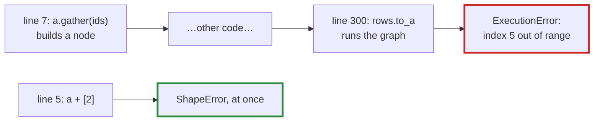

# Q-A: Why does an error in a lazy graph surface far from its cause?

*[Lazy graphs and views](README.md#lazy-graphs-and-views) · first in the theme · next: [Q-K](q-k-stride-zero.md)*

## The question

In tensomite, `a + b` does no arithmetic: it records a node in a graph, and the work happens at `realize` or `to_a` (Decision E). That makes autograd, fusion and buffer reuse possible, but costs something in debugging. Why does an error in a lazy graph surface far from the line of code that caused it, and what would you want in an error message to make up for it?

> **Hint:** an error needs two things: the code that asked for something impossible, and the moment the impossibility is discovered. When does each happen?

<details>
<summary><strong>Answer</strong></summary>

### In short

The line that builds a node and the moment it runs are different times, often different places in the program. An error discovered while running, such as an id out of range in a lookup, is raised at `realize`, perhaps hundreds of lines and many function calls after the bad node was built. To make up for it, the message should say which node failed in terms the programmer recognises: the op, its shapes, and where in the model it was built.

Tensomite narrows the gap two ways. Errors that depend only on shapes, such as adding `[2, 3]` to `[4]`, are checked when the op is written, before anything runs. Only errors that depend on the data, which the graph cannot know until it runs, wait for `realize`.

### An analogy

Writing a recipe now and cooking it next week. A recipe asking for a fourth egg when the box holds three is caught on the shopping list (a shape check). An egg that turns out to be bad is found only when you crack it, on cooking day, and the recipe step that called for it is long out of mind.

### Worked example

The running example for this theme is `a = [[1, 2, 3], [4, 5, 6]]` and a bias `b = [10, 20, 30]`.

```crystal
a = Tensor.from([1, 2, 3, 4, 5, 6].map(&.to_f32), [2, 3])
b = Tensor.from([10, 20, 30].map(&.to_f32), [3])
c = a + b                        # a node; nothing computed yet
a + Tensor.from([1f32, 2f32], [2])  # ShapeError at once: [2, 3] and [2] do not broadcast

rows = a.gather(Tensor.from([0, 5], [2]))  # a node; row 5 does not exist, but nobody knows yet
# ... much later ...
rows.to_a(Float32)               # ExecutionError: index 5 out of range for 2 rows
```



### Where it shows up in tensomite

`ShapeError` and `DTypeError` are raised when an op is called; `ExecutionError` is the one error raised at `realize` (see "Errors" in `GUIDE.md`). On a GPU it surfaces even later, when the command buffer completes, since a kernel cannot raise. Scopes (`Tensomite.scope("attention") { … }`) and names (`tensor.named("ids")`) record where in a model each node was built, and diagrams show them, which is the "where" half of a good message.

</details>

## See also

- [Q-K](q-k-stride-zero.md): what `a + b` actually builds, without copying `b`.
