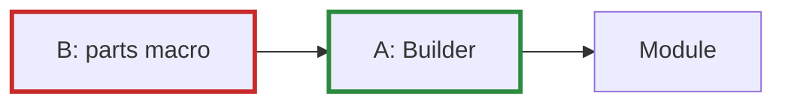

# Q-AA: What would a `parts` macro buy over a builder?

*[Modules](README.md#modules) · previous: [Q-Y](q-y-decay-by-parameter.md) · next: [Q-AB](q-ab-instance-variable-types.md)*

## The question

Two ways to declare a model's parts were tried (Decision AN). **A**, a builder: plain Crystal, `@ln1 = build.layernorm(width)` in a constructor you write. **B**, a `parts` macro on top of A, which writes the constructor and getters for you and lets `forward` say `ln1(x)` instead of `@ln1.call(x)`. Everything B does goes through A. So what does B buy that A cannot, and is it worth its costs?

> **Hint:** list what B writes for you, then list what it costs a reader who makes a mistake.

<strong>Answer</strong>

### In short

Two things: a few lines of constructor and getters written for you, and `ln1(x)` in place of `@ln1.call(x)`. Against that, B's mistakes surface as macro-expansion errors in code the reader never wrote, its part lines trip the linter (`Lint/UselessAssign`), it allows only part assignments inside its block, and it hides the builder as an extra constructor argument. The decision kept A alone: the gain is mostly a shorter call, and the costs land on exactly the moments someone is confused.

This is a judgement, not a fact: the field has gone both ways, Keras's declarative `Sequential` against PyTorch's plain-code `nn.Module`, which won by being ordinary code with conventions.

### An analogy

A form letter generator against writing the letter yourself from a good template. The generator saves typing the greeting; but when a letter comes out wrong, you are debugging the generator, not the letter.

### Worked example

One block, both ways:

Concern         |A, builder                                     |B, `parts` macro                                
----------------|-----------------------------------------------|------------------------------------------------
Declaring parts |`@ln1 = build.layernorm(width)` in `initialize`|`ln1 = layernorm(width)` inside `parts do … end`
Calling a part  |`@ln1.call(x)`                                 |`ln1(x)`                                        
A typo in a part|a compile error on your line                   |a macro-expansion error in generated code       
Linting         |clean                                          |`Lint/UselessAssign` on every part line         
Helper values   |any Crystal                                    |only part assignments                           

### Where it shows up in tensomite

`Builder` is the model DSL (Decision AN); `PLAN.md` records that any macro that returns must pass ameba without suppressing a rule. The tutorial, Shakespeare and GPT-2 models are all written with it.

## See also

- [Q-AB](q-ab-instance-variable-types.md): a Crystal rule that shaped how the builder is passed.
