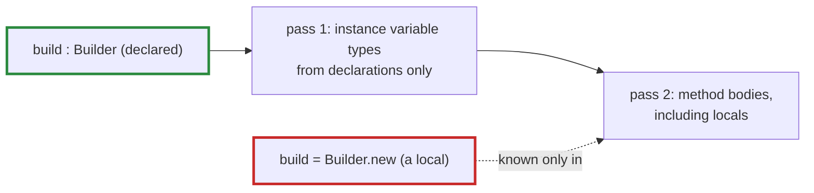

# Q-AB: Why must the builder be an argument rather than a local?

*[Modules](README.md#modules) · previous: [Q-AA](q-aa-what-a-macro-buys.md) · next: [Q-AC](q-ac-stored-attention-mask.md)*

## The question

In a module's constructor, `@ln = build.layernorm(width)` compiles when `build : Builder` is an argument, but not when `build = Builder.new(...)` is a local inside `initialize`. Why?

> **Hint:** Crystal works out every instance variable's type before it type-checks any method body.

<details>
<summary><strong>Answer</strong></summary>

### In short

Crystal decides each instance variable's type in a first pass over the class, looking only at the right-hand side of each `@x = …` in isolation. It can use what is declared: an argument's type restriction (`build : Builder`) and a method's return type (`Builder#layernorm … : LayerNorm`). So `build.layernorm(width)` is a `LayerNorm` from the declarations alone. A local `build = Builder.new` has a type only once the method body is checked, which comes after, and which needs the instance variables' types first. In the first pass, the local is unknown, so the instance variable cannot be typed.

### An analogy

A seating plan drawn before the guests arrive. A name on the invitation list (a declared argument) can be given a seat. A plus-one who will be introduced at the door (a local, known only once the evening starts) cannot be seated in advance.

### Worked example

```crystal
class A < Tensomite::Module
  def initialize(build : Builder)
    @ln = build.layernorm(4)        # compiles: Builder#layernorm is declared to return LayerNorm
  end
end

class B < Tensomite::Module
  def initialize
    build = Builder.new
    @ln = build.layernorm(4)        # Error: can't infer the type of instance variable '@ln' of B
  end
end
```

Both were compiled to check: A builds, B fails with exactly that error.



### Where it shows up in tensomite

Every model takes its `Builder` as a typed argument, and its other constructor arguments get types too. `CharGPT` keeps a convenience `self.new(…, device, seed)` that makes the builder and passes it on. `Sequential.build(build) do … end` is a class method for a related reason: an instance variable cannot take its type from an instance method that takes a block.

</details>

## See also

- [Q-AC](q-ac-stored-attention-mask.md): loading GPT-2's weights into modules built this way.
