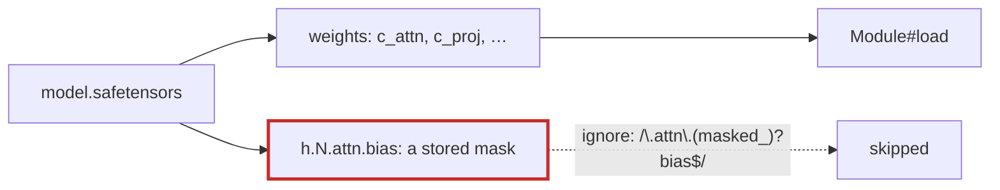

# Q-AC: Why does GPT-2's file contain `h.N.attn.bias`, which is never learned?

*[Modules](README.md#modules) · previous: [Q-AB](q-ab-instance-variable-types.md) · last in the theme*

## The question

Hugging Face's GPT-2 weight file holds a tensor `h.N.attn.bias` in every block. It is not a bias and is never trained: it is the causal mask, a fixed triangle of ones and zeros. Why is it in a file of weights at all?

> **Hint:** think about what PyTorch saves when a module registers a buffer.

<strong>Answer</strong>

### In short

PyTorch modules hold two kinds of tensors: parameters, which are trained, and buffers, which are fixed state the module needs, such as a mask or running statistics. A model's `state_dict`, which is what gets saved, includes buffers unless they are registered as not persistent. Hugging Face's GPT-2 attention registers its causal mask as a buffer called `bias`, so every block's mask is saved alongside the weights, under a misleading name.

### An analogy

Packing a flat for a move and boxing the house rules taped to the fridge along with the furniture. They are not furniture, but they were attached to the kitchen, so the movers took them.

### Worked example

What the file holds for one block, against what tensomite's module needs:

Name in the file                     |Learned?           |Tensomite                                        
-------------------------------------|-------------------|-------------------------------------------------
`h.0.attn.c_attn.weight`, `.bias`    |yes                |loaded into `c_attn`                             
`h.0.attn.c_proj.weight`, `.bias`    |yes                |loaded into `c_proj`                             
`h.0.attn.bias`                      |no: the causal mask|ignored; the mask is made by `Tensor.causal_mask`
`h.0.attn.masked_bias`, in some files|no                 |ignored                                          

### Where it shows up in tensomite

`Module#load(prefix:, ignore:)` (Decision AP) loads by name, using GPT-2's own names (Decision AO), and `GPT2::IGNORED` skips the stored masks. Strict loading still refuses any other mismatch, so a missing or misnamed weight is caught rather than silently left at its initial value.

## See also

- [Q-Y](q-y-decay-by-parameter.md): the same names, used to decide weight decay.
