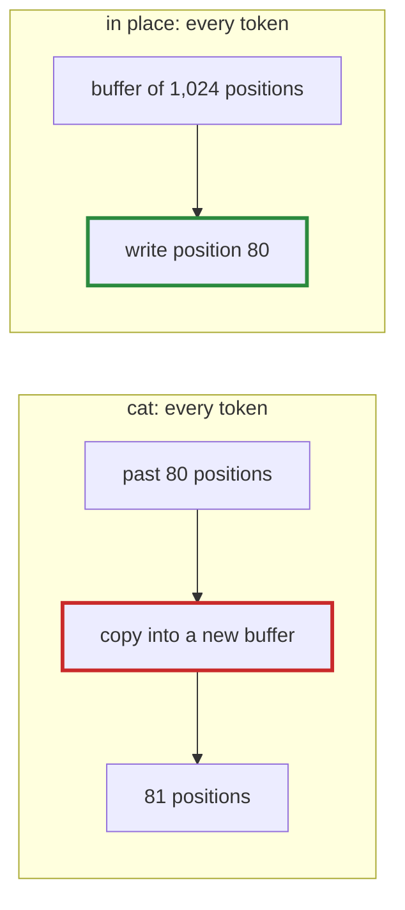

# Q-AD: What does a KV cache written in place save per decoded token?

*[Decoding and the KV cache](README.md#decoding-and-the-kv-cache) · first in the theme · next: [Q-AO](q-ao-the-empty-slots.md)*

## The question

When decoding, each token's attention needs the keys and values of every token before it, so they are kept in a cache. Tensomite's first cache grew with `Tensor.cat`, which copies the whole cache plus the new token's keys and values into a fresh buffer on every decoded token. With a cache preallocated and written in place, what would decoding one token cost instead?

> **Hint:** work out how much `cat` copies at token 80 for one layer, then for token 81.

<strong>Answer</strong>

### In short

Writing in place stores only the new token's keys and values, a fixed amount per token, where `cat` copies everything held so far, an amount that grows with every token. For GPT-2 small, a token's keys and values are 768 floats each per layer: about 72 KB across 12 layers, written once. `cat` at token 80 copies 80 positions' worth, nearly 6 MB, then reads it again; the total over a long generation grows with the square of its length.

### An analogy

Keeping a diary: write today's entry on the next blank page, rather than copying the whole diary into a new notebook every evening and adding the day at the end.

### Worked example

GPT-2 small, decoding token 80 (12 layers, keys and values of 768 floats per position each):

Cache           |Copied for this token                                                                 |Grows with  
----------------|--------------------------------------------------------------------------------------|------------
`cat`           |80 positions × 768 × 2 × 12 layers × 4 bytes ≈ 5.9 MB, written, and about as much read|the position
written in place|1 position: 768 × 2 × 12 × 4 bytes ≈ 72 KB                                            |nothing     

Measured on the GB10 (Decision BB): `Cat` took 0.520 ms of a token, the in-place writes 0.118 ms, and decoding went from 203.6 to 246 tokens/s. The saving was about twice what `Cat` itself cost; I think the copies' 13 MB of traffic a token was also evicting the weights from the GPU's cache, which made the matmuls slower, though that is not measured.

### Where it shows up in tensomite

`CausalSelfAttention::Cache` with a capacity allocates its buffers on the first append (Decision BC: the whole capacity at once) and fills them with `Tensor#write`, the one op that writes into an existing buffer: the scheduler hands it its target's buffer rather than a new one.

## See also

- [Q-AO](q-ao-the-empty-slots.md): what attention does with the slots not yet written.
- [Q-AJ](q-aj-host-copy-after-upload.md): what an in-place write means for a host copy.
