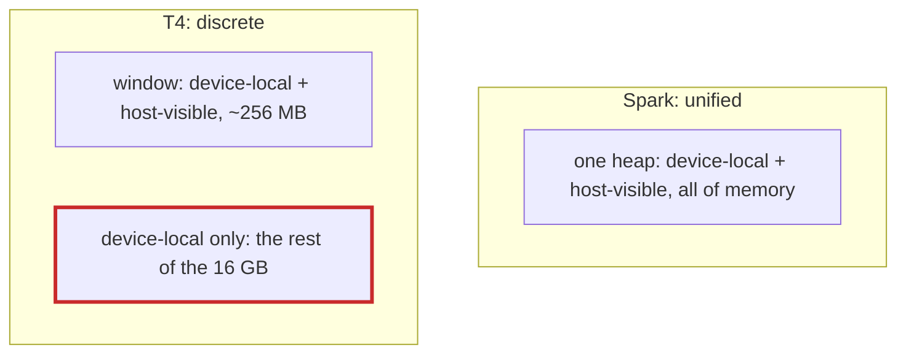

# Q-AE: Why can memory that is both device-local and host-visible still fail on a discrete card?

*[Memory and devices](README.md#memory-and-devices) · previous: [Q-B](q-b-unified-as-special-case.md) · next: [Q-AF](q-af-compute-and-graphics-capabilities.md)*

## The question

Vulkan describes memory by type. On the Spark, whose GPU shares memory with the CPU, a buffer can be "device-local and host-visible": fast for the GPU and readable by the CPU. Code that maps such a buffer and reads it directly works there. Why might the same code give wrong results on a T4, even if the T4 offers a memory type with the same flags?

> **Hint:** how big is that memory type's heap on a discrete card, and what happens when it runs out?

<strong>Answer</strong>

### In short

On a unified GPU the device-local, host-visible heap is all of memory. On a discrete card it is a small window into the card's memory that the CPU can reach across PCIe, typically 256 MB on cards without "resizable BAR", whatever the card's total. Once a program has used it up, allocations land in memory that is device-local only, which the CPU cannot map. Code that assumed every buffer was mappable then fails, or, if it falls back carelessly, reads memory that was never filled. And even within the window, CPU reads across PCIe are slow.

The flags say what a type can do; the heap size says how much of it there is.

### An analogy

A hotel with a small lobby where guests may meet visitors, and many floors of rooms where visitors may not go. In a house the "lobby" is the whole house, so anyone can be met anywhere. In the hotel, plans that assume every guest can be met in the lobby work for the first few guests and then fail.

### Worked example

Machine                              |Device-local and host-visible heap|What happens to a 1 GB model's buffers          
-------------------------------------|----------------------------------|------------------------------------------------
DGX Spark (unified)                  |all shared memory                 |all mappable                                    
A discrete card without resizable BAR|a window of about 256 MB          |the first ~256 MB mappable, the rest device-only

### Where it shows up in tensomite

This was a reason for the plan's rule that "unified memory is an optimisation of the discrete case" ([Q-B](q-b-unified-as-special-case.md)), and for planning a forced-discrete mode, always copying through staging buffers, had Vulkan been built on the Spark. Tensomite chose CUDA for M8 instead (Decision AT), whose device copies explicitly everywhere; Vulkan waits for M12.

## See also

- [Q-AF](q-af-compute-and-graphics-capabilities.md): why Vulkan could not run on the Spark at all.
