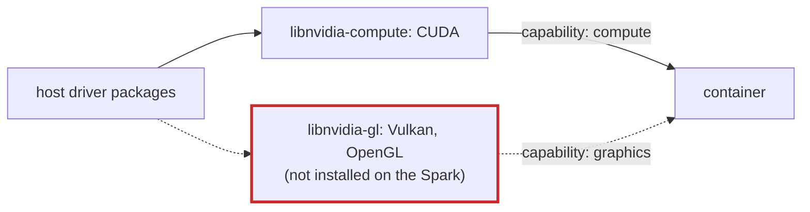

# Q-AF: Why does CUDA work in a container with only the `compute` capability, but Vulkan needs `graphics`?

*[Memory and devices](README.md#memory-and-devices) · previous: [Q-AE](q-ae-mapped-memory-on-a-discrete-card.md) · next: [Q-AJ](q-aj-host-copy-after-upload.md)*

## The question

NVIDIA's container toolkit gives a container access to the GPU, with capabilities chosen by `NVIDIA_DRIVER_CAPABILITIES`. With only `compute`, CUDA works. Vulkan needs `graphics` as well, even for compute shaders that draw nothing. Why?

> **Hint:** the toolkit does not bring its own driver. Which driver library holds each API?

<strong>Answer</strong>

### In short

The toolkit mounts the host's driver libraries into the container, chosen by capability. CUDA lives in `libnvidia-compute`, mounted for `compute`. NVIDIA's Vulkan driver lives in `libnvidia-gl`, with OpenGL, and is mounted for `graphics`. The split follows how NVIDIA packages its driver, not what the program does: a Vulkan compute shader still goes through the graphics library. And a container can only mount what the host has: on the Spark, whose compute-only driver leaves out `libnvidia-gl`, no capability would give a container Vulkan.

### An analogy

A building's master key ring, from which the caretaker lends keys by role. "Compute" gets the lab keys; "graphics" gets the studio keys. The kiln you need happens to sit in the studio, so a potter with only lab keys cannot reach it, however unartistic the job. And the caretaker cannot lend a key the building never had.

### Worked example

API   |Host package                  |Capability that mounts it|On the Spark                                     
------|------------------------------|-------------------------|-------------------------------------------------
CUDA  |`libnvidia-compute-595-server`|`compute`                |installed: vLLM and tensomite's CUDA device work 
Vulkan|`libnvidia-gl-595-server`     |`graphics`               |not installed: no Vulkan, in or out of containers

### Where it shows up in tensomite

This settled Decision AT: rather than add the driver's graphics part to a headless server, M8 became a CUDA device, which needs only what the Spark already had, and Vulkan moved to M12 (Decision BA).

## See also

- [Q-AJ](q-aj-host-copy-after-upload.md): how the CUDA device keeps its copies in step.
