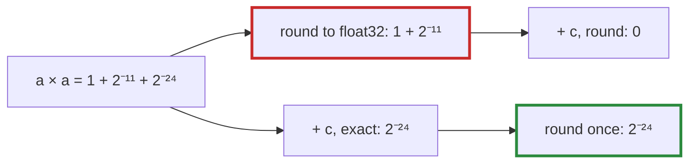

# Q-AG: Why does a more accurate fused multiply-add break bit-matching?

*[Order of addition and determinism](README.md#order-of-addition-and-determinism) · previous: [Q-H](q-h-tile-order.md) · next: [Q-S](q-s-fused-gelu.md)*

## The question

NVIDIA's compilers turn `a * b + c` into one fused multiply-add (FMA) by default, which rounds once instead of twice and so is more accurate. Why might a CUDA kernel compiled that way give results that differ from the CPU?

> **Hint:** what does the CPU oracle compute, step by step?

<strong>Answer</strong>

### In short

The CPU computes `a × b`, rounds it to float32, adds `c` and rounds again. An FMA keeps `a × b` exact and rounds once at the end. Two roundings and one rounding give different answers whenever the first rounding threw something away. Being closer to the true value is still being different, and the oracle is the bits the CPU produces, not the true value.

### An analogy

The cashier from [Q-H](q-h-tile-order.md) rounds after every line. A second cashier keeps the exact total in their head and rounds only at the end. The second is more accurate, and for that very reason sometimes disagrees with the first by a cent.

### Worked example

Take `a = 1.000244140625` (that is `1 + 2⁻¹²`) and `c = −1.00048828125` (`−(1 + 2⁻¹¹)`), both exact in float32, and compute `a × a + c`.

Step   |CPU, two roundings                                                                  |FMA, one rounding            
-------|------------------------------------------------------------------------------------|-----------------------------
`a × a`|exactly `1 + 2⁻¹¹ + 2⁻²⁴`, rounded to `1 + 2⁻¹¹`: float32 has no room for the `2⁻²⁴`|kept exact: `1 + 2⁻¹¹ + 2⁻²⁴`
`+ c`  |`0`                                                                                 |`2⁻²⁴ ≈ 5.96 × 10⁻⁸`         

The exact answer is `2⁻²⁴`. The FMA is right, the CPU is wrong, and they differ.

### Where it shows up in tensomite

CUDA kernels are compiled with `--fmad=false`, and Metal's with fast maths off, so a multiply and an add stay two roundings, as on the CPU. The matmul kernels go further, writing the product and the sum as separate statements. `spec/cuda_spec.cr` compiles a small `a * b + c` kernel the same way and checks that its PTX has a separate `mul` and `add`, and no `fma`.

## See also

- [Q-S](q-s-fused-gelu.md): where fusion keeps the bits, and the one operation where it cannot.
