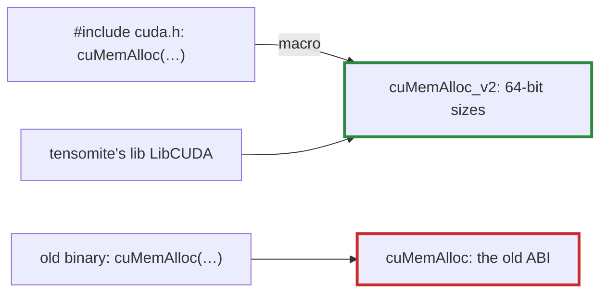

# Q-AH: Why does `libcuda` still export `cuMemAlloc` when the headers call `cuMemAlloc_v2`?

*[GPU runtime and lifetimes](README.md#gpu-runtime-and-lifetimes) · previous: [Q-V](q-v-encoded-is-not-executed.md) · next: [Q-AI](q-ai-asynchronous-errors.md)*

## The question

CUDA's C headers quietly rename many driver functions: a program that calls `cuMemAlloc` is compiled to call `cuMemAlloc_v2`. Yet `dlsym(handle, "cuMemAlloc")` still finds a function in `libcuda`. Why does the old name exist at all, and what might it point to?

> **Hint:** binary compatibility with programs built against CUDA 3.x.

<strong>Answer</strong>

### In short

A program compiled years ago asks the library for the names it was built with, and the driver must keep serving them. When CUDA's signatures changed, NVIDIA added new functions under `_v2` names and pointed the headers at them, leaving the old names exported for old programs. I think this was around CUDA 3.2, and that the change widened device pointers and byte counts from 32 bits to 64, so the old `cuMemAlloc` most likely still takes 32-bit sizes; I have not checked NVIDIA's history. Calling it with today's 64-bit arguments would misread them. Code that binds the driver by hand must use the names the headers would have produced, the `_v2` ones.

### An analogy

A shop that moves premises but keeps the old address's letterbox, so letters from customers with old address books still arrive, handled by the old rules. New customers are given the new address.

### Worked example

Name a program uses                           |What it binds to                 |Sizes          
----------------------------------------------|---------------------------------|---------------
`cuMemAlloc`, compiled against today's headers|`cuMemAlloc_v2`                  |64-bit         
`cuMemAlloc`, from a CUDA 3.x-era binary      |`cuMemAlloc`, the old function   |32-bit, I think
tensomite's `lib LibCUDA`                     |`cuMemAlloc_v2`, named explicitly|64-bit         

### Where it shows up in tensomite

`src/tensomite/cuda/lib.cr` binds the driver directly, without C headers, so it names the `_v2` functions itself: `cuMemAlloc_v2`, `cuMemFree_v2`, `cuMemcpyHtoD_v2` and others. Decision AV links `libcuda` at build time with `@[Link]`, but the naming problem is the same either way.

## See also

- [Q-AI](q-ai-asynchronous-errors.md): the first error the CUDA bring-up met.
