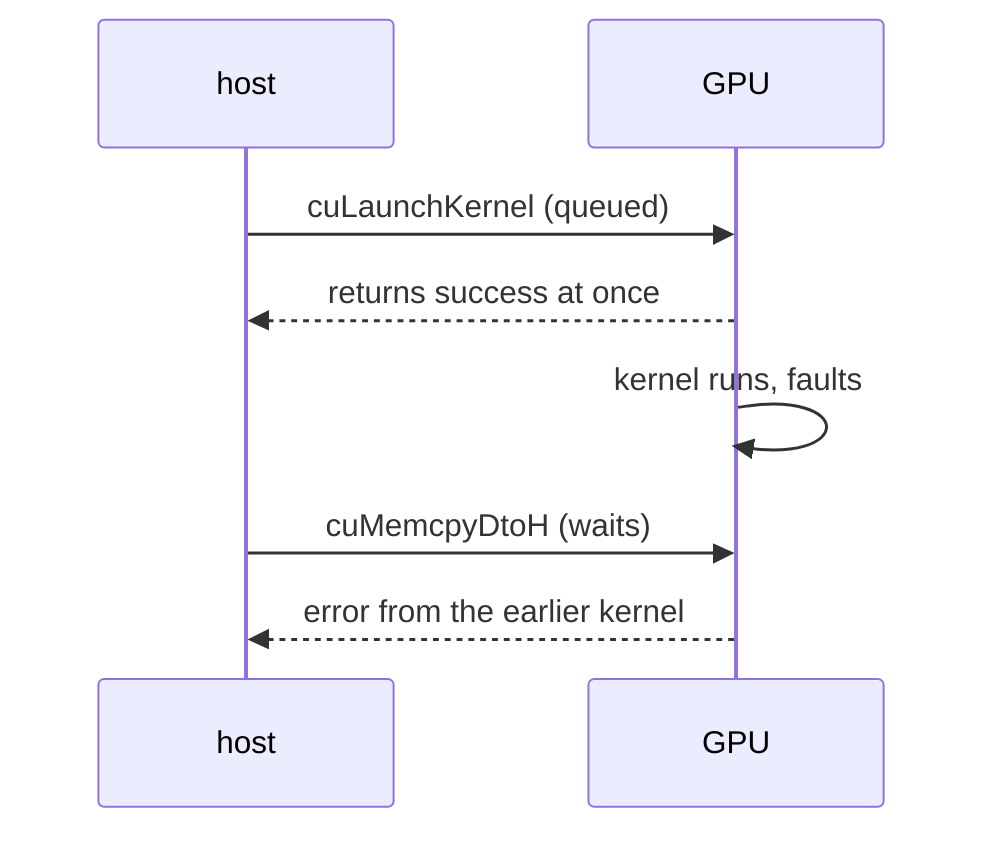

# Q-AI: Why did a bad kernel argument fail at the copy, not at the launch?

*[GPU runtime and lifetimes](README.md#gpu-runtime-and-lifetimes) · previous: [Q-AH](q-ah-v2-symbols.md) · next: [Q-AK](q-ak-emulating-barriers.md)*

## The question

CUDA's first probe squares a million floats on the GPU. An early version passed a kernel argument wrongly, and the kernel read a misaligned address. The error was reported by `cuMemcpyDtoH`, the copy back to the host, not by `cuLaunchKernel`, where the bad argument was passed in. Why?

> **Hint:** what does `cuLaunchKernel` actually wait for before it returns?

<strong>Answer</strong>

### In short

`cuLaunchKernel` only puts the kernel in the GPU's queue and returns at once; nothing has run, so it has nothing to report. The fault happens while the kernel runs, and the driver records it against the context. The next call that waits for the GPU, here the copy back, finds the error and returns it. So an error can belong to any launch since the last wait.

### An analogy

Posting a letter with a wrong address. The post box accepts it without complaint; the letter comes back days later, when you check your mail, and the returned letter does not say which day you posted it.

### Worked example

The probe, step by step:

Call                                   |Returns                        |What the GPU is doing        
---------------------------------------|-------------------------------|-----------------------------
upload the floats                      |after the copy                 |idle                         
`cuLaunchKernel(square, …)`            |at once: success               |starting the kernel          
(the kernel reads a misaligned address)|                               |faults; the error is recorded
`cuMemcpyDtoH`                         |`CUDA_ERROR_MISALIGNED_ADDRESS`|nothing more                 

The bad argument itself was a Crystal bug: `Tuple#map` gave each argument the union type of all of them, so each was stored with a type tag in front, and the kernel read the tag as an address.

### Where it shows up in tensomite

The CUDA device checks for errors at `sync` and at copies, and every check allows for a failure from an earlier launch. To find which kernel failed, sync after every launch while debugging. Data-dependent errors such as a `Gather` id out of range are written to a small error buffer by the kernel and raised at `sync` as `ExecutionError`, the GPU version of [Q-A](q-a-lazy-errors.md)'s late error.

## See also

- [Q-V](q-v-encoded-is-not-executed.md): the same gap between queued and run, on Metal.
- [Q-A](q-a-lazy-errors.md): late errors in a lazy graph.
