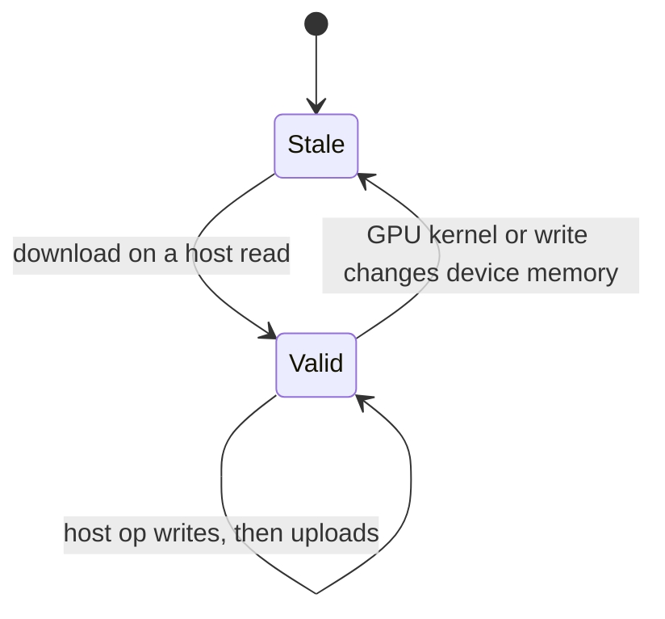

# Q-AJ: Why may a host copy stay valid after it is uploaded?

*[Memory and devices](README.md#memory-and-devices) · previous: [Q-AF](q-af-compute-and-graphics-capabilities.md) · last in the theme*

## The question

On the CUDA device, an op with no GPU kernel runs on the CPU: it computes its output into the buffer's host copy, uploads that to the GPU's memory, and marks the host copy valid. Why is it safe to keep that copy as valid, rather than discard it after the upload? What could make it go stale later?

> **Hint:** right after the upload, compare what the host copy holds with what the GPU's memory holds.

<strong>Answer</strong>

### In short

Right after the upload, the host copy and the GPU's memory hold the same bytes, so the copy is a correct cache of the buffer. Keeping it saves a download the next time a host op reads the buffer. It goes stale the moment the GPU's memory is written by anything else: a GPU kernel computing into the buffer, or an in-place `Tensor#write`, which the KV cache uses to fill one position of an existing buffer. So every such write marks the copy invalid, and the next host read downloads afresh.

### An analogy

A photocopy of a contract kept in your desk after you file the original. It is good for reference for as long as nobody amends the original; the day someone does, the photocopy must be marked out of date and fetched again.

### Worked example

The bias `b = [10, 20, 30]` on the CUDA device, then two ops on it:

Step                                                                    |GPU memory|Host copy             |Valid?                 
------------------------------------------------------------------------|----------|----------------------|-----------------------
`b` computed by a host op, then uploaded                                |`10 20 30`|`10 20 30`            |yes: identical         
a host op reads `b`                                                     |`10 20 30`|`10 20 30`            |yes: no download needed
a `Tensor#write` on the GPU overwrites it in place, as the KV cache does|`20 40 60`|`10 20 30`            |**no**: marked stale   
a host op reads it                                                      |`20 40 60`|`20 40 60`, downloaded|yes again              

### Where it shows up in tensomite

`CUDABuffer` keeps `@copy` and `@copy_valid`. `host_written` uploads the copy and keeps it valid; `device_written`, called after every GPU kernel, marks it stale; `bytes` downloads only when it is stale. Before a host op performs a `Write`, which keeps the rest of its target, the device makes the copy current, so the bytes it does not write are the GPU's, not an old copy's.

## See also

- [Q-B](q-b-unified-as-special-case.md): why the CUDA device copies at all, even on shared memory.
