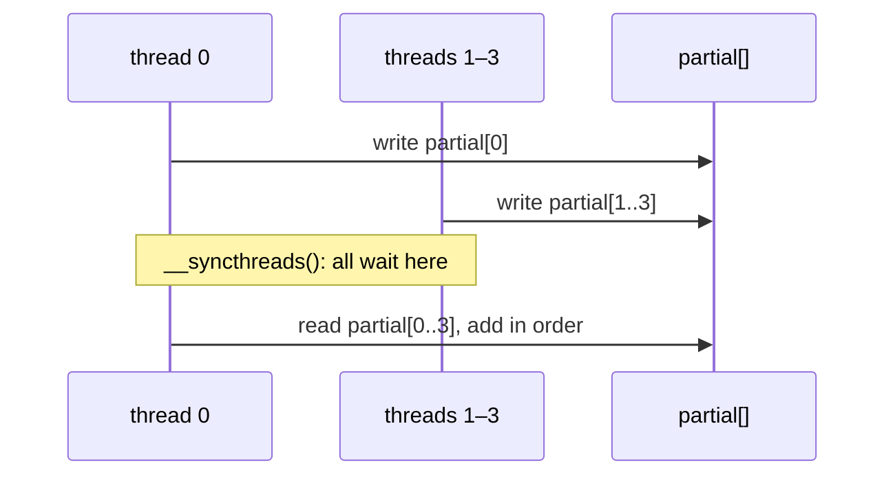

# Q-AK: Why can the emulator run some kernels' threads in a loop but not others?

*[GPU runtime and lifetimes](README.md#gpu-runtime-and-lifetimes) · previous: [Q-AI](q-ai-asynchronous-errors.md) · last in the theme*

## The question

With no GPU, CI runs the CUDA kernels on the CPU: `scripts/cuda_stub` compiles `kernels.cu` as ordinary C++ and runs each block's threads one after another in a plain loop, unless the kernel synchronises its threads. Why is the loop safe for `sum_short_f32`, but wrong for `sum_f32`?

> **Hint:** think about what thread 0 reads from `partial[]`, and when the other threads write it.

<strong>Answer</strong>

### In short

In `sum_short_f32` each thread sums its own row into its own output and talks to no other thread, so the order the threads run in cannot matter. In `sum_f32`, the threads of a block cooperate: each writes its partial sum into shared `partial[t]`, all meet at `__syncthreads()`, and then thread 0 adds the partials. Run as a loop, thread 0 runs first, all the way through, and reads `partial[1]` to `partial[n]` before threads 1 to n have written them. A barrier only means something if threads run at the same time, so kernels that use one are given real threads that meet at a real barrier.

### An analogy

A team relay where the last runner adds up everyone's times. Run the legs one by one from the start and the counter reads blank cards; it only works if everyone runs, then everyone hands in, then the counter adds.

### Worked example

A block of 4 threads, each summing one chunk of a row, run as a loop:

Order                     |Thread 0                                                                                            |Threads 1 to 3                     |Total                        
--------------------------|----------------------------------------------------------------------------------------------------|-----------------------------------|-----------------------------
plain loop                |writes `partial[0]`, passes the barrier at once, adds `partial[0..3]`, three of them not yet written|then write their partials, too late|wrong                        
real threads and a barrier|writes `partial[0]`, waits                                                                          |write `partial[1..3]`, wait        |thread 0 adds all four: right

### Where it shows up in tensomite

`scripts/cuda_stub/register.py` marks a kernel to run its threads as OS threads if its source uses `__shared__` or `__syncthreads`, or calls the tiled matmul templates, whose barriers sit in a helper. It once missed `matmul_tiled_chunks_64x64_f32`, which only calls a template; the rule was widened to cover it (Decision BJ). `scripts/emulate_metal` does the same for Metal kernels, with `threadgroup_barrier` as a `std::barrier`.

## See also

- [Q-AT](q-at-chunk-sums.md): the kernel whose barriers the stub nearly missed.
