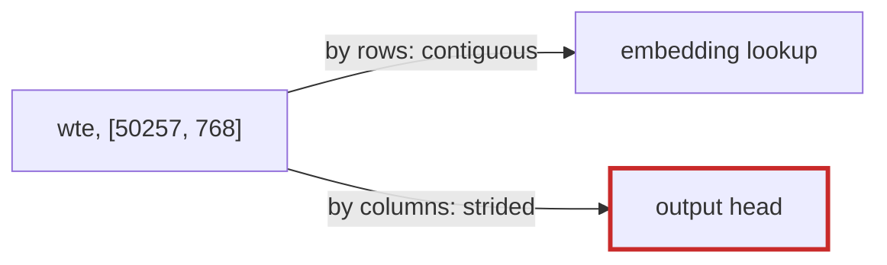

# Q-AL: What if GPT-2's head weights were stored already transposed?

*[GPU speed](README.md#gpu-speed) · previous: [Q-X](q-x-patch-per-thread.md) · next: [Q-AM](q-am-which-gains-from-two-passes.md)*

## The question

GPT-2's output head is `logits = x · wteᵀ`: it reuses the token embedding table `wte`, stored `[50257, 768]`, transposed. On CUDA, decoding was suspected of three costs: the CPU not keeping up with launches, the head reading `wte` through a transpose, and small synchronous copies each token. If the head's weights were stored already transposed, `[768, 50257]`, which cause would go away, and what would it cost elsewhere?

> **Hint:** the embedding lookup reads that same matrix by rows.

<strong>Answer</strong>

### In short

The second cause would go away: the head would read its weights along rows, so neighbouring threads would read neighbouring memory. But `wte` is shared: the embedding lookup picks one row per token, `wte[id]`, which is contiguous as stored. Transposed, a token's 768 numbers would lie 50,257 floats apart, one per row. At decode that is 768 scattered reads per token, small next to the head's 154 MB; in training, 2,048 tokens a step, and its gradient, a scatter into the same matrix, would scatter too. Keeping both layouts would cost another 154 MB, and for training, keeping two copies in step. So the layout helps one reader and hurts the other; a kernel that reads the transposed matrix well serves both.

### An analogy

A library shelved by author helps readers looking up an author and hinders those looking up a subject. Re-shelving by subject swaps who suffers; a second copy of every book costs a second library.

### Worked example

Reader of `wte`                                        |As stored, `[50257, 768]`     |Stored transposed, `[768, 50257]`
-------------------------------------------------------|------------------------------|---------------------------------
the head, `x · wteᵀ`, 154 MB a token                   |strided: 94 GB/s under `Split`|contiguous                       
embedding lookup, 1 token at decode                    |768 neighbouring floats       |768 floats, 200 KB apart         
embedding lookup and gradient, 2,048 tokens in training|rows                          |columns, scattered               

### Where it shows up in tensomite

Decision AX kept the layout and fixed the reader: the `TwoPass` matmul copies a tile of the head's weights into shared memory along `wte`'s contiguous axis, and the head went from 94 to 203 GB/s ([Q-AN](q-an-which-way-the-weights-run.md)).

## See also

- [Q-AM](q-am-which-gains-from-two-passes.md): predicting which products two passes would help.
