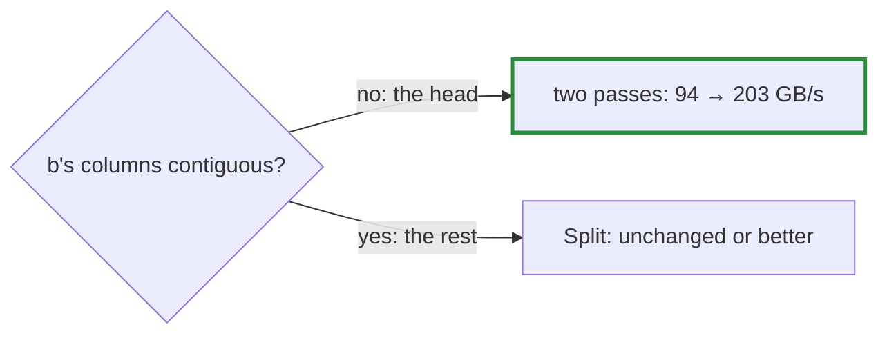

# Q-AM: Which decode products should gain from two passes?

*[GPU speed](README.md#gpu-speed) · previous: [Q-AL](q-al-storing-the-head-transposed.md) · next: [Q-AN](q-an-which-way-the-weights-run.md)*

## The question

Decision AX added a two-pass matmul for decoding: blocks per chunk of `k` that stage the weights in shared memory, then a pass adding the chunk sums. Before measuring, which would you expect to gain more: the products with 768 output columns, or the head, with 50,257?

> **Hint:** ask what was slow about each under `Split` in the first place.

<strong>Answer</strong>

### In short

The head. Its weights are read through a transpose, so under `Split` neighbouring threads read memory 768 floats apart ([Q-AL](q-al-storing-the-head-transposed.md)); staging tiles along the contiguous axis fixes exactly that. The other products already read neighbouring memory, so two passes had nothing to fix there and only added costs: a second launch per matmul, and shared memory per block that limits how many blocks share a multiprocessor. The measurement agreed: the head doubled and the others held or fell.

The number of columns was the wrong thing to look at; the layout was the right one ([Q-AN](q-an-which-way-the-weights-run.md)).

### An analogy

A new trolley for a warehouse picker helps the one who walks between aisles for every item, not the one who already takes everything from one shelf; for that one it is just something extra to push.

### Worked example

GB/s of weights read on the GB10, one decoded token:

Product                       |`Split`|Two passes
------------------------------|-------|----------
head `[768,50257]`, transposed|94     |**203**   
mlp out `[3072,768]`          |137    |140       
mlp in `[768,3072]`           |175    |172       
qkv `[768,2304]`              |171    |151       
attention out `[768,768]`     |126    |99        

### Where it shows up in tensomite

Decision AY made `Auto` choose by layout: below 16 rows, two passes only when `b`'s columns are not contiguous, `Split` otherwise. Decode went to 212 tokens/s, from 171.

## See also

- [Q-AN](q-an-which-way-the-weights-run.md): the layout difference, read by a warp.
