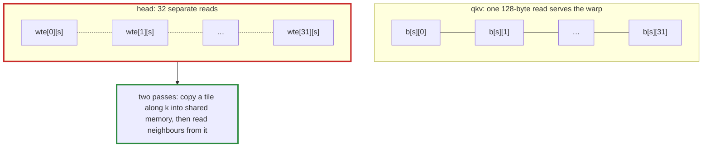

# Q-AN: What makes the head's reads slow when qkv's are fast?

*[GPU speed](README.md#gpu-speed) · previous: [Q-AM](q-am-which-gains-from-two-passes.md) · next: [Q-AP](q-ap-narrower-blocks.md)*

## The question

Two passes gained a lot on the head and nothing on qkv ([Q-AM](q-am-which-gains-from-two-passes.md)), though both read 768-long columns of weights. What is the one difference in how their weights are laid out in memory?

> **Hint:** 32 neighbouring threads, a warp, each read one number at each step. Where are those 32 numbers?

<strong>Answer</strong>

### In short

Which way the weights run. qkv's weights are `[768, 2304]`, stored row by row, and the warp's 32 threads, one per output column, want 32 neighbouring numbers of one row: one 128-byte read. The head uses `wte` transposed: `wte` is `[50257, 768]` stored row by row, so the head's neighbouring columns are different rows of `wte`, 768 floats (3 KB) apart. The warp wants 32 numbers from 32 places: 32 reads per step. Two passes copy a tile along `k`, the way `wte` is contiguous, into shared memory, and the threads pick their numbers from that copy.

### An analogy

32 clerks each fetching one book. For qkv the 32 books sit side by side on one shelf: one trip. For the head they are one per aisle in 32 aisles: 32 trips.

### Worked example

Product|Weights stored                           |Warp's 32 reads at one step           |Memory reads 
-------|-----------------------------------------|--------------------------------------|-------------
qkv    |`[768, 2304]`, row by row                |`b[s][c..c+31]`: one row, side by side|1 × 128 bytes
head   |`wte [50257, 768]`, read as its transpose|`wte[c..c+31][s]`: 32 rows, 3 KB apart|32           

### Where it shows up in tensomite

`matmul_chunks_f32` copies each block's chunk of `b` into shared memory along whichever axis is contiguous; `Auto` uses it only when `b`'s columns are not contiguous. Attention's `q · kᵀ` is the other product with a transposed `b`, and takes two passes too.

## See also

- [Q-AP](q-ap-narrower-blocks.md): what happens when reads are side by side but too short.
