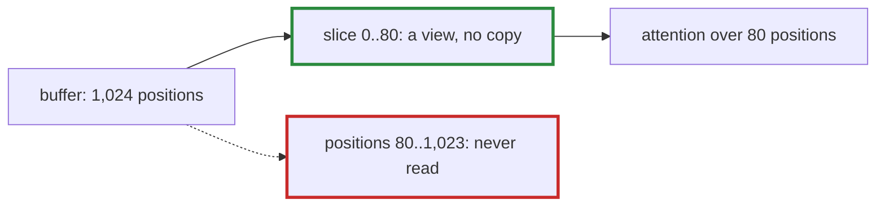

# Q-AO: How does attention avoid a preallocated cache's empty slots?

*[Decoding and the KV cache](README.md#decoding-and-the-kv-cache) · previous: [Q-AD](q-ad-cache-written-in-place.md) · last in the theme*

## The question

A preallocated cache holds 1,024 positions, but at token 80 only 80 are filled; the rest hold whatever the memory held before. How does attention avoid paying for, or being misled by, the 944 empty slots?

> **Hint:** what is a slice of a tensor, in tensomite ([Q-K](q-k-stride-zero.md))?

<strong>Answer</strong>

### In short

Attention never sees them. The cache hands out its keys and values as a slice of the first 80 positions, `slice(2, 0, length)`: a view with a shorter shape over the same buffer, which copies nothing. Everything downstream, `q · kᵀ`, the causal mask and the product with the values, is built for 80 positions, so the empty slots are neither computed on nor read. Their contents are undefined, and that is safe precisely because nothing reads them; a mask alone would not do, since `exp` of garbage could be infinity or NaN before any mask was applied.

### An analogy

An exam hall with 1,024 desks and 80 candidates. The invigilator collects papers from the 80 occupied desks; the empty desks are not marked as zero, they are simply never visited.

### Worked example

Decoding token 80 into a cache of capacity 1,024:

Step                     |Shape              |Touches the empty slots?  
-------------------------|-------------------|--------------------------
the cache's buffer       |`[1, 12, 1024, 64]`|holds them                
`keys`: `slice(2, 0, 80)`|`[1, 12, 80, 64]`  |no: a view of the first 80
scores, `q · kᵀ`         |`[1, 12, 1, 80]`   |no                        
softmax, then `· values` |`[1, 12, 1, 64]`   |no                        

### Where it shows up in tensomite

`Cache#keys` and `Cache#values` return `@keys.slice(2, 0, length)`, and `Cache.empty` makes the buffer without filling it. Because a token's shapes now depend only on its position, not on the buffer, prefill and decode keep giving the same bits ([Q-I](q-i-exact-prefill-decode.md)), and fixed buffers are what CUDA graphs would need later.

## See also

- [Q-AD](q-ad-cache-written-in-place.md): what writing in place saves.
- [Q-L](q-l-cat-slice-views.md): slices used for writing.
