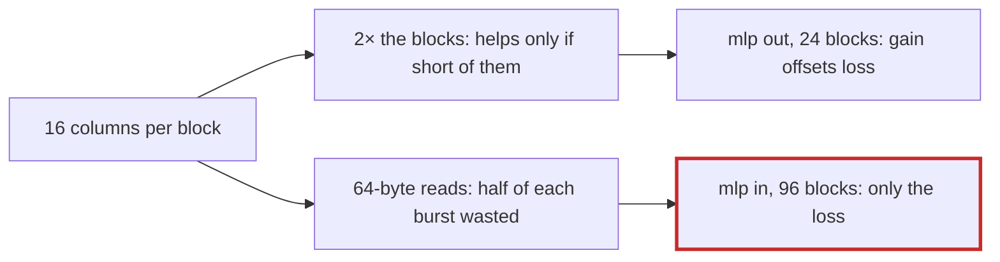

# Q-AP: Why did narrower blocks cost mlp in a fifth of its speed but leave mlp out unchanged?

*[GPU speed](README.md#gpu-speed) · previous: [Q-AN](q-an-which-way-the-weights-run.md) · next: [Q-AQ](q-aq-predicting-the-profile.md)*

## The question

`Split` gives each block 32 output columns. A trial halved that to 16, doubling the number of blocks, on the theory that decode products had too few blocks to fill the GB10. It cost mlp in, `[768, 3072]`, a fifth of its speed, and left mlp out, `[3072, 768]`, unchanged. Why the difference?

> **Hint:** compare their `k` and `n`: how many blocks does each have at 32 columns, and how much does each read per step?

<strong>Answer</strong>

### In short

Narrower blocks change two things at once. They add blocks, which helps only a product short of them; and they shorten each warp's read of a row of weights, from 128 bytes to 64, which wastes half of each memory burst and hurts every product. mlp in has `n = 3072`, so 96 blocks already: it gained nothing and paid the shorter reads, losing a fifth. mlp out has `n = 768`, only 24 blocks at 32 columns, so the extra blocks roughly paid for the shorter reads, and it came out even. I think that is the balance; the measurements fit it, but I have not measured occupancy directly.

The experiment's lesson was that too few blocks was never the main limit: mlp out already read at 202 GB/s with 24 blocks, and 32 columns stayed best or tied everywhere.

### An analogy

Splitting each delivery van's load in two to put more vans on the road. If the depot already has vans to spare (mlp in), you have only made half-empty trips. If it was short of vans (mlp out), the extra vans make up for the half-loads.

### Worked example

GB/s of weights read on the GB10, GPU alone:

Product      |`k`, `n` |Blocks at 32 columns|32 columns|16 columns|8 columns
-------------|---------|--------------------|----------|----------|---------
mlp in       |768, 3072|96                  |**209**   |165       |79       
mlp out      |3072, 768|24                  |**202**   |202       |151      
qkv          |768, 2304|72                  |**196**   |168       |71       
attention out|768, 768 |24                  |160       |161       |136      

### Where it shows up in tensomite

Decision BE trimmed the trial and kept 32 columns; `bench/matmul_cuda.cr` stays as a regression check, and `DESIGN.md` records the negative result so it is not tried again.

## See also

- [Q-X](q-x-patch-per-thread.md): the other limit, too few outputs to go round.
