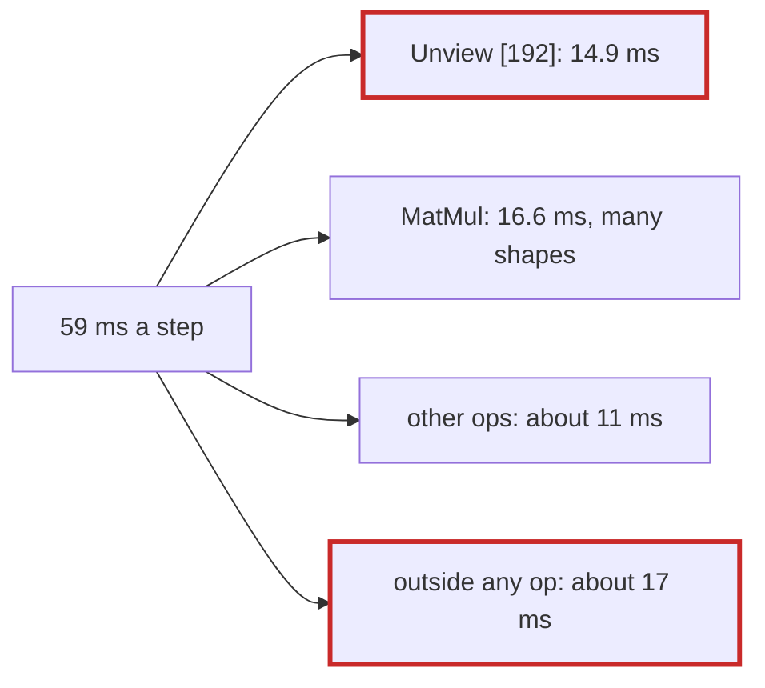

# Q-AQ: Where would Metal's 59 ms of a training step go?

*[GPU speed](README.md#gpu-speed) · previous: [Q-AP](q-ap-narrower-blocks.md) · next: [Q-AS](q-as-loading-ahead.md)*

## The question

After Decision BG, the GB10 trained the larger Shakespeare model in about 20 ms a step and the M5 Pro in 59, three times as long. Before profiling Metal, which would you predict takes most of its 59 ms: (a) a few slow kernels, as `Unview` had been on CUDA; (b) time spread evenly across all the kernels; or (c) time outside the kernels, encoding, syncing and allocating?

> **Hint:** a prediction is worth writing down because it can be wrong. What would each answer look like in a profile?

<strong>Answer</strong>

### In short

All three, in different measure, which was the lesson. The prediction was (a), and one op shape bore it out: `Unview [192]` took 35% of the GPU time. Matrix products took 39%, spread over many shapes, which is (b). And 17 of the 59 ms were outside any op, (c): a step committed 114 command buffers where about 14 would do, so the GPU waited for the host again and again. Each share had its own fix: a port of CUDA's `Unview` and then loading ahead ([Q-AS](q-as-loading-ahead.md)), tiled two-pass matmuls ([Q-AT](q-at-chunk-sums.md)), and one wait per optimizer step.

### An analogy

Asking why a delivery round takes three times as long as a rival's. It is rarely one slow road: one road is slow, the deliveries themselves are a bit slower everywhere, and the van keeps returning to the depot for paperwork.

### Worked example

What a profile looks like for each answer, and what Metal's showed:

Answer                 |What the profile would show                |What it showed                                
-----------------------|-------------------------------------------|----------------------------------------------
(a) a few slow kernels |one or two shapes with most of the GPU time|`Unview [192]`, 35%: 0.83 ms a call           
(b) spread evenly      |a long, flat table of ops                  |`MatMul`, 39%, over many shapes               
(c) outside the kernels|GPU total well below the wall time         |42 of 59 ms in ops; 114 command buffers a step

### Where it shows up in tensomite

`examples/shakespeare.cr --device metal --profile N` prints this report (Decision BH). After Decisions BI to BK, the same model trains at 21.8 ms a step on the M5 Pro.

## See also

- [Q-AS](q-as-loading-ahead.md): the fix for the slow `Unview`.
