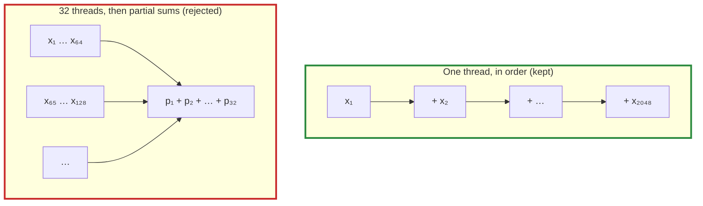

# Q-AR: Why not split one long sum across 32 threads?

*[Order of addition and determinism](README.md#order-of-addition-and-determinism) · previous: [Q-Z](q-z-modules-match-exactly.md) · next: [Q-AT](q-at-chunk-sums.md)*

## The question

`Unview [192]` sums a layer norm's gradient over 2,048 rows into 192 columns. It runs 192 threads, each adding its column's 2,048 numbers one after another, while the GPU could run thousands of threads. Why not split each column across 32 threads, each adding 64 numbers, and then add the 32 partial sums? What would that cost?

> **Hint:** the CPU adds the 2,048 numbers left to right. Write out the grouping the split would use.

<strong>Answer</strong>

### In short

The split regroups the additions: `((x₁ + x₂) + …) + x₂₀₄₈` becomes `(x₁ + … + x₆₄) + (x₆₅ + … + x₁₂₈) + …`. Floating-point addition is not associative, so the sum can change in its last bits ([Q-H](q-h-tile-order.md)). A fixed split would still give the same bits from run to run, but no longer the CPU's. `Unview` promises the host's order, and the trainer's losses would stop matching ([Q-Z](q-z-modules-match-exactly.md)).

### An analogy

One cashier ringing up 2,048 items, rounding after each, against 32 cashiers each ringing up 64 items and then adding their subtotals. Faster, but the total can be off by a cent, because the roundings fell in different places.

### Worked example

The three numbers again, at the start of a column:

Grouping                                       |Sum
-----------------------------------------------|---
In order, as the CPU: `(1 + 1e8) + −1e8`       |`0`
Split into two partial sums: `1 + (1e8 + −1e8)`|`1`

### What was done instead

The time was going on waiting, not adding: each thread asked for a number, waited a full memory round trip for it, added it, then asked for the next. Decision BJ kept the order and changed only the waiting. Metal's `Unview` loads 32 numbers before adding them, still one at a time and in order, so one round trip covers 32 numbers (Q-AS). `Unview [192]` went from 0.40 ms a call to 0.027, with the same bits.

## See also

- [Q-AT](q-at-chunk-sums.md): the same trade-off in a matmul, where splitting is needed and the order is kept another way.
