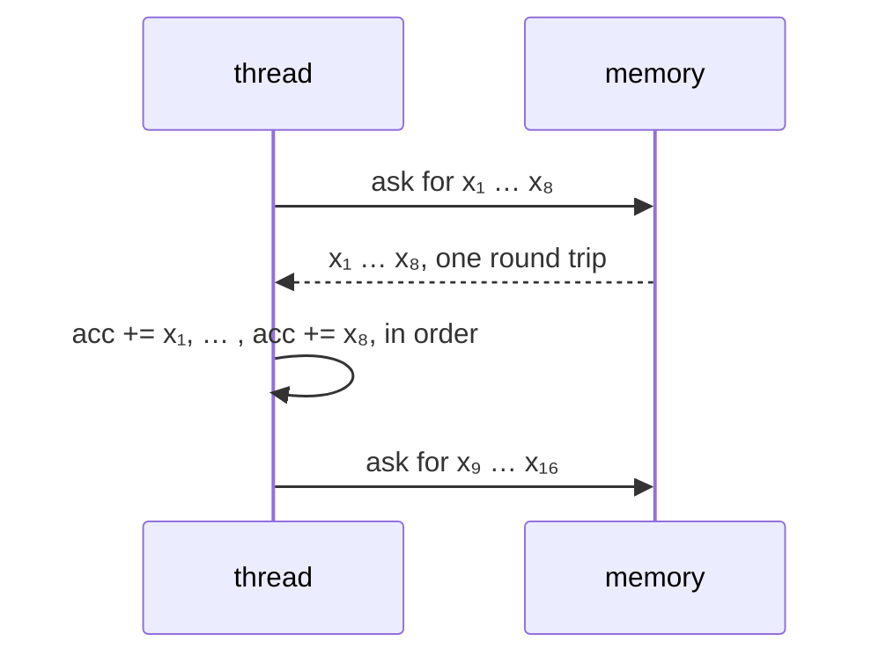

# Q-AS: How can loading ahead save time if no addition happens sooner?

*[GPU speed](README.md#gpu-speed) · previous: [Q-AQ](q-aq-predicting-the-profile.md) · last in the theme*

## The question

`Unview [192]` runs 192 threads, each adding its column's 2,048 numbers one after another, in order, to keep the host's bits ([Q-AR](q-ar-splitting-a-sum.md)). Loading 8, then 32, numbers ahead took it from 0.40 ms a call to 0.058, then 0.027, though every thread still adds its numbers one at a time. Why can loading ahead save so much without making any addition happen sooner?

> **Hint:** work out how long each number took: 0.40 ms for 2,048 of them.

<strong>Answer</strong>

### In short

The additions were never the cost; waiting was. 0.40 ms over 2,048 numbers is about 195 ns each, roughly one round trip to memory: each thread asked for a number, waited for it to arrive, added it, then asked for the next. Loading 8 ahead asks for 8 at once, so one round trip covers 8 numbers, and the additions, still in order, find each number already there. The arithmetic is unchanged; only the waiting overlaps.

### An analogy

A cashier ringing up items one at a time while a helper keeps eight on the belt. The cashier is no faster, but never stops to wait for the next item.

### Worked example

Ahead|Per call|Per number|Round trips per call  
-----|--------|----------|----------------------
1    |0.40 ms |195 ns    |2,048                 
8    |0.058 ms|28 ns     |256: about 227 ns each
32   |0.027 ms|13 ns     |64: about 420 ns each 

Up to 8 ahead, a round trip still takes about 200 ns; there are just fewer of them. At 32 each round trip covers 32 numbers but takes about twice as long, so something besides waiting, perhaps how many loads a core can keep in flight, began to limit it; that is why 32 gained less than predicted. Even so, Metal beat CUDA's 0.032 ms for the same kernel.

### Where it shows up in tensomite

Metal's `unview_f32` has a dense path that loads `UNVIEW_AHEAD`, 32, elements into registers before adding them (Decision BJ). 1, 8 and 32 were measured; threadgroups of 32 rather than 256 made no difference, which ruled out the other theory, that one GPU core's bandwidth was the limit. It is the same split as softmax's passes ([Q-T](q-t-softmax-two-passes.md)) and the i-k-j loop ([Q-O](q-o-which-loop-vectorises.md)): independent work overlapped, dependent additions kept in order.

## See also

- [Q-AR](q-ar-splitting-a-sum.md): why the sum is not split instead.
