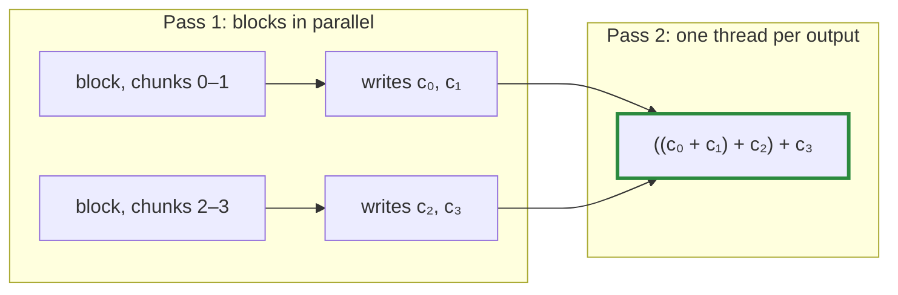

# Q-AT: Why write every chunk sum rather than one per run?

*[Order of addition and determinism](README.md#order-of-addition-and-determinism) · previous: [Q-AR](q-ar-splitting-a-sum.md) · last in the theme*

## The question

`TiledTwoPass` speeds up weight gradients such as `[192,2048]·[2048,192]`, whose `k` of 2,048 is 32 chunks of 64 ([Q-R](q-r-split-depends-on-k.md)). Its first pass gives each block a run of chunks, say 2, and the block writes the sum of each chunk to scratch: 32 numbers per output. A second pass reads them back and adds them in chunk order. Why not have each block add its run's chunks together first, and write one partial sum per run, 16 numbers per output instead of 32?

> **Hint:** write out how the final sum is grouped in both cases, as in [Q-AR](q-ar-splitting-a-sum.md).

<strong>Answer</strong>

### In short

Every matmul mode in tensomite produces `((c₀ + c₁) + c₂) + … + c₃₁`: chunk sums added one at a time, in order. If each block first added its own pair, the second pass would compute `(c₀ + c₁) + (c₂ + c₃) + …`, a different grouping, so different bits from `Split` and `Tiled`, and a prefill and a decode that took different modes would stop matching ([Q-I](q-i-exact-prefill-decode.md)). Writing each chunk's sum costs more scratch memory but keeps the sequence intact.

### An analogy

Thirty-two piles of coins, each counted separately. The rule is to add the pile totals into a running total, one pile at a time, left to right. Two helpers may count the piles, but if each helper hands over their piles already added together, the running total is formed differently, even though the coins are the same.

### Worked example

Four chunk sums, with the running example as three of them:

Second pass receives                                  |It computes             |Result                 
------------------------------------------------------|------------------------|-----------------------
each chunk sum: `1`, `1e8`, `−1e8`, `0`               |`((1 + 1e8) + −1e8) + 0`|`0`, as `Split` gives  
one sum per run of two: `1 + 1e8`, `−1e8 + 0`         |`(1 + 1e8) + (−1e8 + 0)`|`0`, by luck here      
runs split elsewhere: `1`, then `1e8 + −1e8`, then `0`|`(1 + 0) + 0`           |`1`, not `Split`'s bits

Whether a regrouping changes the bits depends on the values; it is safe only if it never happens.

### The cost, measured

For `[192,2048]·[2048,768]` the scratch holds 192 × 768 × 32 floats, about 19 MB, written once and read once. The weight gradients still went from 330 to 1,600 GFLOP/s on the M5 Pro for the smallest, and from 1,000–1,300 to about 1,800 for the others, against 2,100 to 2,300 for forward products. Most of the remaining gap is probably that scratch traffic.

## See also

- [Q-R](q-r-split-depends-on-k.md): where the chunks of 64 come from.
- [Q-AR](q-ar-splitting-a-sum.md): the same reasoning for a plain sum.
