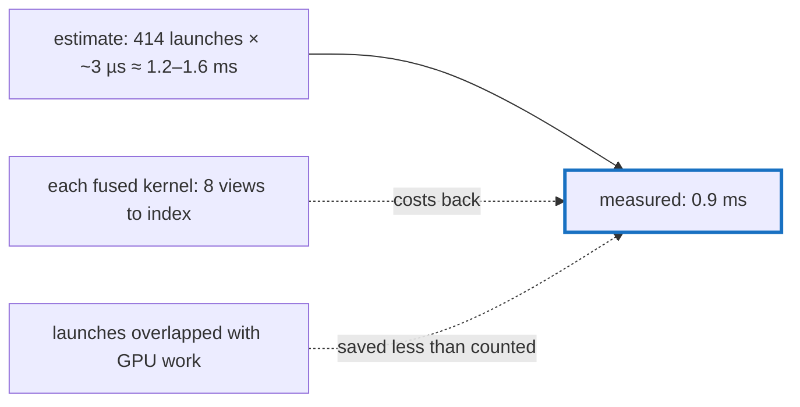

# Q-AU: Why did fusing AdamW save less than its launches suggested?

*[Fusion in training](README.md#fusion-in-training) · first in the theme · next: [Q-AV](q-av-which-kernel-the-fast-path-helps.md)*

## The question

A training step of the larger model launched 925 kernels, over half of them AdamW's: about fifteen primitive ops for each of 36 parameters. Fusing each parameter's update into three kernel macros took the step to 511 launches. On the GB10 a small kernel costs about 3 µs however little it does, so removing 414 launches suggests about 1.2 to 1.6 ms. Would the step fall by more than that, or less?

> **Hint:** a fused kernel is not free either. Compare a fused `Kernel [192]` with the `Mul [192]` it replaced, and think about what each of its eight inputs costs to find.

<strong>Answer</strong>

### In short

Less: the step fell 0.9 ms on the GB10, from 15.0 to 14.1, and 1.0 ms on the M5 Pro. Two things ate into the estimate. Each fused kernel cost more than a primitive, 4.7 µs against 2.8 for a `Kernel [192]`, because it read eight inputs, five of them broadcast scalars, each found through a general view with integer divisions per element ([Q-AV](q-av-which-kernel-the-fast-path-helps.md) follows that up). And much of the launch overhead had already overlapped with work on the GPU, so removing it shortened the wall time less than the GPU time. AdamW's GPU time went from about 2.0 ms to 0.7.

An earlier hint for this question pointed the other way, towards memory traffic saved. The parameters are small, 7 MB in all, so traffic was never the large part.

### An analogy

Combining fifteen errands into three trips saves the walking, but each combined trip has a longer shopping list, and at every shelf you work out its number from scratch.

### Worked example

Measured on the GB10, the larger model:

Measure           |Before |After  
------------------|-------|-------
launches a step   |925    |511    
AdamW's GPU time  |~2.0 ms|~0.7 ms
one `Kernel [192]`|—      |4.7 µs 
one `Mul [192]`   |2.8 µs |—      
wall time a step  |15.0 ms|14.1 ms

### Where it shows up in tensomite

`Kernels::ADAMW_MOMENT`, `ADAMW_SECOND_MOMENT` and `ADAMW_UPDATE` in `kernels.cr`, called from `AdamW#update` from the second step on, with the per-step numbers as scalar inputs (Decision BM). Each does the composite's operations in its order, so the losses kept their bits.

## See also

- [Q-AV](q-av-which-kernel-the-fast-path-helps.md): what the fused kernels' eight views cost, and the fix.
- [Q-S](q-s-fused-gelu.md): why a fused kernel can keep its composite's bits.
