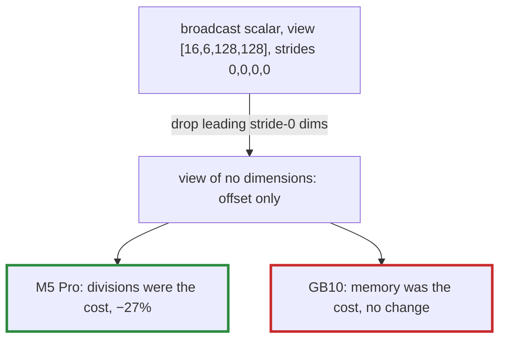

# Q-AV: Which kernels gain when broadcast inputs skip their index arithmetic?

*[Fusion in training](README.md#fusion-in-training) · previous: [Q-AU](q-au-fewer-launches-less-saving.md) · next: [Q-AW](q-aw-counting-passes-over-memory.md)*

## The question

A GPU kernel finds each input's element through its view with `offset_of`: a modulo and a division per dimension, unless the view is dense. A scalar broadcast to `[768, 192]` has stride 0 in both dimensions, so every element paid two divisions to find the same number. The fix drops a view's leading dimensions of stride 0 before the kernel sees it, so a broadcast scalar becomes a view of no dimensions. Will that speed up GELU's `Kernel [2048,768]`, with one input, as much as AdamW's update, with eight?

> **Hint:** count how many views each kernel reads, and ask which of them were dense already.

<strong>Answer</strong>

### In short

GELU did not change: its one input was already dense, so it never did the arithmetic, and at about 45 µs a call it is set by reading and writing its 1.5 million floats. AdamW's kernels gained a little, `Kernel [192]` from 4.8 to 4.4 µs on the M5 Pro, because at that size most of a kernel's time is the fixed cost of a dispatch. The largest gain was one not predicted: attention's scale, `Mul [16,6,128,128]` by a scalar, 1.6 million elements each doing three divisions to find one number, went from 0.81 to 0.59 ms on the M5 Pro. On the GB10 nothing changed beyond noise: its elementwise ops were already limited by memory, which hid the divisions.

### An analogy

A clerk who looks up the same shelf number for every one of 1.6 million parcels saves the most when told the number once. The clerk who already walked straight to the shelf saves nothing.

### Worked example

Op                                   |Views read             |M5 Pro, before → after|GB10, before → after
-------------------------------------|-----------------------|----------------------|--------------------
`Kernel [2048,768]`, GELU            |1, dense               |0.364 → 0.368 ms      |0.363 → 0.366 ms    
`Kernel [192]`, AdamW, a call        |8, five of them scalars|4.8 → 4.4 µs          |4.7 → 4.8 µs        
`Mul [16,6,128,128]`, attention scale|2, one scalar of 3 dims|0.81 → 0.59 ms        |0.752 → 0.732 ms    

### Where it shows up in tensomite

`View#repeated_leading` and `elementwise_view_args` on both GPUs, used for elementwise ops and kernel macros, which read their inputs only through `offset_of` (Decision BN). The shortened view is never marked dense, since its elements repeat.

## See also

- [Q-K](q-k-stride-zero.md): what a stride of 0 means.
- [Q-AW](q-aw-counting-passes-over-memory.md): the GB10's limit, memory traffic, used to make a prediction.
