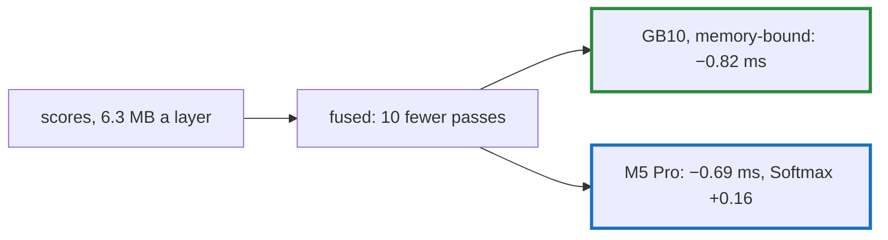

# Q-AW: How much should fusing attention's scale and mask into softmax save?

*[Fusion in training](README.md#fusion-in-training) · previous: [Q-AV](q-av-which-kernel-the-fast-path-helps.md) · next: [Q-AX](q-ax-launches-not-bytes.md)*

## The question

Attention's scores are `[16, 6, 128, 128]` per layer, 6.3 MB. Before the softmax they went through a `Mul` by the scale and an `Add` of the mask; after it, in the backward pass, through five primitives. Fusing the scale and mask into `Softmax`, and the backward into one `SoftmaxGrad`, removes those passes. On the GB10, roughly how much should a step save, and will the M5 Pro save more or less?

> **Hint:** count how many times the 6.3 MB crosses memory before and after, per layer, and remember from [Q-AV](q-av-which-kernel-the-fast-path-helps.md) which GPU was limited by memory.

<strong>Answer</strong>

### In short

Counting passes predicts about 0.9 ms on the GB10, and it saved 0.82 ms of GPU time: on a GPU limited by memory, removing traffic is removing time. The M5 Pro saved less GPU time, 0.69 ms, because its fused `Softmax` got slower, 0.43 to 0.59 ms. Each element's `x · scale + mask` is computed in both of the kernel's passes, loading `x` and the mask each time, and Metal waits for each load in turn ([Q-AS](q-as-loading-ahead.md)). Storing the values in the first pass and reading them back was then tried: Metal gained 0.05 ms, and the GB10 lost 0.29, paying for an extra write and read of 6.3 MB per layer. It was dropped (Decision BQ).

### An analogy

Moving a library's books to the binder and back for each of seven jobs, then doing all seven at once: the saving is the trips. But if the clerk now reads each book's label twice on the way, a clerk who reads slowly gives some of it back.

### Worked example

Passes over one layer's 6.3 MB of scores:

Stage   |Before                                |After                          |Saved
--------|--------------------------------------|-------------------------------|-----
forward |`Mul`: read, write; `Add`: read, write|read inside `Softmax`          |4    
backward|five ops: 7 reads, 4 writes           |`SoftmaxGrad`: 4 reads, 1 write|6    

Ten passes × 6.3 MB × 4 layers ≈ 250 MB a step; at about 270 GB/s, about 0.9 ms.

Measure         |M5 Pro        |GB10          
----------------|--------------|--------------
ops timed alone |19.47 → 18.78 |13.50 → 12.68 
`Softmax`       |0.43 → 0.59 ms|0.63 → 0.65 ms
wall time a step|20.5 → 19.6 ms|14.3 → 13.6 ms

### Where it shows up in tensomite

`Tensor#softmax(scale:, mask:)`, which `CausalSelfAttention` calls, and `Op::SoftmaxGrad`, which adds `g · y` in the order `Sum` adds so that the losses keep their bits (Decision BO). The kernels are `softmax_scaled_f32` and `softmax_grad_f32` on both GPUs.

## See also

- [Q-T](q-t-softmax-two-passes.md): softmax's passes on the CPU.
- [Q-AX](q-ax-launches-not-bytes.md): a fusion where the bytes were not the cost.
