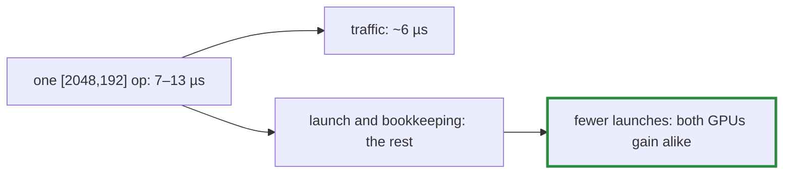

# Q-AX: Which GPU gains more from fusing layer norm's backward?

*[Fusion in training](README.md#fusion-in-training) · previous: [Q-AW](q-aw-counting-passes-over-memory.md) · next: [Q-AY](q-ay-same-kernel-different-share.md)*

## The question

Layer norm's backward pass was about sixteen primitives over `[2048, 192]`, 1.5 MB a tensor, for each of a step's nine layer norms. Fusing it into one `LayerNormGrad` took the step from 487 launches to 334. [Q-AW](q-aw-counting-passes-over-memory.md)'s fusion helped the GB10 more, because it removed memory traffic. Which GPU gains more this time?

> **Hint:** work out how long moving 1.5 MB in and out takes on the GB10, and compare it with what each of those ops took.

<strong>Answer</strong>

### In short

About the same: 0.78 ms of GPU time on the M5 Pro and 0.75 on the GB10. Reading and writing 1.5 MB takes about 6 µs at the GB10's bandwidth, but those ops took 7 to 13 µs each. Their cost was mostly the fixed price of a launch, plus a little arithmetic, not bytes, and 153 fewer launches help any GPU about equally. `LayerNormGrad` itself takes about 37 µs a call on both, 0.7 ms for its eighteen calls, against about 1.4 ms for what it replaced.

### An analogy

Fifteen short taxi rides replaced by one longer one. The saving is mostly the flag fall on each ride, and the flag fall is about the same in every city, whatever the traffic.

### Worked example

Measure                  |M5 Pro        |GB10          
-------------------------|--------------|--------------
launches a step          |487 → 334     |487 → 334     
ops timed alone          |18.78 → 18.00 |12.68 → 11.93 
`LayerNormGrad`, 18 calls|0.70 ms       |0.67 ms       
wall time a step         |19.6 → 18.7 ms|13.6 → 12.9 ms

One `Mul [2048,192]` on the GB10: 13 µs measured, about 6 µs of traffic at 270 GB/s; the rest is the launch and its bookkeeping.

### Where it shows up in tensomite

`Op::LayerNormGrad`: with `g`, `x` and the weight, the input's gradient; with `x` alone, `x̂` for the weight's gradient (Decision BP). Each row recomputes the mean and deviation with its sums in `Sum`'s order, so the losses keep their bits. After this and the fusions before it, a step takes 18.7 ms on the M5 Pro and 12.9 on the GB10, from 21.8 and 15.0, and `MatMul` is 71% and 54% of the GPU time.

## See also

- [Q-AW](q-aw-counting-passes-over-memory.md): the fusion where bytes were the cost.
- [Q-AU](q-au-fewer-launches-less-saving.md): where this theme's launch count started.
