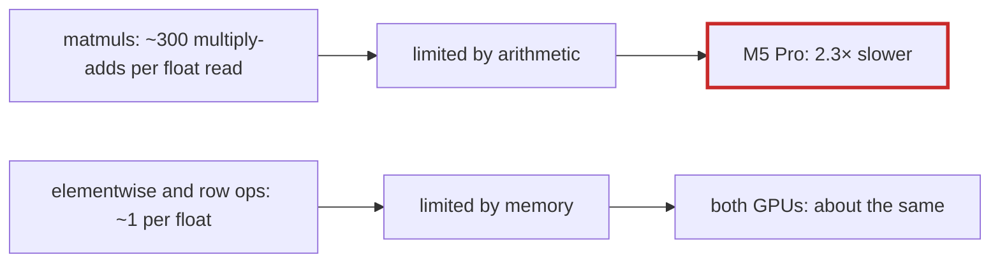

# Q-AY: Why is `MatMul` a larger share of a step on the M5 Pro than on the GB10?

*[Fusion in training](README.md#fusion-in-training) · previous: [Q-AX](q-ax-launches-not-bytes.md) · next: [Q-AZ](q-az-bigger-patches.md)*

## The question

After the fusions of [Q-AU](q-au-fewer-launches-less-saving.md) to [Q-AX](q-ax-launches-not-bytes.md), `MatMul` is 71% of a training step's GPU time on the M5 Pro but 54% on the GB10. The same 75 products run on both, with the same algorithm. What does the gap say about where each GPU is weak: too little arithmetic, or too little memory bandwidth?

> **Hint:** compare the rate of the forward product `[2048,768]·[768,192]` on each, and then compare an op limited by memory, such as `SoftmaxGrad`, on each.

<strong>Answer</strong>

### In short

Arithmetic, not bandwidth. The forward product runs at about 2,100 GFLOP/s on the M5 Pro and 4,900 on the GB10. It does about 300 multiply-adds per float it reads, so memory barely limits it, and the gap is in how fast each GPU multiplies and adds. Memory-bound ops tell the opposite story: `SoftmaxGrad` takes 0.25 ms on the M5 Pro and 0.36 on the GB10, so the M5 Pro moves data as fast or faster. Everything else in the step is about as fast on both, so the matmuls, 2.3 times slower on Metal, take a larger share there. How much of that 2.3 times is the hardware's peak, and how much is the kernel using less of it, is not measured; [Q-AZ](q-az-bigger-patches.md) tries one way to use more of it.

### An analogy

Two kitchens with equally fast delivery vans but different numbers of chefs. A dish that is mostly chopping takes a bigger share of the evening in the kitchen with fewer chefs, though the ingredients arrive as fast.

### Worked example

Op                                   |Limited by|M5 Pro       |GB10         
-------------------------------------|----------|-------------|-------------
`MatMul [2048,768]·[768,192]`        |arithmetic|2,118 GFLOP/s|4,844 GFLOP/s
`SoftmaxGrad [16,6,128,128]`, 4 calls|memory    |0.25 ms      |0.36 ms      
`MatMul`'s share of the GPU time     |          |71%          |54%          

### Where it shows up in tensomite

The profile's rate column, `GB/s or GFLOP/s`, from `--profile`. Both GPUs run `matmul_tiled` with separate multiplies and adds, never fused, so that the bits match the CPU's ([Q-AG](q-ag-fused-multiply-add.md)).

## See also

- [Q-X](q-x-patch-per-thread.md): how the tiled kernel reuses each value it reads.
- [Q-AZ](q-az-bigger-patches.md): trying to reuse each value more.
