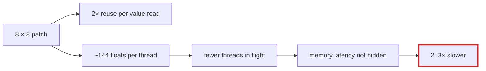

# Q-AZ: Why did bigger patches per thread make Metal's matmul slower?

*[Fusion in training](README.md#fusion-in-training) · previous: [Q-AY](q-ay-same-kernel-different-share.md) · last in the theme*

## The question

Each thread of Metal's tiled matmul computes a 4 × 4 patch of outputs, reading 8 values from threadgroup memory for every 16 multiply-adds ([Q-X](q-x-patch-per-thread.md)). An 8 × 8 patch would read 16 values for 64 multiply-adds, twice the reuse. Which product should gain most: the forward `[2048,768]·[768,192]`, or attention's `q·kᵀ`, `[96,128,32]·[96,32,128]`, whose `k` is only 32?

> **Hint:** a patch's outputs live in registers, twice over here, since each output keeps a running chunk sum and a total to keep the bits. Count the floats an 8 × 8 thread must hold.

<strong>Answer</strong>

### In short

Neither: every 8 × 8 tile ran 2 to 3 times slower, on every product, while matching `Split` bit for bit. An 8 × 8 thread holds 64 chunk sums and 64 totals, plus 16 operands, about 144 floats, and I think that is more registers than the GPU can give each thread while keeping enough threads in flight to hide memory's latency; the reuse gained in the inner loop was lost to waiting. A middle size, 8 × 4, gained 3 to 9% on forward products and 18% on `q·kᵀ`, within the noise of the bench, so 4 × 4 stayed. The prediction to test was about the inner loop; the measurement said the limit was registers.

### An analogy

Giving each cook twice as many dishes to watch, so they fetch ingredients less often. With too many pans on one cook's stove there is room for fewer cooks in the kitchen, and the kitchen as a whole slows down.

### Worked example

`bench/matmul_tiles.cr` on the M5 Pro, GFLOP/s including a round trip to the GPU per product:

Tile               |Floats per thread|Forward products|`q·kᵀ` 
-------------------|-----------------|----------------|-------
4 × 4, the default |~40              |1,050–1,295     |410    
8 × 4              |~76              |1,146–1,370     |483    
8 × 8, in any block|~144             |380–565         |230–290

### Where it shows up in tensomite

`Metal::MatMulTile` keeps `T64x64`, 4 × 4 patches (Decision BR). The patches tried were template instantiations of the same `matmul_tiled`, so the experiment needed no new kernel, and `scripts/emulate_metal` checked each against split-K's bits before the GPU timed them.

## See also

- [Q-X](q-x-patch-per-thread.md): why a patch per thread reduces reads.
- [Q-AS](q-as-loading-ahead.md): hiding memory's latency with independent loads.
