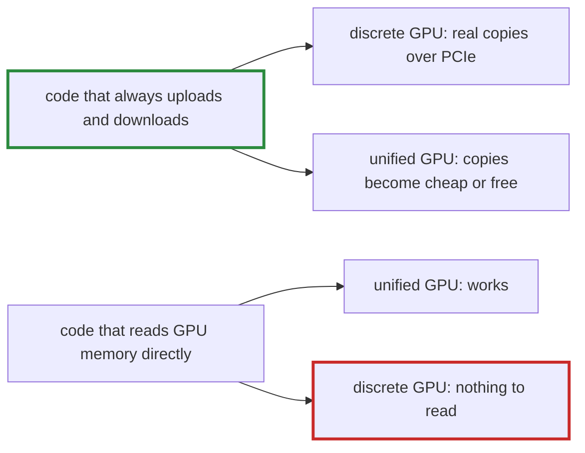

# Q-B: Why treat unified memory as a special case of discrete, not the reverse?

*[Memory and devices](README.md#memory-and-devices) · first in the theme · next: [Q-AE](q-ae-mapped-memory-on-a-discrete-card.md)*

## The question

A discrete GPU, such as an NVIDIA card, has its own memory across a PCIe bus; reaching it takes an explicit copy. A unified GPU, such as Apple Silicon's, shares RAM with the CPU. Most systems that run on both treat unified memory as a special case of discrete memory, not the other way round. Why?

> **Hint:** write the code for one kind first, then run it on the other. Which way round still works?

<details>
<summary><strong>Answer</strong></summary>

### In short

Code written for discrete memory copies explicitly at every crossing. On unified memory those copies still work; they just cost little, or can be skipped. Code written for unified memory reads GPU buffers directly, and on a discrete card there is nothing on the CPU's side to read: it fails, or reads stale data. So the safe default is "always copy", with unified memory as an optimisation that makes copies cheap.

### An analogy

Storing your things in a warehouse across town: every trip is planned, with a list of what to fetch. If the warehouse turns out to be your back room, the plan still works; the trips are just short. Plan for the back room instead, and the day it moves across town you walk into an empty room.

### Worked example

The bias `b = [10, 20, 30]` from [the previous theme](q-k-stride-zero.md), made on a device and read back:

```crystal
b = Tensor.from([10f32, 20f32, 30f32], [3], device)  # upload
b.to_a(Float32)                                        # download
```

Device       |Memory                                    |`map(buffer)`                       |What `to_a` does    
-------------|------------------------------------------|------------------------------------|--------------------
`CPU`        |host                                      |the bytes                           |reads them          
`SimDiscrete`|pretends discrete                         |`nil`, always                       |one counted download
`Metal`      |unified                                   |the bytes, after waiting for the GPU|reads them, no copy 
`CUDA`       |discrete, even on the GB10's shared memory|`nil`                               |a real download     

The same two lines run on every row.



### Where it shows up in tensomite

Every buffer belongs to a device, and moving data is `upload`, `download` or `map`, which may return `nil`. `SimDiscrete` is a CPU device that never maps and counts every transfer, so code that assumes direct access fails its specs on a laptop, long before a discrete GPU is in reach. The CUDA device treats even the GB10, whose GPU shares memory with the CPU, as discrete, so the Spark exercises the code a T4 needs.

</details>

## See also

- [Q-AE](q-ae-mapped-memory-on-a-discrete-card.md): what goes wrong when unified-memory habits reach a discrete card.
