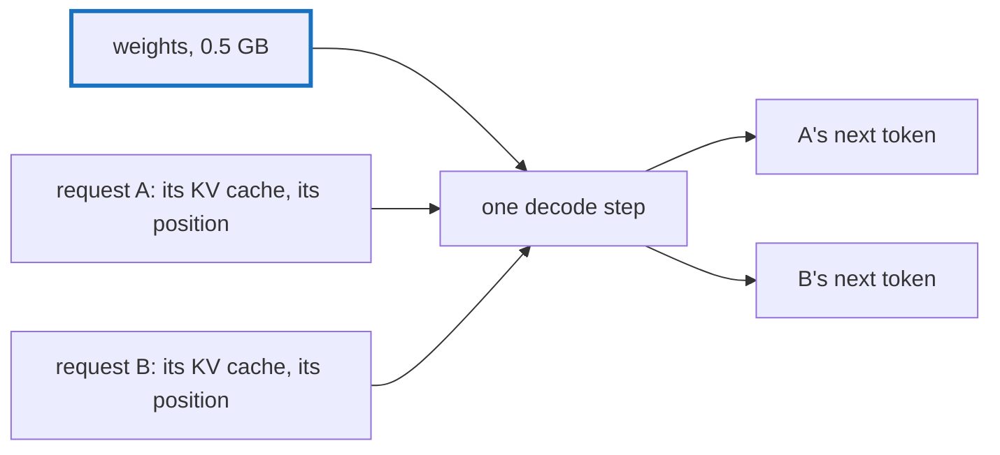

# Q-BA: Should two requests share the GPU one after the other, or step by step?

*[Serving](README.md#serving) · first in the theme · last in the theme*

## The question

A server answering two requests at once from one GPT-2 could finish one before starting the next, or interleave their decode steps. Which uses the GPU better, and what does each request's KV cache need for the second?

> **Hint:** what does one decoded token cost the GPU ([Q-AD](q-ad-cache-written-in-place.md), [Q-AN](q-an-which-way-the-weights-run.md)), and how much of that is reading the weights?

<strong>Answer</strong>

### In short

Interleaving, done as one batched step: both requests' next tokens computed in the same pass. Decoding one token reads every weight once, about 0.5 GB for GPT-2 small, and does little arithmetic with it, so the GPU spends most of the token waiting for memory. Two tokens in one pass read the weights once between them: close to twice the throughput for little more time per step. Each request then needs its own KV cache and its own position, so attention reads each request's past and no one else's; the weights are shared. Today `apps/server` handles requests one at a time, so a long completion makes a short one wait for it.

### An analogy

A bus and two passengers going the same way. Driving each passenger separately costs two trips; taking both costs one trip and a slightly longer stop.

### Worked example

On the GB10, a decoded token of GPT-2 small takes about 4 ms, and its matmuls read the weights at about 180–200 GB/s (Decision BB): reading 0.5 GB is most of the token. Two requests of 64 tokens each:

Schedule                  |Passes over the weights|Time, roughly                 
--------------------------|-----------------------|------------------------------
One after the other       |128                    |2 × 64 × 4 ms ≈ 0.5 s         
One batched step per token|64                     |64 × (4 ms + a little) ≈ 0.3 s

These are estimates from the decode profile, not measurements of a batched server, which tensomite does not have yet.

### Where it shows up in tensomite

`apps/server` queues requests and serves them one by one (Decision BU). Batched decoding, also called continuous batching, would need a batch dimension through `GPT2#forward` with a cache, and a cache per request.

## See also

- [Q-AD](q-ad-cache-written-in-place.md): what the KV cache holds and what a token costs it.
- [Q-AN](q-an-which-way-the-weights-run.md): how reading the weights dominates a decoded token.
